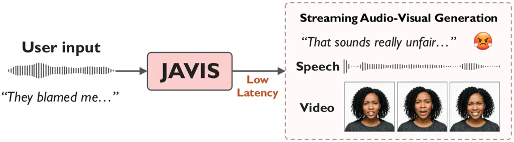
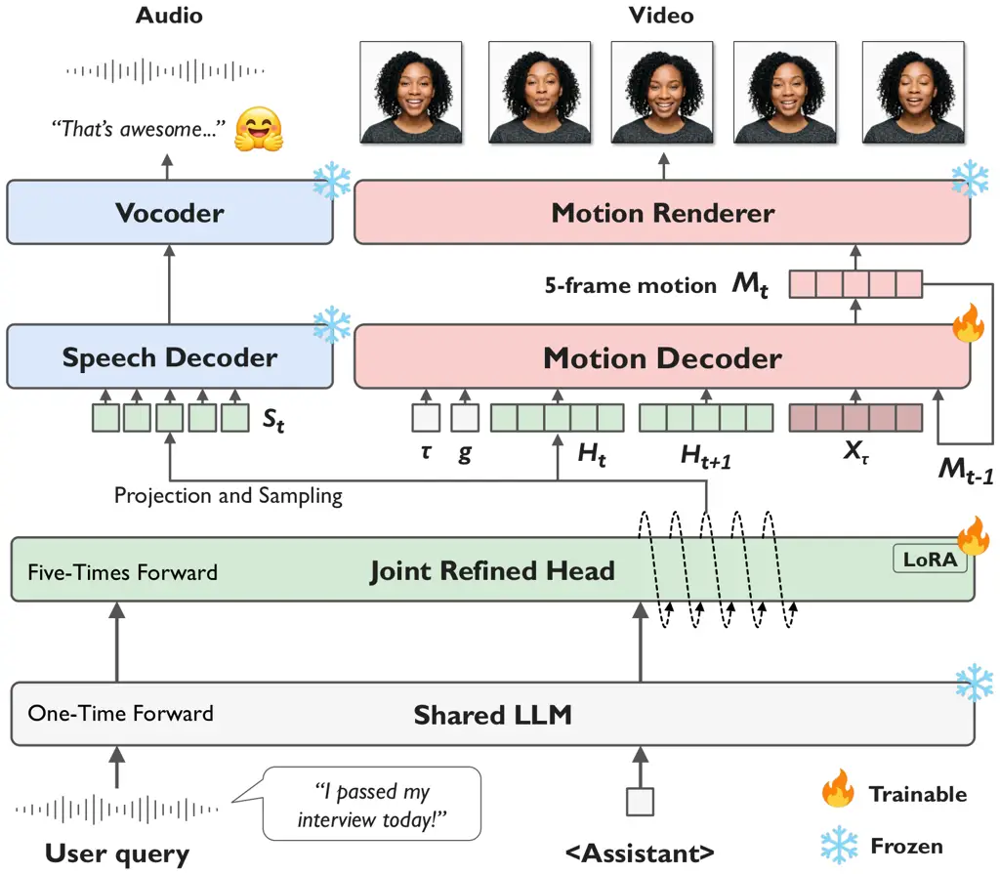

# JAVIS: Joint Audio-Visual Interaction and Streaming for Real-Time Conversational Agents

Junseok Ahn    Jaehyun Park    Jeongsoo Choi    Joon Son Chung   
Ji-Hoon Kim ^(†)^(†)thanks: Project page:
[https://mm.kaist.ac.kr/projects/JAVIS](https://mm.kaist.ac.kr/projects/JAVIS)

###### Abstract

Human communication is inherently multimodal, conveying intent not only
through linguistic and vocal cues but also through visual signals.
However, existing conversational systems have mainly focused on text or
speech, leaving out the visual feedback that is essential for natural
interaction. In this paper, we propose JAVIS, an end-to-end streaming
framework for real-time audio-visual conversational agents. Our key idea
is to let the voice and the face speak from a single representation. On
top of a shared LLM, a Joint Refined Head produces a unified
audio-visual representation, which is fed into dedicated streaming
branches for speech and face generation. This end-to-end design avoids
intermediate bottlenecks, enabling real-time generation while keeping
speech and face tightly synchronized. In addition, we present JAVIS-Syn,
a 334-hour synthetic corpus designed to address the lack of expressive
audio-visual dialogue data, covering emotionally rich multi-turn
conversations and assistant-style exchanges. Experiments show that JAVIS
achieves approximately 200$`\times`$ lower initial latency than a strong
baseline, while outperforming baselines in lip synchronization and
facial expression appropriateness.

###### Index Terms: 

Joint speech-motion generation, real-time conversational agents, talking
face video

^(†)^(†)address: ¹Korea Advanced Institute of Science and Technology,
South Korea  
²Chung-Ang University, South Korea

## 1 Introduction

In our daily lives, we see the face of the person we are talking to and
hear their voice. As such, human communication is inherently
multimodal \[19, 14, 2, 12\]. Speakers convey intent not only through
words and speech but also through facial expressions, head movements,
and gaze. Conversational AI systems, however, have evolved largely along
the linguistic and auditory axes. From text-based chatbots built on
large language models (LLMs) to recent spoken dialogue models that
directly understand and generate speech \[24\], the medium of
interaction has remained confined to text or speech. The absence of a
visual channel limits the expressiveness and naturalness of these
systems, calling for audio-visual conversational agents that can respond
with both voice and face in real time.

A common workaround is to cascade a conversational model with a separate
generator, either a text LLM followed by text-to-audio-visual
generation \[27, 13\], or a spoken dialogue system followed by
speech-driven talking face generation \[26, 15\]. However, such
pipelines are inherently limited by their sequential structure, in which
the intermediate modality acts as an information bottleneck. Text
discards prosodic nuance, and synthesized speech conveys only acoustic
cues, preventing the downstream face generator from accessing the
dialogue context encoded in the upstream model. Furthermore, the
sequential dependency between modules causes latency to accumulate, and
errors propagate across stages and degrade audio-visual
synchronization \[16\].



Figure 1: Overview of JAVIS. Given user speech, JAVIS jointly generates
an audio-visual response in real time.

To date, only a few recent works \[25, 29\] have explored end-to-end
audio-visual dialogue generation. X-Streamer \[25\] adopts a
Thinker–Actor architecture, where a frozen speech LLM guides an Actor
that generates interleaved text and speech tokens and synthesizes video
latents via chunk-wise autoregressive diffusion. Ex-Omni-2D \[29\]
instead conditions a diffusion-based video generator on an LLM-generated
visual plan and speech units produced by a separate speech generator.
However, both approaches rely on iterative generation of spatiotemporal
video latents, which imposes a heavy computational burden on visual
synthesis. Real-time streaming generation of realistic visual responses
thus remains an open problem, made even more challenging by the scarcity
of expressive audio-visual dialogue data.

In this paper, we propose JAVIS, an end-to-end streaming framework for
real-time audio-visual conversational agents. Given a spoken query,
JAVIS responds with synchronized speech and facial video in a streaming
manner, as illustrated in Fig. 1. Rather than animating the face after
speech is synthesized, our framework jointly generates both modalities
from a single representation. Specifically, a Joint Refined Head
produces a unified audio-visual representation, which is fed into two
streaming branches for speech decoding and facial motion generation. By
bypassing intermediate text or speech, this design preserves the
conversational intent in both modalities and maintains tight
audio-visual synchronization. Furthermore, to address the scarcity of
audio-visual dialogue data, we construct JAVIS-Syn, a 334-hour synthetic
corpus comprising emotionally rich multi-turn conversations and
assistant-style exchanges. Experiments demonstrate that JAVIS generates
high-quality audio-visual responses in real time, outperforming existing
works in audio-visual synchronization. Notably, our model reduces
initial latency by approximately 200$`\times`$ compared with a strong
baseline while maintaining comparable visual quality. Human evaluation
further confirms that JAVIS produces natural audio-visual responses with
accurate lip synchronization and situation-appropriate facial
expressions.

## 2 Method

Given a spoken query, the dialogue history, and a reference portrait,
JAVIS generates a spoken response along with a synchronized facial video
of the reference identity, as depicted in Fig. 2. JAVIS is built upon
the pre-trained Fun-Audio-Chat \[24\], which pairs a 5 Hz shared LLM
with a 25 Hz speech refined head for efficient streaming generation.
Rather than conditioning facial motion on the generated speech waveform,
we repurpose the speech refined head into the Joint Refined Head (JRH)
via LoRA \[10\], so that the JRH hidden states serve as a unified
audio-visual representation while preserving the pre-trained speech
generation capability. The unified representation is fed into two
parallel branches: a speech branch that synthesizes the spoken response,
and a motion branch where a Motion Decoder autoregressively generates
chunks of continuous facial motion, which are subsequently rendered by
the Motion Renderer \[15\] with the reference portrait. As verified in
Sec. 3, this end-to-end architecture enables real-time streaming
generation of situation-appropriate responses with tight audio-visual
synchronization.

### 2.1 Joint Refined Head

The JRH repurposes the speech refined head of Fun-Audio-Chat \[24\] to
produce a unified audio-visual representation for both speech token and
facial motion generation. Since the shared LLM and the JRH operate at
5 Hz and 25 Hz, respectively, the $`t`$-th shared LLM output is
ungrouped into five conditioning vectors. The JRH then processes the
five conditioning vectors autoregressively, each combined with the
embedding of the preceding speech token. At each autoregressive step,
the next speech token is sampled from a linear projection of the
final-layer hidden state. The resulting five hidden states are stacked
into $`H_{t}\in\mathbb{R}^{5\times d}`$, where $`d`$ denotes the JRH
hidden dimension, and serve as the unified representation for the
$`t`$-th chunk. The Motion Decoder takes $`H_{t}`$ directly as its
condition, bypassing waveform decoding and re-encoding for motion
generation.

Throughout response generation, the JRH attends to the shared LLM
outputs and dialogue history, allowing $`H_{t}`$ to encode the dialogue
context beyond mere speech content. To exploit this context while
preserving the pre-trained speech generation capability, we freeze the
shared LLM and jointly train the LoRA-adapted JRH and the Motion
Decoder. The JRH is thus supervised by both the cross-entropy loss
$`\mathcal{L}_{\mathrm{speech}}`$ for speech token prediction and the
motion generation loss $`\mathcal{L}_{\mathrm{motion}}`$ (Sec. 2.2),
encouraging $`H_{t}`$ to capture facial dynamics that are synchronized
with speech.



Figure 2: Network architecture. The Joint Refined Head produces a
unified audio-visual representation $`H_{t}`$, which is fed into
parallel speech and motion branches for streaming generation. The speech
branch samples five speech tokens $`S_{t}`$ from $`H_{t}`$, while the
Motion Decoder denoises $`X_{\tau}`$ at timestep $`\tau`$ to generate
the five-frame motion chunk $`M_{t}`$, conditioned on $`H_{t}`$,
$`H_{t+1}`$, the previous motion chunk $`M_{t-1}`$, and the reference
facial state $`g`$.

### 2.2 Streaming Audio-Visual Generation

Speech branch. The speech branch adopts the pre-trained speech decoder
and vocoder of CosyVoice 3 \[8\], which are kept frozen throughout
training. The flow-matching speech decoder converts the sampled speech
tokens into mel-spectrograms, which the vocoder then synthesizes into
waveforms. The decoder’s chunk-aware causal design enables incremental
decoding, so the spoken response can be streamed while subsequent speech
tokens are still being generated.

Motion branch. The motion branch consists of the Motion Decoder, which
autoregressively generates facial motion chunk by chunk from the unified
representation, and the Motion Renderer \[15\], which renders the
generated motion with the reference portrait into video frames. We
represent the facial motion of each frame as 20-dimensional coefficients
over the orthonormal motion basis of FLOAT \[15\]. We group the
coefficients of five consecutive frames into a single motion chunk
$`M_{t}\in\mathbb{R}^{5\times 20}`$, which spans 0.2 seconds at 25 FPS.
This grouping makes each motion chunk correspond to $`H_{t}`$, so that
each motion frame is naturally aligned with a speech token, keeping the
motion branch synchronized with the speech branch at 25 Hz. Since lip
movements are often affected by upcoming phonetic context \[3\], the
Motion Decoder also takes $`H_{t+1}`$ as a one-chunk lookahead. It
further receives the previous motion chunk $`M_{t-1}`$ for temporal
continuity and a reference facial state $`g`$ extracted from the
reference portrait. The resulting condition is
$`c_{t}=(H_{t},H_{t+1},M_{t-1},g)`$.

Conditioned on $`c_{t}`$, the Motion Decoder generates $`M_{t}`$ with a
bidirectional Transformer. It takes the concatenated sequence of
$`c_{t}`$, the noisy motion chunk $`X_{\tau}`$, and the timestep
embedding $`\tau`$, and is trained with the conditional flow matching
objective \[18\]:

```math
\mathcal{L}_{\mathrm{motion}}=\mathbb{E}\!\left[\left\|v_{\theta}(X_{\tau},\tau;c_{t})-v\right\|^{2}\right], \tag{1}
```

where $`v_{\theta}`$ denotes the Motion Decoder and $`v`$ is the target
velocity. The overall objective is
$`\mathcal{L}=\mathcal{L}_{\mathrm{speech}}+\mathcal{L}_{\mathrm{motion}}`$,
under which the LoRA-adapted JRH and the Motion Decoder are optimized
jointly. At inference, once $`H_{t+1}`$ is available, $`\hat{M}_{t}`$ is
sampled from Gaussian noise with an Euler ODE solver and used as the
previous motion chunk for the next chunk, with the first chunk
conditioned on zero motion. The generated motion is then rendered by the
Motion Renderer with the reference portrait and streamed together with
the corresponding speech segments. By operating directly on $`H_{t}`$
with low-dimensional facial motion, the Motion Decoder achieves
low-latency generation, while its fixed input window keeps the per-chunk
cost independent of response length.

| Method                   | AV sync            |                      | Video quality   |                 |                 | Speech quality         |                    |                     |
| ------------------------ | ------------------ | -------------------- | --------------- | --------------- | --------------- | ---------------------- | ------------------ | ------------------- |
|                          | LSE-C $`\uparrow`$ | LSE-D $`\downarrow`$ | IQ $`\uparrow`$ | SC $`\uparrow`$ | MS $`\uparrow`$ | WER (%) $`\downarrow`$ | UTMOS $`\uparrow`$ | SpkSIM $`\uparrow`$ |
| FAC (s2s) + FLOAT        | 7.94               | 8.26                 | 0.743           | 0.989           | 0.9928          | 0.41                   | 4.20               | 0.689               |
| FAC (s2s) + InfiniteTalk | 9.59               | 6.86                 | 0.754           | 0.991           | 0.9936          | 0.41                   | 4.20               | 0.689               |
| FAC (s2t) + Talker-T2AV  | 8.72               | 7.04                 | 0.738           | 0.994           | 0.9954          | 0.54                   | 3.79               | 0.575               |
| Ex-Omni-2D               | 5.24               | 11.06                | 0.734           | 0.991           | 0.9947          | 0.31                   | 4.32               | 0.525               |
| JAVIS                    | 9.59               | 6.74                 | 0.744           | 0.993           | 0.9935          | 0.44                   | 4.29               | 0.701               |

Table 1: Objective quality of audio-visual responses, evaluated in terms
of audio-visual synchronization, video quality, and speech quality.
Arrows indicate the preferred direction. Best and second-best results
are shown in bold and underlined, respectively.

Dialogue Source \# Dialogues \# Video Utterances Duration (h) DailyTalk
2,006 18,400 20.10 ShareChatX-Emotion 26,169 195,908 263.89
VoiceAssistant-400K^(†) 11,472 11,472 50.13 Total 39,647 225,780 334.13

Table 2: Statistics of JAVIS-Syn after lip-sync filtering. ^(†) For
VoiceAssistant-400K, only assistant responses are rendered as videos;
the duration excludes the corresponding user-query audio.

### 2.3 JAVIS-Syn

Training audio-visual conversational systems requires emotionally rich,
multi-turn dialogues in which each spoken response is paired with an
expressive talking face video. However, existing audio-visual dialogue
corpora \[20, 1\] either exhibit a limited range of facial expressions
or focus only on human–human conversations without covering the
user–assistant interaction format targeted by conversational agents. To
address this, we construct JAVIS-Syn, a 334-hour synthetic audio-visual
dialogue dataset that provides expressive facial motion and
assistant-style interactions.

We utilize three dialogue sources to construct JAVIS-Syn.
DailyTalk \[17\] and ShareChatX-Emotion \[6\] provide multi-turn
conversations with utterance-level emotion labels, while
VoiceAssistant-400K \[5\]¹¹ 1 Since the released answer speech is
synthesized in a single voice, we resynthesize it with CosyVoice 3 \[8\]
using reference speech from EARS \[22\], and assign a neutral emotion
label to all answers. provides question–answer pairs reflecting how an
AI assistant responds to user requests. For DailyTalk and
ShareChatX-Emotion, we render every utterance in each dialogue using its
emotion label, whereas for VoiceAssistant-400K, we retain the user query
as audio and render only the assistant response with a neutral emotion
prompt. The corresponding videos are generated by InfiniteTalk \[26\],
an audio-driven talking face model whose facial expressions can be
controlled through an emotion prompt. Reference portraits are drawn from
a pool of 1,220 frontal, neutral-expression portraits generated with
Gemini 3.1 Flash Image \[9\], covering diverse genders and ages. Each
speaker is assigned a portrait matching their gender and age group,
obtained from the speaker metadata, and the same portrait is used for
all utterances of that speaker within a dialogue. The generated videos
are filtered by lip-sync quality using SyncNet \[7\], yielding 225,780
utterance videos totaling 334.13 hours, with the resulting dataset
composition summarized in Table 2. We will publicly release the dataset
upon acceptance.

## 3 Experiments

### 3.1 Experimental Setup

Training. JAVIS is trained in two stages. In the first stage, we train
the model in a monologue setting using 940,497 single-utterance clips
from the Talker-T2AV \[27\] dataset. The model is prompted to repeat the
input speech, and the same speech together with its facial motion serves
as the training target. In the second stage, we adapt the model to
dialogue response generation using 716,565 samples from
MultiDialog \[20\], JAVIS-Syn, and a subset of Seamless
Interaction \[1\]. Each sample contains up to three preceding turns as
context, and the loss is applied only to the final assistant response.

Implementation details. In both stages, only the LoRA adapter of the JRH
and the Motion Decoder are trained, while the remaining modules are
frozen. The Motion Decoder is an eight-layer Transformer with a hidden
dimension of 1,024, and LoRA is applied with rank 16 and $`\alpha=32`$.
Both stages use AdamW with a learning rate of $`10^{-4}`$, a cosine
schedule, and a batch size of 8. At inference, motion is sampled with 10
Euler steps and a noise temperature of 0.7.

Evaluation. JAVIS is compared with an end-to-end system, Ex-Omni-2D²² 2
We use the publicly released Teacher checkpoint., and three cascaded
systems that pair Fun-Audio-Chat (FAC) with FLOAT \[15\],
InfiniteTalk \[26\]³³ 3 We use the four-step distilled configuration.,
or Talker-T2AV \[27\]. Since FAC produces both a text and a speech
response, FLOAT and InfiniteTalk animate its speech output (s2s),
whereas Talker-T2AV generates both speech and video from its text output
(s2t). All models are evaluated on 140 samples from VStyle \[28\], which
is unseen during training.

Metrics. For video, we measure image quality (IQ), subject consistency
(SC), and motion smoothness (MS) using VBench \[11\]. Lip
synchronization is measured with LSE-C and LSE-D \[7\]. For speech, we
measure speech naturalness (UTMOS \[23\]), speaker similarity
(SpkSIM \[4\]), and intelligibility (WER \[21\]) of the generated
speech. Generation efficiency is evaluated by the initial latency,
defined as the delay until the first audio and video outputs are both
available, and the real-time factor (RTF), computed as the ratio of
total generation time to the duration of the generated response.

| System                   | Latency (s) $`\downarrow`$ | RTF $`\downarrow`$ | Len. (s) |
| ------------------------ | -------------------------- | ------------------ | -------- |
| FAC + FLOAT              | 6.73                       | 0.569              | 11.8     |
| FAC + FLOAT (2 s chunks) | 2.09                       | 0.560              | 11.8     |
| FAC + InfiniteTalk       | 252.0                      | 20.9               | 11.8     |
| FAC + Talker-T2AV        | 113.3                      | 10.8               | 10.5     |
| Ex-Omni-2D               | 1210.7                     | 116.6              | 10.5     |
| JAVIS                    | 1.27                       | 0.541              | 12.1     |

Table 3: Streaming latency on two RTX 4090 GPUs, averaged over five
queries. Latency: time until both the first audio and video packets are
available. RTF: wall-clock time divided by the length of the generated
response. Len.: the length of the generated response.

### 3.2 Objective Evaluation

Audio-visual quality. We compare JAVIS against cascaded and end-to-end
baselines, and the results are shown in Table 1. JAVIS achieves the most
accurate audio-visual synchronization, with the highest LSE-C of 9.59
and the lowest LSE-D of 6.74. This indicates that our unified
audio-visual representation enables tight coupling between speech and
facial motion. In terms of video quality, JAVIS achieves comparable
performance to the dedicated face generation models in the cascaded
pipelines. JAVIS also maintains natural speech quality, improving UTMOS
and SpkSIM over the original FAC, which shows that the LoRA-adapted JRH
preserves the pre-trained speech generation capability.

Latency and generation speed. To evaluate the suitability for real-time
interaction, we also measure the initial latency and real-time factor
(RTF) of each system. As shown in Table 3, JAVIS achieves both the
lowest initial latency and the lowest RTF among all systems. JAVIS
starts responding within 1.27 s, 5.3$`\times`$ faster than FAC + FLOAT,
and has 39% lower initial latency than even FLOAT’s streaming
configuration. The gap widens further against the other baselines: FAC +
InfiniteTalk, FAC + Talker-T2AV, and Ex-Omni-2D require 252.0 s,
113.3 s, and 1210.7 s, respectively, before the response begins, and all
run slower than real time (RTF $`>`$ 10). In contrast, JAVIS generates
faster than real time with an RTF of 0.541. This efficiency stems from
our end-to-end architecture, which generates motion chunk by chunk
directly from the unified audio-visual representation without waiting
for the full response speech, and operates on low-dimensional motion
coefficients. Notably, JAVIS matches the lip synchronization of FAC +
InfiniteTalk while reducing initial latency by approximately
200$`\times`$.

### 3.3 Subjective Evaluation

We conduct a human evaluation to assess the perceptual quality of the
generated responses, including whether the facial expressions are
appropriate to the user’s situation. We sample 30 queries from VStyle
with a balanced distribution across emotion categories. A total of 26
raters listen to the user’s speech and rate the response videos on a
five-point scale in terms of audio-visual synchronization, motion
naturalness, and facial expression appropriateness.

The mean scores are reported in Table 4 with 95% confidence intervals.
As shown, JAVIS achieves the highest audio-visual synchronization score
of 4.37, consistent with the objective evaluation results in Sec. 3.2.
Its motion naturalness score of 3.92 is comparable to the best score of
4.02 obtained by FAC + InfiniteTalk, with overlapping confidence
intervals. Most importantly, JAVIS achieves the best facial expression
appropriateness score of 3.76, clearly outperforming all baselines. This
suggests the effectiveness of our end-to-end architecture, in which the
motion branch directly attends to the hidden states that encode the
user’s query context, whereas cascaded systems generate faces solely
from the response speech or text.

| Method             | AV                | Motion                   | Facial Expression            |
| ------------------ | ----------------- | ------------------------ | ---------------------------- |
|                    | Sync $`\uparrow`$ | Naturalness $`\uparrow`$ | Appropriateness $`\uparrow`$ |
| FAC + FLOAT        | 3.70$`\pm`$0.15   | 3.50$`\pm`$0.15          | 3.25$`\pm`$0.15              |
| FAC + InfiniteTalk | 4.25$`\pm`$0.11   | 4.02$`\pm`$0.11          | 3.44$`\pm`$0.14              |
| FAC + Talker-T2AV  | 3.87$`\pm`$0.13   | 2.13$`\pm`$0.12          | 1.78$`\pm`$0.11              |
| Ex-Omni-2D         | 1.93$`\pm`$0.13   | 2.19$`\pm`$0.13          | 2.15$`\pm`$0.14              |
| JAVIS              | 4.37$`\pm`$0.10   | 3.92$`\pm`$0.13          | 3.76$`\pm`$0.16              |

Table 4: Subjective evaluation results. The results are presented with
95% confidence intervals.

### 3.4 Ablation Study

To validate the effect of each component, we report an ablation study in
Table 5. First, removing the lookahead representation $`H_{t+1}`$
degrades lip synchronization (LSE-C 9.59$`\rightarrow`$8.80, LSE-D
6.74$`\rightarrow`$7.55), indicating that access to upcoming speech
context is important for generating accurate lip movements. Removing
JAVIS-Syn from dialogue adaptation also degrades lip synchronization
(LSE-C 6.71, LSE-D 8.72) as well as speech quality (WER 1.21%, UTMOS
4.03). We attribute the lip-synchronization gains brought by JAVIS-Syn
to its clean frontal faces and clearly visible lip movements, which
provide more reliable supervision than existing dialogue videos that
often contain low-quality frames with occlusion or blur. Finally, the
model trained only in the monologue stage shows degraded performance
across all metrics, with particularly severe drops in speech
intelligibility (WER 13.91%) and lip synchronization (LSE-C 6.17, LSE-D
8.79), highlighting the importance of dialogue adaptation for
audio-visual response generation.

| Model         | IQ$`\uparrow`$ | LSE-C$`\uparrow`$ | LSE-D$`\downarrow`$ | WER (%)$`\downarrow`$ | UTMOS$`\uparrow`$ |
| ------------- | -------------- | ----------------- | ------------------- | --------------------- | ----------------- |
| JAVIS         | 0.744          | 9.59              | 6.74                | 0.44                  | 4.29              |
| w/o lookahead | 0.744          | 8.80              | 7.55                | 0.37                  | 4.31              |
| w/o JAVIS-Syn | 0.737          | 6.71              | 8.72                | 1.21                  | 4.03              |
| Stage 1 only  | 0.734          | 6.17              | 8.79                | 13.91                 | 3.74              |

Table 5: Ablation study of JAVIS.

## 4 Conclusion

We presented JAVIS, an end-to-end streaming framework for real-time
audio-visual conversational agents. Rather than animating a face after
speech is synthesized, our framework generates speech and facial motion
jointly from a single representation, allowing both modalities to be
streamed together while sharing the dialogue context. To address the
scarcity of expressive audio-visual dialogue data, we further
constructed JAVIS-Syn, a 334-hour synthetic corpus of emotionally rich
multi-turn conversations and assistant-style interactions. Extensive
experiments demonstrate that JAVIS achieves strong audio-visual
synchronization and facial expression appropriateness, while reducing
initial latency by approximately 200$`\times`$ over a strong cascaded
baseline and preserving the speech quality. Future work includes
extending JAVIS to full-duplex interaction with listening behavior. We
believe JAVIS offers a practical step toward conversational agents that
engage with users through both voice and face in real time.

## References

- \[1\] V. Agrawal, A. Akinyemi, K. Alvero, M. Behrooz, J.
  Buffalini, F. M. Carlucci, J. Chen, J. Chen, Z. Chen, S. Cheng, et
  al. (2025) Seamless Interaction: dyadic audiovisual motion modeling
  and large-scale dataset. arXiv:2506.22554. Cited by: §2.3, §3.1.
- \[2\] J. Ahn, Y. Jang, and J. S. Chung (2024) SlowFast network for
  continuous sign language recognition. In Proc. ICASSP, Cited by: §1.
- \[3\] C. Chandrasekaran, A. Trubanova, S. Stillittano, A. Caplier,
  and A. A. Ghazanfar (2009) The natural statistics of audiovisual
  speech. PLoS Computational Biology 5 (7), pp. 1–18. Cited by: §2.2.
- \[4\] S. Chen, C. Wang, Z. Chen, Y. Wu, S. Liu, Z. Chen, J. Li, N.
  Kanda, T. Yoshioka, X. Xiao, et al. (2022) WavLM: large-scale
  self-supervised pre-training for full stack speech processing. IEEE
  Journal of Selected Topics in Signal Processing 16 (6), pp. 1505–1518.
  Cited by: §3.1.
- \[5\] W. Chen, Z. Ma, R. Yan, Y. Liang, X. Li, R. Xu, Z. Niu, Y.
  Zhu, Y. Yang, Z. Liu, et al. (2025) SLAM-Omni: timbre-controllable
  voice interaction system with single-stage training. In Findings of
  ACL, Cited by: §2.3.
- \[6\] X. Cheng, D. Fu, X. Yang, M. Fang, R. Hu, J. Lu, B. Jionghao, Z.
  Wang, S. Ji, R. Huang, et al. (2025) OmniChat: enhancing spoken
  dialogue systems with scalable synthetic data for diverse scenarios.
  arXiv:2501.01384. Cited by: §2.3.
- \[7\] J. S. Chung and A. Zisserman (2016) Out of time: automated lip
  sync in the wild. In Proc. ACCV Workshops, Cited by: §2.3, §3.1.
- \[8\] Z. Du, C. Gao, Y. Wang, F. Yu, T. Zhao, H. Wang, X. Lv, H.
  Wang, C. Ni, X. Shi, et al. (2025) CosyVoice 3: towards in-the-wild
  speech generation via scaling-up and post-training. arXiv:2505.17589.
  Cited by: §2.2, footnote 1.
- \[9\] Google DeepMind (2026) Gemini 3.1 Flash Image model card. Note:
  [https://deepmind.google/models/model-cards/gemini-3-1-flash-image/](https://deepmind.google/models/model-cards/gemini-3-1-flash-image/)
  Cited by: §2.3.
- \[10\] E. J. Hu, Y. Shen, P. Wallis, Z. Allen-Zhu, Y. Li, S. Wang, L.
  Wang, and W. Chen (2022) LoRA: low-rank adaptation of large language
  models. In Proc. ICLR, Cited by: §2.
- \[11\] Z. Huang, Y. He, J. Yu, F. Zhang, C. Si, Y. Jiang, Y. Zhang, T.
  Wu, Q. Jin, N. Chanpaisit, et al. (2024) VBench: comprehensive
  benchmark suite for video generative models. In Proc. CVPR, Cited by:
  §3.1.
- \[12\] Y. Jang, J. Choi, J. Ahn, and J. S. Chung (2026) Deep
  understanding of sign language for sign to subtitle alignment. IEEE
  Transactions on Multimedia 28, pp. 7647–7659. Cited by: §1.
- \[13\] Y. Jang, J. Kim, J. Ahn, D. Kwak, H. Yang, Y. Ju, I. Kim, B.
  Kim, and J. S. Chung (2024) Faces that speak: jointly synthesising
  talking face and speech from text. In Proc. CVPR, Cited by: §1.
- \[14\] A. Kendon (1967) Some functions of gaze-direction in social
  interaction. Acta Psychologica 26, pp. 22–63. Cited by: §1.
- \[15\] T. Ki, D. Min, and G. Chae (2025) FLOAT: generative motion
  latent flow matching for audio-driven talking portrait. In Proc. ICCV,
  Cited by: §1, §2.2, §2, §3.1.
- \[16\] J. Kim, J. Ahn, D. Kwak, J. S. Chung, and S. Watanabe (2025)
  TAVID: text-driven audio-visual interactive dialogue generation.
  arXiv:2512.20296. Cited by: §1.
- \[17\] K. Lee, K. Park, and D. Kim (2023) DailyTalk: spoken dialogue
  dataset for conversational text-to-speech. In Proc. ICASSP, Cited by:
  §2.3.
- \[18\] Y. Lipman, R. T. Q. Chen, H. Ben-Hamu, M. Nickel, and M.
  Le (2023) Flow matching for generative modeling. In Proc. ICLR, Cited
  by: §2.2.
- \[19\] H. McGurk and J. MacDonald (1976) Hearing lips and seeing
  voices. Nature 264 (5588), pp. 746–748. Cited by: §1.
- \[20\] S. J. Park, C. W. Kim, H. Rha, M. Kim, J. Hong, J. H. Yeo,
  and Y. M. Ro (2024) Let’s go real talk: spoken dialogue model for
  face-to-face conversation. In Proc. ACL, Cited by: §2.3, §3.1.
- \[21\] A. Radford, J. W. Kim, T. Xu, G. Brockman, C. McLeavey, and I.
  Sutskever (2023) Robust speech recognition via large-scale weak
  supervision. In Proc. ICML, Cited by: §3.1.
- \[22\] J. Richter, Y. Wu, S. Krenn, S. Welker, B. Lay, S. Watanabe, A.
  Richard, and T. Gerkmann (2024) EARS: an anechoic fullband speech
  dataset benchmarked for speech enhancement and dereverberation. In
  Proc. Interspeech, Cited by: footnote 1.
- \[23\] T. Saeki, D. Xin, W. Nakata, T. Koriyama, S. Takamichi, and H.
  Saruwatari (2022) UTMOS: UTokyo-SaruLab system for VoiceMOS Challenge 2022. In Proc. Interspeech, Cited by: §3.1.
- \[24\] T. F. Team, Q. Chen, L. Cheng, C. Deng, X. Li, J. Liu, C.
  Tan, W. Wang, J. Xu, J. Ye, et al. (2025) Fun-Audio-Chat technical
  report. arXiv:2512.20156. Cited by: §1, §2.1, §2.
- \[25\] Y. Xie, T. Gu, Z. Li, C. Zhang, G. Song, X. Zhao, C. Liang, J.
  Jiang, H. Xu, and L. Luo (2025) X-Streamer: unified human world
  modeling with audiovisual interaction. arXiv:2509.21574. Cited by: §1.
- \[26\] S. Yang, Z. Kong, F. Gao, M. Cheng, X. Liu, Y. Zhang, Z.
  Kang, W. Luo, X. Cai, R. He, et al. (2025) InfiniteTalk: audio-driven
  video generation for sparse-frame video dubbing. arXiv:2508.14033.
  Cited by: §1, §2.3, §3.1.
- \[27\] Z. Ye, X. Tan, A. Yin, H. Lin, G. Zhang, P. Sun, Y. Li, C.
  Chan, W. Ye, S. Zhang, et al. (2026) Talker-T2AV: joint talking
  audio-video generation with autoregressive diffusion modeling. In
  Proc. ACM MM, Cited by: §1, §3.1, §3.1.
- \[28\] J. Zhan, M. Han, Y. Xie, C. Wang, D. Zhang, K. Huang, H.
  Shi, D. Wang, T. Song, Q. Cheng, et al. (2026) VStyle: a benchmark for
  voice style adaptation with spoken instructions. In Proc. ICASSP,
  Cited by: §3.1.
- \[29\] H. Zhang, Z. Li, X. Tang, T. Yu, and Y. Guo (2026) Ex-Omni-2D:
  expressive omni-modal dialogue models with native visual presence.
  arXiv:2608.10720. Cited by: §1.
