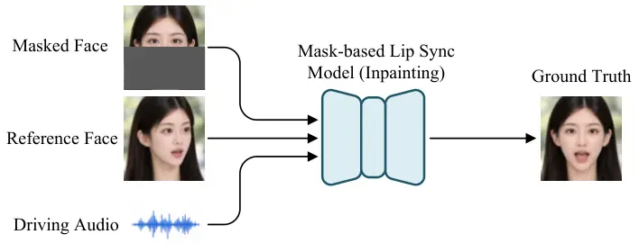
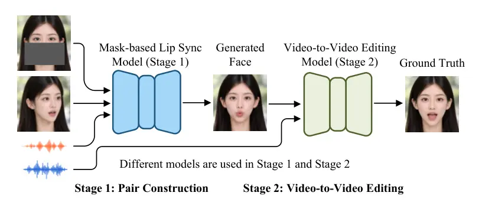
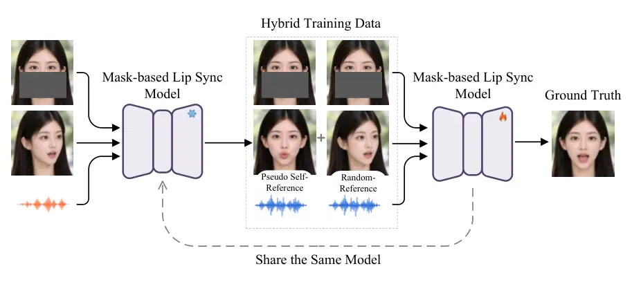
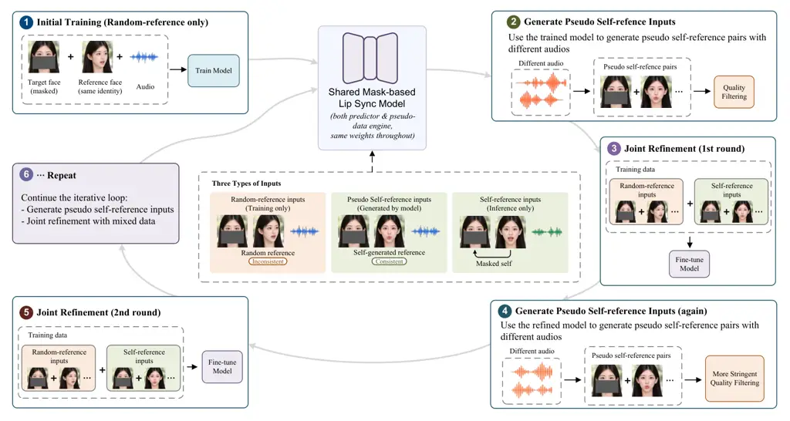
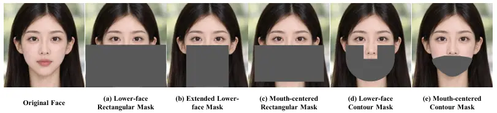
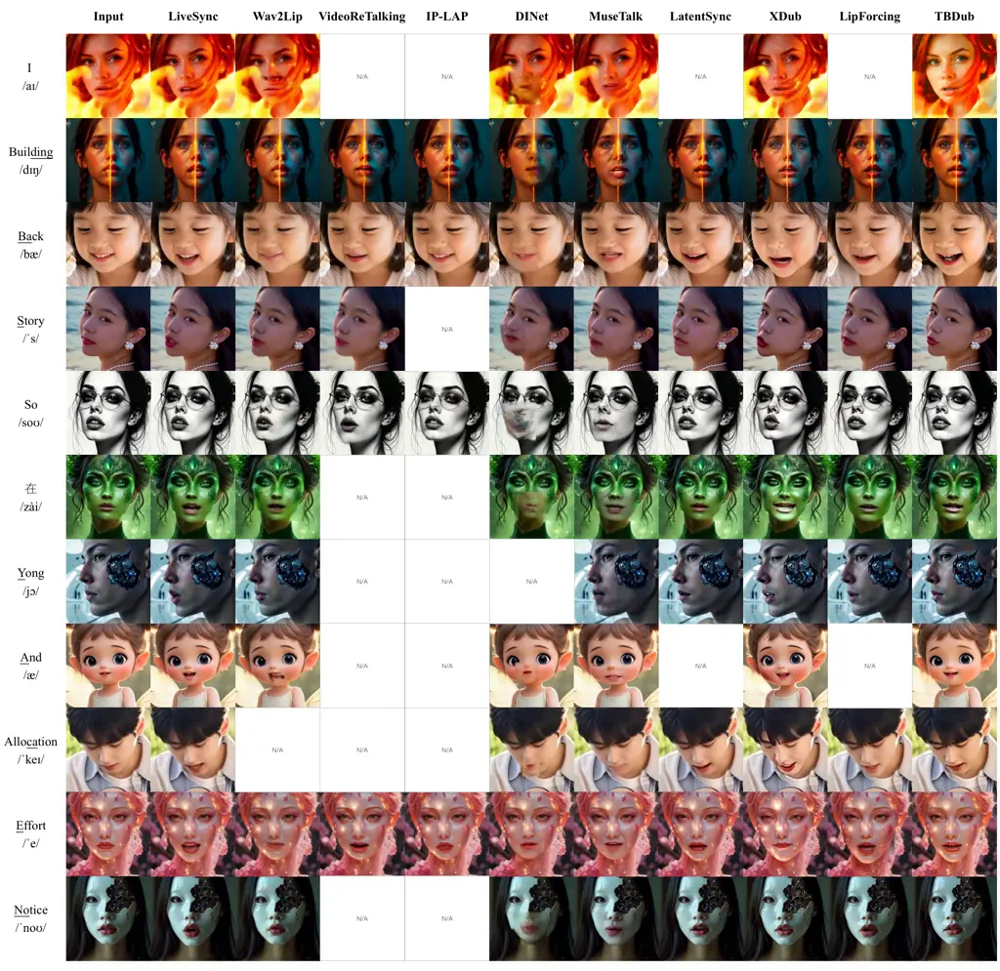
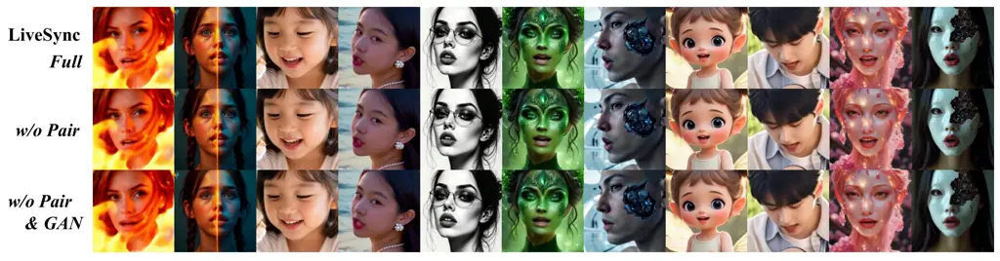

# LiveSync: Iterative Self-Training for Lip-Sync Generation

Huaishao Luo    Huan Zhang^(\*)    Guanbo Bao    Yinglu Liu
Affiliation: Youzheng Wu    Xiaodong He Affiliation: JD Technology

###### Abstract

Audio-driven lip synchronization aims to match target speech through
localized mouth and jaw articulation while preserving subject identity,
head pose, and surrounding facial context. Naturally recorded videos
provide synchronized reconstruction targets but rarely offer pairs that
are matched in identity and pose yet differ primarily in speech-related
articulation. Mask-based training enables reconstruction from these
videos, but random-reference inputs differ from the aligned
self-reference used at inference. We present LiveSync, an iterative
self-training framework in which a single mask-based model generates
pseudo pairs and is refined for deployment. The model is first trained
on a curated real-video corpus augmented with externally generated clips
covering under-represented visual conditions. A frozen checkpoint then
uses independently sampled audio to generate mouth-edited references
from real-video frames, copying pixels outside the edit mask from each
source frame. After confidence filtering, these references are paired
with aligned masked inputs and original real-frame targets. The retained
pseudo pairs are mixed with real training data to refine the same model
from its current weights, updating training supervision without adding
inference stages. Although we instantiate the framework with a
single-pass GAN-based model, the self-training strategy could in
principle also be adapted to diffusion-based models. Experimental
results show that LiveSync achieves leading synchronization performance
on HDTF and competitive performance compared with the baselines on the
AIGC-LipSync subset, while maintaining low inference latency.

^(\*)^(\*)footnotetext: Project Leader

## 1 Introduction



(a) Mask-based Framework



(b) Two-stage Framework



(c) LiveSync: Iterative Self-training Framework

Figure 1: Comparison of lip-sync training paradigms. (a) Single-stage
mask-based methods reconstruct masked facial regions from audio and
reference frames. (b) Two-stage methods use a mask-based generator to
construct pseudo pairs for a separate mask-free model. (c) LiveSync uses
the same mask-based model to generate spatially aligned pseudo pairs,
filter and mix them with real training data, and continue training from
the previous round’s weights, forming a closed-loop self-training
pipeline. Gray-filled rectangles indicate masked regions.

Lip synchronization edits speech-related mouth and jaw motion in a
source video to match target speech while retaining identity, head pose,
surrounding facial context, and background \[19\]. It supports video
dubbing, virtual avatars, and audio-driven video editing, but remains
challenging in the wild, particularly under large pose variation and
occlusion.

Earlier audio-driven facial animation and lip-sync systems often
separate motion prediction from image synthesis: audio is mapped to
explicit facial geometry or parameters, or to learned motion
representations, which then drive rendering or compositing \[21, 12,
26\]. End-to-end models instead synthesize the edited facial region
directly from audio and visual inputs. Ideally, these models would be
trained on source–target pairs that differ only in speech-related mouth
motion while preserving the source’s other visual attributes. Naturally
recorded videos provide synchronized audio and frames, but rarely
contain such controlled editing pairs \[27, 9\].

Mask-based methods obtain a reconstruction surrogate for this missing
supervision. They mask the mouth-centered region of a real frame and
reconstruct it from the corresponding audio and source or reference
frames, using the original frame as the target \[19, 29, 3, 28, 2\].
This makes ordinary synchronized videos usable for training, but removes
local context rather than providing intact source–target editing pairs.
Moreover, to avoid exposing the target mouth during training, the masked
target is commonly paired with a randomly sampled same-identity
reference. That reference may differ in pose and appearance, whereas
inference uses the source frame and its spatially aligned masked self.
The resulting context loss and training–inference mismatch complicate
precise mouth editing, especially under extreme poses and
occlusion \[27, 9\].

Recent methods address the supervision gap through mask-free or hybrid
editing. OmniSync \[18\] explores mask-free editing with Diffusion
Transformers, while UniSync \[7\] combines mask-free pose-anchored
training with mask-based blending at inference. SyncAnyone \[27\] and
X-Dub \[9\] explicitly construct the missing supervision: a mask-based
generator synthesizes pseudo pairs, which train a separate mask-free
model. These methods shift the emphasis from reconstructing missing
pixels to changing mouth articulation while preserving the source
performance.

Pretrained generative priors and paired editing supervision play
complementary roles. Large-scale diffusion pretraining provides
appearance and geometry priors that can support synthesis across diverse
poses and partial occlusions, but visual plausibility alone does not
ensure accurate audio-driven editing. Pseudo pairs that retain aligned
source context while varying speech-related articulation provide a
targeted signal for learning the audio-to-lip mapping. In mask-free
models, complete source context additionally constrains where and how
the image should change \[18, 27, 9\]. These constraints are especially
valuable under large pose variation and occlusion, where insufficiently
constrained generation may introduce unsupported details or alter
content that should remain unchanged. The two-stage approaches above,
however, use the mask-based model as a data generator rather than
continuously refining it as the final model.

We ask whether better editing supervision can instead improve the same
mask-based model. We introduce LiveSync, a data-centric iterative
self-training framework in which the same mask-based model generates
pseudo pairs and is refined across training rounds. The base model is
trained on a curated real-video corpus augmented with externally
generated clips for under-represented visual conditions. A frozen
checkpoint is then driven by randomly sampled audio to synthesize
references with altered mouth motion while preserving the original real
frame outside the edit mask. Pairing these references with the original
real frames yields spatially aligned pseudo pairs with real
reconstruction targets. We filter generated references for confidence,
mix the retained pairs with real training data, and continue optimizing
the same model from its previous-round weights, forming the closed loop
in Fig. 1.

Unlike random references, these self-generated references share the
target frame’s pose and surrounding appearance, reducing unrelated
visual differences and matching the self-reference configuration used at
inference. The aligned supervision is designed to strengthen
audio-driven mouth control while preserving source-controlled content,
making it particularly relevant to the pose and occlusion challenges
above. Filtering limits the influence of unreliable generated
references, while real-data mixing retains reference diversity. All
refinement directly updates the deployment model, without a hand-off to
a separate mask-free model.

We instantiate LiveSync with a single-pass GAN model. Pseudo-pair
synthesis and filtering occur only during training and add no inference
stages. Our focus is on supervision construction and reuse rather than a
particular generator family. Applying the same principle to
diffusion-based models remains future work.

Our contributions are threefold. First, we construct spatially aligned
pseudo pairs with real reconstruction targets to reduce the mismatch
between random-reference training and self-reference inference. Second,
we develop a closed-loop training process that combines confidence
filtering and mixed-data training to refine the same model across
rounds. Third, we instantiate the framework using a single-pass
GAN-based model and validate the effectiveness of self-training via
benchmark comparisons and ablation studies on real and AI-generated
videos. Despite operating at three times the linear face resolution of
the fastest method, LiveSync maintains low inference latency and ranks
as the second-fastest among the compared methods.

## 2 Related Work

### 2.1 Mask-based Lip Sync

Mask-based lip-sync methods typically reconstruct a masked mouth region
or edit local facial content conditioned on audio and visual references.
Early systems such as Wav2Lip \[19\] and VideoReTalking \[3\] establish
effective pipelines for in-the-wild videos, while DINet \[29\] combines
deformation and inpainting to preserve fine facial details in
high-resolution dubbing. Later work targets fidelity, efficiency, or
robustness. MuseTalk \[28\] uses latent-space inpainting and
spatio-temporal sampling for real-time generation, whereas KeySync \[2\]
addresses expression leakage and occlusion through masking.
Diffusion-based methods, including Diff2Lip \[17\], SayAnything \[16\],
LatentSync \[14\], and UniSync \[7\], explore improved realism and
broader operating conditions. Lip Forcing \[4\] distills a bidirectional
video diffusion teacher into few-step autoregressive students, while
EfficientSync \[11\] focuses on efficient reference-texture transfer
through deformation-based feature fusion and adaptive masking.

Across these methods, progress has primarily come from changes to the
generator, reference use, or synchronization objective. LiveSync instead
focuses on the supervision available to the model. It constructs
spatially aligned pseudo pairs and uses them to iteratively refine the
same mask-based model, reducing the gap between randomly referenced
training examples and the aligned self-reference input used at
inference.

### 2.2 Pseudo-paired Supervision for Lip Sync

Naturally recorded videos rarely provide pairs that share closely
matched identity and pose but differ in speech-related articulation,
motivating pseudo-paired supervision for lip-sync editing.
SyncAnyone \[27\] and X-Dub \[9\] address this gap with two-stage
pipelines in which a mask-based model first generates audio-driven mouth
motion, and its outputs then provide pseudo pairs for training a
separate mask-free model. TBDub \[13\] extends this strategy to
production-domain footage, with additional attention to domain
adaptation and diffusion acceleration. OmniSync \[18\] also adopts
mask-free editing, using a diffusion transformer for direct frame
editing across diverse visual conditions, but follows a distinct
training paradigm.

Together, these works illustrate distinct routes to full-context
editing, including pseudo-pair bootstrapping and direct mask-free
diffusion-based editing. LiveSync shares the data-centric motivation of
pseudo-paired methods, but uses filtered generated references together
with real target frames to iteratively refine the mask-based model
itself. Unlike two-stage bootstrapping methods that hand off supervision
to a separately trained mask-free model, LiveSync keeps supervision
construction and model refinement within a single training loop.

## 3 Method



Figure 2: Overview of LiveSync’s closed-loop self-training. The figure
highlights the mismatch between inference, which uses a frame and its
aligned masked self, and conventional training, which uses a randomly
sampled reference. A frozen checkpoint driven by sampled audio produces
a self-generated reference that preserves the target frame outside the
edit mask. Confidence-filtered aligned pairs are then mixed with real
pairs to refine the same model.

### 3.1 Problem Setup

Given a talking-face video with $`T`$ frames, $`X=\{x_{t}\}_{t=1}^{T}`$,
and target speech $`A`$, lip synchronization generates
$`\hat{Y}=\{\hat{y}_{t}\}_{t=1}^{T}`$ whose speech-related mouth and jaw
motion matches $`A`$ while maintaining identity and head pose, limiting
unintended changes to surrounding appearance, and preserving temporal
coherence. Following common practice \[19, 3\], we detect and crop the
face in each frame. For each crop of height $`H`$ and width $`W`$, we
define a face-relative binary mask $`m_{t}\in\{0,1\}^{H\times W}`$ in
crop coordinates. Here, $`m_{t}=1`$ marks the mouth region to be edited
and $`m_{t}=0`$ marks pixels to preserve. The mask is broadcast across
color channels. Ideally, training pairs would share identity and pose
while differing primarily in speech-related articulation, but naturally
recorded videos rarely provide such pairs \[27, 9\].

At inference, a frame and its masked self are spatially aligned. During
conventional mask-based training, the target mouth is masked in the
input, and the masked target is paired with a randomly sampled reference
of the same identity. Using the unmasked target itself as the reference
would expose its ground-truth mouth shape, allowing the model to copy
the target articulation rather than infer it from audio. A random
reference avoids this leakage but may differ in pose, expression, or
illumination, creating a training–inference input mismatch.

LiveSync addresses this mismatch by using the trained model as a
_self-improving data engine_. A frozen checkpoint driven by sampled
audio synthesizes a self-generated reference. Pairing it with the
original masked frame yields an aligned pseudo pair with a real target.
Confidence filtering and iterative training on real and pseudo pairs are
detailed below. Unlike two-model bootstrapping, the same model is
refined throughout, without a separate mask-free student.

### 3.2 Base Mask-Based Lip-Sync Model

LiveSync uses a deterministic, single-pass GAN-based model with a
pretrained VAE encoder $`E_{\phi}`$ and decoder $`V_{\omega}`$ for
latent encoding and reconstruction. The audio-conditioned latent
predictor $`F_{\eta}`$ takes a reference frame, a masked target frame,
and an audio window and predicts an edited visual latent. The VAE
decoder reconstructs the face crop, with reference features injected at
intermediate decoder blocks as described in the training objective. We
use $`G_{\theta}`$ for this complete editing model, with parameters
$`\theta`$ covering the predictor, decoder, and feature projections.
Unlike a diffusion pipeline, it predicts and decodes in one pass without
iterative denoising. Two region-specific critics are used during
training, as described in Sec. 3.5.

At inference, for source frame $`x_{t}`$, the masked self is

```math
\tilde{x}_{t}=(1-m_{t})\odot x_{t}, \tag{1}
```

where $`\odot`$ denotes element-wise multiplication. Given the target
audio window $`A^{\prime}_{t}`$, the model predicts the edited crop
$`G_{\theta}(x_{t},\tilde{x}_{t},A^{\prime}_{t})`$. We paste only the
mouth region from this prediction into the source frame.

```math
\hat{y}^{\mathrm{inf}}_{t}=(1-m_{t})\odot x_{t}+m_{t}\odot G_{\theta}(x_{t},\tilde{x}_{t},A^{\prime}_{t}). \tag{2}
```

Thus, pixels outside the mask are copied unchanged from $`x_{t}`$.

For real-data training, let $`y_{t}`$ be a ground-truth frame with
synchronized audio window $`A_{t}`$, and let $`r_{t}`$ be a randomly
sampled reference frame of the same identity. Its masked target is
$`\tilde{y}_{t}=(1-m_{t})\odot y_{t}`$, and the composed prediction is

```math
\hat{y}^{\mathrm{real}}_{t}=(1-m_{t})\odot y_{t}+m_{t}\odot G_{\theta}(r_{t},\tilde{y}_{t},A_{t}). \tag{3}
```

Here, $`\hat{y}^{\mathrm{inf}}_{t}`$ and $`\hat{y}^{\mathrm{real}}_{t}`$
denote the inference and real-training outputs, respectively. The former
uses the aligned source frame as reference, whereas the latter uses a
random reference to avoid exposing the target mouth. In the loss
definitions below, $`\hat{y}_{t}`$ denotes the composed prediction for
the current real or pseudo training example.

### 3.3 Mask Construction and Boundary Handling

Our mask is defined relative to the detected face crop rather than at a
fixed position in the full video frame, so the crop and mask move
together with the subject. As illustrated in Fig. 3, masks can cover the
entire lower face or focus on the mouth, and can use either rectangular
or contour-based boundaries. LiveSync adopts the mouth-centered
rectangular mask in Fig. 3(c). Centering the mask on the detected mouth
reliably removes the target lip motion, while the rectangular region
provides sufficient surrounding facial context for reconstruction and
efficient batched processing.



Figure 3: Comparison of representative face masking strategies. LiveSync
adopts (c), the mouth-centered rectangular mask, which removes the
target lip motion while retaining surrounding facial context. We further
use boundary-aware padding when the face crop partially extends beyond
the video frame.

Faces near an image boundary require special treatment because the
desired face box may extend beyond the valid frame. Directly clipping or
resizing such a box changes its scale and spatial layout across frames,
causing temporal jitter and geometric distortion. We instead preserve
the original box size and fill all out-of-frame pixels with black. The
padded crop is passed through the same model without changing its
spatial resolution. After inference, we remove the padded margins and
paste only the valid generated region back into the original frame. This
boundary-aware procedure keeps the face and mask coordinates consistent
over time, and is therefore particularly friendly to large subject
motion and partial out-of-frame cases.

### 3.4 Diversity-Oriented Synthetic Data Construction

Self-training improves input alignment but cannot introduce visual
conditions absent from the original corpus. To broaden the base training
set, we augment it with externally generated clips for under-represented
scenarios, including extreme head poses, partial occlusions, stylized
avatars, and non-human characters. These clips are produced by image-
and audio-conditioned talking-avatar models such as JoyStreamer \[23\].
We retain only clips with stable face tracking, adequate audio–visual
synchronization, preserved identity or character appearance, and
acceptable visual quality. By contrast, pseudo-pair construction uses
real-video targets and therefore retains real reconstruction
supervision. The two components play complementary but distinct roles.
External generation broadens visual coverage, while the self-improving
data engine provides aligned editing supervision without changing the
single-pass inference path.

### 3.5 Training Objective

For each synchronized training tuple, we optimize the model with pixel,
perceptual, lip-synchronization, and region-specific Wasserstein
adversarial losses. The coefficients $`\lambda_{\mathrm{rec}}`$,
$`\lambda_{\mathrm{per}}`$, $`\lambda_{\mathrm{sync}}`$, and
$`\lambda_{\mathrm{wgan}}`$ weight the corresponding losses, while
$`\lambda_{m}`$ weights the additional mouth-region reconstruction term.
The reconstruction terms are

```math
\displaystyle\mathcal{L}_{\text{rec}} \displaystyle=\|\hat{y}_{t}-y_{t}\|_{1}+\lambda_{m}\|m_{t}\odot(\hat{y}_{t}-y_{t})\|_{1}, \tag{4}
```

```math
\displaystyle\mathcal{L}_{\text{per}} \displaystyle=\text{LPIPS}(\hat{y}_{t},y_{t}). \tag{5}
```

#### Lip-only SyncNet supervision.

LatentSync demonstrates the importance of a well-converged SyncNet for
explicitly learning audio–visual correspondence \[14\]. We use
pretrained visual and audio encoders $`s_{v}`$ and $`s_{a}`$ as a fixed
SyncNet supervisory network \[5, 19\]. SyncNet parameters remain
unchanged, and its audio–visual similarity loss guides the generator
through the predicted lip crops. Let $`b`$ index samples in a minibatch
and $`L`$ denote the temporal extent of its input. For each target frame
$`y_{b,t}`$, facial landmarks define a tight mouth box with width
$`w_{b,t}`$, height $`h_{b,t}`$, and center $`c_{b,t}`$. We use these
landmarks only to locate the corresponding region in the generated frame
$`\hat{y}_{b,t}`$. A shared square crop size for the batch is

```math
d_{\mathcal{B}}=\max_{b,t}\max(w_{b,t},h_{b,t}), \tag{6}
```

which allows all mouth regions to be extracted in a single batched
operation. The generated crop is resized to the fixed SyncNet input
resolution,

```math
\hat{p}_{b,t}=\operatorname{Resize}\!\left(\operatorname{Crop}(\hat{y}_{b,t},c_{b,t},d_{\mathcal{B}})\right). \tag{7}
```

Stacking consecutive generated crops gives the lip clip
$`\hat{P}_{b,t:t+L}`$. The synchronization loss compares its visual
embedding with that of the corresponding audio segment,

```math
\mathcal{L}_{\text{sync}}=1-\cos\big(s_{v}(\hat{P}_{b,t:t+L}),s_{a}(A_{b,t:t+L})\big). \tag{8}
```

Thus, $`y_{b,t}`$ supplies only the mouth-crop coordinates, while the
loss is computed from the generated lip clip and its audio. Using a
shared batch crop size preserves local lip detail and enables efficient
tensor processing while limiting pose- and background-related shortcuts.

#### Encoder-initialized dual-region WGAN.

We apply Wasserstein adversarial learning \[1, 8\] at two complementary
spatial scales. The face critic $`D_{\mathrm{face}}`$ evaluates global
structure, skin continuity, and blending over the lower-face region. The
lip critic $`D_{\mathrm{lip}}`$ focuses on high-frequency lip contours,
teeth, and inner-mouth texture within a mouth-centered crop. For an
image $`u`$, let $`R_{r}(u)`$ extract region
$`r\in\{\mathrm{face},\mathrm{lip}\}`$. Each critic takes this image
crop as input and is initialized from the pretrained VAE encoder
$`E_{\phi}`$. We retain the encoder’s convolutional feature extractor
and attach a scalar Wasserstein scoring head. The face and lip critics
are initialized as separate copies and optimized independently. This
initialization provides learned visual features from the start, avoiding
a critic cold start while keeping adversarial feedback focused on the
corresponding facial region.

Let $`\bar{u}_{r}`$ interpolate between real and generated crops,
$`R_{r}(y)`$ and $`R_{r}(\hat{y})`$. We minimize the WGAN-GP critic
objective

```math
\displaystyle\mathcal{L}_{D}^{r}={} \displaystyle\mathbb{E}\big[D_{r}(R_{r}(\hat{y}))\big]-\mathbb{E}\big[D_{r}(R_{r}(y))\big] \tag{9}
```

```math
\displaystyle+\lambda_{\mathrm{gp}}\mathbb{E}\left[\left(\|\nabla_{\bar{u}_{r}}D_{r}(\bar{u}_{r})\|_{2}-1\right)^{2}\right], \tag{10}
```

while the generator receives

```math
\mathcal{L}_{\text{wgan}}=-\alpha_{\mathrm{face}}\mathbb{E}[D_{\mathrm{face}}(R_{\mathrm{face}}(\hat{y}))]-\alpha_{\mathrm{lip}}\mathbb{E}[D_{\mathrm{lip}}(R_{\mathrm{lip}}(\hat{y}))]. \tag{11}
```

Here, $`\lambda_{\mathrm{gp}}`$ weights the gradient penalty, and
$`\alpha_{\mathrm{face}}`$ and $`\alpha_{\mathrm{lip}}`$ balance the two
critic terms. The face-level term discourages seams and inconsistent
lower-face geometry, while the lip-level term promotes realistic
speaking-region detail.

The complete editing objective is

```math
\mathcal{L}_{\text{edit}}=\lambda_{\text{rec}}\mathcal{L}_{\text{rec}}+\lambda_{\text{per}}\mathcal{L}_{\text{per}}+\lambda_{\text{sync}}\mathcal{L}_{\text{sync}}+\lambda_{\text{wgan}}\mathcal{L}_{\text{wgan}}. \tag{12}
```

#### Late-stage VAE decoder refinement.

Latent decoding can lose fine details, particularly around teeth, lip
boundaries, and skin texture. To restore frame-specific appearance, we
extract a multi-scale feature pyramid $`\{f_{t}^{\ell}\}`$ from the
reference frame and inject it into intermediate VAE decoder blocks. At
decoder level $`\ell`$, the hidden activation becomes

```math
h_{t}^{\ell}=B_{\ell}(h_{t}^{\ell-1})+\gamma_{\ell}P_{\ell}(f_{t}^{\ell}), \tag{13}
```

where $`B_{\ell}`$ is the decoder block, $`P_{\ell}`$ projects the
reference feature to the decoder channel dimension, and
$`\gamma_{\ell}`$ is a learnable modulation weight. These features
restore cues omitted by latent compression and anchor the output to the
reference appearance.

During initial training, we freeze $`V_{\omega}`$ and the
reference-feature projections so that $`F_{\eta}`$ first learns stable
audio-conditioned mouth motion. Once synchronization and reconstruction
losses stabilize, we jointly fine-tune the predictor, decoder, and
projections, using a smaller learning rate for the decoder. This delayed
update limits premature drift of the pretrained VAE while improving
local detail and mask-boundary transitions.

### 3.6 Pseudo-Paired Data Synthesis

After the base model $`G_{\theta}^{(0)}`$ converges, we construct
aligned references for real-video targets. Given a real training tuple
$`(r_{t},\tilde{y}_{t},A_{t},y_{t})`$, we sample an unrelated audio
window $`A^{\prime}_{t}`$ and use the frozen current checkpoint
$`G_{\theta}^{(r)}`$ to synthesize a counterfactual reference

```math
s_{t}=(1-m_{t})\odot y_{t}+m_{t}\odot G_{\theta}^{(r)}(r_{t},\tilde{y}_{t},A^{\prime}_{t}). \tag{14}
```

The generated frame $`s_{t}`$ follows the randomly sampled audio in its
mouth region, while pixels outside the edit mask are copied exactly from
$`y_{t}`$. Consequently, masking $`s_{t}`$ gives
$`(1-m_{t})\odot s_{t}=\tilde{y}_{t}`$. We can therefore form the pseudo
training tuple $`(s_{t},\tilde{y}_{t},A_{t},y_{t})`$. Here, $`s_{t}`$ is
the self-generated unmasked reference, $`\tilde{y}_{t}`$ is its
spatially aligned masked self, and the original audio $`A_{t}`$ and real
frame $`y_{t}`$ provide the supervision target. Unlike the original
tuple with random reference $`r_{t}`$, this construction matches the
self-reference input pattern used at inference while retaining a real
ground-truth target.

A naive self-training loop can amplify teacher errors, so we retain only
high-confidence self-generated references. We assess confidence using
lip-sync similarity $`q_{\text{sync}}`$ between $`s_{t}`$ and the
sampled audio $`A^{\prime}_{t}`$ with SyncNet \[5, 19\], identity
similarity $`q_{\text{id}}`$ between $`s_{t}`$ and $`y_{t}`$ with
ArcFace \[6\], and blind image quality $`q_{\text{iqa}}`$ of $`s_{t}`$
with HyperIQA \[20\]. The thresholds $`\tau_{\text{sync}}`$,
$`\tau_{\text{id}}`$, and $`\tau_{\text{iqa}}`$ are preset minimum
scores. A sample is retained only if
$`q_{\text{sync}}>\tau_{\text{sync}}`$,
$`q_{\text{id}}>\tau_{\text{id}}`$, and
$`q_{\text{iqa}}>\tau_{\text{iqa}}`$. We also discard trivial examples
with negligible mouth change, which avoids over-populating the pseudo
corpus with near-identity copies.

### 3.7 Iterative Self-Training

Let $`\mathcal{P}_{\mathrm{real}}`$ and
$`\mathcal{P}_{\mathrm{pseudo}}^{(r)}`$ be the empirical sampling
distributions over the original real tuples and the filtered pseudo
tuples from round $`r`$, respectively. We train on their mixture.

```math
\mathcal{P}_{\mathrm{mix}}^{(r)}=(1-\beta_{r})\mathcal{P}_{\mathrm{real}}+\beta_{r}\mathcal{P}_{\mathrm{pseudo}}^{(r)}, \tag{15}
```

where $`\beta_{r}\in[0,1]`$ is the pseudo-tuple sampling proportion.
Each round starts from the current model weights. A frozen copy
generates pseudo pairs, and the trainable model is then optimized on the
mixture to produce the next checkpoint. This retains weight continuity
rather than handing supervision to a separately trained model.

Real tuples $`(r_{t},\tilde{y}_{t},A_{t},y_{t})`$ and pseudo tuples
$`(s_{t},\tilde{y}_{t},A_{t},y_{t})`$ share the same real reconstruction
target, so both use the same editing objective. We apply mild mask
jitter, color augmentation, and audio-window resampling during training.
Real tuples retain reference diversity, while pseudo tuples expose the
model to the aligned self-reference input used at inference. The update
changes the training data, not the single-pass inference path.

## 4 Experiments

### 4.1 Experimental Settings

#### Datasets.

We evaluate LiveSync on HDTF \[30\] and the AIGC-LipSync Benchmark
introduced by OmniSync \[18\]. HDTF contains real talking-face videos,
while AIGC-LipSync covers AI-generated videos, including stylized and
non-human subjects. To reduce evaluation time, we randomly select 100
AIGC-LipSync videos and use the same subset for all methods. All methods
use the same selected videos and target audio in our evaluation runs.
LiveSync is trained on a curated real-video corpus augmented with
externally generated clips for under-represented visual conditions, as
described in Sec. 3.

#### Implementation details.

LiveSync is a deterministic, single-pass GAN model that uses a
pretrained VAE for latent encoding and decoding, with a U-Net-style
audio-conditioned predictor and region-specific critics. Multi-scale
reference-frame features are injected into intermediate decoder blocks
during final refinement. We use an audio window of $`K{=}5`$ frames on
each side.

#### Metrics.

We report Sync-C and Sync-D for audio–visual synchronization \[5, 19\],
PSNR and SSIM for frame-level similarity \[24\], FID and FVD for image-
and video-level distributional similarity \[10, 22\], LPIPS for
perceptual similarity \[25\], and CSIM for face-identity
similarity \[6\]. Higher Sync-C, PSNR, SSIM, and CSIM and lower Sync-D,
FID, FVD, and LPIPS are better.

### 4.2 Quantitative Comparison

|                        |                     |                       |                   |                   |                    |                    |                      |                   |                                     |
| ---------------------- | ------------------- | --------------------- | ----------------- | ----------------- | ------------------ | ------------------ | -------------------- | ----------------- | ----------------------------------- |
| Method                 | Lip Sync            |                       | Visual Quality    |                   |                    |                    |                      | Identity          | Efficiency                          |
|                        | Sync-C $`\uparrow`$ | Sync-D $`\downarrow`$ | PSNR $`\uparrow`$ | SSIM $`\uparrow`$ | FID $`\downarrow`$ | FVD $`\downarrow`$ | LPIPS $`\downarrow`$ | CSIM $`\uparrow`$ | Latency ($`\times`$) $`\downarrow`$ |
| HDTF                   |                     |                       |                   |                   |                    |                    |                      |                   |                                     |
| Wav2Lip \[19\]         | 8.419               | 7.158                 | 27.609            | 0.8860            | 31.727             | 318.165            | 0.1848               | 0.4753            | 1.0                                 |
| VideoReTalking \[3\]   | 8.199               | 6.930                 | 25.944            | 0.8506            | 33.741             | 310.598            | 0.2011               | 0.4379            | 9.2                                 |
| IP-LAP \[31\]          | 4.544               | 9.992                 | 29.035            | 0.8952            | 20.623             | 243.397            | 0.1565               | 0.4936            | 143.9                               |
| DINet \[29\]           | 6.787               | 8.118                 | 26.507            | 0.8819            | 14.447             | 151.289            | 0.1507               | 0.4797            | 18.7                                |
| MuseTalk \[28\]        | 7.020               | 7.999                 | 28.663            | 0.9086            | 11.400             | 151.682            | 0.1207               | 0.5468            | 18.5                                |
| LatentSync \[14\]      | 6.810               | 7.776                 | 31.223            | 0.9444            | 8.038              | 109.404            | 0.0860               | 0.5987            | 265.4                               |
| X-Dub \[9\]            | 4.996               | 10.112                | 23.687            | 0.7663            | 11.450             | 158.650            | 0.2016               | 0.3501            | 987.9                               |
| Lip Forcing \[4\]      | 6.129               | 8.819                 | 29.817            | 0.9203            | 7.321              | 131.012            | 0.1094               | 0.5680            | 143.5                               |
| TBDub \[13\]           | 7.078               | 8.414                 | 26.190            | 0.8715            | 14.961             | 142.123            | 0.1421               | 0.4965            | 48.3                                |
| LiveSync               | 9.138               | 6.395                 | 28.921            | 0.9144            | 16.589             | 142.584            | 0.1113               | 0.5759            | 3.1                                 |
| AIGC-LipSync Benchmark |                     |                       |                   |                   |                    |                    |                      |                   |                                     |
| Wav2Lip \[19\]         | 5.887               | 8.499                 | 27.929            | 0.8848            | 44.829             | 401.002            | 0.2527               | 0.4496            | 1.0                                 |
| VideoReTalking \[3\]   | 5.630               | 8.309                 | 25.372            | 0.8639            | 54.387             | 320.042            | 0.2484               | 0.4290            | 9.2                                 |
| IP-LAP \[31\]          | 3.305               | 10.044                | 28.369            | 0.9021            | 41.838             | 253.867            | 0.2073               | 0.4728            | 143.9                               |
| DINet \[29\]           | 3.059               | 10.393                | 22.666            | 0.8641            | 39.439             | 326.767            | 0.2324               | 0.4533            | 18.7                                |
| MuseTalk \[28\]        | 3.687               | 9.800                 | 26.756            | 0.9142            | 26.768             | 271.187            | 0.1636               | 0.5214            | 18.5                                |
| LatentSync \[14\]      | 5.920               | 8.039                 | 31.016            | 0.9462            | 20.494             | 135.993            | 0.1148               | 0.5582            | 265.4                               |
| X-Dub \[9\]            | 4.373               | 9.579                 | 24.557            | 0.8317            | 18.193             | 240.506            | 0.2059               | 0.4142            | 987.9                               |
| Lip Forcing \[4\]      | 5.068               | 8.646                 | 28.197            | 0.9131            | 22.818             | 158.803            | 0.1428               | 0.5314            | 143.5                               |
| TBDub \[13\]           | 3.944               | 9.922                 | 29.422            | 0.9164            | 14.687             | 162.735            | 0.1419               | 0.5160            | 48.3                                |
| LiveSync               | 5.746               | 8.251                 | 30.863            | 0.9317            | 15.370             | 181.594            | 0.1423               | 0.5406            | 3.1                                 |

Table 1: Quantitative comparison of LiveSync and all baselines on HDTF
and a shared 100-video subset of AIGC-LipSync \[18\]. All entries are
measured under our evaluation protocol. PSNR is reported in dB. Latency
is normalized to Wav2Lip (1.0$`\times`$) and repeated in both dataset
blocks. Bold and underlining indicate the best and second-best values,
respectively, for each metric within a dataset.

Table 1 compares LiveSync with all baselines on HDTF and the selected
100-video AIGC-LipSync subset.

#### Results on HDTF.

LiveSync achieves the best lip-synchronization scores, with Sync-C of
9.138 and Sync-D of 6.395. The strongest competing scores are 8.419 in
Sync-C from Wav2Lip and 6.930 in Sync-D from VideoReTalking. LiveSync
also outperforms both methods on all five visual-quality metrics and
achieves the second-highest CSIM (0.5759). Compared with LatentSync,
however, LiveSync has stronger synchronization scores, while LatentSync
performs better on all five visual-quality metrics and CSIM. Lip Forcing
achieves the lowest FID. These results identify synchronization as
LiveSync’s main strength on HDTF, while also showing a gap to the
leading methods in visual quality.

#### Results on AIGC-LipSync.

On the selected AIGC-LipSync subset, LiveSync ranks second in Sync-D and
third in Sync-C, while also ranking second in PSNR, SSIM, FID, and CSIM.
Its PSNR is 0.153 dB lower than LatentSync’s (30.863 vs. 31.016),
whereas its FID is lower (15.370 vs. 20.494). TBDub is the only method
with a lower FID (14.687), but LiveSync outperforms it on both
synchronization metrics. LatentSync retains an advantage in FVD (135.993
vs. 181.594) and LPIPS (0.1148 vs. 0.1423). Thus, LiveSync is
competitive in frame-level reconstruction and image-distribution
similarity on this subset, but trails LatentSync in video-level
distributional and perceptual similarity.

#### Inference latency.

We compare model-side latency under a deployment-oriented protocol,
excluding components that can be processed offline (e.g., the VAE
encoder and VideoReTalking’s DNet and ENet) and timing only the model
components required to generate the edited face. For diffusion baselines
with multiple official configurations, we use the fastest official
variant at its minimum official step when available, or the default step
otherwise, and retain each method’s default resolution. The evaluated
face widths and heights range from 96 to 512 pixels, so latency is
measured at each method’s native resolution rather than at a common
input size. As shown in Tab. 1, latency is normalized to Wav2Lip
(1.0$`\times`$). LiveSync takes 3.1$`\times`$ the Wav2Lip latency and is
the second-fastest method, while operating at three times Wav2Lip’s
linear face resolution. This indicates a favorable speed–resolution
trade-off under the reported protocol.

### 4.3 Qualitative Comparison

Figure 4 compares selected source frames and outputs generated from the
same target audio. The first column shows the original input. Subsequent
columns show LiveSync and all baselines. Driving words and phonemes are
listed at left, and “N/A” marks a generation failure. The examples
include large pose changes, occlusions, and stylized faces, allowing
qualitative inspection of articulation and preservation of source
appearance.



Figure 4: Qualitative comparison of lip-sync outputs. The first column
shows the original input frame, followed by outputs from LiveSync and
all baselines for the same target audio. Driving words and phonemes are
listed at left, and “N/A” indicates that a method failed to generate an
output. The examples include profile views, occluded faces, and stylized
subjects.

Across the displayed driving phonemes, LiveSync, MuseTalk, X-Dub, and
TBDub produce outputs for every case. Several other methods show “N/A”
on one or more examples, including challenging pose and occlusion cases.
The generated frames exhibit different mouth openings and lip
configurations across target phonemes, providing qualitative evidence of
articulation control. “N/A” denotes generation failure rather than a
low-quality output.

The examples include side-facing subjects and partial occlusions, such
as the cybernetic profile in “Yong” and the occluded face in “Notice,”
as well as stylized characters. LiveSync produces outputs in these cases
while retaining the visible pose, occluding elements, and character
appearance outside the edited mouth region, suggesting robustness to the
shown visual conditions.

| Setting                | Sync-C $`\uparrow`$ | Sync-D $`\downarrow`$ | PSNR $`\uparrow`$ | SSIM $`\uparrow`$ | FID $`\downarrow`$ | FVD $`\downarrow`$ | LPIPS $`\downarrow`$ | CSIM $`\uparrow`$ |
| ---------------------- | ------------------- | --------------------- | ----------------- | ----------------- | ------------------ | ------------------ | -------------------- | ----------------- |
| HDTF                   |                     |                       |                   |                   |                    |                    |                      |                   |
| LiveSync               | 9.138               | 6.395                 | 28.921            | 0.9144            | 16.589             | 142.584            | 0.1113               | 0.5759            |
| w/o Pair               | 8.938               | 6.566                 | 27.461            | 0.8704            | 28.458             | 194.823            | 0.1656               | 0.4672            |
| w/o Pair & GAN         | 8.718               | 6.559                 | 28.496            | 0.8924            | 32.175             | 251.520            | 0.1606               | 0.4998            |
| AIGC-LipSync Benchmark |                     |                       |                   |                   |                    |                    |                      |                   |
| LiveSync               | 5.746               | 8.251                 | 30.863            | 0.9317            | 15.370             | 181.594            | 0.1423               | 0.5406            |
| w/o Pair               | 5.736               | 8.242                 | 28.661            | 0.8923            | 24.219             | 234.588            | 0.1986               | 0.4686            |
| w/o Pair & GAN         | 5.153               | 8.556                 | 29.825            | 0.9052            | 25.456             | 237.135            | 0.1929               | 0.4856            |

Table 2: Cumulative ablation on HDTF and the shared 100-video
AIGC-LipSync subset, using the eight metrics of the main comparison. The
w/o Pair variant removes self-generated pseudo pairs, and w/o Pair & GAN
additionally removes adversarial training. All entries are measured
results. Bold marks the best value among the three variants for each
metric within each dataset.

Compared with the first column, LiveSync generally preserves
source-controlled appearance while changing the mouth to match the
target audio. This is particularly apparent in the third row (“Back”),
where LiveSync closely preserves the child’s framing and surrounding
facial appearance while changing the articulation, appearing especially
consistent with the input among the displayed outputs. These still
frames support a qualitative comparison of appearance and mouth shape,
but cannot establish temporal stability or audio–visual synchronization.
Those properties require video inspection and quantitative metrics.

### 4.4 Ablation Studies

We conduct a cumulative ablation on HDTF and the same 100-video
AIGC-LipSync subset used in the main comparison. We remove
self-generated pseudo pairs while retaining GAN training (_w/o Pair_),
then remove adversarial training as well (_w/o Pair & GAN_), so the
final variant disables both components. “Pair” denotes LiveSync’s
self-generated pseudo pairs, not real pairs or external clips. Table 2
reports the scores, and Figure 5 shows matched examples. The examples
retain similar identity, pose, and overall appearance, with visible
differences concentrated in mouth opening, lip contours, and inner-mouth
detail, particularly for stylized or non-frontal subjects. Still images
show appearance differences but cannot establish synchronization or
temporal stability. The scores show clearer synchronization gains from
pseudo-pair training on HDTF, while changes on AIGC-LipSync are small
and mixed.



Figure 5: Qualitative comparison of the cumulative ablation variants.
From top to bottom: full LiveSync, w/o Pair, and w/o Pair & GAN,
matching the configurations in Tab. 2. Each column shows the same
example across the three variants. The examples cover diverse facial
appearances, stylized characters, and head poses, allowing comparison of
mouth shape, lip boundaries, and inner-mouth appearance.

#### Effect of pseudo-paired supervision.

Comparing LiveSync with _w/o Pair_ evaluates pseudo-paired supervision
while retaining the GAN objective. On HDTF, the full model improves all
eight metrics. For example, Sync-C rises from 8.938 to 9.138, while FID
and FVD fall from 28.458 to 16.589 and from 194.823 to 142.584. PSNR,
SSIM, LPIPS, and CSIM also improve. On AIGC-LipSync, seven metrics
improve, with clear gains in PSNR (28.661 to 30.863), FID (24.219 to
15.370), and LPIPS (0.1986 to 0.1423). The synchronization changes there
are small and mixed, with Sync-C changing from 5.736 to 5.746 and Sync-D
from 8.242 to 8.251. Overall, the results are consistent with a broad
visual-quality benefit from pseudo-paired supervision, whereas its
synchronization benefit is not uniform across datasets.

#### Effect of adversarial training.

Comparing _w/o Pair_ with _w/o Pair & GAN_ assesses adversarial training
only when pseudo pairs are absent. Retaining the GAN objective lowers
FID and FVD on both datasets and improves Sync-C on both. It also
improves Sync-D on AIGC-LipSync, while the HDTF difference in Sync-D is
negligible and slightly favors the non-adversarial variant (6.559 vs.
6.566). Conversely, PSNR, SSIM, LPIPS, and CSIM favor the
non-adversarial variant on both datasets. Thus, under this ablation,
adversarial training trades pixel/perceptual and identity scores for
better distributional metrics and, in most cases, synchronization
scores. The full model gives the best value on all eight HDTF metrics
and seven AIGC-LipSync metrics. The _w/o Pair_ variant has the best
AIGC-LipSync Sync-D. The comparison between the second and third rows of
Figure 5 qualitatively illustrates how adversarial training affects
mouth appearance when pseudo pairs are absent.

## 5 Discussion: Avatar Generation versus Lip Sync

Image-and-audio-driven avatar generation and video lip synchronization
both synthesize speech-conditioned mouth motion, but they impose
different requirements on the learned data distribution. Avatar
generation starts from a static or weakly constrained reference and
synthesizes a complete motion trajectory. It is expected to coordinate
head motion, facial expression, and sometimes body gestures with speech;
rhythmic nods and emphasis-related movement are desirable, not spurious
correlations \[32, 26, 15, 23\]. These models can also produce sharp,
realistic, expressive outputs across diverse appearances, including
stylized and non-human subjects. Lip-sync editing, in contrast, modifies
speech-related mouth and jaw articulation within an existing performance
while retaining its source-specific pose and surrounding motion.

Because target audio may be unrelated to the source performance, target
articulation is ideally driven by target audio rather than inferred from
source-correlated pose, expression, and body movement. Natural
recordings rarely contain such counterfactual combinations: speech,
expression, and gesture are statistically coupled. Models trained only
on natural audio-video pairs can therefore exploit these correlations
instead of learning a precise, independently controllable mapping from
speech to lip motion \[14, 27\].

The tasks also differ in who controls time. Avatar models generate and
evolve their own motion; lip-sync models inherit a trajectory that may
contain pose changes, frozen or duplicated frames, tracking failures,
occlusions, and shot cuts. Temporal consistency therefore benefits from
adapting to source continuity: strict framewise fidelity can cause
flicker, while indiscriminate smoothing can alter appearance or
propagate errors across cuts. Robust editing requires balancing fidelity
and coherence according to the reliability of the input, not merely the
generated history \[2, 7\].

This distinction explains the role of factorized motion representations
in earlier talking-face systems. Synthesizing Obama aligns predicted
mouth shapes to the target video’s 3D pose \[21\]; LipSync3D separates
geometry, pose, texture, and illumination \[12\]; and SadTalker models
expression separately from head pose \[26\]. These explicit or learned
factorizations reduce interference between audio-driven articulation and
source-controlled motion. Modern pixel- and latent-space models may
dispense with explicit 3D rendering, but not with the underlying
identifiability problem.

Accordingly, LiveSync uses avatar-generated videos and pseudo-paired
lip-sync data for complementary purposes. Large-scale generation
broadens coverage of rare identities, extreme poses, occlusions,
stylized characters, and non-human appearances, but largely retains
natural coupling between speech and whole-body motion. Pseudo pairs
instead combine a fixed source performance with independently sampled
speech, using the unchanged context outside the edit mask to provide
counterfactual supervision. Robust lip synchronization thus needs both
broad visual coverage and deliberately decorrelated audio-motion
supervision.

## 6 Conclusion

We introduced LiveSync, an iterative self-training framework in which a
mask-based lip-sync model generates aligned pseudo-references for its
own refinement. These pseudo-references preserve the real target frames
outside the edit mask, while confidence filtering and mixed-data
training enable the model to improve without requiring a separate
mask-free student or altering its single-pass inference path. Externally
generated clips are further incorporated to broaden the visual
conditions covered during training. On HDTF, LiveSync achieves the
strongest synchronization scores among the evaluated methods. On the
selected AIGC-LipSync subset, it remains competitive in synchronization
and achieves strong results on several visual metrics. The ablation
studies further confirm the benefit of pseudo-paired supervision.
LiveSync also ranks as the second-fastest method in model-side latency
under our deployment-oriented protocol, despite using a linear face
resolution three times that of the fastest method. Overall, these
results suggest that pseudo-reference-based self-training can serve as a
complementary route to improving lip-sync models, alongside advances in
model architecture.

## References

- \[1\] M. Arjovsky, S. Chintala, and L. Bottou (2017) Wasserstein GAN.
  External Links: 1701.07875,
  [Document](https://dx.doi.org/10.48550/arXiv.1701.07875) Cited by:
  §3.5.
- \[2\] A. Bigata, R. Mira, S. Bounareli, M. Stypułkowski, K.
  Vougioukas, S. Petridis, and M. Pantic (2025) KeySync: A Robust
  Approach for Leakage-free Lip Synchronization in High Resolution.
  arXiv (en). Note: arXiv:2505.00497 \[cs\] External Links:
  [Link](http://arxiv.org/abs/2505.00497),
  [Document](https://dx.doi.org/10.48550/arXiv.2505.00497) Cited by: §1,
  §2.1, §5.
- \[3\] K. Cheng, X. Cun, Y. Zhang, M. Xia, F. Yin, M. Zhu, X. Wang, J.
  Wang, and N. Wang (2022) VideoReTalking: Audio-based Lip
  Synchronization for Talking Head Video Editing In the Wild. arXiv
  (en). Note: arXiv:2211.14758 \[cs\] External Links:
  [Link](http://arxiv.org/abs/2211.14758),
  [Document](https://dx.doi.org/10.48550/arXiv.2211.14758) Cited by: §1,
  §2.1, §3.1, Table 1, Table 1.
- \[4\] P. H. Cho, J. Jang, S. Lee, J. Lee, S. Jin, H. Shin, J. Yi, Y.
  Park, C. Park, and S. Kim (2026) Lip Forcing: Few-Step Autoregressive
  Diffusion for Real-time Lip Synchronization. arXiv (en). Note: Version
  Number: 1 External Links: [Link](https://arxiv.org/abs/2606.11180),
  [Document](https://dx.doi.org/10.48550/ARXIV.2606.11180) Cited by:
  §2.1, Table 1, Table 1.
- \[5\] J. S. Chung and A. Zisserman (2017) Out of time: automated lip
  sync in the wild. In Computer Vision–ACCV 2016 Workshops: ACCV 2016
  International Workshops, Taipei, Taiwan, November 20-24, 2016, Revised
  Selected Papers, Part II 13, pp. 251–263. Cited by: §3.5, §3.6, §4.1.
- \[6\] J. Deng, J. Guo, N. Xue, and S. Zafeiriou (2019) Arcface:
  additive angular margin loss for deep face recognition. In Proceedings
  of the IEEE/CVF conference on computer vision and pattern recognition,
  pp. 4690–4699. Cited by: §3.6, §4.1.
- \[7\] R. Fan, Y. Zhou, S. Wang, T. Yu, Y. Jiang, and X. Liu (2026)
  UniSync: Towards Generalizable and High-Fidelity Lip Synchronization
  for Challenging Scenarios. arXiv (en). Note: Version Number: 1
  External Links: [Link](https://arxiv.org/abs/2603.03882),
  [Document](https://dx.doi.org/10.48550/ARXIV.2603.03882) Cited by: §1,
  §2.1, §5.
- \[8\] I. Gulrajani, F. Ahmed, M. Arjovsky, V. Dumoulin, and A.
  Courville (2017) Improved training of wasserstein GANs. External
  Links: 1704.00028,
  [Document](https://dx.doi.org/10.48550/arXiv.1704.00028) Cited by:
  §3.5.
- \[9\] X. He, H. Zhang, H. Chen, C. Zheng, L. Chen, S. Tang, J.
  Huang, X. Liu, P. Wan, and Z. Wu (2026) From Inpainting to Editing:
  Unlocking Robust Mask-Free Visual Dubbing via Generative
  Bootstrapping. arXiv (en). Note: arXiv:2512.25066 \[cs\] External
  Links: [Link](http://arxiv.org/abs/2512.25066),
  [Document](https://dx.doi.org/10.48550/arXiv.2512.25066) Cited by: §1,
  §1, §1, §1, §2.2, §3.1, Table 1, Table 1.
- \[10\] M. Heusel, H. Ramsauer, T. Unterthiner, B. Nessler, and S.
  Hochreiter (2017) Gans trained by a two time-scale update rule
  converge to a local nash equilibrium. Advances in neural information
  processing systems 30. Cited by: §4.1.
- \[11\] F. Hong, R. Liu, L. Song, H. Cai, and C. Xian (2026)
  EfficientSync: real-time lip synchronization via deformation-based
  reference texture mixing. Note: arXiv:2608.18832 \[cs.CV\] External
  Links: 2608.18832,
  [Document](https://dx.doi.org/10.48550/arXiv.2608.18832),
  [Link](https://arxiv.org/abs/2608.18832) Cited by: §2.1.
- \[12\] A. Lahiri, V. Kwatra, C. Frueh, J. Lewis, and C. Bregler (2021)
  LipSync3D: Data-Efficient Learning of Personalized 3D Talking Faces
  from Video using Pose and Lighting Normalization. In 2021 IEEE/CVF
  Conference on Computer Vision and Pattern Recognition (CVPR),
  Nashville, TN, USA, pp. 2754–2763 (en). External Links: ISBN
  978-1-6654-4509-2,
  [Link](https://ieeexplore.ieee.org/document/9577593/),
  [Document](https://dx.doi.org/10.1109/CVPR46437.2021.00278) Cited by:
  §1, §5.
- \[13\] B. Li, X. Li, Z. Xu, M. Jin, and J. Ma (2026) TBDub:
  production-oriented visual dubbing. Note: arXiv:2609.06144 \[cs.CV\]
  External Links: 2609.06144,
  [Document](https://dx.doi.org/10.48550/arXiv.2609.06144),
  [Link](https://arxiv.org/abs/2609.06144) Cited by: §2.2, Table 1,
  Table 1.
- \[14\] C. Li, C. Zhang, W. Xu, J. Lin, J. Xie, W. Feng, B. Peng, C.
  Chen, and W. Xing (2025) LatentSync: Taming Audio-Conditioned Latent
  Diffusion Models for Lip Sync with SyncNet Supervision. arXiv (en).
  Note: arXiv:2412.09262 \[cs\] External Links:
  [Link](http://arxiv.org/abs/2412.09262),
  [Document](https://dx.doi.org/10.48550/arXiv.2412.09262) Cited by:
  §2.1, §3.5, Table 1, Table 1, §5.
- \[15\] T. Li, R. Zheng, M. Yang, J. Chen, and M. Yang (2025) Ditto:
  Motion-Space Diffusion for Controllable Realtime Talking Head
  Synthesis. In Proceedings of the 33rd ACM International Conference on
  Multimedia, pp. 9704–9713 (en). Note: arXiv:2411.19509 \[cs\] External
  Links: [Link](http://arxiv.org/abs/2411.19509),
  [Document](https://dx.doi.org/10.1145/3746027.3755075) Cited by: §5.
- \[16\] J. Ma, S. Wang, J. Yang, J. Hu, J. Liang, G. Lin, J. chen, K.
  Li, and Y. Meng (2025) SayAnything: Audio-Driven Lip Synchronization
  with Conditional Video Diffusion. arXiv (en). Note: arXiv:2502.11515
  \[cs\] External Links: [Link](http://arxiv.org/abs/2502.11515),
  [Document](https://dx.doi.org/10.48550/arXiv.2502.11515) Cited by:
  §2.1.
- \[17\] S. Mukhopadhyay, S. Suri, R. T. Gadde, and A.
  Shrivastava (2023) Diff2Lip: Audio Conditioned Diffusion Models for
  Lip-Synchronization. arXiv (en). Note: arXiv:2308.09716 \[cs\]
  External Links: [Link](http://arxiv.org/abs/2308.09716),
  [Document](https://dx.doi.org/10.48550/arXiv.2308.09716) Cited by:
  §2.1.
- \[18\] Z. Peng, J. Liu, H. Zhang, X. Liu, S. Tang, P. Wan, D.
  Zhang, H. Liu, and J. He (2025) OmniSync: Towards Universal Lip
  Synchronization via Diffusion Transformers. arXiv (en). Note:
  arXiv:2505.21448 \[cs\] External Links:
  [Link](http://arxiv.org/abs/2505.21448),
  [Document](https://dx.doi.org/10.48550/arXiv.2505.21448) Cited by: §1,
  §1, §2.2, §4.1, Table 1.
- \[19\] K. R. Prajwal, R. Mukhopadhyay, V. Namboodiri, and C. V.
  Jawahar (2020) A Lip Sync Expert Is All You Need for Speech to Lip
  Generation In The Wild. In Proceedings of the 28th ACM International
  Conference on Multimedia, pp. 484–492 (en). Note: arXiv:2008.10010
  \[cs\] External Links: [Link](http://arxiv.org/abs/2008.10010),
  [Document](https://dx.doi.org/10.1145/3394171.3413532) Cited by: §1,
  §1, §2.1, §3.1, §3.5, §3.6, §4.1, Table 1, Table 1.
- \[20\] S. Su, Q. Yan, Y. Zhu, C. Zhang, X. Ge, J. Sun, and Y.
  Zhang (2020) Blindly assess image quality in the wild guided by a
  self-adaptive hyper network. In Proceedings of the IEEE/CVF conference
  on computer vision and pattern recognition, pp. 3667–3676. Cited by:
  §3.6.
- \[21\] S. Suwajanakorn, S. M. Seitz, and I.
  Kemelmacher-Shlizerman (2017) Synthesizing Obama: learning lip sync
  from audio. ACM Transactions on Graphics 36 (4), pp. 1–13 (en).
  External Links: ISSN 0730-0301, 1557-7368,
  [Link](https://dl.acm.org/doi/10.1145/3072959.3073640),
  [Document](https://dx.doi.org/10.1145/3072959.3073640) Cited by: §1,
  §5.
- \[22\] T. Unterthiner, S. Van Steenkiste, K. Kurach, R. Marinier, M.
  Michalski, and S. Gelly (2018) Towards accurate generative models of
  video: a new metric & challenges. arXiv preprint arXiv:1812.01717.
  Cited by: §4.1.
- \[23\] R. Wang, J. Feng, L. Tian, H. Luo, C. Li, L. Zhou, H. Zhang, Y.
  Wu, and X. He (2026) JoyStreamer: unlocking highly expressive avatars
  via harmonized text-audio conditioning. External Links: 2602.00702,
  [Document](https://dx.doi.org/10.48550/arXiv.2602.00702) Cited by:
  §3.4, §5.
- \[24\] Z. Wang, A. C. Bovik, H. R. Sheikh, and E. P. Simoncelli (2004)
  Image quality assessment: from error visibility to structural
  similarity. IEEE transactions on image processing 13 (4), pp. 600–612.
  Cited by: §4.1.
- \[25\] R. Zhang, P. Isola, A. A. Efros, E. Shechtman, and O.
  Wang (2018) The unreasonable effectiveness of deep features as a
  perceptual metric. In Proceedings of the IEEE conference on computer
  vision and pattern recognition, pp. 586–595. Cited by: §4.1.
- \[26\] W. Zhang, X. Cun, X. Wang, Y. Zhang, X. Shen, Y. Guo, Y. Shan,
  and F. Wang (2023) SadTalker: Learning Realistic 3D Motion
  Coefficients for Stylized Audio-Driven Single Image Talking Face
  Animation. arXiv (en). Note: arXiv:2211.12194 \[cs\] External Links:
  [Link](http://arxiv.org/abs/2211.12194),
  [Document](https://dx.doi.org/10.48550/arXiv.2211.12194) Cited by: §1,
  §5, §5.
- \[27\] X. Zhang, D. Meng, S. Xiao, Q. Wang, P. Zhang, and B.
  Zhang (2026) SyncAnyone: Implicit Disentanglement via Progressive
  Self-Correction for Lip-Syncing in the wild. arXiv (en). Note:
  arXiv:2512.21736 \[cs\] External Links:
  [Link](http://arxiv.org/abs/2512.21736),
  [Document](https://dx.doi.org/10.48550/arXiv.2512.21736) Cited by: §1,
  §1, §1, §1, §2.2, §3.1, §5.
- \[28\] Y. Zhang, Z. Zhong, M. Liu, Z. Chen, B. Wu, Y. Zeng, C.
  Zhan, Y. He, J. Huang, and W. Zhou (2025) MuseTalk: Real-Time
  High-Fidelity Video Dubbing via Spatio-Temporal Sampling. arXiv (en).
  Note: arXiv:2410.10122 \[cs\] External Links:
  [Link](http://arxiv.org/abs/2410.10122),
  [Document](https://dx.doi.org/10.48550/arXiv.2410.10122) Cited by: §1,
  §2.1, Table 1, Table 1.
- \[29\] Z. Zhang, Z. Hu, W. Deng, C. Fan, T. Lv, and Y. Ding (2023)
  DINet: Deformation Inpainting Network for Realistic Face Visually
  Dubbing on High Resolution Video. Proceedings of the AAAI Conference
  on Artificial Intelligence 37 (3), pp. 3543–3551 (en). External Links:
  ISSN 2374-3468, 2159-5399,
  [Link](https://ojs.aaai.org/index.php/AAAI/article/view/25464),
  [Document](https://dx.doi.org/10.1609/aaai.v37i3.25464) Cited by: §1,
  §2.1, Table 1, Table 1.
- \[30\] Z. Zhang, L. Li, Y. Ding, and C. Fan (2021) Flow-guided
  one-shot talking face generation with a high-resolution audio-visual
  dataset. In Proceedings of the IEEE/CVF Conference on Computer Vision
  and Pattern Recognition, pp. 3661–3670. Cited by: §4.1.
- \[31\] W. Zhong, C. Fang, Y. Cai, P. Wei, G. Zhao, L. Lin, and G.
  Li (2023) Identity-preserving talking face generation with landmark
  and appearance priors. In Proceedings of the IEEE/CVF Conference on
  Computer Vision and Pattern Recognition (CVPR), pp. 9729–9738.
  External Links:
  [Link](https://openaccess.thecvf.com/content/CVPR2023/html/Zhong_Identity-Preserving_Talking_Face_Generation_With_Landmark_and_Appearance_Priors_CVPR_2023_paper.html)
  Cited by: Table 1, Table 1.
- \[32\] Y. Zhou, X. Han, E. Shechtman, J. Echevarria, E. Kalogerakis,
  and D. Li (2020) MakeltTalk: speaker-aware talking-head animation. ACM
  Transactions on Graphics 39 (6), pp. 1–15 (en). External Links: ISSN
  0730-0301, 1557-7368,
  [Link](https://dl.acm.org/doi/10.1145/3414685.3417774),
  [Document](https://dx.doi.org/10.1145/3414685.3417774) Cited by: §5.
