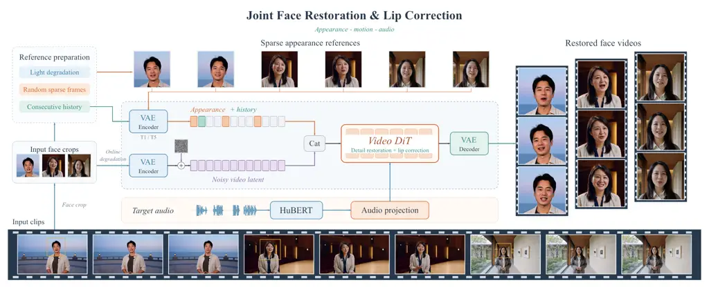
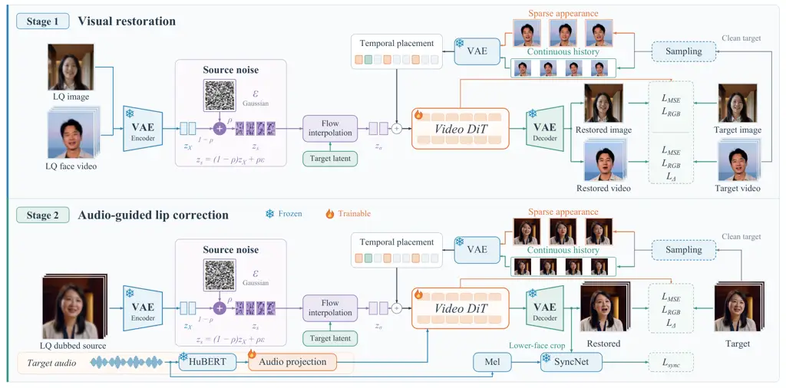
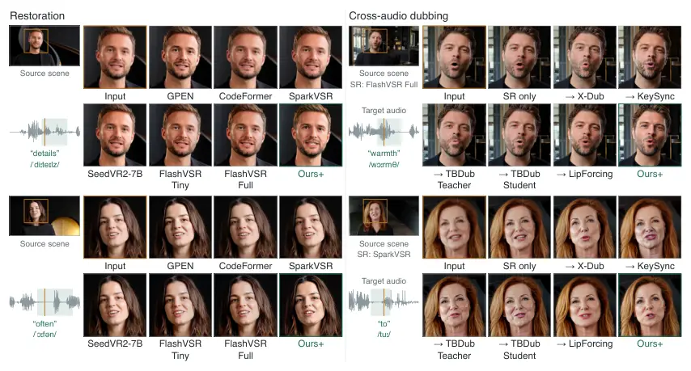
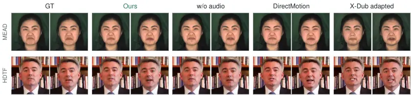

TaoMate-FVSR

# TaoMate-FVSR: Audio-Guided Facial Video Restoration

###### Abstract

Low-quality facial videos suffer from missing fine details, while
AI-generated videos may additionally contain implausible teeth and lip
movements that do not match the speech. Restoring the mouth region is
particularly challenging: enhancing existing details can preserve
structural errors, whereas regenerating them risks changing facial
identity and articulation. We propose an audio-guided facial video
restoration framework that reconstructs unreliable mouth details and
aligns lip movements with the speech while preserving facial identity
and temporal consistency. Built on a video diffusion transformer, our
framework mixes input video latents with noise to retain useful source
information while allowing corrupted details to be regenerated. Audio
guides lip movements, reference images constrain facial appearance, and
previously generated frames promote temporal consistency. We train the
model in two stages, first learning visual restoration from degraded
images and videos, then learning audio-guided lip correction from
degraded dubbed videos. The resulting model supports both restoration
with the original audio and visual dubbing with replacement audio. On
talking-head restoration benchmarks, our method achieves the lowest
LPIPS and DISTS and the best lip synchronization scores among the
evaluated restoration baselines. Qualitative results on AI-generated
videos further show improvements in facial detail and mouth-region
appearance, including clearer tooth boundaries and lip contours.

Project page:
[https://taoliveaigc.github.io/TaoMate-FVSR/](https://taoliveaigc.github.io/TaoMate-FVSR/)

![[Uncaptioned
image]](arxiv-2611-03393v2--3505d5012fd6.figures/figure-1.webp)![[Uncaptioned
image]](arxiv-2611-03393v2--3505d5012fd6.figures/figure-2.webp)

Xinyang Li^($`\dagger`$), Zeran Xu^($`\dagger`$), Jingna Sun, Qijun Gan,
Chenwei Zhang, Meiguang Jin^(\*), Junfeng Ma

Alibaba Group

[lyon.lxy@taobao.com](mailto:lyon.lxy@taobao.com) [xuzeran.xzr@taobao.com](mailto:xuzeran.xzr@taobao.com) [meiguang.jmg@taobao.com](mailto:meiguang.jmg@taobao.com)

  

^(†)^(†)footnotetext: ^($`\dagger`$)Equal
contribution.  ^(\*)Corresponding author.



Figure 1: Audio-guided facial restoration from AIGC footage. Small
facial regions provide limited evidence for lip and teeth structure. The
model restores these regions using reference frames and accompanying
audio. The three clips illustrate the source scenes and reconstructed
heads; the reference bank depicts training-time conditioning.
Quantitative references originate from the GT first frame. “Cat” denotes
channel-wise fusion implemented by separate linear projections and
summation.

## 1  Introduction

Low-quality facial videos often lack fine details due to limited
resolution, blur, and compression. AI-generated videos pose an
additional challenge. Video generation models can synthesize detailed
scenes and coordinated character motion \[1\], yet faces may remain
poorly resolved when they occupy only a small region of the frame.
Beyond missing detail, generated faces may contain implausible teeth or
lip movements that do not match the speech. These defects become
particularly noticeable during close viewing and reframing. Improving
facial quality without regenerating the entire shot is therefore
valuable for both captured and generated videos.

Teeth are especially difficult to restore because their shape and
boundaries must remain consistent as the lips, jaw, and head move. Low
resolution can make individual teeth indistinguishable, while generation
can introduce incorrect or temporally unstable structures. Sharpening
these observations can accentuate their errors; restoration must instead
resolve the ambiguous structure across frames.

Recent video super-resolution methods offer powerful generative priors
and reference guidance for restoring visual detail. SeedVR2 \[2\] uses
generative priors for reconstruction, FlashVSR \[3\] targets efficient
streaming restoration, and SparkVSR \[4\] introduces sparse high-quality
keyframes for appearance control. For speaking faces, however, visual
quality alone is insufficient: a sharp and plausible mouth can still
move out of sync with the speech. Audio provides complementary cues for
recovering these movements. Extreme-scale talking-face upsampling \[5\]
combines audio with a high-resolution identity image; MDVD-Net \[6\]
exploits multimodal cues for compressed face video; and GAVN \[7\]
models temporal and identity information. Building on these directions,
we study facial video restoration when the input mouth details may be
missing or incorrect, requiring visual reconstruction and audio-guided
lip correction within the same framework.

A central challenge is deciding how much of the input to preserve.
Strong source conditioning retains appearance and motion but can also
preserve mouth errors; greater freedom to regenerate details risks
identity drift. Our video diffusion transformer addresses this trade-off
by starting reconstruction from noise-mixed input latents. Target speech
constrains articulation, while appearance references and recent
generated frames supply identity and temporal cues.

Training first learns restoration from degraded images and videos, then
introduces dubbed sources whose mouth movements differ from the target.
This mismatch trains the model to follow the supplied speech rather than
copy source articulation. Independently encoded reference images and
sequence-encoded history occupy separate temporal slots, retaining a
fixed appearance anchor across video segments. Figure 1 illustrates the
task, and Figure 2 presents the framework.

We evaluate original-audio restoration and replacement-audio dubbing
using visual-quality and synchronization metrics, including comparisons
with super-resolution and dubbing cascades \[8, 9\]. Native AI-generated
examples further examine tooth boundaries, lip contours, and surrounding
facial texture.

The contributions are threefold:

- $`\blacktriangleright`$
  We introduce a joint facial reconstruction and speech-guided
  lip-correction framework for original-audio restoration and
  replacement-audio dubbing.
- $`\blacktriangleright`$
  We combine source–noise reconstruction with two-stage restoration and
  lip-correction training, enabling the model to revise unreliable mouth
  details.
- $`\blacktriangleright`$
  We design structured conditioning with separate appearance and history
  slots to preserve identity and continuity across video segments.

## 2  Related Work

#### Facial and video restoration.

Facial restoration methods use learned priors to recover details lost
through degradation. GAN-based approaches \[10, 11\] and codebook-based
approaches \[12\] provide high-quality facial representations, while
diffusion-based methods \[13, 14, 15\] exploit generative priors for
perceptually realistic reconstruction. Video restoration further
incorporates temporal information through feature propagation \[16, 17\]
or video diffusion models \[18, 2, 3\]. Reference-guided methods recover
identity-specific appearance: InstantRestore \[19\] uses shared-image
attention, RG-FVR \[20\] introduces identity conditioning into a
flow-based video generator, and SparkVSR \[4\] propagates sparse
high-quality keyframes. Our task additionally requires correcting
unreliable source articulation according to target speech.

#### Audio-assisted facial restoration.

Audio helps recover mouth movements when visual observations are
insufficient. Extreme-scale talking-face upsampling \[5\] combines
low-resolution video, audio, and an identity image. MDVD-Net \[6\] uses
audio, geometry, and codec cues; GAVN \[7\] models complementary
temporal and identity information. We extend this audiovisual
restoration setting to degraded dubbed sources whose articulation
differs from the target speech.

#### Teeth restoration and temporal consistency.

HDTR-Net \[21\] enhances teeth and surrounding mouth details through
fine-grained feature fusion and reference guidance. OrthoNet \[22\]
addresses teeth artifacts using detail-oriented alignment with long-term
and short-term memory. We address dental detail within full-face
reconstruction, where its temporal evolution must also follow speech,
without a separate teeth-restoration module.

#### Visual dubbing.

Visual dubbing modifies an existing video’s mouth movements to match
target speech. Wav2Lip \[23\] uses expert synchronization supervision,
while VideoReTalking \[9\] combines lip editing with identity-aware
enhancement. KeySync \[24\] uses a two-stage framework and masking to
address temporal consistency, expression leakage, and occlusions.
X-Dub \[8\] develops mask-free dubbing, and TBDub \[25\] extends it
through task-adaptive post-training and few-step distillation.
LipForcing \[26\] explores streaming lip synchronization through
few-step autoregressive diffusion. In our setting, the model must
additionally recover degraded facial detail during dubbing.

## 3  Method



Figure 2: Audio-guided facial video restoration. Stage 1 jointly trains
on degraded images and videos with their corresponding targets. Images
use only flow-matching MSE ($`\mathcal{L}_{\mathrm{MSE}}`$) and RGB
losses; videos additionally use temporal supervision. Stage 2 uses
degraded dubbed sources and target audio for lip correction. Sparse
references and continuous history occupy distinct conditioning slots.
The VAE, HuBERT, and SyncNet are frozen; the video DiT and conditioning
projections are trainable. AIGC thumbnails illustrate the input and
target roles.

Given a low-quality facial video $`X`$, target audio $`a`$, and
appearance references $`R`$, TaoMate-FVSR reconstructs a high-quality
video with speech-aligned lip movements. Figure 2 shows the video
diffusion transformer operating in the latent space of a frozen causal
video autoencoder. A single trained model supports both original-audio
restoration and replacement-audio dubbing.

### 3.1 Source–Noise Reconstruction

A degraded video provides useful information about facial appearance and
motion, but its mouth details may be blurred or incorrect. To retain
this information without requiring the output to reproduce unreliable
details, we initialize reconstruction from a noisy version of the input
latents. A frozen causal video encoder $`E`$ maps the input $`X`$ and
clean training target $`Y`$ to $`z_{X}=E(X)`$ and $`z_{Y}=E(Y)`$. Inputs
are resized to the target resolution before encoding. Images are treated
as single-frame examples in the same latent representation.

We mix the input latents with Gaussian noise to obtain the
reconstruction starting point:

```math
z_{s}=(1-\rho)z_{X}+\rho\epsilon,\qquad\epsilon\sim\mathcal{N}(0,I). \tag{1}
```

The mixing strength $`\rho`$ controls how much source information
remains in $`z_{s}`$. During training, we construct a linear path
between the clean target and this noisy source:

```math
z_{\sigma}=(1-\sigma)z_{Y}+\sigma z_{s},\qquad v^{\star}=z_{s}-z_{Y}. \tag{2}
```

Following flow matching \[27\], the video DiT predicts the target
velocity $`v^{\star}`$ from $`z_{\sigma}`$, flow time $`\sigma`$, and
the conditioning inputs. The two scalars serve different roles: $`\rho`$
determines the reconstruction starting point, whereas $`\sigma`$
specifies a position along the training path. At inference, we integrate
the predicted velocity field from $`\sigma=1`$ to $`\sigma=0`$, starting
at $`z_{s}`$.

### 3.2 Audio and Reference Conditioning

#### Audio conditioning.

We extract target-speech features with a frozen HuBERT encoder \[28\]
and pass them through a trainable audio projection. The projected
features are aligned with the reconstruction windows and supplied to the
DiT. The same interface accepts original audio or replacement speech.

#### Appearance and history conditioning.

Reference images and recent frames provide different information.
Reference images supply persistent appearance cues, but their pose and
mouth configuration need not match the current output frame. Recent
frames provide local motion and appearance context. We therefore encode
sparse reference images independently and obtain history features
through sequence encoding. Their features occupy separate temporal
positions in a reference canvas, with unused positions set to zero. A
shared projection adds this canvas to the DiT input features without
replacing the reconstruction latents. This design makes appearance
references available as conditions rather than prescribing their mouth
configuration as the output. The fixed appearance reference remains
accessible in every inference window, independently of generated
history.

### 3.3 Two-Stage Training

#### Stage 1: visual restoration.

We first train the model using high-quality facial images and videos
$`Y`$ paired with degraded inputs $`X=\mathcal{D}(Y)`$. The degraded
inputs are resized back to the target resolution before encoding. This
stage learns to reconstruct facial appearance from incomplete visual
observations. Image examples supervise spatial detail, while video
examples additionally supervise changes over time. Sparse clean target
frames provide appearance references during training.

For video examples, the reconstruction objective combines latent flow
supervision with losses on decoded predictions:

```math
\mathcal{L}_{\mathrm{rec}}=\mathcal{L}_{\mathrm{flow}}+0.1\mathcal{L}_{\mathrm{RGB}}+0.1\mathcal{L}_{\Delta}+0.1\mathcal{L}_{\mathrm{LPIPS}}. \tag{3}
```

The flow loss is a time-weighted velocity MSE, denoted
$`\mathcal{L}_{\mathrm{MSE}}`$ in Figure 2, with twice the weight
assigned to the mouth region. RGB MSE and LPIPS \[29\] supervise
reconstruction fidelity and perceptual similarity, respectively. The
temporal term $`\mathcal{L}_{\Delta}`$ matches adjacent-frame
differences between predictions and targets. Still images use only
$`\mathcal{L}_{\mathrm{flow}}+0.1\mathcal{L}_{\mathrm{RGB}}`$, without
perceptual or temporal losses. To compute decoded video losses, we
sample a four-latent window and use detached preceding predictions as
causal decoding context.

#### Stage 2: audio-guided lip correction.

Paired visual restoration does not explicitly require the model to
change source articulation. We therefore continue training with dubbed
sources $`X^{\mathrm{dub}}`$ and clean targets $`Y`$ that share the
person and scene but differ in articulation. We degrade the dubbed
source to obtain $`X=\mathcal{D}(X^{\mathrm{dub}})`$ and use the audio
associated with $`Y`$ as the target condition. Reconstructing $`Y`$ now
requires both visual detail recovery and lip correction, discouraging
the model from copying the source mouth.

We retain the reconstruction losses and add audiovisual synchronization
supervision:

```math
\mathcal{L}_{\mathrm{stage2}}=\mathcal{L}_{\mathrm{rec}}+\lambda_{\mathrm{sync}}\mathcal{L}_{\mathrm{sync}},\qquad\lambda_{\mathrm{sync}}=10^{-4}. \tag{4}
```

A frozen SyncNet provides the synchronization loss, following
Wav2Lip \[23\]. The VAE, HuBERT, and SyncNet remain frozen, while the
video DiT and conditioning projections are trainable. Training uses
77-frame windows corresponding to 20 temporal latents, with source–noise
strength $`\rho\in[0.80,0.95]`$. Appearance and history conditions are
independently dropped with probabilities 0.1 and 0.4; the second stage
additionally drops audio with probability 0.1.

### 3.4 Long-Video Inference

#### History across windows.

We reconstruct long videos in overlapping windows while keeping a fixed
appearance reference $`r`$. For window $`k`$, let $`\tau`$ denote the
index of the last retained output frame from the preceding window. We
construct the conditioning sequence

```math
P_{k}=\bigl[r,\hat{y}_{\tau-3},\hat{y}_{\tau-2},\hat{y}_{\tau-1},\hat{y}_{\tau}\bigr]. \tag{5}
```

The reference $`r`$ is encoded independently, while the second temporal
latent of $`E(P_{k})`$ supplies the history feature. These features are
placed in their respective conditioning slots. Thus, the history feature
is obtained by encoding the reference-prefixed sequence, rather than
encoding the four history frames independently. For the initial window,
we repeat $`r`$ five times because no generated history is available.
Later windows use previously reconstructed frames without access to
future targets.

#### Window transitions.

We additionally encode the last retained frame as $`E(\hat{y}_{\tau})`$
to provide an appearance condition at the transition to new content.
This independent encoding complements the sequence-encoded history
feature. Within the overlap, we reuse the preceding window’s latent
trajectory at matching flow times. Source frames, noise, and audio
conditions remain aligned to the same video timeline.

#### Stateful decoding.

The causal VAE decoder preserves its internal state when decoding newly
retained latents from successive windows. Each window contains five
conditioning frames and 72 payload frames. A stride of 56 yields an
overlap of 16 payload frames. We discard the conditioning prefix and
duplicated overlap to recover the original video duration. Outputs are
assembled without RGB cross-fading or histogram matching.

## 4  Experiments

We compare original-audio restoration and replacement-audio dubbing
quantitatively, examine native AI-generated videos qualitatively, and
ablate the reconstruction and conditioning designs.

|                |                          |                          |                             |                             |                            |                              |                           |                              |                               |                           |
| -------------- | ------------------------ | ------------------------ | --------------------------- | --------------------------- | -------------------------- | ---------------------------- | ------------------------- | ---------------------------- | ----------------------------- | ------------------------- |
|                | Reference-based fidelity |                          |                             |                             | Lip sync.                  |                              | No-reference quality      |                              |                               |                           |
| Method         | PSNR $`\uparrow`$ \[30\] | SSIM $`\uparrow`$ \[31\] | LPIPS $`\downarrow`$ \[29\] | DISTS $`\downarrow`$ \[32\] | Sync-C $`\uparrow`$ \[33\] | Sync-D $`\downarrow`$ \[33\] | MUSIQ $`\uparrow`$ \[34\] | CLIP-IQA $`\uparrow`$ \[35\] | FasterVQA $`\uparrow`$ \[36\] | DOVER $`\uparrow`$ \[37\] |
| GT             | –                        | –                        | –                           | –                           | 6.959                      | 7.863                        | 62.70                     | 0.4525                       | 0.7735                        | 0.6148                    |
| GPEN           | 26.77                    | 0.7970                   | 0.2267                      | 0.1825                      | 6.309                      | 8.288                        | 76.47                     | 0.7032                       | 0.8931                        | 0.8505                    |
| CodeFormer     | 27.38                    | 0.8045                   | 0.2195                      | 0.1876                      | 5.856                      | 8.693                        | 74.42                     | 0.6649                       | 0.8854                        | 0.7954                    |
| InstantRestore | 27.42                    | 0.8283                   | 0.1380                      | 0.1421                      | 6.209                      | 8.403                        | 68.11                     | 0.5166                       | 0.8562                        | 0.7704                    |
| SparkVSR       | 30.62                    | 0.8863                   | 0.1755                      | 0.1586                      | 6.545                      | 8.170                        | 65.66                     | 0.4417                       | 0.8459                        | 0.7467                    |
| RG-FVR         | 26.69                    | 0.8308                   | 0.1645                      | 0.1461                      | 5.685                      | 9.024                        | 70.51                     | 0.5246                       | 0.8688                        | 0.7407                    |
| SeedVR2-3B     | 27.49                    | 0.8456                   | 0.2227                      | 0.1630                      | 6.377                      | 8.339                        | 57.36                     | 0.4412                       | 0.7548                        | 0.5601                    |
| SeedVR2-7B     | 28.60                    | 0.8584                   | 0.2046                      | 0.1525                      | 6.359                      | 8.319                        | 54.30                     | 0.3939                       | 0.7433                        | 0.5212                    |
| FlashVSR-Tiny  | 27.74                    | 0.8497                   | 0.1563                      | 0.1428                      | 6.490                      | 8.275                        | 70.19                     | 0.5395                       | 0.8810                        | 0.7709                    |
| FlashVSR-Full  | 27.52                    | 0.8435                   | 0.1652                      | 0.1458                      | 6.468                      | 8.316                        | 71.23                     | 0.5776                       | 0.8820                        | 0.7729                    |
| FlashVSR+      | 26.68                    | 0.8379                   | 0.1652                      | 0.1473                      | 6.524                      | 8.230                        | 69.83                     | 0.4947                       | 0.8775                        | 0.7851                    |
| Ours           | 28.67                    | 0.8836                   | 0.0793                      | 0.0858                      | 7.413                      | 7.561                        | 66.84                     | 0.4908                       | 0.8245                        | 0.7178                    |
| Ours⁺          | 23.52                    | 0.7525                   | 0.2402                      | 0.1902                      | 7.453                      | 7.520                        | 77.62                     | 0.7081                       | 0.8997                        | 0.8823                    |

- Reference-capable baselines and Ours use the same GT first frame; ⁺
  denotes GPT-Image-assisted enhancement of that frame for Ours⁺.
  Quantitative results use fixed-reference motion conditioning. GT uses
  undegraded source frames and original audio; paired self-comparisons
  are omitted, and GT is excluded from rankings. Scores use complete
  prepared $`512\times 512`$ frames (Section 4.2).

Table 1: Facial restoration under original audio. Results on the
150-video benchmark, averaged equally over common valid clips. Darker
and lighter green mark the best and second-best results, respectively.

### 4.1 Experimental Setup

#### Evaluation data.

The original-audio benchmark contains 150 talking-head videos from
MEAD \[38\], HDTF \[39\], TalkVid \[40\], and our internal dataset.
Inputs are synthetically degraded using the training-style degradation
pipeline, including $`4\times`$ downsampling followed by resizing to
$`512\times 512`$. The undegraded videos serve as paired targets.
Replacement-audio evaluation uses 30 clips and their corresponding
replacement-audio pairs, for which no paired target-mouth video is
available. We additionally examine four native MiniMax-H3 \[41\]
text-to-audio-video clips without synthetic degradation or clean
targets. Ablations use 30 videos, comprising 15 MEAD and 15 HDTF clips.

#### Reference protocol.

For quantitative restoration in Table 1, reference-capable baselines and
Ours use the same undegraded GT first frame. Ours⁺ uses a
GPT-Image-enhanced version of that frame, with the model and sampler
unchanged. For replacement-audio evaluation, SparkVSR and Ours⁺ share
the same enhanced GT first frame. Methods without a reference interface
retain their supported inputs. For native AIGC clips, references are
enhanced from the input first frame and shared across reference-capable
methods. All ablations use the unenhanced GT first frame.

#### Baselines.

Restoration comparisons include face restoration methods GPEN \[11\] and
CodeFormer \[12\]; reference-guided methods InstantRestore \[19\],
SparkVSR \[4\], and RG-FVR \[20\]; and video restoration methods
SeedVR2 \[2\] and three FlashVSR \[3\] variants. For replacement audio,
we compare against ten cascades formed by FlashVSR Full or SparkVSR
followed by X-Dub \[8\], KeySync \[24\], TBDub Teacher or
Student \[25\], or LipForcing \[26\]. Baselines retain their released
interfaces and sampling budgets.

#### Metrics and implementation.

PSNR \[30\], SSIM \[31\], LPIPS \[29\], and DISTS \[32\] assess fidelity
and perceptual similarity when paired targets are available. Sync-C and
Sync-D measure audiovisual agreement using frozen SyncNet-v2 \[33\].
MUSIQ \[34\] and CLIP-IQA \[35\] assess no-reference frame quality,
while FasterVQA \[36\] and DOVER \[37\] assess overall video quality. We
inspect tooth boundaries and lip contours qualitatively in matched-time
crops. Quantitative results are averaged equally over common valid
videos using native uncompressed RGB outputs; visual metrics use
complete prepared frames. Our quantitative runs use seed 42,
source–noise strength 0.8, ten Euler steps, shift 5, audio guidance 4,
and reference guidance 1.5.

|                               |                            |                              |                           |                              |                               |                           |
| ----------------------------- | -------------------------- | ---------------------------- | ------------------------- | ---------------------------- | ----------------------------- | ------------------------- |
|                               | Lip sync.                  |                              | No-reference quality      |                              |                               |                           |
| Method                        | Sync-C $`\uparrow`$ \[33\] | Sync-D $`\downarrow`$ \[33\] | MUSIQ $`\uparrow`$ \[34\] | CLIP-IQA $`\uparrow`$ \[35\] | FasterVQA $`\uparrow`$ \[36\] | DOVER $`\uparrow`$ \[37\] |
| FlashVSR Full $`\to`$ dubbing |                            |                              |                           |                              |                               |                           |
|   X-Dub                       | 6.137                      | 9.332                        | 73.25                     | 0.6582                       | 0.8750                        | 0.7845                    |
|   KeySync                     | 7.347                      | 7.840                        | 68.07                     | 0.4908                       | 0.8736                        | 0.7647                    |
|   TBDub Teacher               | 7.736                      | 7.543                        | 70.18                     | 0.6208                       | 0.8650                        | 0.7179                    |
|   TBDub Student               | 7.469                      | 8.196                        | 69.72                     | 0.5834                       | 0.8641                        | 0.7309                    |
|   LipForcing                  | 7.917                      | 7.186                        | 66.18                     | 0.4973                       | 0.8476                        | 0.6958                    |
| SparkVSR $`\to`$ dubbing      |                            |                              |                           |                              |                               |                           |
|   X-Dub                       | 5.853                      | 9.409                        | 74.12                     | 0.6335                       | 0.8596                        | 0.7822                    |
|   KeySync                     | 7.175                      | 7.964                        | 62.17                     | 0.4271                       | 0.8318                        | 0.7199                    |
|   TBDub Teacher               | 7.208                      | 7.817                        | 67.94                     | 0.5383                       | 0.8389                        | 0.7030                    |
|   TBDub Student               | 7.090                      | 8.401                        | 67.25                     | 0.4987                       | 0.8412                        | 0.7174                    |
|   LipForcing                  | 7.858                      | 7.224                        | 60.70                     | 0.4270                       | 0.8079                        | 0.6517                    |
| Ours⁺                         | 8.175                      | 7.083                        | 77.56                     | 0.7070                       | 0.8958                        | 0.8709                    |

- ⁺ denotes GPT-Image-assisted enhancement of the GT first frame.
  SparkVSR and Ours⁺ use the same enhanced reference. Arrows indicate
  execution order. Motion conditioning follows Table 1.

Table 2: Visual dubbing under replacement audio. Equal-video means on
the same 30 clips and replacement-audio pairs. Darker and lighter green
mark the best and second-best method results.

### 4.2 Facial Restoration under Original Audio

#### Reconstruction and synchronization.

Table 1 shows that Ours achieves the lowest paired perceptual errors,
with LPIPS of 0.0793 and DISTS of 0.0858. Its Sync-C/D of 7.413/7.561
also improves on SparkVSR at 6.545/8.170, the strongest restoration
baseline on these synchronization measures. SparkVSR achieves the
highest PSNR and SSIM, exceeding Ours by 1.95 dB and 0.0027,
respectively. Ours therefore leads in perceptual similarity and
synchronization, while SparkVSR retains an advantage in pixel fidelity.

#### Effect of reference enhancement.

Ours⁺ achieves the highest scores on all four no-reference quality
metrics, including MUSIQ of 77.62 and DOVER of 0.8823, while retaining
Sync-C/D of 7.453/7.520. Compared with Ours, PSNR decreases from 28.67
to 23.52 and LPIPS increases from 0.0793 to 0.2402. Reference
enhancement thus yields higher no-reference quality scores but lower
paired fidelity to the original target.

### 4.3 Visual Dubbing under Replacement Audio

Table 2 compares joint reconstruction with restoration–dubbing cascades.
All methods receive the same degraded source and replacement audio, with
no additional degradation between cascade stages.

Ours⁺ achieves the best scores across all six reported metrics among the
evaluated pipelines. Its Sync-C/D of 8.175/7.083 improves on the
strongest synchronization cascade, FlashVSR Full followed by LipForcing,
at 7.917/7.186. MUSIQ reaches 77.56, compared with 74.12 for the best
cascade on this metric, SparkVSR followed by X-Dub. Different cascades
favor different criteria: LipForcing gives the strongest synchronization
results, whereas X-Dub leads several quality measures. These results
support joint reconstruction as an effective alternative to the
evaluated restoration–dubbing cascades under replacement audio.

### 4.4 Native AIGC Results



Figure 3: Facial detail and articulation in AIGC scenes. Four
MiniMax-H3 \[41\] clips are shown with matched-time head crops located
by orange boxes. Left: restoration under original audio. Right: FlashVSR
Full (top) or SparkVSR (bottom) is followed by the arrow-marked dubbing
methods; Input and SR-only outputs provide visual controls. Ours⁺
jointly reconstructs detail and articulation with a GPT-Image-enhanced
reference, without an external SR frontend. Waveforms and word-level IPA
labels identify the audio segments. Displayed predictions are
unretouched.

Figure 3 compares matched-time facial crops from four native H3 clips
under original and replacement audio.

Under original audio, the male example shows soft tooth boundaries in
FlashVSR Tiny and Full and weak separation between adjacent teeth in
SparkVSR. Ours⁺ produces clearer upper-tooth boundaries and a more
distinct lip–skin boundary, together with detailed beard texture. In the
female example, it recovers distinct lip contours and visible upper
teeth alongside fine hair detail.

Under replacement audio, the crops show differences in both the mouth
and its surroundings. KeySync changes the beard and chin boundary after
FlashVSR Full restoration, and alters lip geometry and color after
SparkVSR restoration. LipForcing leaves the lower face comparatively
soft in the displayed SparkVSR example. Ours⁺ retains detailed beard
texture around the male subject’s mouth and produces a distinct lip
contour with visible upper teeth for the female subject.

### 4.5 Ablation Study

We evaluate four configurations on the same 30 degraded videos using the
unenhanced GT first frame. Original audio is supplied to all
audio-conditioned variants. Alongside audio removal, restoration-adapted
X-Dub and DirectMotion test alternative source-conditioning and
history-conditioning configurations. Table 3 reports quantitative
results, and Figure 4 shows matched-frame comparisons.

| Metric                 | GT     | Ours   | w/o Audio | Direct Motion | X-Dub (adapted) |
| ---------------------- | ------ | ------ | --------- | ------------- | --------------- |
| PSNR $`\uparrow`$      | –      | 29.10  | 29.36     | 28.24         | 26.63           |
| SSIM $`\uparrow`$      | –      | 0.8852 | 0.8889    | 0.8600        | 0.8415          |
| LPIPS $`\downarrow`$   | –      | 0.0850 | 0.0856    | 0.1341        | 0.1523          |
| MUSIQ $`\uparrow`$     | 63.26  | 68.19  | 69.09     | 69.49         | 70.08           |
| CLIP-IQA $`\uparrow`$  | 0.4971 | 0.5591 | 0.5709    | 0.5807        | 0.6145          |
| FasterVQA $`\uparrow`$ | 0.7880 | 0.8352 | 0.8432    | 0.8595        | 0.8354          |
| DOVER $`\uparrow`$     | 0.6392 | 0.7367 | 0.7567    | 0.7602        | 0.7232          |
| Sync-C $`\uparrow`$    | 7.762  | 7.621  | 4.283     | 7.254         | 7.407           |
| Sync-D $`\downarrow`$  | 7.374  | 7.560  | 10.524    | 7.875         | 8.144           |

Table 3: Ablation comparison on the same 30 videos: 15 from MEAD \[38\]
and 15 from HDTF \[39\]. All variants use the GT first frame.
X-Dub \[8\] and DirectMotion provide alternatives to source–noise mixing
and structured reference injection, respectively. Values are video-wise
means; GT is excluded from rankings. Dark and light green mark the best
and second-best model results.

#### Source–noise reconstruction.

Restoration-adapted X-Dub \[8\] starts from Gaussian noise with dense
degraded-video conditions. It uses our reference injection: an
independently encoded GT first frame and motion history occupy separate
slots. Ours improves PSNR from 26.63 to 29.10, reduces LPIPS from 0.1523
to 0.0850, and improves Sync-C/D from 7.407/8.144 to 7.621/7.560.
Despite higher MUSIQ and CLIP-IQA, the adapted outputs show
over-emphasized skin texture and hard dental edges in the selected
frames. The comparison favors source–noise reconstruction for paired
fidelity and synchronization.

#### Audio conditioning.

Removing audio reduces Sync-C from 7.621 to 4.283 and increases Sync-D
from 7.560 to 10.524, although PSNR improves by 0.26 dB and LPIPS
remains nearly unchanged at 0.0856 versus 0.0850. In the HDTF example,
the visual-only variant narrows the target mouth opening, whereas Ours
recovers it. Audio thus improves synchronization despite similar overall
reconstruction fidelity.

#### Appearance and history conditioning.

DirectMotion replaces the reference canvas with motion-frame
conditioning: the first window repeats the GT reference five times, and
later windows use the preceding output’s last five frames without
independently injecting the fixed reference. Ours reduces LPIPS from
0.1341 to 0.0850, improves PSNR from 28.24 to 29.10, and improves
Sync-C/D from 7.254/7.875 to 7.621/7.560. DirectMotion’s over-smoothed
texture and artificial dot patterns in the selected outputs support
retaining the fixed appearance reference alongside generated history.



Figure 4: Qualitative ablation comparison. Each row shows two selected
frames from one clip: MEAD \[38\] (top) and HDTF \[39\] (bottom). The
same frame pair is displayed for GT and each model variant, with ten
images per row. All variants use the GT first frame, and predictions are
extracted directly from native RGB outputs.

## 5  Conclusion

TaoMate-FVSR combines facial restoration and lip correction in a single
audio-guided model. It improves paired perceptual similarity and
synchronization over the evaluated restoration baselines and performs
favorably against restoration–dubbing cascades. Native AIGC examples
show clearer facial detail and mouth boundaries. These results support
speech-guided reconstruction when the source’s visual evidence is
unreliable.

Reconstructed detail is a generative estimate of appearance.
Applications should obtain appropriate permission and disclose edited
content to reduce impersonation risk.

## References

- \[1\] Wan Team et al. Wan: Open and advanced large-scale video
  generative models. _arXiv preprint arXiv:2503.20314_, 2025. URL
  [https://arxiv.org/abs/2503.20314](https://arxiv.org/abs/2503.20314).
- \[2\] Jianyi Wang, Shanchuan Lin, Zhijie Lin, Yuxi Ren, Meng Wei,
  Zongsheng Yue, Shangchen Zhou, Hao Chen, Yang Zhao, Ceyuan Yang,
  Xuefeng Xiao, Chen Change Loy, and Lu Jiang. SeedVR2: One-step video
  restoration via diffusion adversarial post-training. arXiv preprint
  arXiv:2506.05301v1, 2025. URL
  [https://arxiv.org/abs/2506.05301v1](https://arxiv.org/abs/2506.05301v1).
- \[3\] Junhao Zhuang, Shi Guo, Xin Cai, Xiaohui Li, Yihao Liu, Chun
  Yuan, and Tianfan Xue. FlashVSR: Towards real-time diffusion-based
  streaming video super-resolution. arXiv preprint
  arXiv:2510.12747v1, 2025. URL
  [https://arxiv.org/abs/2510.12747v1](https://arxiv.org/abs/2510.12747v1).
- \[4\] Jiongze Yu, Xiangbo Gao, Pooja Verlani, Akshay Gadde, Yilin
  Wang, Balu Adsumilli, and Zhengzhong Tu. SparkVSR: Interactive video
  super-resolution via sparse keyframe propagation. arXiv preprint
  arXiv:2603.16864, 2026. URL
  [https://arxiv.org/abs/2603.16864](https://arxiv.org/abs/2603.16864).
- \[5\] Sindhu B. Hegde, Rudrabha Mukhopadhyay, Vinay P. Namboodiri, and
  C. V. Jawahar. Extreme-scale talking-face video upsampling with
  audio-visual priors. In _Proceedings of the 30th ACM International
  Conference on Multimedia_, 2022. doi: 10.1145/3503161.3548080. URL
  [https://doi.org/10.1145/3503161.3548080](https://doi.org/10.1145/3503161.3548080).
- \[6\] Xi Zhang and Xiaolin Wu. Multi-modality deep restoration of
  extremely compressed face videos. _IEEE Transactions on Pattern
  Analysis and Machine Intelligence_, 45(2):2024–2037, 2023. doi:
  10.1109/TPAMI.2022.3157388. URL
  [https://doi.org/10.1109/TPAMI.2022.3157388](https://doi.org/10.1109/TPAMI.2022.3157388).
- \[7\] Yuqin Cao, Yixuan Gao, Wei Sun, Xiaohong Liu, Yulun Zhang, and
  Xiongkuo Min. Audio-assisted face video restoration with temporal and
  identity complementary learning. In _Proceedings of the AAAI
  Conference on Artificial Intelligence_, volume 40, pages
  2661–2669, 2026. doi: 10.1609/aaai.v40i4.37254. URL
  [https://ojs.aaai.org/index.php/AAAI/article/view/37254](https://ojs.aaai.org/index.php/AAAI/article/view/37254).
- \[8\] Xu He, Haoxian Zhang, Hejia Chen, Changyuan Zheng, Liyang Chen,
  Songlin Tang, Jiehui Huang, Xiaoqiang Liu, Pengfei Wan, and Zhiyong
  Wu. From inpainting to editing: Unlocking robust mask-free visual
  dubbing via generative bootstrapping. arXiv preprint
  arXiv:2512.25066v2, 2026. URL
  [https://arxiv.org/abs/2512.25066v2](https://arxiv.org/abs/2512.25066v2).
- \[9\] Kun Cheng, Xiaodong Cun, Yong Zhang, Menghan Xia, Fei Yin,
  Mingrui Zhu, Xuan Wang, Jue Wang, and Nannan Wang. VideoReTalking:
  Audio-based lip synchronization for talking head video editing in the
  wild. arXiv preprint arXiv:2211.14758, 2022. URL
  [https://arxiv.org/abs/2211.14758](https://arxiv.org/abs/2211.14758).
- \[10\] Xintao Wang, Yu Li, Honglun Zhang, and Ying Shan. Towards
  real-world blind face restoration with generative facial prior. In
  _Proceedings of the IEEE/CVF Conference on Computer Vision and Pattern
  Recognition_, 2021. URL
  [https://openaccess.thecvf.com/content/CVPR2021/papers/Wang_Towards_Real-World_Blind_Face_Restoration_With_Generative_Facial_Prior_CVPR_2021_paper.pdf](https://openaccess.thecvf.com/content/CVPR2021/papers/Wang_Towards_Real-World_Blind_Face_Restoration_With_Generative_Facial_Prior_CVPR_2021_paper.pdf).
- \[11\] Tao Yang, Peiran Ren, Xuansong Xie, and Lei Zhang. GAN prior
  embedded network for blind face restoration in the wild. In
  _Proceedings of the IEEE/CVF Conference on Computer Vision and Pattern
  Recognition_, pages 672–681, 2021. URL
  [https://openaccess.thecvf.com/content/CVPR2021/html/Yang_GAN_Prior_Embedded_Network_for_Blind_Face_Restoration_in_the_CVPR_2021_paper.html](https://openaccess.thecvf.com/content/CVPR2021/html/Yang_GAN_Prior_Embedded_Network_for_Blind_Face_Restoration_in_the_CVPR_2021_paper.html).
- \[12\] Shangchen Zhou, Kelvin Chan, Chongyi Li, and Chen Change Loy.
  Towards robust blind face restoration with codebook lookup
  transformer. In _Advances in Neural Information Processing Systems_,
  volume 35, pages 30599–30611, 2022. URL
  [https://proceedings.neurips.cc/paper_files/paper/2022/hash/c573258c38d0a3919d8c1364053c45df-Abstract-Conference.html](https://proceedings.neurips.cc/paper_files/paper/2022/hash/c573258c38d0a3919d8c1364053c45df-Abstract-Conference.html).
- \[13\] Jianyi Wang, Zongsheng Yue, Shangchen Zhou, Kelvin C. K. Chan,
  and Chen Change Loy. Exploiting diffusion prior for real-world image
  super-resolution. _International Journal of Computer Vision_, 2024.
  URL
  [https://github.com/IceClear/StableSR](https://github.com/IceClear/StableSR).
- \[14\] Xinqi Lin, Jingwen He, Ziyan Chen, Zhaoyang Lyu, Bo Dai,
  Fanghua Yu, Yu Qiao, Wanli Ouyang, and Chao Dong. DiffBIR: Toward
  blind image restoration with generative diffusion prior. In _European
  Conference on Computer Vision_, 2024. URL
  [https://www.ecva.net/papers/eccv_2024/papers_ECCV/papers/07690.pdf](https://www.ecva.net/papers/eccv_2024/papers_ECCV/papers/07690.pdf).
- \[15\] Fanghua Yu, Jinjin Gu, Zheyuan Li, Jinfan Hu, Xiangtao Kong,
  Xintao Wang, Jingwen He, Yu Qiao, and Chao Dong. Scaling up to
  excellence: Practicing model scaling for photo-realistic image
  restoration in the wild. In _Proceedings of the IEEE/CVF Conference on
  Computer Vision and Pattern Recognition_, pages 25669–25680, 2024. URL
  [https://openaccess.thecvf.com/content/CVPR2024/html/Yu_Scaling_Up_to_Excellence_Practicing_Model_Scaling_for_Photo-Realistic_Image_CVPR_2024_paper.html](https://openaccess.thecvf.com/content/CVPR2024/html/Yu_Scaling_Up_to_Excellence_Practicing_Model_Scaling_for_Photo-Realistic_Image_CVPR_2024_paper.html).
- \[16\] Kelvin C. K. Chan, Shangchen Zhou, Xiangyu Xu, and Chen Change
  Loy. BasicVSR++: Improving video super-resolution with enhanced
  propagation and alignment. In _Proceedings of the IEEE/CVF Conference
  on Computer Vision and Pattern Recognition_, pages 5972–5981, 2022.
  URL
  [https://openaccess.thecvf.com/content/CVPR2022/html/Chan_BasicVSR_Improving_Video_Super-Resolution_With_Enhanced_Propagation_and_Alignment_CVPR_2022_paper.html](https://openaccess.thecvf.com/content/CVPR2022/html/Chan_BasicVSR_Improving_Video_Super-Resolution_With_Enhanced_Propagation_and_Alignment_CVPR_2022_paper.html).
- \[17\] Ruicheng Feng, Chongyi Li, and Chen Change Loy. Kalman-inspired
  FEaturE propagation for video face super-resolution. In _European
  Conference on Computer Vision_, 2024. URL
  [https://jnjaby.github.io/projects/KEEP/](https://jnjaby.github.io/projects/KEEP/).
- \[18\] Shangchen Zhou, Peiqing Yang, Jianyi Wang, Yihang Luo, and
  Chen Change Loy. Upscale-A-Video: Temporal-consistent diffusion model
  for real-world video super-resolution. In _Proceedings of the IEEE/CVF
  Conference on Computer Vision and Pattern Recognition_, 2024. URL
  [https://openaccess.thecvf.com/content/CVPR2024/papers/Zhou_Upscale-A-Video_Temporal-Consistent_Diffusion_Model_for_Real-World_Video_Super-Resolution_CVPR_2024_paper.pdf](https://openaccess.thecvf.com/content/CVPR2024/papers/Zhou_Upscale-A-Video_Temporal-Consistent_Diffusion_Model_for_Real-World_Video_Super-Resolution_CVPR_2024_paper.pdf).
- \[19\] Howard Zhang, Yuval Alaluf, Sizhuo Ma, Achuta Kadambi, Jian
  Wang, and Kfir Aberman. InstantRestore: Single-step personalized face
  restoration with shared-image attention. Official SIGGRAPH
  implementation, 2025. URL
  [https://github.com/snap-research/InstantRestore](https://github.com/snap-research/InstantRestore).
- \[20\] Cem Eteke, Batuhan Tosun, and Eckehard Steinbach. RGFVR:
  Reference-guided face video restoration with flow matching, 2026. URL
  [https://arxiv.org/abs/2606.16401](https://arxiv.org/abs/2606.16401).
- \[21\] Yongyuan Li, Xiuyuan Qin, Chao Liang, and Mingqiang Wei.
  HDTR-Net: A real-time high-definition teeth restoration network for
  arbitrary talking face generation methods. In _Chinese Conference on
  Pattern Recognition and Computer Vision (PRCV)_, pages 89–103.
  Springer, 2023. URL
  [https://arxiv.org/abs/2309.07495](https://arxiv.org/abs/2309.07495).
- \[22\] Zibo Su, Ziqi Zhang, Kun Wei, Xu Yang, and Cheng Deng.
  Outstanding orthodontist: No more artifactual teeth in talking face.
  In _Proceedings of the Thirty-Fourth International Joint Conference on
  Artificial Intelligence_, pages 1891–1899, 2025. doi:
  10.24963/ijcai.2025/211. URL
  [https://ijcai.org/proceedings/2025/211](https://ijcai.org/proceedings/2025/211).
- \[23\] K R Prajwal, Rudrabha Mukhopadhyay, Vinay P. Namboodiri, and
  C. V. Jawahar. A lip sync expert is all you need for speech to lip
  generation in the wild. In _Proceedings of the 28th ACM International
  Conference on Multimedia_, pages 484–492, 2020. doi:
  10.1145/3394171.3413532. URL
  [https://doi.org/10.1145/3394171.3413532](https://doi.org/10.1145/3394171.3413532).
- \[24\] Antoni Bigata, Rodrigo Mira, Stella Bounareli, Michał
  Stypułkowski, Konstantinos Vougioukas, Stavros Petridis, and Maja
  Pantic. KeySync: A robust approach for leakage-free lip
  synchronization in high resolution. arXiv preprint
  arXiv:2505.00497, 2025. URL
  [https://arxiv.org/abs/2505.00497](https://arxiv.org/abs/2505.00497).
- \[25\] Bihan Li, Xinyang Li, Zeran Xu, Meiguang Jin, and Junfeng Ma.
  TBDub: Production-oriented visual dubbing, 2026. URL
  [https://arxiv.org/abs/2609.06144](https://arxiv.org/abs/2609.06144).
- \[26\] Paul Hyunbin Cho, Jinhyuk Jang, SeokYoung Lee, Joungbin Lee,
  Siyoon Jin, Heeseong Shin, Jung Yi, Yunjin Park, Chulmin Park, and
  Seungryong Kim. Lip forcing: Few-step autoregressive diffusion for
  real-time lip synchronization. arXiv preprint arXiv:2606.11180, 2026.
  URL
  [https://arxiv.org/abs/2606.11180](https://arxiv.org/abs/2606.11180).
- \[27\] Yaron Lipman, Ricky T. Q. Chen, Heli Ben-Hamu, Maximilian
  Nickel, and Matt Le. Flow matching for generative modeling. arXiv
  preprint arXiv:2210.02747v1, 2022. URL
  [https://arxiv.org/abs/2210.02747v1](https://arxiv.org/abs/2210.02747v1).
- \[28\] Wei-Ning Hsu, Benjamin Bolte, Yao-Hung Hubert Tsai, Kushal
  Lakhotia, Ruslan Salakhutdinov, and Abdelrahman Mohamed. HuBERT:
  Self-supervised speech representation learning by masked prediction of
  hidden units. _IEEE/ACM Transactions on Audio, Speech, and Language
  Processing_, 29:3451–3460, 2021. doi: 10.1109/TASLP.2021.3122291. URL
  [https://doi.org/10.1109/TASLP.2021.3122291](https://doi.org/10.1109/TASLP.2021.3122291).
- \[29\] Richard Zhang, Phillip Isola, Alexei A. Efros, Eli Shechtman,
  and Oliver Wang. The unreasonable effectiveness of deep features as a
  perceptual metric. In _Proceedings of the IEEE Conference on Computer
  Vision and Pattern Recognition_, pages 586–595, 2018. URL
  [https://openaccess.thecvf.com/content_cvpr_2018/html/Zhang_The_Unreasonable_Effectiveness_CVPR_2018_paper.html](https://openaccess.thecvf.com/content_cvpr_2018/html/Zhang_The_Unreasonable_Effectiveness_CVPR_2018_paper.html).
- \[30\] Zhou Wang and Alan C. Bovik. Mean squared error: Love it or
  leave it? a new look at signal fidelity measures. _IEEE Signal
  Processing Magazine_, 26(1):98–117, 2009. doi:
  10.1109/MSP.2008.930649. URL
  [https://doi.org/10.1109/MSP.2008.930649](https://doi.org/10.1109/MSP.2008.930649).
- \[31\] Zhou Wang, Alan C. Bovik, Hamid R. Sheikh, and Eero P.
  Simoncelli. Image quality assessment: From error visibility to
  structural similarity. _IEEE Transactions on Image Processing_,
  13(4):600–612, 2004. doi: 10.1109/TIP.2003.819861. URL
  [https://doi.org/10.1109/TIP.2003.819861](https://doi.org/10.1109/TIP.2003.819861).
- \[32\] Keyan Ding, Kede Ma, Shiqi Wang, and Eero P. Simoncelli. Image
  quality assessment: Unifying structure and texture similarity. _IEEE
  Transactions on Pattern Analysis and Machine Intelligence_,
  44(5):2567–2581, 2022. doi: 10.1109/TPAMI.2020.3045810. URL
  [https://doi.org/10.1109/TPAMI.2020.3045810](https://doi.org/10.1109/TPAMI.2020.3045810).
- \[33\] Joon Son Chung and Andrew Zisserman. Out of time: Automated lip
  sync in the wild. In _Workshop on Multi-view Lip-reading, ACCV_, 2016.
  URL
  [https://www.robots.ox.ac.uk/˜vgg/publications/2016/Chung16a/](https://www.robots.ox.ac.uk/~vgg/publications/2016/Chung16a/).
- \[34\] Junjie Ke, Qifei Wang, Yilin Wang, Peyman Milanfar, and Feng
  Yang. MUSIQ: Multi-scale image quality transformer. In _Proceedings of
  the IEEE/CVF International Conference on Computer Vision_, pages
  5148–5157, 2021. URL
  [https://openaccess.thecvf.com/content/ICCV2021/html/Ke_MUSIQ_Multi-Scale_Image_Quality_Transformer_ICCV_2021_paper.html](https://openaccess.thecvf.com/content/ICCV2021/html/Ke_MUSIQ_Multi-Scale_Image_Quality_Transformer_ICCV_2021_paper.html).
- \[35\] Jianyi Wang, Kelvin C. K. Chan, and Chen Change Loy. Exploring
  CLIP for assessing the look and feel of images. In _Proceedings of the
  AAAI Conference on Artificial Intelligence_, volume 37, pages
  2555–2563, 2023. doi: 10.1609/aaai.v37i2.25353. URL
  [https://doi.org/10.1609/aaai.v37i2.25353](https://doi.org/10.1609/aaai.v37i2.25353).
- \[36\] Haoning Wu, Chaofeng Chen, Liang Liao, Jingwen Hou, Wenxiu Sun,
  Qiong Yan, Jinwei Gu, and Weisi Lin. Neighbourhood representative
  sampling for efficient end-to-end video quality assessment. _IEEE
  Transactions on Pattern Analysis and Machine Intelligence_,
  45(12):15185–15202, 2023a. doi: 10.1109/TPAMI.2023.3319332. URL
  [https://doi.org/10.1109/TPAMI.2023.3319332](https://doi.org/10.1109/TPAMI.2023.3319332).
- \[37\] Haoning Wu, Erli Zhang, Liang Liao, Chaofeng Chen, Jingwen Hou,
  Annan Wang, Wenxiu Sun, Qiong Yan, and Weisi Lin. Exploring video
  quality assessment on user generated contents from aesthetic and
  technical perspectives. In _Proceedings of the IEEE/CVF International
  Conference on Computer Vision_, pages 20144–20154, 2023b. URL
  [https://openaccess.thecvf.com/content/ICCV2023/html/Wu_Exploring_Video_Quality_Assessment_on_User_Generated_Contents_from_Aesthetic_ICCV_2023_paper.html](https://openaccess.thecvf.com/content/ICCV2023/html/Wu_Exploring_Video_Quality_Assessment_on_User_Generated_Contents_from_Aesthetic_ICCV_2023_paper.html).
- \[38\] Kaisiyuan Wang, Qianyi Wu, Linsen Song, Zhuoqian Yang, Wayne
  Wu, Chen Qian, Ran He, Yu Qiao, and Chen Change Loy. MEAD: A
  large-scale audio-visual dataset for emotional talking-face
  generation. In _Proceedings of the European Conference on Computer
  Vision_, 2020. URL
  [https://wywu.github.io/projects/MEAD/MEAD.html](https://wywu.github.io/projects/MEAD/MEAD.html).
- \[39\] Zhimeng Zhang, Lincheng Li, Yu Ding, and Changjie Fan.
  Flow-guided one-shot talking face generation with a high-resolution
  audio-visual dataset. In _Proceedings of the IEEE/CVF Conference on
  Computer Vision and Pattern Recognition_, pages 3661–3670, 2021. URL
  [https://openaccess.thecvf.com/content/CVPR2021/html/Zhang_Flow-Guided_One-Shot_Talking_Face_Generation_With_a_High-Resolution_Audio-Visual_Dataset_CVPR_2021_paper.html](https://openaccess.thecvf.com/content/CVPR2021/html/Zhang_Flow-Guided_One-Shot_Talking_Face_Generation_With_a_High-Resolution_Audio-Visual_Dataset_CVPR_2021_paper.html).
- \[40\] Shunian Chen, Hejin Huang, Yexin Liu, Zihan Ye, Pengcheng Chen,
  Chenghao Zhu, Michael Guan, Rongsheng Wang, Junying Chen, Guanbin Li,
  Ser-Nam Lim, Harry Yang, and Benyou Wang. TalkVid: A large-scale
  diversified dataset for audio-driven talking head synthesis. arXiv
  preprint arXiv:2508.13618, 2025. URL
  [https://arxiv.org/abs/2508.13618](https://arxiv.org/abs/2508.13618).
- \[41\] MiniMax. MiniMax H3: An open model breaking the boundaries
  between tasks and modalities. MiniMax Research, July 2026. URL
  [https://www.minimax.io/blog/minimax-h3](https://www.minimax.io/blog/minimax-h3).
  [https://www.minimax.io/blog/minimax-h3](https://www.minimax.io/blog/minimax-h3).
