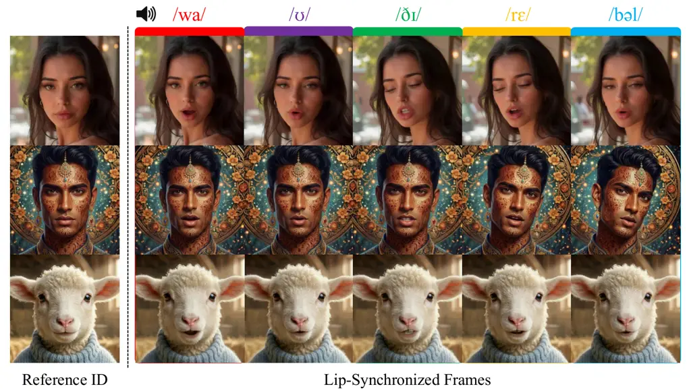
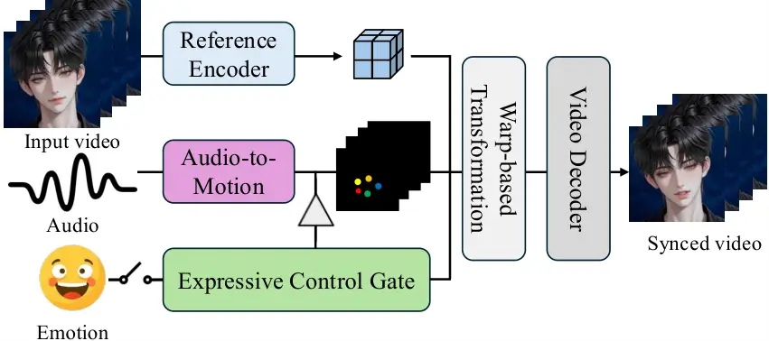
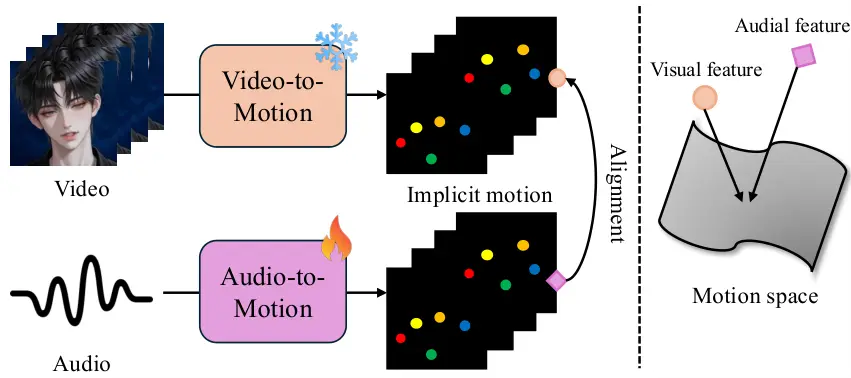
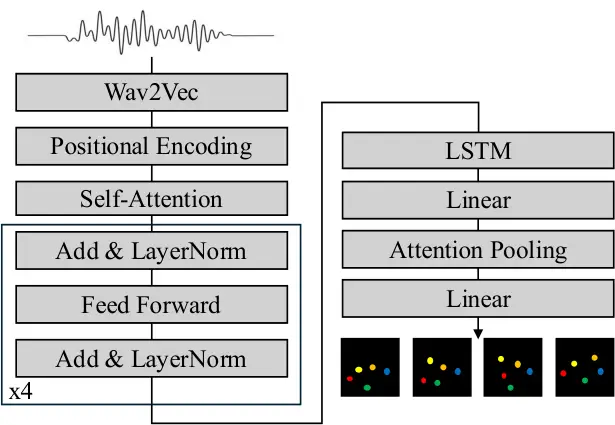
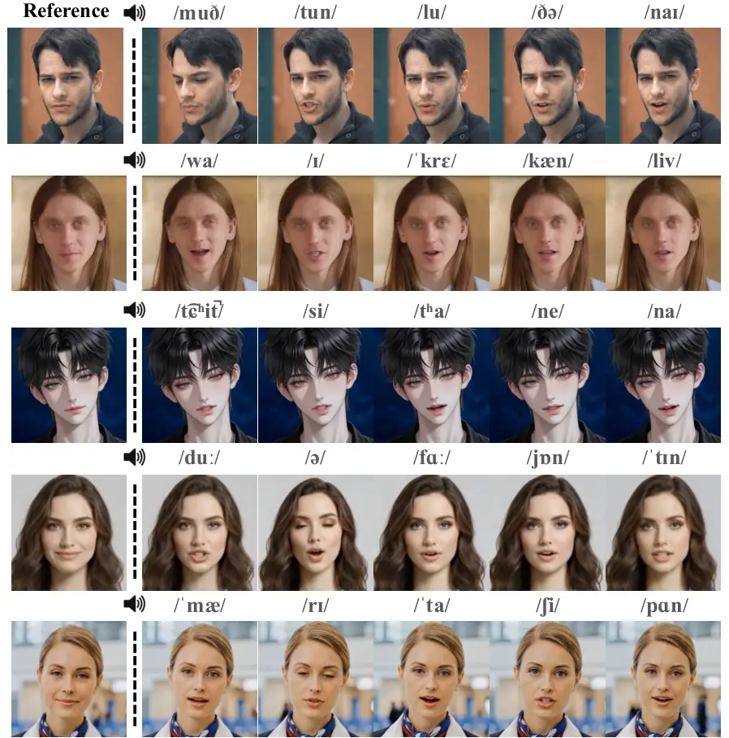
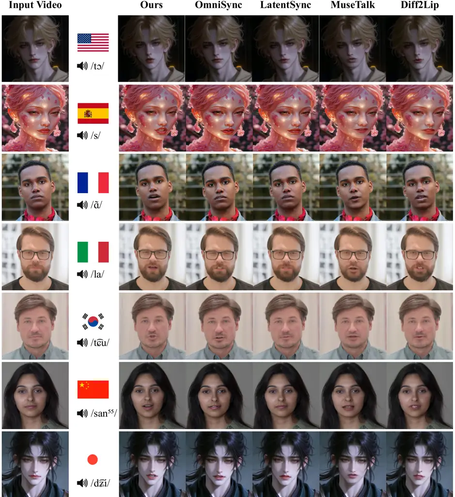
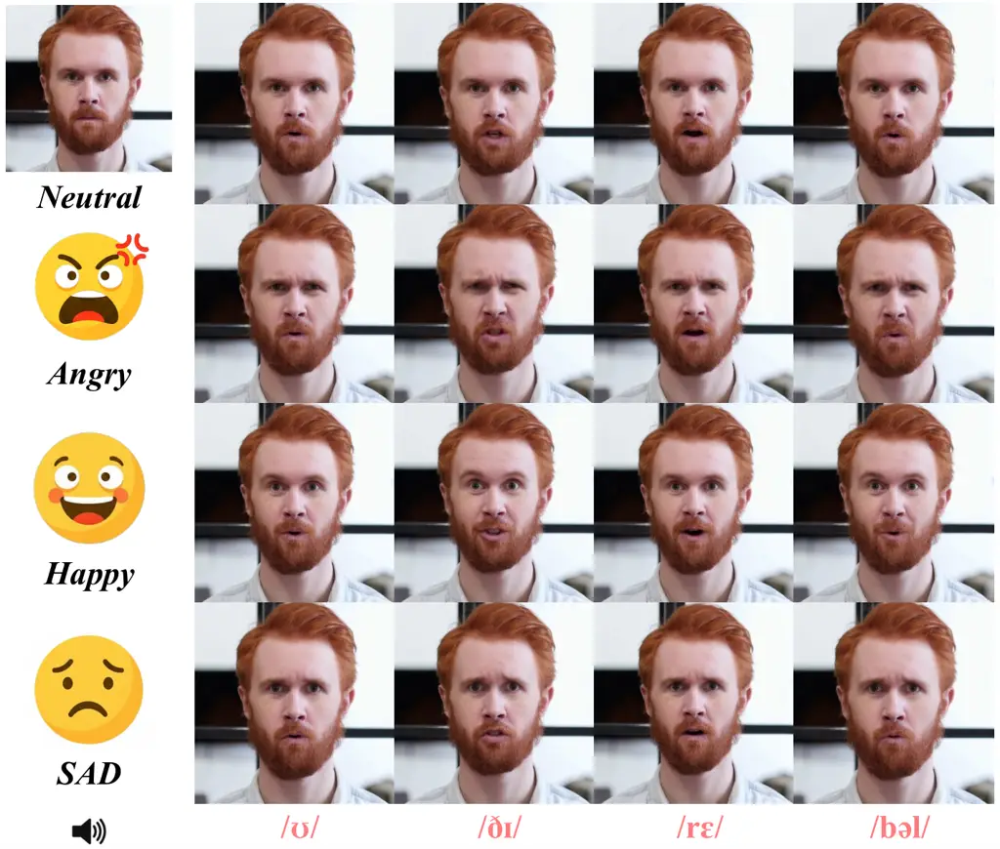
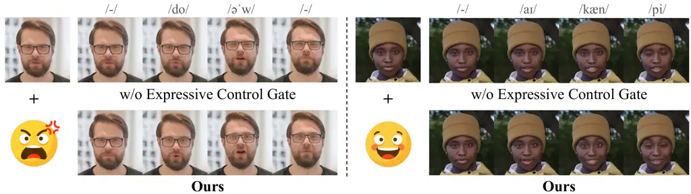

Emo-LiveSync

# Emo-LiveSync: Real-Time Universal Lip Synchronization with Explicit Emotion Control

Sangjoon Yu^(∗)    Seungeun Lee^(∗)    JoonHyeok Shin    Ji-Su Kang

###### Abstract

Lip synchronization, the task of generating realistic lip movements
synchronized with audio signals, is fundamental to applications such as
film dubbing, virtual avatars, and digital content creation. Recent
GAN-based methods offer computational efficiency but often lack visual
fidelity, while diffusion-based approaches achieve high-quality results
at the cost of substantial computational overhead. Moreover, most
existing methods are limited to photo-realistic human faces, restricting
their applicability to stylized characters and non-human entities. In
this paper, we propose an efficient universal lip-sync video generation
framework that achieves high-quality results without compromising
computational efficiency. We build on LivePortrait, a warp-based
portrait animation model, and introduce a training strategy that aligns
audio signals to an implicit motion space by distilling knowledge from a
pre-trained video-to-motion model. This enables real-time inference
while maintaining high visual fidelity, and naturally generalizes to
diverse stylistic characters beyond photo-realistic humans. Furthermore,
we introduce an expressive control gate that enables explicit
manipulation of emotional expressions for content enrichment. Extensive
experiments demonstrate that our method achieves state-of-the-art
performance in both visual quality and lip-sync accuracy while ensuring
real-time inference.

^(†)^(†)email: sangjoon.yu@klleon.io^(†)^(†)email:
seungeun.lee@klleon.io^(†)^(†)email: shinjh0729@g.skku.edu^(†)^(†)email:
jisu.kang@klleon.io^(†)^(†)affiliation: Klleon AI Research  
Seoul, South Korea  
^(†)^(†)affiliation: Sungkyunkwan University  
Suwon, South Korea  
^(∗)Equally contributed co-first authors.

## 1 Introduction



Figure 1: We present an universal model that generates lip-synchronized
video on stylistic humans and characters corresponding to driving audio
sequences. Our method ensures computational efficiency without
sacrificing high visual fidelity.

Lip synchronization, the task of generating realistic lip movements
synchronized with given audio signals, has emerged as a fundamental
problem in computer vision and multimedia applications. This technology
serves as a cornerstone for various downstream applications, including
film dubbing, virtual avatars, video conferencing, and digital content
creation. Despite its practical importance and growing demand, achieving
high-quality lip-synced video generation remains a challenging problem
due to the inherent complexity of modeling the intricate mapping between
audio signals and corresponding facial movements.

Recent advances in generative models have led to significant progress in
lip synchronization. GAN-based approaches \[Prajwal et al.(2020)Prajwal,
Mukhopadhyay, Namboodiri, and Jawahar, Zhang et al.(2023c)Zhang, Hu,
Deng, Fan, Lv, and Ding, Zhong et al.(2023)Zhong, Fang, Cai, Wei, Zhao,
Lin, and Li, Guan et al.(2024)Guan, Xu, Zhou, Wang, He, Zhang, Liang,
Feng, Ding, Liu, et al.\] have demonstrated the ability to generate
lip-synced videos with reasonable efficiency, yet they often struggle to
achieve high visual fidelity, particularly in preserving fine-grained
facial details and temporal consistency. On the other hand,
diffusion-based methods \[Zhong et al.(2024)Zhong, Li, Cai, Li, Gao,
Lin, and Li, Yu et al.(2024)Yu, He, Zhang, Wang, Guo, Tan, Liu, Chen,
and Bian, Liu et al.(2024b)Liu, Du, Fan, Chen, and Yu, Li
et al.(2024)Li, Zhang, Xu, Lin, Xie, Feng, Peng, Chen, and Xing, Ma
et al.(2025)Ma, Wang, Yang, Hu, Liang, Lin, Li, Meng, et al.,
Mukhopadhyay et al.(2024)Mukhopadhyay, Suri, Gadde, and Shrivastava,
Peng et al.(2025)Peng, Liu, Zhang, Liu, Tang, Wan, Zhang, Liu, and He\]
have shown remarkable capability in producing high-fidelity results by
leveraging the powerful generative capacity of large-scale diffusion
models. However, these approaches typically entail substantial
computational costs, making them impractical for real-time or
resource-constrained applications. Consequently, an efficient approach
that does not compromise the visual quality of generated lip-synced
videos remains an open challenge.

Furthermore, most existing lip synchronization methods have been
primarily developed and evaluated on photo-realistic human faces. This
limitation significantly restricts their applicability to universal
domains, such as stylized characters, animated avatars, or non-human
entities. As the demand for lip synchronization in animation, gaming,
and virtual content creation continues to grow, developing methods that
generalize beyond photo-realistic humans becomes increasingly important.

To address these challenges, we revisit warp-based lip synchronization
methods that offer an attractive balance between efficiency and visual
quality. Specifically, we focus on learning a model that maps audio
signals to an implicit motion space. By leveraging LivePortrait \[Guo
et al.(2024)Guo, Zhang, Liu, Zhong, Zhang, Wan, and Zhang\], a
pre-trained video-to-motion model originally designed for portrait image
animation, we propose to align visual and audial features into a shared
motion space represented by implicit keypoints. This approach enables
efficient lip-synced video generation while maintaining high visual
fidelity inherited from the warp-based transformation, and naturally
generalizes to diverse character styles beyond photo-realistic humans.

In addition to achieving efficient and high-fidelity lip
synchronization, we further extend our framework with an expressive
control gate that enables explicit manipulation of emotional
expressions. While most existing methods focus solely on synchronizing
lip movements with audio, they overlook the potential for enriching
generated content with controllable emotional cues. Our expressive
control mechanism allows users to specify emotional transitions through
a frame-wise blending schedule, facilitating diverse and expressive
content generation for applications such as dubbing services and virtual
character animation. To comprehensively validate these capabilities
across linguistically and visually diverse scenarios, we also present
UniVox-Bench, a new evaluation benchmark that encompasses multilingual
speech and diverse subjects including stylistic non-human characters,
going beyond the English-centric and human-only settings of prior
benchmarks.

Our contributions can be summarized as follows. First, we propose an
efficient lip-sync video generation framework that aligns audio signals
to an implicit motion space, achieving real-time inference without
compromising visual fidelity. Second, we introduce a training strategy
that distills knowledge from a pre-trained video-to-motion model,
enabling robust audio-to-motion mapping for universal lip
synchronization across diverse stylistic characters. Third, we present
an expressive control gate that allows explicit manipulation of
emotional expressions, thereby facilitating diverse and enriched content
generation. Finally, we construct UniVox-Bench, a multilingual
evaluation benchmark featuring diverse human and non-human stylistic
subjects, which addresses the limited linguistic and visual coverage of
existing lip synchronization benchmarks.

## 2 Related Work

|                                                                                    |           |           |            |
| ---------------------------------------------------------------------------------- | --------- | --------- | ---------- |
| Method                                                                             | Real-time | Universal | Expressive |
| Wav2Lip \[Prajwal et al.(2020)Prajwal, Mukhopadhyay, Namboodiri, and Jawahar\]     | ✔        | ✗         | ✗          |
| Diff2Lip \[Mukhopadhyay et al.(2024)Mukhopadhyay, Suri, Gadde, and Shrivastava\]   | ✗         | ✗         | ✗          |
| MuseTalk \[Zhang et al.(2024)Zhang, Liu, Chen, Wu, He, Zhan, and Zhou\]            | ✔        | ✗         | ✗          |
| LatentSync \[Li et al.(2024)Li, Zhang, Xu, Lin, Xie, Feng, Peng, Chen, and Xing\]  | ✗         | ✗         | ✗          |
| OmniSync \[Peng et al.(2025)Peng, Liu, Zhang, Liu, Tang, Wan, Zhang, Liu, and He\] | ✗         | ✔        | ✗          |
| Ours                                                                               | ✔        | ✔        | ✔         |

Table 1: Functional comparison across methods. Our approach supports
both real-time inference and universal lip synchronization for diverse
stylistic characters. Furthermore, our method enables explicit user
control over expressions, thereby enriching the contents.

Figure 2: Comparison of lip-sync accuracy (LMD) versus computational
time (FPS) against existing methods with model size. Our approach
ensures lip-sync generation without compromising between visual
high-fidelity and computational efficiency.

### 2.1 Audio-driven Talking Head Generation

Audio-driven talking head generation has undergone several paradigm
shifts. Early methods \[Karras et al.(2017)Karras, Aila, Laine, Herva,
and Lehtinen, Jamaludin et al.(2019)Jamaludin, Chung, and Zisserman,
Wiles et al.(2018)Wiles, Koepke, and Zisserman, Zhou et al.(2020)Zhou,
Han, Shechtman, Echevarria, Kalogerakis, and Li\] learned
person-specific audio-to-face mappings via CNNs and RNNs. Adversarial
training \[Zhou et al.(2019)Zhou, Liu, Liu, Luo, and Wang, Chen
et al.(2019)Chen, Maddox, Duan, and Xu, Vougioukas
et al.(2020)Vougioukas, Petridis, and Pantic, Zhou et al.(2021)Zhou,
Sun, Wu, Loy, Wang, and Liu, Lu et al.(2021)Lu, Chai, and Cao\] then
enabled one-shot synthesis for unseen identities. Several approaches
introduced explicit 3D priors \[Thies et al.(2020)Thies, Elgharib,
Tewari, Theobalt, and Nießner, Zhang et al.(2021a)Zhang, Zhao, Huang,
Zeng, Ni, Budagavi, and Guo, Peng et al.(2024)Peng, Hu, Shi, Zhu, Zhang,
Zhao, He, Liu, and Fan, Ye et al.(2024)Ye, Zhong, Ren, Yang, Li, Huang,
Jiang, He, Huang, Liu, et al., Wei et al.(2024)Wei, Yang, and Wang,
Zhang et al.(2023b)Zhang, Cun, Wang, Zhang, Shen, Guo, Shan, and Wang,
Tang et al.(2025)Tang, Wang, Zhou, Chen, He, Hu, Liu, Liu, Zeng, and
Wang, Sun et al.(2025)Sun, Zhang, Zhu, Zhang, Zhang, Ji, Zhou, Gao, Bo,
and Cao\] or implicit 3D representations \[Guo et al.(2021)Guo, Chen,
Liang, Liu, Bao, and Zhang, Shen et al.(2022)Shen, Li, Zhu, Duan, Zhou,
and Lu, Cho et al.(2024)Cho, Lee, Yoon, Hong, Ko, Ahn, and Kim\] with
free-viewpoint rendering, while Transformers and 3DMM pipelines improved
temporal coherence, and NeRF and 3DGS-based representation increased
photorealism \[Moon et al.(2025)Moon, Lew, Lee, Kang, and Park, Lee
et al.(2026b)Lee, Moon, Lew, Kang, and Park, Lee et al.(2026a)Lee, Moon,
Lew, Kang, and Park\]. Recent works such as \[Shen et al.(2023)Shen,
Zhao, Meng, Li, Zhu, Zhou, and Lu, Ma et al.(2023)Ma, Zhang, Wang, Wang,
Zhang, and Deng, Tian et al.(2024)Tian, Wang, Zhang, and Bo, Xu
et al.(2024b)Xu, Chen, Guo, Yang, Li, Zang, Zhang, Tong, and Guo, Xu
et al.(2024a)Xu, Li, Su, Shang, Zhang, Liu, Wang, Yao, and Zhu, Wang
et al.(2024)Wang, Tian, Zhang, Guan, Luo, Shen, Jiang, Gu, Han, and
Yang, Liu et al.(2024a)Liu, Chen, Fan, Du, Chen, Chen, and Yu, Cui
et al.(2025a)Cui, Li, Yao, Zhu, Shang, Cheng, Zhou, Zhu, and Wang, Gao
et al.(2025)Gao, Hu, Hu, Huang, Ji, Meng, Qi, Qiao, Shen, Song, et al.,
Jiang et al.(2025)Jiang, Liang, Yang, Lin, Zhong, and Zheng, Cui
et al.(2025b)Cui, Li, Zhan, Shang, Cheng, Ma, Mu, Zhou, Wang, and Zhu,
Chen et al.(2025b)Chen, Cao, Chen, Li, and Ma, Wang et al.(2025)Wang,
Wang, Jiang, Fan, Zhang, Qi, Zhao, and Xu, Tian et al.(2025)Tian, Hu,
Wang, Zhang, and Bo, Chen et al.(2025a)Chen, Liang, Zhou, Huang, Ma,
Tang, Lin, Zhou, and Lu, Gan et al.(2025)Gan, Yang, Zhu, Xue, and Hoi,
Wei et al.(2025)Wei, Sun, Ma, Hou, Juefei-Xu, He, Dai, Zhang, Li, Hou,
et al., Lin et al.(2025)Lin, Jiang, Yang, Zheng, Liang, Zhang, and Liu\]
utilize diffusion-based architectures to synthesize realistic talking
head videos from a single reference image and an audio stream.

However, talking head generation differs fundamentally from lip
synchronization. The former lacks constraints to preserve source video
integrity, often redefining the entire spatial-temporal composition.
This is unsuitable for pipelines requiring fixed poses. In contrast,
lip-sync operates within a video-to-video framework, requiring localized
modifications that maintain consistency with original facial features
and lighting. As generative pipelines evolve, specialized lip
synchronization becomes essential as a surgical tool to rectify
phonetic-visual misalignments without altering the original motion
dynamics or artistic intent. Consequently, dedicated lip synchronization
remains a distinct and essential research challenge.

### 2.2 Audio-driven Lip Synchronization

Unlike audio-driven talking head generation that synthesizes full facial
motion from a single image, lip synchronization is a video-to-video
editing task that modifies only the mouth region of a source video to
match target audio, preserving pose, expression, and background. Early
GAN-based methods \[Chung and Zisserman(2016b), K R et al.(2019)K R,
Mukhopadhyay, Philip, Jha, Namboodiri, and Jawahar, Song
et al.(2019)Song, Zhu, Wang, and Qi, Vougioukas et al.(2018)Vougioukas,
Petridis, and Pantic\] established encoder-decoder architectures with
lip-sync discriminators. Wav2Lip \[Prajwal et al.(2020)Prajwal,
Mukhopadhyay, Namboodiri, and Jawahar\] showed that a frozen pre-trained
SyncNet discriminator is critical for sync accuracy, becoming the
standard baseline. Subsequent works improved fidelity via
landmarks \[Zhong et al.(2023)Zhong, Fang, Cai, Wei, Zhao, Lin, and Li,
Wang et al.(2023a)Wang, Qian, Zhang, Tan, and Li\], deformation
fields \[Zhang et al.(2023c)Zhang, Hu, Deng, Fan, Lv, and Ding\],
codebooks \[Wang et al.(2023b)Wang, Zhao, Zhang, Zhang, Shen, Zhao, and
Zhou\], style-based generators \[Guan et al.(2023)Guan, Zhang, Zhou, Hu,
Wang, He, Feng, Liu, Ding, Liu, et al., Ki and Min(2023), Guan
et al.(2024)Guan, Xu, Zhou, Wang, He, Zhang, Liang, Feng, Ding, Liu,
et al.\], and multi-stage pipelines \[Cheng et al.(2022)Cheng, Cun,
Zhang, Xia, Yin, Zhu, Wang, Wang, and Wang, Kim et al.(2019)Kim,
Elgharib, Zollhöfer, Seidel, Beeler, Richardt, and Theobalt, Park
et al.(2022)Park, Kim, Hong, Choi, and Ro\]. Diff2Lip \[Mukhopadhyay
et al.(2024)Mukhopadhyay, Suri, Gadde, and Shrivastava\] first applied
pixel-space diffusion to lip-sync inpainting, surpassing GANs in
perceptual quality. MuseTalk \[Zhang et al.(2024)Zhang, Liu, Chen, Wu,
He, Zhan, and Zhou\] achieves real-time inference via single-step latent
prediction with Whisper features. LatentSync \[Li et al.(2024)Li, Zhang,
Xu, Lin, Xie, Feng, Peng, Chen, and Xing\] introduces end-to-end latent
diffusion with StableSyncNet and temporal alignment to address shortcut
learning. OmniSync \[Peng et al.(2025)Peng, Liu, Zhang, Liu, Tang, Wan,
Zhang, Liu, and He\] proposes mask-free Diffusion Transformers for
generalization to stylized and AI-generated content. Recent
works \[Bigata et al.(2026)Bigata, Mira, Bounareli, Stypułkowski,
Vougioukas, Petridis, and Pantic, Zhang et al.(2025)Zhang, Meng, Xiao,
Wang, Zhang, and Zhang, Ma et al.(2025)Ma, Wang, Yang, Hu, Liang, Lin,
Li, Meng, et al.\] further explore leakage-free generation and
self-bootstrapping training.

However, existing methods generally face a trade-off among quality,
efficiency, and generalization: diffusion-based approaches achieve high
fidelity but incur substantial computational costs, while most methods
remain limited to human faces and offer no control over emotions. In
contrast, our approach aligns audio to an implicit motion space via
knowledge distillation from a pre-trained video-to-motion model,
enabling real-time inference that naturally generalizes to stylized
characters and further supports explicit emotion control.

### 2.3 Warp-based Image Portrait Animation

Unlike audio-driven lip synchronization focusing on mouth regions,
portrait animation transfers full facial motion from a driving source to
a target image; while diffusion-based methods \[Ma et al.(2024)Ma, Liu,
Wang, Pan, He, Yuan, Zeng, Cai, Shum, Liu, and Chen, Xie
et al.(2024)Xie, Wang, Xu, Song, Shi, Chang, Yang, Luo, Feng, and Liu,
Han et al.(2024)Han, Zhu, He, Chen, Ge, Li, Li, Zhang, Wang, and Liu,
Wei et al.(2024)Wei, Yang, and Wang, Hu et al.(2024)Hu, Gao, Zhang, Sun,
Zhang, and Bo, Xu et al.(2024c)Xu, Zhang, Liew, Yan, Liu, Zhang, Feng,
and Shou, Cui et al.(2025b)Cui, Li, Zhan, Shang, Cheng, Ma, Mu, Zhou,
Wang, and Zhu, Xu et al.(2025)Xu, Yu, Zhou, Zhou, Jin, Hong, Ji, Zhu,
Cai, Tang, Lin, Li, and Lu, Li et al.(2026)Li, Pun, Fang, Wang, and
Cun\] show promise, we focus on warping-based approaches. Early works
used 3DMMs or learned warps \[Thies et al.(2016)Thies, Zollhöfer,
Stamminger, Theobalt, and Nießner, Averbuch-Elor
et al.(2017)Averbuch-Elor, Cohen-Or, Kopf, and Cohen, Kim
et al.(2018)Kim, Garrido, Tewari, Xu, Thies, Nießner, Pérez, Richardt,
Zollhöfer, and Theobalt, Wiles et al.(2018)Wiles, Koepke, and Zisserman,
Wu et al.(2018)Wu, Zhang, Li, Qian, and Loy, Ren et al.(2021)Ren, Li,
Chen, Li, and Liu, Doukas et al.(2021)Doukas, Zafeiriou, and
Sharmanska\]. Building on unsupervised keypoints \[Siarohin
et al.(2018)Siarohin, Sangineto, Lathuiliere, and Sebe, Siarohin
et al.(2019b)Siarohin, Lathuiliere, Tulyakov, Ricci, and Sebe\],
FOMM \[Siarohin et al.(2019a)Siarohin, Lathuilière, Tulyakov, Ricci, and
Sebe\] modeled motion via local affine transforms, extended with
iterative refinement \[Nirkin et al.(2019)Nirkin, Keller, and Hassner,
Ha et al.(2020)Ha, Kersner, Kim, Seo, and Kim\], region
decomposition \[Siarohin et al.(2021)Siarohin, Woodford, Ren, Chai, and
Tulyakov\], latent navigation \[Wang et al.(2022)Wang, Yang, Vajda, and
Belongie\], depth awareness \[Hong et al.(2022)Hong, Zhang, Shen, and
Xu\], and thin-plate splines \[Zhao and Zhang(2022)\]. Recent methods
use 3D keypoints \[Wang et al.(2021)Wang, Mallya, and Liu\] for
volumetric warping at high resolution \[Drobyshev et al.(2022)Drobyshev,
Chelishev, Khakhulin, Ivakhnenko, Lempitsky, and Zakharov, Khakhulin
et al.(2022)Khakhulin, Sklyarova, Lempitsky, and Zakharov, Yin
et al.(2022)Yin, Zhang, Cun, Cao, Fan, Wang, Bai, Wu, Wang, and Yang,
Zhang et al.(2023a)Zhang, Qi, Zhang, Zhang, Wu, Chen, Wen, Wang, and
Luo, Drobyshev et al.(2024)Drobyshev, Antal, Khakhulin, Bhattacharjee,
Lempitsky, and Zakharov, Guo et al.(2024)Guo, Zhang, Liu, Zhong, Zhang,
Wan, and Zhang\].

These methods demonstrate distinct advantages in disentangling
appearance from motion properties, thereby enabling the capture and
control of high-fidelity facial expressions while rigorously preserving
the identity of the reference image. In this work, we build upon a
pre-trained warping-based portrait animation model by adapting it as
video-to-motion model. We propose a knowledge distillation strategy that
transfers the mapping of implicit keypoints from the driving video
domain to the audio domain, facilitating real-time and high-fidelity
lip-sync synthesis. Our method ensures robust, identity-consistent
results across various stylistic characters and avatars without
sacrificing computational efficiency.

### 2.4 Emotion Controllability

Early works on emotional talking heads relied on categorical emotion
labels \[Eskimez et al.(2022)Eskimez, Zhang, and Duan, Wang
et al.(2020)Wang, Wu, Song, Yang, Wu, Qian, He, Qiao, and Loy, Li
et al.(2021)Li, Wang, Zhang, Ding, Zheng, Yu, and Fan\], which limits
fine-grained expressiveness. To address this, subsequent methods
disentangled lip motion from upper-face expression for independent
emotion manipulation \[Ji et al.(2021)Ji, Zhou, Wang, Wu, Loy, Cao, and
Xu, Ji et al.(2022)Ji, Zhou, Wang, Wu, Loy, Cao, and Xu, Peng
et al.(2023)Peng, Wu, Song, Xu, Zhu, He, Liu, and Fan, Tan
et al.(2024)Tan, Ji, and Pan, Gan et al.(2023)Gan, Yang, Yue, Sun, and
Yang\], with EMOTE \[Daněček et al.(2023)Daněček, Chhatre, Tripathi,
Wen, Black, and Bolkart\] further introducing decoupled speech-emotion
losses on FLAME to support both emotion type and intensity control.
Controllable emotion has also been pursued in neighboring modalities.
FaceCrafter \[Mishima et al.(2025)Mishima, Casademunt, Petridis, Pantic,
and Suzuki\] inserts lightweight control modules into the
cross-attention layers of an identity-conditional diffusion model, while
IndexTTS2 \[Zhou et al.(2026)Zhou, Zhou, He, Zhou, Wang, Deng, and
Shu\], EmoDubber \[Cong et al.(2025)Cong, Pan, Li, Qi, Peng, Van
Den Hengel, Yang, and Huang\], and EmoSteer-TTS \[Xie et al.(2025)Xie,
Yang, Li, Yu, and Liu\] act on the speech side, respectively
disentangling emotion from speaker timbre, exposing emotion type and
intensity for movie dubbing, and converting emotion without any
training. These works establish the criteria we adopt: semantic
fidelity, continuous rather than discrete intensity, disentanglement
from identity and content, and temporal consistency.

Our setting differs on two axes: these methods act on speech or on a
static image, whereas we manipulate the visual emotion of an existing
video whose head motion and background must be preserved; and they bind
control to a specific trained backbone, through learned adaptors or its
internal activations. In contrast, our module is training-free and
model-agnostic: it synthesizes continuous per-frame expression
displacements through parametric activation envelopes and gating
variables, requiring neither learned parameters nor reference videos and
enabling plug-and-play integration with existing lip-sync backbones.

## 3 Method

### 3.1 System Overview

We present an efficient lip synchronization framework that generates
high-fidelity talking videos from audio signals. Our approach builds
upon a warp-based portrait animation method, LivePortrait \[Guo
et al.(2024)Guo, Zhang, Liu, Zhong, Zhang, Wan, and Zhang\], which
offers an attractive trade-off between computational efficiency and
visual quality. The key insight is that audio and video signals for lip
synchronization can be aligned in a shared motion space represented by
implicit keypoints. It is illustrated in Fig. 4.

Our framework consists of five main components: (1) an audio-to-motion
model $`\mathcal{M}_{A}`$ that predicts implicit keypoints from audio
signals, (2) a video-to-motion model $`\mathcal{M}_{V}`$ that extracts
implicit keypoints from video frames, (3) a warp-based transformation
module that computes dense motion fields, and (4) a video decoder that
synthesizes the final output. To enable expressive content generation,
we additionally introduce (5) an expressive control gate that allows
explicit manipulation of emotional expressions.

During training, we align the audio-to-motion model to the implicit
motion space defined by the pre-trained video-to-motion model \[Guo
et al.(2024)Guo, Zhang, Liu, Zhong, Zhang, Wan, and Zhang\]. Given
paired audio-video data, the video-to-motion model extracts target
keypoints $`\mathbf{k}_{V}`$ from ground-truth video frames, while the
audio-to-motion model predicts keypoints $`\mathbf{k}_{A}`$ from the
corresponding audio. The training objective minimizes the discrepancy
between these two keypoint representations through a combination of
Charbonnier loss for robust alignment, velocity loss for temporal
coherence, and Wing loss for precise localization.

At inference time, given an arbitrary input video and a driving audio
signal, the reference encoder first extracts appearance features from
the input frames. The audio-to-motion model then predicts implicit
keypoints synchronized with the audio, while the video-to-motion model
provides source keypoints from the input video. The warp-based
transformation module computes the motion field between source and
predicted keypoints, which warps the reference features accordingly.
Finally, the video decoder synthesizes lip-synced output frames that
preserve the identity of the input while faithfully reflecting the
audio-driven lip movements. Fig. 4 illustrates the architectural
overview.



Figure 3: System overview of our proposed lip-synced video generation
framework at inference stage. Given a source video and driving audio,
our model produces temporally coherent lip-synced video.



Figure 4: Key concept of learning audio-to-motion model by aligning with
video-to-motion model into an implicit motion space.

### 3.2 Audio-Visual Alignment to Implicit Motion Space

Our goal is to generate lip-synced videos synchronized with speaking
audio signals while ensuring both computational efficiency and high
visual fidelity. To achieve this, we depart from recent large-scale
generative models based on diffusion processes that entail heavy
computational costs, and instead revisit warp-based generative
approaches.

We start from a key hypothesis: audio and video signals for lip
synchronization meet in a shared motion space represented by implicit
keypoints. Building upon this hypothesis, we align an audio-to-motion
model $`\mathcal{M}_{A}`$ to the motion space defined by implicit
keypoints $`\mathbf{k}`$ extracted from a pre-trained video-to-motion
model $`\mathcal{M}_{V}`$ \[Guo et al.(2024)Guo, Zhang, Liu, Zhong,
Zhang, Wan, and Zhang\] , as illustrated in Fig. 4. This is formulated
as minimizing the discrepancy between $`\mathbf{k}_{A}`$ predicted by
$`\mathcal{M}_{A}`$ and $`\mathbf{k}_{V}`$ predicted by
$`\mathcal{M}_{V}`$. The basic alignment objective is defined as the L2
loss: $`\left\|\mathbf{k}_{A}-\mathbf{k}_{V}\right\|_{2}^{2}`$, where
$`\mathbf{k}_{A}=\mathcal{M}_{A}(\mathbf{a})`$ denotes the implicit
keypoints predicted from audio input $`\mathbf{a}`$, and
$`\mathbf{k}_{V}=\mathcal{M}_{V}(\mathbf{v})`$ denotes those extracted
from the corresponding video frames $`\mathbf{v}`$.

To facilitate stable training when aligning two high-dimensional raw
signals from different modalities, we extend the objective to the
Charbonnier loss \[Barron(2019)\] formulation:

```math
\mathcal{L}_{kpt}=\sqrt{\left\|\mathbf{k}_{A}-\mathbf{k}_{V}\right\|^{2}+\epsilon^{2}}, \tag{1}
```

where $`\epsilon`$ is a small constant for numerical stability. The
variant of the L1 loss provides robustness against outliers while
maintaining smooth gradients near zero, which proves beneficial when
bridging the heterogeneous distributions of audio and visual modalities.

To encourage temporally coherent motion and reduce jittering artifacts,
we introduce a velocity loss that penalizes discrepancies in keypoint
dynamics:

```math
\mathcal{L}_{vel}=\|({\mathbf{k}}^{t}_{V}-{\mathbf{k}}^{t-1}_{V})-(\mathbf{k}^{t}_{A}-\mathbf{k}^{t-1}_{A})\|_{2}^{2} \tag{2}
```

This loss ensures that the temporal changes in predicted keypoints from
audio signals match those from visual signals, promoting smooth
transitions between consecutive frames.

We additionally employ the Wing loss \[Feng et al.(2018)Feng, Kittler,
Awais, Huber, and Wu\], which has proven effective for landmark
localization. It is defined as:

```math
\mathcal{L}_{wing}=\begin{cases}w\ln(1+|x|/\kappa)&\text{if }|x|<w\\
|x|-C&\text{otherwise}\end{cases} \tag{3}
```

where $`x={\mathbf{k}}^{t}_{V}-\mathbf{k}^{t}_{A}`$, $`w`$ and
$`\kappa`$ are hyperparameters controlling the nonlinear region, and
$`C=w-w\ln(1+w/\kappa)`$ ensures continuity. The Wing loss applies
stronger gradients to small errors compared to L2 loss, enabling more
precise keypoint localization. The final training objective combines all
three losses:

```math
\mathcal{L}_{total}=\lambda_{kpt}\mathcal{L}_{kpt}+\lambda_{vel}\mathcal{L}_{vel}+\lambda_{wing}\mathcal{L}_{wing} \tag{4}
```

where $`\lambda_{kpt}`$, $`\lambda_{vel}`$, and $`\lambda_{wing}`$ are
weighting factors balancing the contribution of each term.

#### Architecture.



Figure 5: Architecture flow of our proposed audio-to-implicit motion
generation model.

Our audio-to-motion model $`\mathcal{M}_{A}`$ is designed to align audio
sequences to the shared implicit motion space. We build our framework
upon a pre-trained warp-based portrait animation model, borrowing its
transformation module and video decoder, and focus our contribution on
bridging the audio modality to the motion space. As illustrated in
Fig. 5, $`\mathcal{M}_{A}`$ adopts a hybrid Transformer-LSTM
architecture. Given a raw audio, we first extract phonetic and prosodic
representations using a pre-trained Wav2Vec \[Baevski
et al.(2020)Baevski, Zhou, Mohamed, and Auli\]. The features are then
processed by a stack of Transformer encoder blocks to capture long-range
contextual dependencies, followed by an LSTM layer that models the
sequential dynamics of speech for smooth and coherent motion generation.
Finally, the LSTM outputs are aggregated via attention pooling and
projected through a linear layer to produce implicit keypoints
$`\mathbf{k}_{A}\in\mathbb{R}^{N\times D}`$, where $`N`$ and $`D`$
denote the number and dimension of keypoints, respectively. It is
noteworthy that the full set of $`N=21`$ implicit keypoints defined in
\[Guo et al.(2024)Guo, Zhang, Liu, Zhong, Zhang, Wan, and Zhang\] is
retained rather than restricting the prediction to a mouth-region
subset, because lip articulation is not independent of the rest of the
face: jaw rotation, cheek deformation, and the surrounding facial
geometry co-vary with mouth motion, and predicting the complete keypoint
set allows the model to represent these dependencies instead of severing
them.

### 3.3 Expressive Control Gate

Audio-driven lip synchronization produces plausible mouth shapes from
speech, yet the resulting faces often appear emotionally neutral because
speech audio primarily encodes phonemic content; affective cues such as
brow raises or cheek deformations are only weakly correlated with the
acoustic signal. Prior methods \[Gan et al.(2023)Gan, Yang, Yue, Sun,
and Yang, Daněček et al.(2023)Daněček, Chhatre, Tripathi, Wen, Black,
and Bolkart, Ji et al.(2022)Ji, Zhou, Wang, Wu, Loy, Cao, and Xu, Tan
et al.(2024)Tan, Ji, and Pan\] address this by training dedicated
emotion encoders tied to specific architectures. We instead propose a
_training-free, model-agnostic_ emotion injection module based on signal
processing, requiring no learned parameters or reference video.

We define two latent control signals: an activation envelope
$`u^{t}\!\in\![0,1]`$ controlling expression intensity, and a gating
variable $`v^{t}\!\in\![0,1]`$ determining the distribution between two
expression states
$`\boldsymbol{\delta}_{1},\boldsymbol{\delta}_{2}\!\in\!\mathbb{R}^{N\times D}`$.
The final blending weights are $`w_{1}^{t}=u^{t}(1-v^{t})`$ and
$`w_{2}^{t}=u^{t}\cdot v^{t}`$, yielding the emotion-injected keypoints:

```math
\hat{\mathbf{k}}_{A}^{t}=\mathbf{k}_{A}^{t}+w_{1}^{t}\,\boldsymbol{\delta}_{1}+w_{2}^{t}\,\boldsymbol{\delta}_{2}, \tag{5}
```

which are passed to the warp-based transformation module. The two states
$`\boldsymbol{\delta}_{1},\boldsymbol{\delta}_{2}`$ are fixed offsets
constructed once, offline, and are never derived from the video being
edited: for each target emotion we extract implicit keypoints with the
frozen $`\mathcal{M}_{V}`$ from training-set frames (Sec. 4.1) and take
the difference between an expressive and a neutral frame of the same
subject, so that identity-specific geometry cancels and only the
expression component remains. Because the conveyed emotion is a
perceptual rather than a geometric attribute, the representative pair is
determined by human verification instead of an automatic recognizer,
avoiding the domain bias of a classifier trained on photo-realistic
faces; annotators confirm that a candidate is perceived as the intended
emotion and that its displacement magnitude is neither imperceptible nor
exaggerated. The selected states are then frozen and blended identically
into every identity’s audio keypoints, and are added on top of
$`\mathbf{k}_{A}^{t}`$ rather than replacing it, so the gate carries no
learned parameters, preserves the phoneme-driven lip motion, and admits
no test-video content into the model.

Figure 6: Flow diagram of our proposed expressive control gate for
injection and transition of emotion states.

The base activation envelope $`u_{\mathrm{base}}`$ is constructed by
concatenating rise–hold–fall segments with cosine easing:

```math
u_{\mathrm{base}}(t)\!=\!\begin{cases}\tfrac{1}{2}\bigl(1-\cos\bigl(\pi\tfrac{t-t_{r}}{t_{h}-t_{r}}\bigr)\bigr),&t_{r}\!\leq\!t\!<\!t_{h}\\[2.0pt]
1,&t_{h}\!\leq\!t\!<\!t_{f}\\[2.0pt]
\tfrac{1}{2}\bigl(1+\cos\bigl(\pi\tfrac{t-t_{f}}{t_{e}-t_{f}}\bigr)\bigr),&t_{f}\!\leq\!t\!<\!t_{e}\\[2.0pt]
0,&\text{otherwise}\end{cases} \tag{6}
```

where $`t_{r},t_{h},t_{f},t_{e}`$ denote the rise start, hold start,
fall start, and fall end times. To enhance realism, we inject
band-limited jitter with amplitude proportional to the activation level:
$`u_{\mathrm{jitter}}^{t}=u_{\mathrm{base}}^{t}\,(1+\alpha\,n_{\mathrm{BL}}^{t})`$,
where $`\alpha`$ controls jitter intensity and
$`n_{\mathrm{BL}}^{t}=\mathrm{BandPass}_{[f_{l},f_{h}]}(\epsilon^{t})`$,
$`\epsilon^{t}\!\sim\!\mathcal{N}(0,1)`$. The signal is then stabilized
via exponential moving average (EMA) smoothing followed by slew-rate
limiting:

```math
\tilde{u}^{t}=\beta\,\tilde{u}^{t-1}+(1-\beta)\,u_{\mathrm{jitter}}^{t},\quad u^{t}=\tilde{u}^{t-1}+\mathrm{clamp}\!\left(\tilde{u}^{t}-\tilde{u}^{t-1},\,-s_{\max},\,s_{\max}\right), \tag{7}
```

where $`\beta\!\in\!(0,1)`$ is the smoothing factor and $`s_{\max}`$
bounds the maximum per-frame change, suppressing abrupt transitions. The
gating signal $`v^{t}`$ transitions smoothly between two expression
states via cosine interpolation:
$`v^{t}=\tfrac{1}{2}\bigl(1-\cos\bigl(\pi(t-t_{s})/(t_{e}-t_{s})\bigr)\bigr)`$
for $`t_{s}\!\leq\!t\!\leq\!t_{e}`$, where $`t_{s}`$ and $`t_{e}`$ are
the transition boundaries. Finally, both $`u`$ and $`v`$ are resampled
to match the target frame count $`T`$ via linear interpolation for
$`t\!=\!0,\ldots,T\!-\!1`$, enabling length-independent application
across varying video durations.

## 4 Experiments

### 4.1 Experimental Setup

#### Dataset.

We evaluate on two standard benchmarks: HDTF \[Zhang et al.(2021b)Zhang,
Li, Ding, and Fan\], comprising 720p+ talking-face videos, and
VoxCeleb2 \[Chung et al.(2018)Chung, Nagrani, and Zisserman\],
comprising in-the-wild celebrity utterances. We randomly select 50
subjects in total, 20 from HDTF and 30 from VoxCeleb2, ensuring
diversity in identity, pose, and audio characteristics. We further
introduce UniVox-Bench, since prior benchmarks \[Zhang
et al.(2021b)Zhang, Li, Ding, and Fan, Chung et al.(2018)Chung, Nagrani,
and Zisserman, Peng et al.(2025)Peng, Liu, Zhang, Liu, Tang, Wan, Zhang,
Liu, and He\] are restricted to predominantly English speech and/or real
human subjects. It comprises 34 subjects, 46% real humans and 54%
non-human stylistic characters including cartoon, anime and animals,
paired with speech spanning seven languages: English, Chinese, French,
Italian, Japanese, Korean, and Spanish. It is collected via web crawling
and AI content generator with ElevenLabs \[ElevenLabs(2024)\] and
Gemini \[Gemini Team, Google(2024)\].

#### Metrics.

We evaluate visual fidelity, identity preservation, and lip
synchronization. For visual fidelity, we report PSNR and LPIPS for
per-frame reconstruction, FID \[Heusel et al.(2017)Heusel, Ramsauer,
Unterthiner, Nessler, and Hochreiter\] for distributional similarity to
real frames, FVD \[Unterthiner et al.(2018)Unterthiner, Van Steenkiste,
Kurach, Marinier, Michalski, and Gelly\] for temporal coherence, and
HyperIQA \[Su et al.(2020)Su, Yan, Zhu, Zhang, Ge, Sun, and Zhang\], a
no-reference metric that scores perceptual quality without ground truth.
Identity preservation is measured by CSIM, the cosine similarity between
identity embeddings of the source and generated videos. For lip
synchronization, we use LMD, the landmark distance capturing geometric
alignment of lip movements, and AVS \[Yaman et al.(2024b)Yaman, Eyiokur,
Bärmann, Ekenel, and Waibel, Yaman et al.(2024a)Yaman, Eyiokur, Bärmann,
Akti, Ekenel, and Waibel\], a reference-free score computing the cosine
similarity between audio and visual features of a pretrained AV
model \[Shi et al.(2022)Shi, Hsu, Lakhotia, and Mohamed\]. We exclude
the SyncNet-based metric LSE-C \[Prajwal et al.(2020)Prajwal,
Mukhopadhyay, Namboodiri, and Jawahar\] on HDTF and VoxCeleb2 since
several baselines train with SyncNet loss, which biases the score in
their favor on these datasets.

#### Implementation details.

Our model takes as input a source video of arbitrary length with
512$`\times`$512 resolution, along with driving audio sampled at 16 kHz.
The audio-to-motion is aligned onto implicit motion space, which
consists of $`N=21`$ keypoints. For training, we utilize Lip Reading in
the Wild (LRW) dataset \[Chung and Zisserman(2016a)\] without additional
data augmentation. The expression states
$`\boldsymbol{\delta}_{1},\boldsymbol{\delta}_{2}`$ of the expressive
control gate are likewise built from the LRW training split, which is
disjoint from evaluations; the offsets are thus constructed entirely
outside the evaluation data and remain fixed across all subjects and
benchmarks. The training objective is weighted with
$`\lambda_{kpt}=\lambda_{vel}=1`$ and $`\lambda_{wing}=1.5`$, with the
Wing loss parameters set to $`w=10`$. We employ Adam optimizer \[Kingma
and Ba(2015)\] with $`\beta_{1}`$ = 0.9 and $`\beta_{2}`$ = 0.99, and
learning rate of 1e-4. The training is conducted on a single NVIDIA A100
GPU.

|                                                                                    |                   |                   |                  |                     |                  |                   |                 |                   |                   |                  |                     |                  |                   |                 |
| ---------------------------------------------------------------------------------- | ----------------- | ----------------- | ---------------- | ------------------- | ---------------- | ----------------- | --------------- | ----------------- | ----------------- | ---------------- | ------------------- | ---------------- | ----------------- | --------------- |
|                                                                                    | HDTF              |                   |                  |                     |                  |                   |                 | VoxCeleb2         |                   |                  |                     |                  |                   |                 |
|                                                                                    | Gen. Quality      |                   | Recon. Quality   |                     |                  | Lip-Sync          |                 | Gen. Quality      |                   | Recon. Quality   |                     |                  | Lip-Sync          |                 |
| Methods                                                                            | FID$`\downarrow`$ | FVD$`\downarrow`$ | PSNR$`\uparrow`$ | LPIPS$`\downarrow`$ | CSIM$`\uparrow`$ | LMD$`\downarrow`$ | AVS$`\uparrow`$ | FID$`\downarrow`$ | FVD$`\downarrow`$ | PSNR$`\uparrow`$ | LPIPS$`\downarrow`$ | CSIM$`\uparrow`$ | LMD$`\downarrow`$ | AVS$`\uparrow`$ |
| Wav2Lip \[Prajwal et al.(2020)Prajwal, Mukhopadhyay, Namboodiri, and Jawahar\]     | 12.50             | 304.35            | 30.65            | 0.135               | 0.818            | 7.88              | 0.3742          | 10.80             | 257.85            | 30.48            | 0.146               | 0.791            | 7.91              | 0.3658          |
| Diff2Lip \[Mukhopadhyay et al.(2024)Mukhopadhyay, Suri, Gadde, and Shrivastava\]   | 10.30             | 260.45            | 33.04            | 0.122               | 0.905            | 5.32              | 0.3886          | 9.80              | 210.45            | 34.82            | 0.057               | 0.932            | 5.80              | 0.3950          |
| MuseTalk \[Zhang et al.(2024)Zhang, Liu, Chen, Wu, He, Zhan, and Zhou\]            | 9.35              | 246.75            | 35.06            | 0.062               | 0.932            | 4.98              | 0.4103          | 7.10              | 203.43            | 34.57            | 0.064               | 0.905            | 4.98              | 0.4021          |
| LatentSync \[Li et al.(2024)Li, Zhang, Xu, Lin, Xie, Feng, Peng, Chen, and Xing\]  | 7.22              | 151.00            | 35.16            | 0.039               | 0.958            | 3.86              | 0.5174          | 5.70              | 85.75             | 34.82            | 0.042               | 0.958            | 4.61              | 0.5081          |
| OmniSync \[Peng et al.(2025)Peng, Liu, Zhang, Liu, Tang, Wan, Zhang, Liu, and He\] | 13.75             | 169.44            | 36.01            | 0.032               | 0.966            | 3.17              | 0.5352          | 16.64             | 71.38             | 35.16            | 0.049               | 0.940            | 4.22              | 0.5288          |
| Ours                                                                               | 5.64              | 66.77             | 36.67            | 0.026               | 0.983            | 2.74              | 0.5618          | 4.64              | 52.26             | 36.41            | 0.021               | 0.985            | 3.21              | 0.5525          |

Table 2: Quantitative comparison with existing lip-sync video generation
methods on HDTF and VoxCeleb2 datasets. Best: bolded, and second:
underlined.

|                                                                                    |                    |                  |                             |                         |                      |
| ---------------------------------------------------------------------------------- | ------------------ | ---------------- | --------------------------- | ----------------------- | -------------------- |
| Methods                                                                            | LMD $`\downarrow`$ | FPS $`\uparrow`$ | Latency (ms) $`\downarrow`$ | \#Params $`\downarrow`$ | FLOPs $`\downarrow`$ |
| MuseTalk \[Zhang et al.(2024)Zhang, Liu, Chen, Wu, He, Zhan, and Zhou\]            | 4.98               | 11.71            | 85.34                       | 933.60M                 | 1,330.92G            |
| Diff2Lip \[Mukhopadhyay et al.(2024)Mukhopadhyay, Suri, Gadde, and Shrivastava\]   | 5.80               | 3.70             | 267.17                      | 101.67M                 | 3810.36G             |
| LatentSync \[Li et al.(2024)Li, Zhang, Xu, Lin, Xie, Feng, Peng, Chen, and Xing\]  | 4.61               | 6.17             | 162.07                      | 1,350.75M               | 781.03T              |
| OmniSync \[Peng et al.(2025)Peng, Liu, Zhang, Liu, Tang, Wan, Zhang, Liu, and He\] | 4.22               | 4.01             | 249.37                      | -                       | -                    |
| Ours                                                                               | 3.21               | 24.00            | 41.66                       | 126.59M                 | 649.71G              |

Table 3: Report of computational cost compared to the existing methods.
It is measured on a single RTX 3090 GPU device. Best: bolded, and
second: underlined.

|                                                                                    |                    |                    |                       |                    |                  |
| ---------------------------------------------------------------------------------- | ------------------ | ------------------ | --------------------- | ------------------ | ---------------- |
| Methods                                                                            | FID $`\downarrow`$ | FVD $`\downarrow`$ | HyperIQA $`\uparrow`$ | LSE-C $`\uparrow`$ | AVS $`\uparrow`$ |
| MuseTalk \[Zhang et al.(2024)Zhang, Liu, Chen, Wu, He, Zhan, and Zhou\]            | 28.41              | 312.57             | 62.34                 | 4.66               | 5.87             |
| Diff2Lip \[Mukhopadhyay et al.(2024)Mukhopadhyay, Suri, Gadde, and Shrivastava\]   | 33.10              | 358.92             | 58.76                 | 7.01               | 5.21             |
| LatentSync \[Li et al.(2024)Li, Zhang, Xu, Lin, Xie, Feng, Peng, Chen, and Xing\]  | 26.32              | 287.43             | 64.51                 | 5.87               | 6.34             |
| OmniSync \[Peng et al.(2025)Peng, Liu, Zhang, Liu, Tang, Wan, Zhang, Liu, and He\] | 24.08              | 263.15             | 67.23                 | 3.01               | 6.82             |
| Ours                                                                               | 18.34              | 198.71             | 72.86                 | 7.14               | 7.95             |

Table 4: Quantitative comparison of visual quality and audio-visual
synchronization metrics on UniVox including multi-lingual speeches and
stylistic characters. Best: bolded, and second: underlined.

### 4.2 Comparison to State-of-the-Art Methods

For fair comparison, the expressive control gate is disabled throughout
the quantitative evaluation, so that Table 2 & 4 measure lip
synchronization alone under the same condition as the baselines. We
compare our method with existing state-of-the-art lip-sync video
generation methods \[Prajwal et al.(2020)Prajwal, Mukhopadhyay,
Namboodiri, and Jawahar, Mukhopadhyay et al.(2024)Mukhopadhyay, Suri,
Gadde, and Shrivastava, Zhang et al.(2024)Zhang, Liu, Chen, Wu, He,
Zhan, and Zhou, Li et al.(2024)Li, Zhang, Xu, Lin, Xie, Feng, Peng,
Chen, and Xing, Peng et al.(2025)Peng, Liu, Zhang, Liu, Tang, Wan,
Zhang, Liu, and He\] on the HDTF and VoxCeleb2 datasets. For each
method, we conduct evaluation using its publicly available code and
checkpoints. For OmniSync, since only a web demo¹¹ 1
[https://klingai.com/app/ai-human/video](https://klingai.com/app/ai-human/video)
is available, we generate lip-synced videos through its online
interface. As shown in Table 2, our method achieves the best performance
across all metrics on both HDTF and VoxCeleb2 datasets. In terms of
generation quality, we obtain the lowest FID and FVD scores, indicating
superior frame-level realism and temporal coherence compared to all
baselines. For reconstruction quality, our method attains the highest
PSNR and CSIM while achieving the lowest LPIPS, demonstrating faithful
preservation of visual details and source identity. Regarding lip
synchronization, we achieve the lowest LMD and the highest AVS on both
datasets, confirming that our method produces more accurate and
temporally aligned lip movements. In Table 4, we further evaluate on
UniVox-Bench, a more challenging benchmark comprising multi-lingual
speeches and stylistically diverse characters. Our method consistently
outperforms all competitors across every metric, achieving the best FID,
FVD, and HyperIQA scores for visual quality, as well as the highest
LSE-C and AVS for lip-sync accuracy. These results demonstrate that our
approach generalizes robustly beyond standard English-centric benchmarks
to diverse linguistic and visual conditions. In Table 4, we report
frames per second (FPS) and number of model parameters (#Params) to
evaluate computational efficiency. It is measured on a single RTX 3090
GPU. Since OmniSync does not provide officially available code, we
cannot report its \#Params, and instead report FPS calculated from the
time required to generate lip-synced videos through its available demo
page. These results demonstrate that our method is computationally
efficient, enabling real-time inference without compromising high visual
fidelity.



Figure 7: Qualitative results of our method. It faithfully generates
lip-synchronized videos according to driving audios across subjects.



Figure 8: Qualitative comparison on UniVoxBench. Our method exhibit
robust lip synchronization on multi lingual speeches across
human/stylistic characters.



Figure 9: The effectiveness of expressive control gate. It enables
explicit emotion control for diverse and enriched content generation.

Figure 10: User study comparing our method with the state-of-the-art
baseline across identity preservation, synchronization, and visual
synthesis. Our method consistently outperforms the baseline in all
metrics; Error bar: std. err., \*\*\*: $`p<0.001`$.

### 4.3 Visual Analysis

Fig. 8 presents temporal lip-sync results across diverse human and
non-human characters, demonstrating highly consistent universal
synchronization. In Fig. 15 and Fig. 16, we compare with GAN-based and
diffusion-based methods; our approach achieves competitive visual
quality while maintaining robust performance even for stylistic
characters where most existing methods fail. These results suggest that
aligning auditory and visual signals in an implicit motion space offers
a compelling and efficient alternative to diffusion-based approaches. We
further report quantitative multilingual comparisons on UniVox-Bench in
Fig. 8, where existing methods exhibit acceptable synchronization only
for limited languages or human subjects, while ours consistently
achieves robust performance across all languages, validating the
generalizability of our disentangled motion representation.

### 4.4 Ablation Study and Analysis

In Fig. 12, we present ablation experiments on the loss functions
designed for distilling knowledge from the video-to-implicit motion
space mapping model to the audio-to-implicit motion space mapping model.
We start from a baseline using L2 loss between implicit keypoints mapped
from video and those mapped from audio. We then sequentially add
$`\mathcal{L}_{vel}`$ and $`\mathcal{L}_{wing}`$. We evaluate on five
subjects including stylistic characters, measuring PSNR for visual
fidelity, CSIM for identity preservation, and LMD for lip
synchronization. Compared to the baseline, the velocity loss improves
performance by 1.1% across all metrics. Furthermore, the wing loss
yields an additional improvement of 8.7% across all metrics. These
results demonstrate the effectiveness of our proposed objectives for
audio-to-motion mapping. We also investigate architecture design choices
for the audio-to-implicit motion generation model in Fig. 12. We compare
our proposed architecture against a Transformer-based variant and a
plain MLP, evaluating convergence behavior across Charbonnier, velocity,
and MSE losses. As shown, our design achieves both faster convergence
and lower final loss values, exhibiting superior stability and
optimality over the alternative configurations. Beyond generating video
content aligned with the context conveyed in the audio, we introduce an
additional intriguing capability. Through an expressive control gate, we
incorporate an optional emotion amplification component for diverse and
rich content generation. In Fig. 10, we demonstrate lip-synchronized
videos generated from the same audio signal with three distinct emotions
injected. The results show that our method produces expressive videos
corresponding to the injected emotions. To confirm that this
expressiveness does not come at the cost of synchronization, Fig. 13
compares generated frames with and without the expressive control gate
at matched phonemes. At each sampled phoneme, the mouth remains
articulated consistently with the underlying speech in both settings,
while the brows, cheeks, and eyes carry the injected emotion. Since the
gate applies its offsets additively on top of the audio-predicted
keypoints, the phoneme-driven articulation established by our alignment
objective is retained, and emotion enters as a complementary rather than
a competing signal. We anticipate that this proposed approach will serve
as a compelling element for application to video dubbing services.

Figure 11: Ablation study of each loss component $`\mathcal{L}_{vel}`$
and $`\mathcal{L}_{wing}`$ for audio-to-implicit motion generation. Both
terms prove essential for knowledge distillation of the audio-motion
mapping, with removal of either causing notable sync degradation.

Figure 12: Ablation study of architecture design choices for the
audio-to-implicit motion generation model. The proposed architecture
demonstrates superior convergence stability and optimality over
alternative design configurations.



Figure 13: The visual effectiveness on the proposed expressive control
gate.

### 4.5 User Study

We conduct an A/B test comparing our method against a state-of-the-art
method \[Peng et al.(2025)Peng, Liu, Zhang, Liu, Tang, Wan, Zhang, Liu,
and He\]. 19 participants rate their preference on a 5-point scale along
three aspects: identity preservation, lip synchronization, and visual
quality. As reported in Fig. 10, our method is preferred across all
three, and a paired $`t`$-test on the preference scores confirms that
the margin is significant ($`p=1.42\times 10^{-9}`$). Together with the
efficiency reported in Tab. 4, this validates the core motivation of
this work, high visual fidelity without compromising computational
efficiency, under human judgment rather than automatic metrics alone.

Figure 14: Perceptual ablation on the expressive control gate.

We further evaluate the expressive control gate with the same
participants. Since automatic emotion metrics collapse continuous
expression into discrete categories and overlook temporal naturalness, a
central design objective of our gate, we assess it perceptually. For
seven source identities spanning diverse ethnicities and genders, we
inject happy, angry, and sad emotions, yielding 21 comparison pairs per
participant, each rated on a 5-point mean opinion score scale with and
without the gate. As reported in Fig. 14, the gate raises the score from
1.87 to 4.03 for happy, 2.17 to 3.83 for angry, and 1.80 to 4.20 for
sad, with an overall mean of 4.02 and lip synchronization reported as
unaffected. Participants noted that the upturned mouth corners induced
by larger lip openings occasionally weakened the perceived intensity of
angry expressions, consistent with its lower score.

## 5 Conclusion

In this paper, we propose an efficient universal lip-synced video
generation method that achieves high-quality lip synchronization without
compromising visual fidelity. Leveraging LivePortrait with pre-trained
implicit keypoints, we introduce a training strategy that distills
knowledge from a pre-trained video-to-motion model into
audio-to-implicit-motion mapping, optimized with complementary
Charbonnier, velocity, and Wing losses for stable cross-modal alignment.
The consistent deformation provided by the warping module enables both
high-fidelity results and real-time inference, while naturally
generalizing to stylistic non-human characters beyond humans. We further
propose a training-free, model-agnostic expressive control gate that
explicitly manipulates emotions through parametric activation envelopes,
enriching contents without additional supervision. Extensive experiments
demonstrate that our approach is both robust and effective for lip
synchronization, offering a compelling alternative to computationally
expensive diffusion-based methods.

![[Uncaptioned
image]](arxiv-2611-09074v1--1bbb9cb7a17c.figures/figure-9.webp)

Figure 15: Qualitative comparison with previous lip-sync video methods
on human subjects.

![[Uncaptioned
image]](arxiv-2611-09074v1--1bbb9cb7a17c.figures/figure-10.webp)

Figure 16: Qualitative comparison with previous lip-sync video methods
on characters.

## References

- \[Averbuch-Elor et al.(2017)Averbuch-Elor, Cohen-Or, Kopf, and Cohen\]
  Hadar Averbuch-Elor, Daniel Cohen-Or, Johannes Kopf, and Michael F.
  Cohen. Bringing portraits to life. In _ACM TOG_, 2017.
- \[Baevski et al.(2020)Baevski, Zhou, Mohamed, and Auli\] Alexei
  Baevski, Yuhao Zhou, Abdelrahman Mohamed, and Michael Auli. wav2vec
  2.0: A framework for self-supervised learning of speech
  representations. In _NeurIPS_, 2020.
- \[Barron(2019)\] Jonathan T Barron. A general and adaptive robust loss
  function. In _CVPR_, 2019.
- \[Bigata et al.(2026)Bigata, Mira, Bounareli, Stypułkowski,
  Vougioukas, Petridis, and Pantic\] Antoni Bigata, Rodrigo Mira, Stella
  Bounareli, Michał Stypułkowski, Konstantinos Vougioukas, Stavros
  Petridis, and Maja Pantic. KeySync: A robust approach for leakage-free
  lip synchronization in high resolution. In _TMLR_, 2026.
- \[Chen et al.(2019)Chen, Maddox, Duan, and Xu\] Lele Chen, Ross K
  Maddox, Zhiyao Duan, and Chenliang Xu. Hierarchical cross-modal
  talking face generation with dynamic pixel-wise loss. In _CVPR_, 2019.
- \[Chen et al.(2025a)Chen, Liang, Zhou, Huang, Ma, Tang, Lin, Zhou, and
  Lu\] Yi Chen, Sen Liang, Zixiang Zhou, Ziyao Huang, Yifeng Ma, Junshu
  Tang, Qin Lin, Yuan Zhou, and Qinglin Lu. HunyuanVideo-Avatar:
  High-fidelity audio-driven human animation for multiple characters. In
  _arXiv:2505.20156_, 2025a.
- \[Chen et al.(2025b)Chen, Cao, Chen, Li, and Ma\] Zhiyuan Chen,
  Jiajiong Cao, Zhiquan Chen, Yuming Li, and Chenguang Ma. EchoMimic:
  Lifelike audio-driven portrait animations through editable landmark
  conditions. In _AAAI_, 2025b.
- \[Cheng et al.(2022)Cheng, Cun, Zhang, Xia, Yin, Zhu, Wang, Wang, and
  Wang\] Kun Cheng, Xiaodong Cun, Yong Zhang, Menghan Xia, Fei Yin,
  Mingrui Zhu, Xuan Wang, Jue Wang, and Nannan Wang. VideoReTalking:
  Audio-based lip synchronization for talking head video editing in the
  wild. In _SIGGRAPH Asia_, 2022.
- \[Cho et al.(2024)Cho, Lee, Yoon, Hong, Ko, Ahn, and Kim\] Kyusun Cho,
  Joungbin Lee, Heeji Yoon, Yeobin Hong, Jaehoon Ko, Sangjun Ahn, and
  Seungryong Kim. GaussianTalker: Real-time talking head synthesis with
  3D Gaussian splatting. In _ACM MM_, 2024.
- \[Chung and Zisserman(2016a)\] Joon Son Chung and Andrew Zisserman.
  Lip reading in the wild. In _ACCV_, 2016a.
- \[Chung and Zisserman(2016b)\] Joon Son Chung and Andrew Zisserman.
  Out of time: Automated lip sync in the wild. In _ACCV_, 2016b.
- \[Chung et al.(2018)Chung, Nagrani, and Zisserman\] Joon Son Chung,
  Arsha Nagrani, and Andrew Zisserman. VoxCeleb2: Deep speaker
  recognition. In _Interspeech_, 2018.
- \[Cong et al.(2025)Cong, Pan, Li, Qi, Peng, Van Den Hengel, Yang, and
  Huang\] Gaoxiang Cong, Jiadong Pan, Liang Li, Yuankai Qi, Yuxin Peng,
  Anton Van Den Hengel, Jian Yang, and Qingming Huang. EmoDubber:
  Towards high quality and emotion controllable movie dubbing. In
  _CVPR_, 2025.
- \[Cui et al.(2025a)Cui, Li, Yao, Zhu, Shang, Cheng, Zhou, Zhu, and
  Wang\] Jiahao Cui, Hui Li, Yao Yao, Hao Zhu, Hanlin Shang, Kaihui
  Cheng, Hang Zhou, Siyu Zhu, and Jingdong Wang. Hallo2: Long-duration
  and high-resolution audio-driven portrait image animation. In _ICLR_,
  2025a.
- \[Cui et al.(2025b)Cui, Li, Zhan, Shang, Cheng, Ma, Mu, Zhou, Wang,
  and Zhu\] Jiahao Cui, Hui Li, Yun Zhan, Hanlin Shang, Kaihui Cheng,
  Yuqi Ma, Shan Mu, Hang Zhou, Jingdong Wang, and Siyu Zhu. Hallo3:
  Highly dynamic and realistic portrait image animation with video
  diffusion transformer. In _CVPR_, 2025b.
- \[Daněček et al.(2023)Daněček, Chhatre, Tripathi, Wen, Black, and
  Bolkart\] Radek Daněček, Kiran Chhatre, Shashank Tripathi, Yandong
  Wen, Michael J. Black, and Timo Bolkart. Emotional speech-driven
  animation with content-emotion disentanglement. In _SIGGRAPH
  Asia_, 2023.
- \[Doukas et al.(2021)Doukas, Zafeiriou, and Sharmanska\]
  Michail Christos Doukas, Stefanos Zafeiriou, and Viktoriia Sharmanska.
  HeadGAN: One-shot neural head synthesis and editing. In _ICCV_, 2021.
- \[Drobyshev et al.(2022)Drobyshev, Chelishev, Khakhulin, Ivakhnenko,
  Lempitsky, and Zakharov\] Nikita Drobyshev, Jenya Chelishev, Taras
  Khakhulin, Aleksei Ivakhnenko, Victor Lempitsky, and Egor Zakharov.
  MegaPortraits: One-shot megapixel neural head avatars. In _ACM
  MM_, 2022.
- \[Drobyshev et al.(2024)Drobyshev, Antal, Khakhulin, Bhattacharjee,
  Lempitsky, and Zakharov\] Nikita Drobyshev, Antoni Antal, Taras
  Khakhulin, Daniil Bhattacharjee, Victor Lempitsky, and Egor Zakharov.
  EMOPortraits: Emotion-enhanced multimodal one-shot head avatars. In
  _CVPR_, 2024.
- \[ElevenLabs(2024)\] ElevenLabs. ElevenLabs Text-to-Speech Platform.
  [https://elevenlabs.io](https://elevenlabs.io), 2024.
- \[Eskimez et al.(2022)Eskimez, Zhang, and Duan\] Sefik Emre Eskimez,
  You Zhang, and Zhiyao Duan. Speech driven talking face generation from
  a single image and an emotion condition. In _IEEE TMM_, 2022.
- \[Feng et al.(2018)Feng, Kittler, Awais, Huber, and Wu\] Zhen-Hua
  Feng, Josef Kittler, Muhammad Awais, Patrik Huber, and Xiao-Jun Wu.
  Wing loss for robust facial landmark localisation with convolutional
  neural networks. In _CVPR_, 2018.
- \[Gan et al.(2025)Gan, Yang, Zhu, Xue, and Hoi\] Qijun Gan, Ruizi
  Yang, Jianke Zhu, Shaofei Xue, and Steven Hoi. OmniAvatar: Efficient
  audio-driven avatar video generation with adaptive body animation. In
  _arXiv:2506.18866_, 2025.
- \[Gan et al.(2023)Gan, Yang, Yue, Sun, and Yang\] Yuan Gan, Zongxin
  Yang, Xihang Yue, Lingyun Sun, and Yi Yang. Efficient emotional
  adaptation for audio-driven talking-head generation. In _ICCV_, 2023.
- \[Gao et al.(2025)Gao, Hu, Hu, Huang, Ji, Meng, Qi, Qiao, Shen, Song,
  et al.\] Xin Gao, Li Hu, Siqi Hu, Mingyang Huang, Chaonan Ji, Dechao
  Meng, Jinwei Qi, Penchong Qiao, Zhen Shen, Yafei Song, et al. Wan-S2V:
  Audio-driven cinematic video generation. In _arXiv:2508.18621_, 2025.
- \[Gemini Team, Google(2024)\] Gemini Team, Google. Gemini: A family of
  highly capable multimodal models. In _arXiv:2312.11805_, 2024.
- \[Guan et al.(2023)Guan, Zhang, Zhou, Hu, Wang, He, Feng, Liu, Ding,
  Liu, et al.\] Jiazhi Guan, Zhanwang Zhang, Hang Zhou, Tianshu Hu,
  Kaisiyuan Wang, Dongliang He, Haocheng Feng, Jingtuo Liu, Errui Ding,
  Ziwei Liu, et al. StyleSync: High-fidelity generalized and
  personalized lip sync in style-based generator. In _CVPR_, 2023.
- \[Guan et al.(2024)Guan, Xu, Zhou, Wang, He, Zhang, Liang, Feng, Ding,
  Liu, et al.\] Jiazhi Guan, Zhiliang Xu, Hang Zhou, Kaisiyuan Wang,
  Shengyi He, Zhanwang Zhang, Borong Liang, Haocheng Feng, Errui Ding,
  Jingtuo Liu, et al. ReSyncer: Rewiring style-based generator for
  unified audio-visually synced facial performer. In _ECCV_, 2024.
- \[Guo et al.(2024)Guo, Zhang, Liu, Zhong, Zhang, Wan, and Zhang\]
  Jianzhu Guo, Dingyun Zhang, Xiaoqiang Liu, Zhizhou Zhong, Yuan Zhang,
  Pengfei Wan, and Di Zhang. LivePortrait: Efficient portrait animation
  with stitching and retargeting control. In _arXiv:2407.03168_, 2024.
- \[Guo et al.(2021)Guo, Chen, Liang, Liu, Bao, and Zhang\] Yudong Guo,
  Keyu Chen, Sen Liang, Yong-Jin Liu, Hujun Bao, and Juyong Zhang.
  AD-NeRF: Audio driven neural radiance fields for talking head
  synthesis. In _ICCV_, 2021.
- \[Ha et al.(2020)Ha, Kersner, Kim, Seo, and Kim\] Sungjoo Ha, Martin
  Kersner, Beomsu Kim, Seokjun Seo, and Dongyoung Kim. MarioNETte:
  Few-shot face reenactment preserving identity of unseen targets. In
  _AAAI_, 2020.
- \[Han et al.(2024)Han, Zhu, He, Chen, Ge, Li, Li, Zhang, Wang, and
  Liu\] Yue Han, Junwei Zhu, Keke He, Xu Chen, Yanhao Ge, Wei Li,
  Xiangtai Li, Jiangning Zhang, Chengjie Wang, and Yong Liu. Face
  adapter for pre-trained diffusion models with fine-grained ID and
  attribute control. In _ECCV_, 2024.
- \[Heusel et al.(2017)Heusel, Ramsauer, Unterthiner, Nessler, and
  Hochreiter\] Martin Heusel, Hubert Ramsauer, Thomas Unterthiner,
  Bernhard Nessler, and Sepp Hochreiter. GANs trained by a two
  time-scale update rule converge to a local Nash equilibrium. In
  _NeurIPS_, 2017.
- \[Hong et al.(2022)Hong, Zhang, Shen, and Xu\] Fa-Ting Hong, Longhao
  Zhang, Li Shen, and Dan Xu. Depth-aware generative adversarial network
  for talking head video generation. In _CVPR_, 2022.
- \[Hu et al.(2024)Hu, Gao, Zhang, Sun, Zhang, and Bo\] Li Hu, Xin Gao,
  Peng Zhang, Ke Sun, Bang Zhang, and Liefeng Bo. Animate Anyone:
  Consistent and controllable image-to-video synthesis for character
  animation. In _CVPR_, 2024.
- \[Jamaludin et al.(2019)Jamaludin, Chung, and Zisserman\] Amir
  Jamaludin, Joon Son Chung, and Andrew Zisserman. You said that?:
  Synthesising talking faces from audio. In _IJCV_, 2019.
- \[Ji et al.(2021)Ji, Zhou, Wang, Wu, Loy, Cao, and Xu\] Xinya Ji, Hang
  Zhou, Kaisiyuan Wang, Wayne Wu, Chen Change Loy, Xun Cao, and Feng Xu.
  Audio-driven emotional video portraits. In _CVPR_, 2021.
- \[Ji et al.(2022)Ji, Zhou, Wang, Wu, Loy, Cao, and Xu\] Xinya Ji, Hang
  Zhou, Kaisiyuan Wang, Wayne Wu, Chen Change Loy, Xun Cao, and Feng Xu.
  EAMM: One-shot emotional talking face via audio-based emotion-aware
  motion model. In _SIGGRAPH_, 2022.
- \[Jiang et al.(2025)Jiang, Liang, Yang, Lin, Zhong, and Zheng\]
  Jianwen Jiang, Chao Liang, Jiaqi Yang, Gaojie Lin, Tianyun Zhong, and
  Yanbo Zheng. Loopy: Taming audio-driven portrait avatar with long-term
  motion dependency. In _ICLR_, 2025.
- \[K R et al.(2019)K R, Mukhopadhyay, Philip, Jha, Namboodiri, and
  Jawahar\] Prajwal K R, Rudrabha Mukhopadhyay, Jerin Philip, Abhishek
  Jha, Vinay Namboodiri, and C.V. Jawahar. Towards automatic
  face-to-face translation. In _ACM MM_, 2019.
- \[Karras et al.(2017)Karras, Aila, Laine, Herva, and Lehtinen\] Tero
  Karras, Timo Aila, Samuli Laine, Antti Herva, and Jaakko Lehtinen.
  Audio-driven facial animation by joint end-to-end learning of pose and
  emotion. In _ACM TOG_, 2017.
- \[Khakhulin et al.(2022)Khakhulin, Sklyarova, Lempitsky, and
  Zakharov\] Taras Khakhulin, Vanessa Sklyarova, Victor Lempitsky, and
  Egor Zakharov. ROME: Realistic one-shot mesh-based head avatars. In
  _ECCV_, 2022.
- \[Ki and Min(2023)\] Taekyung Ki and Dongchan Min. StyleLipSync:
  Style-based personalized lip-sync video generation. In _ICCV_, 2023.
- \[Kim et al.(2018)Kim, Garrido, Tewari, Xu, Thies, Nießner, Pérez,
  Richardt, Zollhöfer, and Theobalt\] Hyeongwoo Kim, Pablo Garrido,
  Ayush Tewari, Weipeng Xu, Justus Thies, Matthias Nießner, Patrick
  Pérez, Christian Richardt, Michael Zollhöfer, and Christian Theobalt.
  Deep video portraits. In _ACM TOG_, 2018.
- \[Kim et al.(2019)Kim, Elgharib, Zollhöfer, Seidel, Beeler, Richardt,
  and Theobalt\] Hyeongwoo Kim, Mohamed Elgharib, Michael Zollhöfer,
  Hans-Peter Seidel, Thabo Beeler, Christian Richardt, and Christian
  Theobalt. Neural style-preserving visual dubbing. In _ACM TOG_, 2019.
- \[Kingma and Ba(2015)\] Diederik P Kingma and Jimmy Ba. Adam: A method
  for stochastic optimization. In _ICLR_, 2015.
- \[Lee et al.(2026a)Lee, Moon, Lew, Kang, and Park\] Seungeun Lee,
  SeungJun Moon, Hah Min Lew, Ji-Su Kang, and Gyeong-Moon Park.
  AudioAvatar: Personalized audio-driven whole-body talking avatars. In
  _CVPR_, 2026a.
- \[Lee et al.(2026b)Lee, Moon, Lew, Kang, and Park\] Seungeun Lee,
  SeungJun Moon, Hah Min Lew, Ji-Su Kang, and Gyeong-Moon Park.
  Secondary motion-aware 3D clothed Gaussian avatars from monocular
  videos. In _ICLR_, 2026b.
- \[Li et al.(2024)Li, Zhang, Xu, Lin, Xie, Feng, Peng, Chen, and Xing\]
  Chunyu Li, Chao Zhang, Weikai Xu, Jingyu Lin, Jinghui Xie, Weiguo
  Feng, Bingyue Peng, Cunjian Chen, and Weiwei Xing. LatentSync: Taming
  audio-conditioned latent diffusion models for lip sync with SyncNet
  supervision. In _arXiv:2412.09262_, 2024.
- \[Li et al.(2021)Li, Wang, Zhang, Ding, Zheng, Yu, and Fan\] Lincheng
  Li, Suzhen Wang, Zhimeng Zhang, Yu Ding, Yixing Zheng, Xin Yu, and
  Changjie Fan. Write-a-speaker: Text-based emotional and rhythmic
  talking-head generation. In _AAAI_, 2021.
- \[Li et al.(2026)Li, Pun, Fang, Wang, and Cun\] Zhiyuan Li, Chi-Man
  Pun, Chen Fang, Jue Wang, and Xiaodong Cun. PersonaLive! expressive
  portrait image animation for live streaming. In _CVPR_, 2026.
- \[Lin et al.(2025)Lin, Jiang, Yang, Zheng, Liang, Zhang, and Liu\]
  Gaojie Lin, Jianwen Jiang, Jiaqi Yang, Zerong Zheng, Chao Liang, Yuan
  Zhang, and Jingtuo Liu. OmniHuman-1: Rethinking the scaling-up of
  one-stage conditioned human animation models. In _ICCV_, 2025.
- \[Liu et al.(2024a)Liu, Chen, Fan, Du, Chen, Chen, and Yu\] Tao Liu,
  Feilong Chen, Shuai Fan, Chenpeng Du, Qi Chen, Xie Chen, and Kai Yu.
  AniTalker: Animate vivid and diverse talking faces through
  identity-decoupled facial motion encoding. In _ACM MM_, 2024a.
- \[Liu et al.(2024b)Liu, Du, Fan, Chen, and Yu\] Tao Liu, Chenpeng Du,
  Shuai Fan, Feilong Chen, and Kai Yu. DiffDub: Person-generic visual
  dubbing using inpainting renderer with diffusion auto-encoder. In
  _ICASSP_, 2024b.
- \[Lu et al.(2021)Lu, Chai, and Cao\] Yuanxun Lu, Jinxiang Chai, and
  Xun Cao. Live speech portraits: Real-time photorealistic talking-head
  animation. In _ACM TOG_, 2021.
- \[Ma et al.(2025)Ma, Wang, Yang, Hu, Liang, Lin, Li, Meng, et al.\]
  Junxian Ma, Shiwen Wang, Jian Yang, Junyi Hu, Jian Liang, Guosheng
  Lin, Kai Li, Yu Meng, et al. SayAnything: Audio-driven lip
  synchronization with conditional video diffusion. In
  _arXiv:2502.11515_, 2025.
- \[Ma et al.(2023)Ma, Zhang, Wang, Wang, Zhang, and Deng\] Yifeng Ma,
  Shiwei Zhang, Jiayu Wang, Xiang Wang, Yingya Zhang, and Zhidong Deng.
  DreamTalk: When expressive talking head generation meets diffusion
  probabilistic models. In _arXiv:2312.09767_, 2023.
- \[Ma et al.(2024)Ma, Liu, Wang, Pan, He, Yuan, Zeng, Cai, Shum, Liu,
  and Chen\] Yue Ma, Hongyu Liu, Hongfa Wang, Heng Pan, Yingqing He,
  Junkun Yuan, Ailing Zeng, Chengfei Cai, Heung-Yeung Shum, Wei Liu, and
  Qifeng Chen. Follow-Your-Emoji: Fine-controllable and expressive
  freestyle portrait animation. In _SIGGRAPH Asia_, 2024.
- \[Mishima et al.(2025)Mishima, Casademunt, Petridis, Pantic, and
  Suzuki\] Kazuaki Mishima, Antoni Bigata Casademunt, Stavros Petridis,
  Maja Pantic, and Kenji Suzuki. FaceCrafter: Identity-conditional
  diffusion with disentangled control over facial pose, expression, and
  emotion. In _BMVC_, 2025.
- \[Moon et al.(2025)Moon, Lew, Lee, Kang, and Park\] SeungJun Moon,
  Hah Min Lew, Seungeun Lee, Ji-Su Kang, and Gyeong-Moon Park.
  GeoAvatar: Adaptive geometrical Gaussian splatting for 3D head avatar.
  In _ICCV_, 2025.
- \[Mukhopadhyay et al.(2024)Mukhopadhyay, Suri, Gadde, and
  Shrivastava\] Soumik Mukhopadhyay, Saksham Suri, Ravi Teja Gadde, and
  Abhinav Shrivastava. Diff2Lip: Audio conditioned diffusion models for
  lip-synchronization. In _WACV_, 2024.
- \[Nirkin et al.(2019)Nirkin, Keller, and Hassner\] Yuval Nirkin, Yosi
  Keller, and Tal Hassner. FSGAN: Subject agnostic face swapping and
  reenactment. In _ICCV_, 2019.
- \[Park et al.(2022)Park, Kim, Hong, Choi, and Ro\] Se Jin Park, Minsu
  Kim, Joanna Hong, Jeongsoo Choi, and Yong Man Ro. SyncTalkFace:
  Talking face generation with precise lip-syncing via audio-lip memory.
  In _AAAI_, 2022.
- \[Peng et al.(2023)Peng, Wu, Song, Xu, Zhu, He, Liu, and Fan\] Ziqiao
  Peng, Haoyu Wu, Zhenbo Song, Hao Xu, Xiangyu Zhu, Jun He, Hongyan Liu,
  and Zhaoxin Fan. EmoTalk: Speech-driven emotional disentanglement for
  3D face animation. In _ICCV_, 2023.
- \[Peng et al.(2024)Peng, Hu, Shi, Zhu, Zhang, Zhao, He, Liu, and Fan\]
  Ziqiao Peng, Wentao Hu, Yue Shi, Xiangyu Zhu, Xiaomei Zhang, Hao Zhao,
  Jun He, Hongyan Liu, and Zhaoxin Fan. SyncTalk: The devil is in the
  synchronization for talking head synthesis. In _CVPR_, 2024.
- \[Peng et al.(2025)Peng, Liu, Zhang, Liu, Tang, Wan, Zhang, Liu, and
  He\] Ziqiao Peng, Jiwen Liu, Haoxian Zhang, Xiaoqiang Liu, Songlin
  Tang, Pengfei Wan, Di Zhang, Hongyan Liu, and Jun He. OmniSync:
  Towards universal lip synchronization via diffusion transformers. In
  _NeurIPS_, 2025.
- \[Prajwal et al.(2020)Prajwal, Mukhopadhyay, Namboodiri, and Jawahar\]
  KR Prajwal, Rudrabha Mukhopadhyay, Vinay P Namboodiri, and CV Jawahar.
  A lip sync expert is all you need for speech to lip generation in the
  wild. In _ACM MM_, 2020.
- \[Ren et al.(2021)Ren, Li, Chen, Li, and Liu\] Yurui Ren, Ge Li,
  Yuanqi Chen, Thomas H Li, and Shan Liu. PIRenderer: Controllable
  portrait image generation via semantic neural rendering. In
  _ICCV_, 2021.
- \[Shen et al.(2022)Shen, Li, Zhu, Duan, Zhou, and Lu\] Shuai Shen,
  Wanhua Li, Zheng Zhu, Yueqi Duan, Jie Zhou, and Jiwen Lu. Learning
  dynamic facial radiance fields for few-shot talking head synthesis. In
  _ECCV_, 2022.
- \[Shen et al.(2023)Shen, Zhao, Meng, Li, Zhu, Zhou, and Lu\] Shuai
  Shen, Wenliang Zhao, Zibin Meng, Wanhua Li, Zheng Zhu, Jie Zhou, and
  Jiwen Lu. DiffTalk: Crafting diffusion models for generalized
  audio-driven portraits animation. In _CVPR_, 2023.
- \[Shi et al.(2022)Shi, Hsu, Lakhotia, and Mohamed\] Bowen Shi,
  Wei-Ning Hsu, Kushal Lakhotia, and Abdelrahman Mohamed. Learning
  audio-visual speech representation by masked multimodal cluster
  prediction. In _ICLR_, 2022.
- \[Siarohin et al.(2018)Siarohin, Sangineto, Lathuiliere, and Sebe\]
  Aliaksandr Siarohin, Enver Sangineto, Stephane Lathuiliere, and Nicu
  Sebe. Deformable GANs for pose-based human image generation. In
  _CVPR_, 2018.
- \[Siarohin et al.(2019a)Siarohin, Lathuilière, Tulyakov, Ricci, and
  Sebe\] Aliaksandr Siarohin, Stéphane Lathuilière, Sergey Tulyakov,
  Elisa Ricci, and Nicu Sebe. First order motion model for image
  animation. In _NeurIPS_, 2019a.
- \[Siarohin et al.(2019b)Siarohin, Lathuiliere, Tulyakov, Ricci, and
  Sebe\] Aliaksandr Siarohin, Stéphane Lathuiliere, Sergey Tulyakov,
  Elisa Ricci, and Nicu Sebe. Animating arbitrary objects via deep
  motion transfer. In _CVPR_, 2019b.
- \[Siarohin et al.(2021)Siarohin, Woodford, Ren, Chai, and Tulyakov\]
  Aliaksandr Siarohin, Oliver J. Woodford, Jian Ren, Menglei Chai, and
  Sergey Tulyakov. Motion representations for articulated animation. In
  _CVPR_, 2021.
- \[Song et al.(2019)Song, Zhu, Wang, and Qi\] Yang Song, Jingwen Zhu,
  Xiaolong Wang, and Hairong Qi. Talking face generation by conditional
  recurrent adversarial network. In _IJCAI_, 2019.
- \[Su et al.(2020)Su, Yan, Zhu, Zhang, Ge, Sun, and Zhang\] Shaolin Su,
  Qingsen Yan, Yu Zhu, Cheng Zhang, Xin Ge, Jinqiu Sun, and Yanning
  Zhang. Blindly assess image quality in the wild guided by a
  self-adaptive hyper network. In _CVPR_, 2020.
- \[Sun et al.(2025)Sun, Zhang, Zhu, Zhang, Zhang, Ji, Zhou, Gao, Bo,
  and Cao\] Xusen Sun, Longhao Zhang, Hao Zhu, Peng Zhang, Bang Zhang,
  Xinya Ji, Kangneng Zhou, Daiheng Gao, Liefeng Bo, and Xun Cao.
  VividTalk: One-shot audio-driven talking head generation based on 3D
  hybrid prior. In _3DV_, 2025.
- \[Tan et al.(2024)Tan, Ji, and Pan\] Shuai Tan, Bin Ji, and Ye Pan.
  EDTalk: Efficient disentanglement for emotional talking head
  synthesis. In _ECCV_, 2024.
- \[Tang et al.(2025)Tang, Wang, Zhou, Chen, He, Hu, Liu, Liu, Zeng, and
  Wang\] Jiaxiang Tang, Kaisiyuan Wang, Hang Zhou, Xiaokang Chen,
  Dongliang He, Tianshu Hu, Jingtuo Liu, Ziwei Liu, Gang Zeng, and
  Jingdong Wang. Real-time neural radiance talking portrait synthesis
  via audio-spatial decomposition. In _IJCV_, 2025.
- \[Thies et al.(2016)Thies, Zollhöfer, Stamminger, Theobalt, and
  Nießner\] Justus Thies, Michael Zollhöfer, Marc Stamminger, Christian
  Theobalt, and Matthias Nießner. Face2Face: Real-time face capture and
  reenactment of RGB videos. In _CVPR_, 2016.
- \[Thies et al.(2020)Thies, Elgharib, Tewari, Theobalt, and Nießner\]
  Justus Thies, Mohamed Elgharib, Ayush Tewari, Christian Theobalt, and
  Matthias Nießner. Neural voice puppetry: Audio-driven facial
  reenactment. In _ECCV_, 2020.
- \[Tian et al.(2024)Tian, Wang, Zhang, and Bo\] Linrui Tian, Qi Wang,
  Bang Zhang, and Liefeng Bo. EMO: Emote portrait alive – generating
  expressive portrait videos with Audio2Video diffusion model under weak
  conditions. In _ECCV_, 2024.
- \[Tian et al.(2025)Tian, Hu, Wang, Zhang, and Bo\] Linrui Tian, Siqi
  Hu, Qi Wang, Bang Zhang, and Liefeng Bo. EMO2: End-effector guided
  audio-driven avatar video generation. In _arXiv:2501.10687_, 2025.
- \[Unterthiner et al.(2018)Unterthiner, Van Steenkiste, Kurach,
  Marinier, Michalski, and Gelly\] Thomas Unterthiner, Sjoerd
  Van Steenkiste, Karol Kurach, Raphael Marinier, Marcin Michalski, and
  Sylvain Gelly. Towards accurate generative models of video: A new
  metric & challenges. In _arXiv:1812.01717_, 2018.
- \[Vougioukas et al.(2018)Vougioukas, Petridis, and Pantic\]
  Konstantinos Vougioukas, Stavros Petridis, and Maja Pantic. End-to-end
  speech-driven facial animation with temporal GANs. In _BMVC_, 2018.
- \[Vougioukas et al.(2020)Vougioukas, Petridis, and Pantic\]
  Konstantinos Vougioukas, Stavros Petridis, and Maja Pantic. Realistic
  speech-driven facial animation with GANs. In _IJCV_, 2020.
- \[Wang et al.(2024)Wang, Tian, Zhang, Guan, Luo, Shen, Jiang, Gu, Han,
  and Yang\] Cong Wang, Kuan Tian, Jun Zhang, Yonghang Guan, Feng Luo,
  Fei Shen, Zhiwei Jiang, Qing Gu, Xiao Han, and Wei Yang. V-Express:
  Conditional dropout for progressive training of portrait video
  generation. In _arXiv:2406.02511_, 2024.
- \[Wang et al.(2023a)Wang, Qian, Zhang, Tan, and Li\] Jiadong Wang,
  Xinyuan Qian, Malu Zhang, Robby T. Tan, and Haizhou Li. Seeing what
  you said: Talking face generation guided by a lip reading expert. In
  _CVPR_, 2023a.
- \[Wang et al.(2023b)Wang, Zhao, Zhang, Zhang, Shen, Zhao, and Zhou\]
  Jiayu Wang, Kang Zhao, Shiwei Zhang, Yingya Zhang, Yujun Shen, Deli
  Zhao, and Jingren Zhou. LipFormer: High-fidelity and generalizable
  talking face generation with a pre-learned facial codebook. In _CVPR_,
  2023b.
- \[Wang et al.(2020)Wang, Wu, Song, Yang, Wu, Qian, He, Qiao, and Loy\]
  Kaisiyuan Wang, Qianyi Wu, Linsen Song, Zhuoqian Yang, Wayne Wu, Chen
  Qian, Ran He, Yu Qiao, and Chen Change Loy. MEAD: A large-scale
  audio-visual dataset for emotional talking-face generation. In
  _ECCV_, 2020.
- \[Wang et al.(2025)Wang, Wang, Jiang, Fan, Zhang, Qi, Zhao, and Xu\]
  Mengchao Wang, Qiang Wang, Fan Jiang, Yaqi Fan, Yunpeng Zhang,
  Yonggang Qi, Kun Zhao, and Mu Xu. FantasyTalking: Realistic talking
  portrait generation via coherent motion synthesis. In _ACM MM_, 2025.
- \[Wang et al.(2021)Wang, Mallya, and Liu\] Ting-Chun Wang, Arun
  Mallya, and Ming-Yu Liu. One-shot free-view neural talking-head
  synthesis for video conferencing. In _CVPR_, 2021.
- \[Wang et al.(2022)Wang, Yang, Vajda, and Belongie\] Yaohui Wang,
  Di Yang, Peter Vajda, and Serge Belongie. Latent image animator:
  Learning to animate images via latent space navigation. In
  _ICLR_, 2022.
- \[Wei et al.(2025)Wei, Sun, Ma, Hou, Juefei-Xu, He, Dai, Zhang, Li,
  Hou, et al.\] Cong Wei, Bo Sun, Haoyu Ma, Ji Hou, Felix Juefei-Xu,
  Zecheng He, Xiaoliang Dai, Luxin Zhang, Kunpeng Li, Tingbo Hou, et al.
  MoCha: Towards movie-grade talking character generation. In
  _NeurIPS_, 2025.
- \[Wei et al.(2024)Wei, Yang, and Wang\] Huawei Wei, Zejun Yang, and
  Zhisheng Wang. AniPortrait: Audio-driven synthesis of photorealistic
  portrait animation. In _arXiv:2403.17694_, 2024.
- \[Wiles et al.(2018)Wiles, Koepke, and Zisserman\] Olivia Wiles,
  A Koepke, and Andrew Zisserman. X2Face: A network for controlling face
  generation using images, audio, and pose codes. In _ECCV_, 2018.
- \[Wu et al.(2018)Wu, Zhang, Li, Qian, and Loy\] Wayne Wu, Yunxuan
  Zhang, Cheng Li, Chen Qian, and Chen Change Loy. ReenactGAN: Learning
  to reenact faces via boundary transfer. In _ECCV_, 2018.
- \[Xie et al.(2025)Xie, Yang, Li, Yu, and Liu\] Tianxin Xie, Shan Yang,
  Chenxing Li, Dong Yu, and Li Liu. EmoSteer-TTS: Fine-grained and
  training-free emotion-controllable text-to-speech via activation
  steering. In _arXiv:2508.03543_, 2025.
- \[Xie et al.(2024)Xie, Wang, Xu, Song, Shi, Chang, Yang, Luo, Feng,
  and Liu\] You Xie, Hongyi Wang, Hongyi Xu, Guoxian Song, Yichun Shi,
  Di Chang, Xiao Yang, Jinjie Luo, Jiashi Feng, and Linjie Liu.
  X-Portrait: Expressive portrait animation with hierarchical motion
  attention. In _SIGGRAPH_, 2024.
- \[Xu et al.(2024a)Xu, Li, Su, Shang, Zhang, Liu, Wang, Yao, and Zhu\]
  Mingwang Xu, Hui Li, Qingkun Su, Hanlin Shang, Liwei Zhang, Ce Liu,
  Jingdong Wang, Yao Yao, and Siyu Zhu. Hallo: Hierarchical audio-driven
  visual synthesis for portrait image animation. In _arXiv:2406.08801_,
  2024a.
- \[Xu et al.(2024b)Xu, Chen, Guo, Yang, Li, Zang, Zhang, Tong, and
  Guo\] Sicheng Xu, Guojun Chen, Yu-Xiao Guo, Jiaolong Yang, Chong Li,
  Zhenyu Zang, Yizhong Zhang, Xin Tong, and Baining Guo. VASA-1:
  Lifelike audio-driven talking faces generated in real time. In
  _NeurIPS_, 2024b.
- \[Xu et al.(2024c)Xu, Zhang, Liew, Yan, Liu, Zhang, Feng, and Shou\]
  Zhongcong Xu, Jianfeng Zhang, Jun Hao Liew, Hanshu Yan, Jia-Wei Liu,
  Chenxu Zhang, Jiashi Feng, and Mike Zheng Shou. MagicAnimate:
  Temporally consistent human image animation using diffusion model. In
  _CVPR_, 2024c.
- \[Xu et al.(2025)Xu, Yu, Zhou, Zhou, Jin, Hong, Ji, Zhu, Cai, Tang,
  Lin, Li, and Lu\] Zunnan Xu, Zhentao Yu, Zixiang Zhou, Jun Zhou,
  Xiaoyu Jin, Fa-Ting Hong, Xiaozhong Ji, Junwei Zhu, Chengfei Cai,
  Shiyu Tang, Qin Lin, Xiu Li, and Qinglin Lu. HunyuanPortrait: Implicit
  condition control for enhanced portrait animation. In _CVPR_, 2025.
- \[Yaman et al.(2024a)Yaman, Eyiokur, Bärmann, Akti, Ekenel, and
  Waibel\] Dogucan Yaman, Fevziye Irem Eyiokur, Leonard Bärmann,
  Seymanur Akti, Hazım Kemal Ekenel, and Alexander Waibel. Audio-visual
  speech representation expert for enhanced talking face video
  generation and evaluation. In _CVPRW_, 2024a.
- \[Yaman et al.(2024b)Yaman, Eyiokur, Bärmann, Ekenel, and Waibel\]
  Dogucan Yaman, Fevziye Irem Eyiokur, Leonard Bärmann, Hazım Kemal
  Ekenel, and Alexander Waibel. Audio-driven talking face generation
  with stabilized synchronization loss. In _ECCV_, 2024b.
- \[Ye et al.(2024)Ye, Zhong, Ren, Yang, Li, Huang, Jiang, He, Huang,
  Liu, et al.\] Zhenhui Ye, Tianyun Zhong, Yi Ren, Jiaqi Yang, Weichuang
  Li, Jiawei Huang, Ziyue Jiang, Jinzheng He, Rongjie Huang, Jinglin
  Liu, et al. Real3D-Portrait: One-shot realistic 3D talking portrait
  synthesis. In _ICLR_, 2024.
- \[Yin et al.(2022)Yin, Zhang, Cun, Cao, Fan, Wang, Bai, Wu, Wang, and
  Yang\] Fei Yin, Yong Zhang, Xiaodong Cun, Mingdeng Cao, Yanbo Fan,
  Xuan Wang, Qingyan Bai, Baoyuan Wu, Jue Wang, and Yujiu Yang.
  StyleHEAT: One-shot high-resolution editable talking face generation
  via pre-trained StyleGAN. In _ECCV_, 2022.
- \[Yu et al.(2024)Yu, He, Zhang, Wang, Guo, Tan, Liu, Chen, and Bian\]
  Runyi Yu, Tianyu He, Ailing Zhang, Yuchi Wang, Junliang Guo, Xu Tan,
  Chang Liu, Jie Chen, and Jiang Bian. Make your actor talk:
  Generalizable and high-fidelity lip sync with motion and appearance
  disentanglement. In _arXiv:2406.08096_, 2024.
- \[Zhang et al.(2023a)Zhang, Qi, Zhang, Zhang, Wu, Chen, Wen, Wang, and
  Luo\] Bowen Zhang, Chenyang Qi, Pan Zhang, Bo Zhang, HsiangTao Wu,
  Dong Chen, Qifeng Wen, Yong Wang, and Fang Luo. MetaPortrait:
  Identity-preserving talking head generation with fast personalized
  adaptation. In _CVPR_, 2023a.
- \[Zhang et al.(2021a)Zhang, Zhao, Huang, Zeng, Ni, Budagavi, and Guo\]
  Chenxu Zhang, Yifan Zhao, Yifei Huang, Ming Zeng, Saifeng Ni, Madhukar
  Budagavi, and Xiaohu Guo. FACIAL: Synthesizing dynamic talking face
  with implicit attribute learning. In _ICCV_, 2021a.
- \[Zhang et al.(2023b)Zhang, Cun, Wang, Zhang, Shen, Guo, Shan, and
  Wang\] Wenxuan Zhang, Xiaodong Cun, Xuan Wang, Yong Zhang, Xi Shen,
  Yu Guo, Ying Shan, and Fei Wang. SadTalker: Learning realistic 3D
  motion coefficients for stylized audio-driven single image talking
  face animation. In _CVPR_, 2023b.
- \[Zhang et al.(2025)Zhang, Meng, Xiao, Wang, Zhang, and Zhang\] Xindi
  Zhang, Dechao Meng, Steven Xiao, Qi Wang, Peng Zhang, and Bang Zhang.
  SyncAnyone: Implicit disentanglement via progressive self-correction
  for lip-syncing in the wild. In _arXiv:2512.21736_, 2025.
- \[Zhang et al.(2024)Zhang, Liu, Chen, Wu, He, Zhan, and Zhou\] Yue
  Zhang, Minhao Liu, Zhaokang Chen, Bin Wu, Yingjie He, Chao Zhan, and
  Wenjiang Zhou. MuseTalk: Real-time high quality lip synchronization
  with latent space inpainting. In _arXiv:2410.10122_, 2024.
- \[Zhang et al.(2021b)Zhang, Li, Ding, and Fan\] Zhimeng Zhang,
  Lincheng Li, Yu Ding, and Changjie Fan. Flow-guided one-shot talking
  face generation with a high-resolution audio-visual dataset. In
  _CVPR_, 2021b.
- \[Zhang et al.(2023c)Zhang, Hu, Deng, Fan, Lv, and Ding\] Zhimeng
  Zhang, Zhipeng Hu, Wenjin Deng, Changjie Fan, Tangjie Lv, and Yu Ding.
  DINet: Deformation inpainting network for realistic face visually
  dubbing on high resolution video. In _AAAI_, 2023c.
- \[Zhao and Zhang(2022)\] Jian Zhao and Hui Zhang. Thin-plate spline
  motion model for image animation. In _CVPR_, 2022.
- \[Zhong et al.(2023)Zhong, Fang, Cai, Wei, Zhao, Lin, and Li\] Weizhi
  Zhong, Chaowei Fang, Yinqi Cai, Pengxu Wei, Gangming Zhao, Liang Lin,
  and Guanbin Li. Identity-preserving talking face generation with
  landmark and appearance priors. In _CVPR_, 2023.
- \[Zhong et al.(2024)Zhong, Li, Cai, Li, Gao, Lin, and Li\] Weizhi
  Zhong, Jichang Li, Yinqi Cai, Ming Li, Feng Gao, Liang Lin, and
  Guanbin Li. Style-preserving lip sync via audio-aware style reference.
  In _arXiv:2408.05412_, 2024.
- \[Zhou et al.(2019)Zhou, Liu, Liu, Luo, and Wang\] Hang Zhou, Yu Liu,
  Ziwei Liu, Ping Luo, and Xiaogang Wang. Talking face generation by
  adversarially disentangled audio-visual representation. In
  _AAAI_, 2019.
- \[Zhou et al.(2021)Zhou, Sun, Wu, Loy, Wang, and Liu\] Hang Zhou,
  Yasheng Sun, Wayne Wu, Chen Change Loy, Xiaogang Wang, and Ziwei Liu.
  Pose-controllable talking face generation by implicitly modularized
  audio-visual representation. In _CVPR_, 2021.
- \[Zhou et al.(2026)Zhou, Zhou, He, Zhou, Wang, Deng, and Shu\] Siyi
  Zhou, Yiquan Zhou, Yi He, Xun Zhou, Jinchao Wang, Wei Deng, and
  Jingchen Shu. IndexTTS2: A breakthrough in emotionally expressive and
  duration-controlled auto-regressive zero-shot text-to-speech. In
  _AAAI_, 2026.
- \[Zhou et al.(2020)Zhou, Han, Shechtman, Echevarria, Kalogerakis, and
  Li\] Yang Zhou, Xintong Han, Eli Shechtman, Jose Echevarria, Evangelos
  Kalogerakis, and Dingzeyu Li. MakeItTalk: Speaker-aware talking-head
  animation. In _ACM TOG_, 2020.
