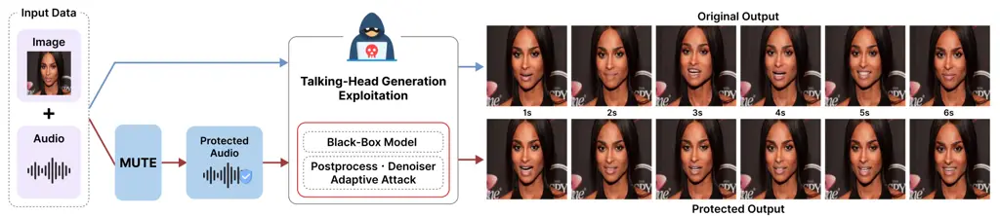
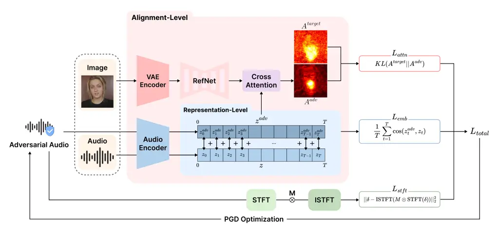
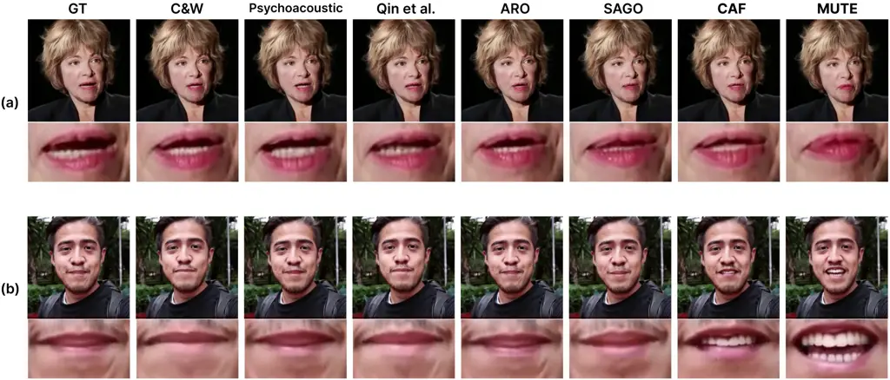
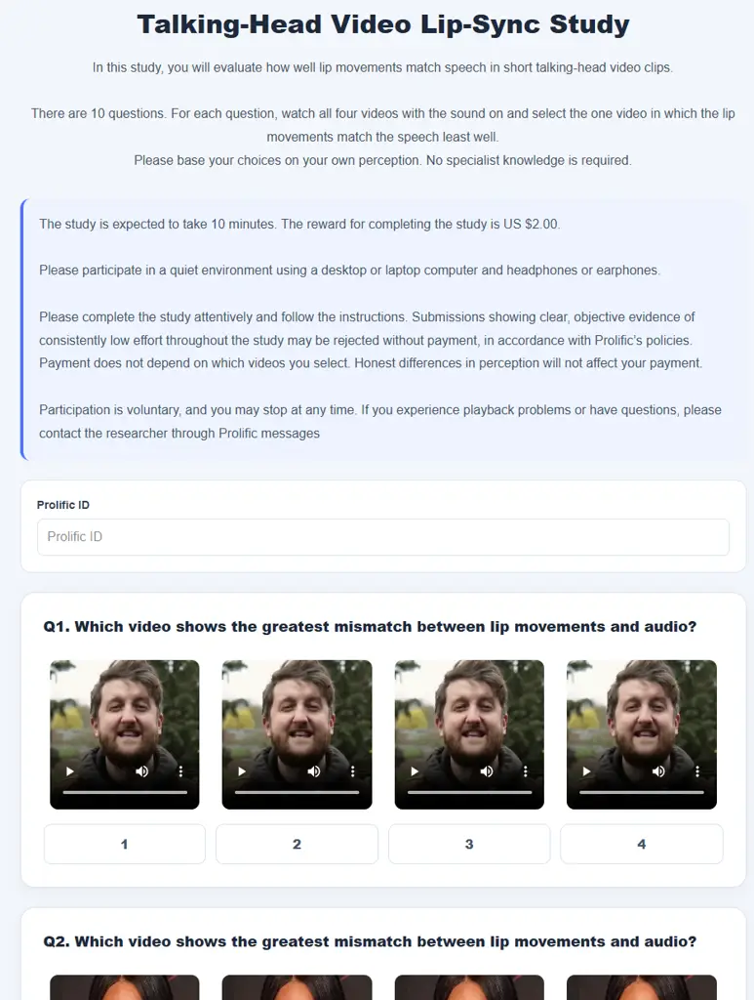
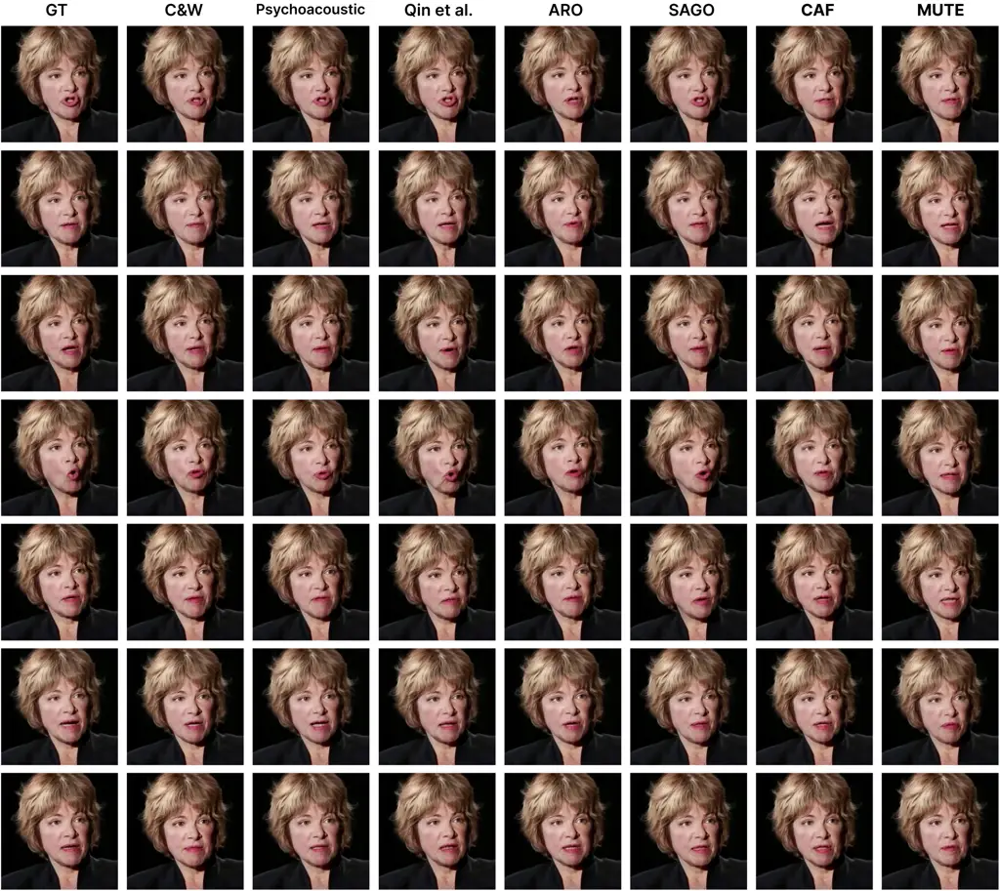
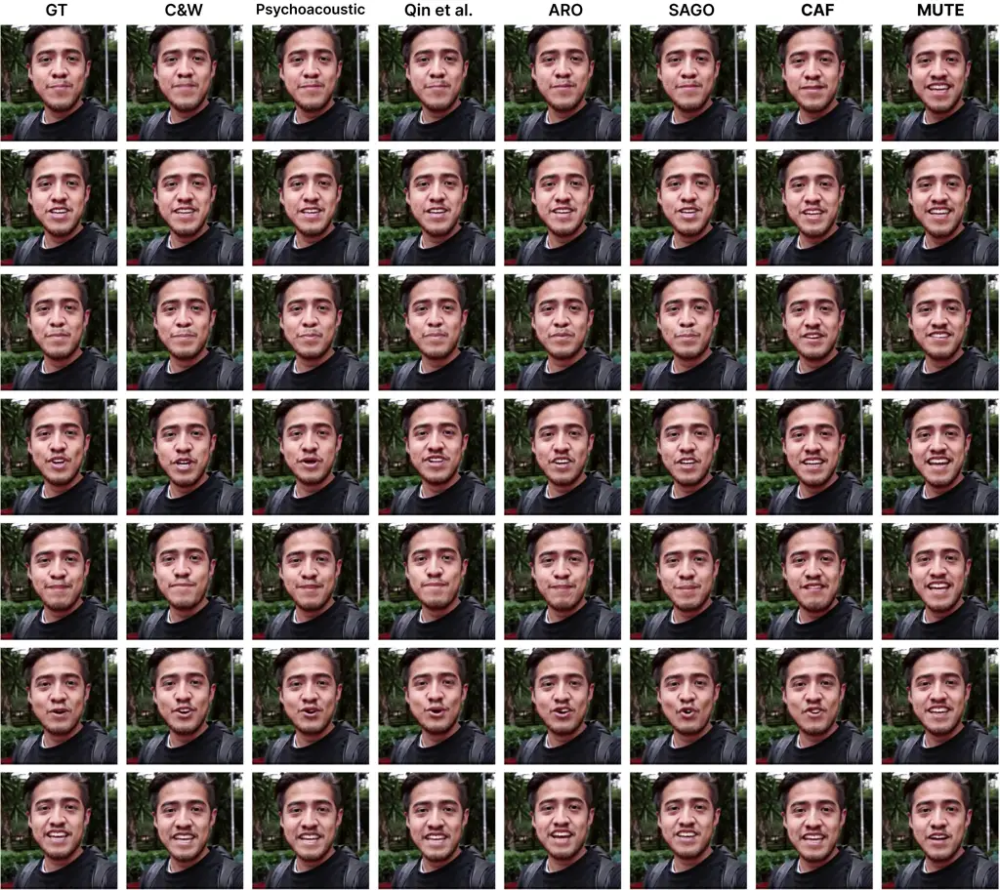
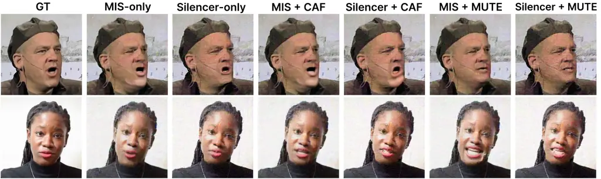
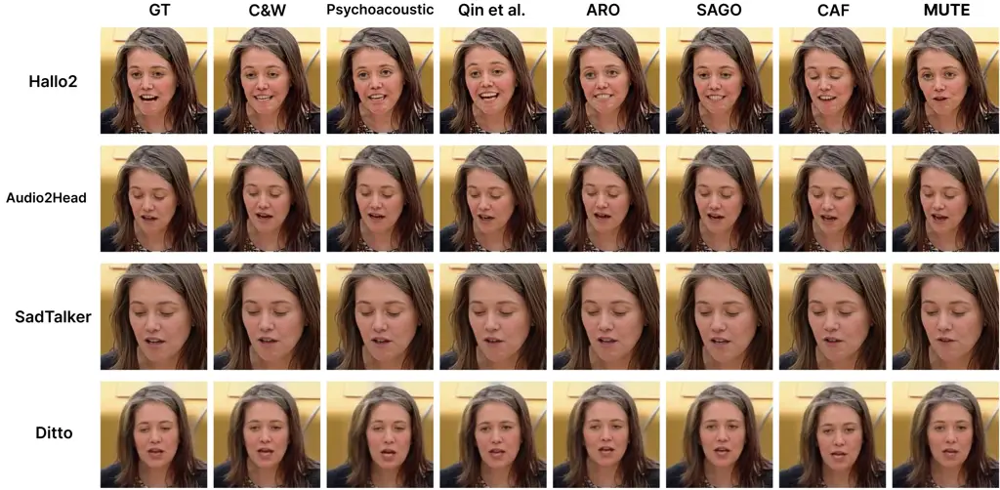
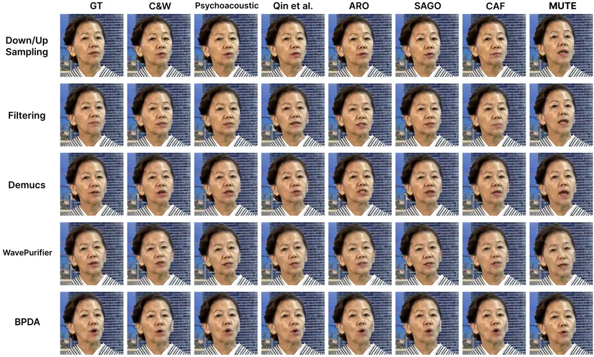
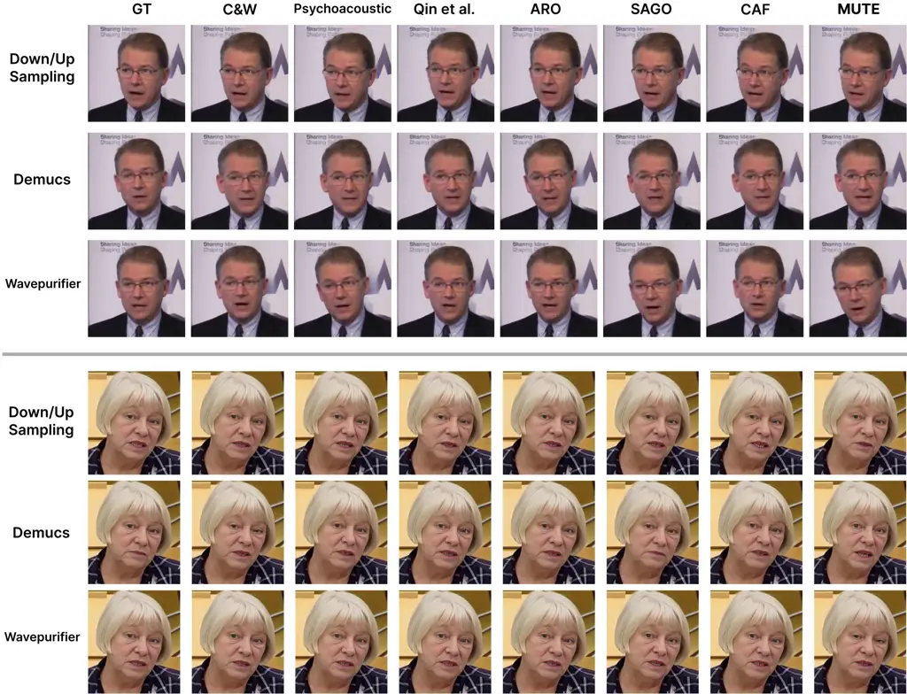

# MUTE: Multi-Level Alignment Uncoupling Against Talking-Head Exploitation for Voice Protection

Donghyun Kim Affiliation: Soongsil University
Email: [kmit16@soongsil.ac.kr](mailto:)    Jin Hong
Affiliation: Chung-Ang University
Email: [kimsm0802@soongsil.ac.kr](mailto:)    Seungmin Kim
Affiliation: Soongsil University Affiliation: AIM Intelligence
Email: [dikim420@soongsil.ac.kr](mailto:)    Dain Kim
Affiliation: Soongsil University Email: [jindl465@cau.ac.kr](mailto:)   
Junseok Kwon Affiliation: Chung-Ang University
Email: [jskwon@cau.ac.kr](mailto:)    Daeseon Choi
Email: [sunchoi@ssu.ac.kr^(\*)Equal contribution  ^(†)Corresponding
authors](mailto:) Affiliation: Soongsil University

###### Abstract

Talking-head generation models, which synthesize realistic facial
animations from audio, are increasingly vulnerable to misuse in
multimodal deepfake scenarios. Protecting such systems remains
challenging, as talking-head models fundamentally rely on precise
audio–visual alignment, while effective audio protection methods remain
largely underexplored. In this work, we propose MUTE, an audio
protection framework that uncouples the underlying audio–visual
alignment through a multi-level strategy. Specifically, MUTE combines
(1) _Alignment-level Disruption_, which directly perturbs cross-modal
attention to disrupt structural alignment, and (2) _Representation-level
Degradation_, which perturbs temporal audio embeddings to degrade their
representations. To improve robustness, perturbations are constrained in
the STFT domain to high-energy regions, making them resistant to
post-processing, denoising, and adaptive attacks. An optional
speaker-level objective further mitigates potential bypass via TTS-based
resynthesis. Extensive experiments demonstrate that MUTE consistently
degrades lip synchronization across both white-box and black-box
talking-head models while preserving perceptual audio quality. The
proposed method remains effective under real-world transformations and
can be combined with image-based approaches to provide stronger
multimodal protection. The source code and project page are available at
[https://github.com/jindl465/MUTE](https://github.com/jindl465/MUTE).

## 1 Introduction

Rapid advances in generative models \[1, 2, 3, 4, 5, 6, 7, 8, 9, 10,
11\] have significantly improved the realism of talking-head generation
systems that jointly leverage audio and visual information. As
generative AI continues to evolve, deepfake technologies have progressed
from unimodal settings, such as image or speech manipulation, to more
sophisticated multimodal scenarios that combine both modalities. This
evolution has amplified the potential for misuse, raising growing
concerns over multimodal deepfake attacks and motivating the need for
data protection methods that go beyond conventional unimodal settings.
However, unlike unimodal generation, talking-head models critically rely
on precise audio-visual alignment between speech and facial motion.
Existing protection methods designed for image \[12, 13, 14\] or speech
deepfakes \[15, 16, 17\] largely overlook such cross-modal coupling and
therefore fail to target the alignment mechanism on which talking-head
generation depends.

Recently, data protection methods specifically targeting talking-head
generation models have been proposed. In particular, an approach that
introduces perturbations to images \[18\] has demonstrated the potential
to degrade generation quality from the visual modality. Furthermore, a
method that simultaneously applies perturbations to both image and audio
inputs \[19\] has shown that stronger suppression effects can be
achieved by directly disrupting multimodal alignment. These findings
suggest that effective data protection for talking-head generation
models should be approached from a multimodal perspective rather than
being limited to unimodal settings.



Figure 1: Overview of MUTE. This conceptual overview shows how MUTE
preemptively protects audio data from malicious synthesis. Even in
real-world scenarios, the resulting outputs remain visually
unsynchronized and unusable due to severe audio-visual misalignment.

Despite these advances, existing approaches still exhibit several
important limitations. In realistic security scenarios, protecting
against the misuse of talking-head generation must satisfy multiple
requirements. First, since the specific talking-head generation model
used by an attacker is unknown in advance, strong transferability under
black-box settings is essential. Second, robustness is critical, as
attackers can apply post-processing techniques, denoising methods, or
adaptive attack to remove perturbations and neutralize their effects. In
particular, for audio, an attacker can neutralize protection by
extracting the speaker identity from protected speech and resynthesizing
it via a text-to-speech (TTS) model. Despite these challenges, existing
methods do not address these challenges systematically. Moreover,
modality-specific considerations, especially for audio, remain
relatively underexplored.

To address these limitations, we propose MUTE (Multi-level alignment
Uncoupling against Talking-head Exploitation), an audio protection
framework designed to achieve strong transferability under black-box
settings while being robust to diverse real-world transformations. The
key idea of MUTE is to uncouple audio-visual alignment through a
multi-level strategy operating at both alignment structure and
representation levels.

First, to achieve Alignment-level Disruption, we employ a Target
Attention KL Loss that perturbs the shared audio-visual alignment
structure by guiding the attention map toward a target distribution.
Subsequently, to achieve Representation-level Degradation, we introduce
a Frame-wise Embedding Cosine Loss, which decomposes temporal audio
embeddings and effectively degrades the embedding extraction process.
Together, these objectives degrade both the structural mechanism and the
input representations responsible for alignment. Furthermore, to enhance
robustness, we constrain perturbations in the STFT domain to concentrate
in high-energy regions, making them less susceptible to removal by
post-processing, denoising and adaptive attack. In addition, we
optionally incorporate a speaker-level perturbation objective to reduce
identity consistency, thereby mitigating potential bypass via TTS-based
resynthesis.

Fig.1 illustrates the effectiveness of MUTE under these scenarios.
Through this design, MUTE consistently degrades lip synchronization
across black-box models and remains effective under real-world
transformation scenarios, including post-processing, denoising, adaptive
attack and TTS-based resynthesis, while preserving perceptual audio
quality. Moreover, MUTE operates solely on audio inputs and can be
combined with image-based approaches to enable stronger multimodal
protection.

Our main contributions are summarized as follows:

- •
  We propose MUTE, a multi-level audio protection framework that
  combines _Alignment-level Disruption_ and _Representation-level
  Degradation_, effectively uncoupling audio-visual alignment and
  mitigating the misuse of talking-head generation systems.
- •
  We show that MUTE is complementary to existing image-based methods,
  achieving stronger protection when both modalities are jointly
  considered.
- •
  We demonstrate that MUTE achieves strong performance under black-box
  settings by targeting model-agnostic audio-visual alignment.
- •
  We introduce a robustness-aware perturbation strategy in the STFT
  domain that concentrates perturbations to high-energy regions,
  improving resistance to post-processing, denoising, adaptive attack
  and extend MUTE with a speaker-level objective to mitigate TTS-based
  resynthesis attacks.

## 2 Related Work

Audio Adversarial Attacks. Audio adversarial attacks against Automatic
Speech Recognition (ASR) systems have progressed from waveform-level
optimization \[20\], to perceptually-aware perturbations leveraging
psychoacoustic masking \[21, 22\], and more recently to transferable
attacks designed for black-box settings \[23, 24\]. These methods have
been shown to affect self-supervised models like Wav2Vec 2.0 \[25\] and
Whisper \[26\], degrading learned representations and downstream
performance \[27, 28\]. Since talking-head generation relies on the
linguistic and phonetic content of speech to drive facial motion,
ASR-based adversarial attacks provide a natural starting point for
evaluating audio-domain perturbations in this setting. We therefore
include *C&W* \[20\], *Psychoacoustic* \[21\], *Qin et al.* \[22\],
*ARO* \[23\], and *SAGO* \[24\] as baselines in our experiments.

Talking-Head Generation. Talking-head generation aims to synthesize
realistic facial animations driven by control signals, most commonly
audio. Early approaches were primarily based on GANs \[10, 11\],
focusing on accurate lip synchronization and identity preservation.
Subsequent methods introduced structured motion representations, such as
3D priors \[1\] and disentangled facial dynamics \[3, 4\], as well as
neural radiance fields \[2\], to improve motion diversity and
controllability. More recently, diffusion-based models \[5, 6, 7, 8, 9\]
have emerged as the dominant paradigm, achieving superior visual quality
and temporal coherence. Across these paradigms, audio remains the
primary driving modality, enabling highly realistic and synchronized
facial animations. However, such strong dependency on audio also
introduces potential vulnerabilities, as manipulated or adversarial
inputs can significantly affect the generation process. This observation
has motivated a growing body of work on adversarial attacks and defenses
for talking-head generation.

Adversarial Attacks on Talking-Head Models. Adversarial attack methods
on talking-head generation are still nascent, with only a few works
exploring this direction. Silencer \[18\] perturbs the input portrait
but is often less effective in audio-driven settings where facial motion
is primarily controlled by speech. To address this limitation,
audio-level attacks introduce perturbations to the speech signal to
disrupt audio-visual synchronization. More recently, SyncBreaker \[19\]
enhances attack effectiveness by jointly leveraging audio perturbations
with visual perturbations, enabling stronger disruption across different
talking-head models. We also include *CAF* \[19\], the audio protection
method of SyncBreaker, as a baseline. Despite these advances, existing
approaches still struggle to achieve both transferability under
black-box settings and robustness against post-processing, denoising,
adaptive attacks or TTS-based bypass — limitations that motivate our
multi-level audio-based protection framework.

## 3 Problem Formulation

We formulate audio protection against talking-head generation as a
proactive defense problem, where adversarial perturbations are
intentionally introduced to prevent unauthorized audio-driven synthesis.
Given a clean audio signal $`x`$, we aim to generate an adversarial
audio $`x^{adv}=x+\delta`$, where $`\delta`$ denotes a small
perturbation. The goal is to degrade the synchronization quality of the
generated talking-head output while preserving perceptual similarity to
the original audio. In this setting, only the audio modality is
modified, while the visual input remains unchanged. To ensure perceptual
imperceptibility, the perturbation is constrained by
$`\|x^{adv}-x\|_{\infty}\leq\epsilon`$.

The primary objective is to disrupt lip synchronization between audio
and visual modalities. In addition, we consider secondary effects such
as degradation in per-frame visual quality, temporal coherence, and
facial expression consistency. We characterize the attack as a
disruption of audio-visual alignment. Specifically, the perturbations
first disrupt the cross-modal attention structure that governs
audio-visual alignment and then degrade temporal audio representations.
The detailed design is described in Section 4.

We assume a transfer-based black-box setting, where adversarial
perturbations are generated without access to the architecture or
parameters of the target model. Instead, the adversarial audio is
generated on a surrogate model and directly evaluated on unseen
talking-head models. Furthermore, the adversarial audio may undergo
post-processing, denoising, adaptive attack and TTS-based resynthesis,
necessitating robustness against such operations.

## 4 Method



Figure 2: Overall Framework of MUTE. The framework uncouples
audio-visual alignment through a multi-level strategy, combining
alignment-level disruption and representation-level degradation, while
applying an STFT loss to ensure robustness.

We propose MUTE (Multi-level Alignment Uncoupling against Talking-Head
Exploitation), an audio protection framework that degrades audio-visual
synchronization quality in talking-head generation. As illustrated in
Fig.2, MUTE adopts a multi-level strategy to disrupt alignment through
two complementary components: (1) Alignment-level Disruption, which
directly perturbs the cross-modal alignment structure, and (2)
Representation-level Degradation, which interferes with the extraction
of reliable audio representations. These two components target different
aspects of the alignment process and jointly amplify the overall
disruption effectiveness.

At the alignment level, we perform Alignment-level Disruption
(Section 4.1) by directly perturbing the structural mechanism that
governs audio-visual alignment. Specifically, we treat the attention map
from a surrogate model as a proxy for the alignment structure and guide
it toward a predefined target distribution. This directly disrupts the
cross-modal correspondence between audio and visual features, weakening
the alignment required for accurate lip synchronization.

Building upon this, we introduce Representation-level Degradation
(Section 4.2) by destabilizing the audio embedding extraction process.
Since temporal audio representations drive frame-level facial motion, we
decompose the embeddings along the temporal axis and apply degradation
at each frame. By degrading the representations used for alignment, this
step further propagates errors throughout the generation pipeline and
amplifies synchronization disruption compared to applying either
component alone.

Furthermore, to ensure Robustness to Post-processing, Denoising and
Adaptive Attack (Section 4.3), we design perturbations in the STFT
domain by concentrating them in frequency regions less susceptible to
removal. This allows MUTE to remain effective under transformations such
as post-processing and denoising, thereby improving robustness in
real-world. Additionally, to mitigate potential bypass via TTS-based
resynthesis, we optionally incorporate a speaker-level objective to
reduce identity consistency.

### 4.1 Alignment-level Disruption

To directly disrupt the audio-visual alignment structure, we leverage
audio-conditioned visual cross-attention within the denoising UNet.
Specifically, visual latent features encoded from a reference image
$`I^{ref}`$ serve as queries, while audio embeddings extracted from the
adversarial audio $`x^{adv}`$ serve as keys and values. This results in
an attention map defined as
$`A^{adv}=\text{Attn}(Q(I^{ref}),K(x^{adv}),V(x^{adv}))`$.

To disrupt alignment, we construct a target attention distribution by
identifying spatial locations that are most sensitive to an
$`\epsilon`$-bounded perturbation. To this end, we approximate the
variation of attention using a Taylor expansion and derive a sensitivity
score based on first- and second-order sensitivity:
$`s(n)\propto\frac{|A^{\prime}(n)|+\frac{\epsilon}{2}|A^{\prime\prime}(n)|}{A(n)}`$,
where $`n`$ indexes spatial locations in the attention map (e.g., 64 ×
64 in our setting). This formulation estimates the maximum achievable
change under an $`\epsilon`$-bounded perturbation and prioritizes
regions where attention can be effectively manipulated. Based on this
score, we define the target attention distribution as
$`A^{target}(n)=\text{softmax}(s(n))`$.

Finally, we define the alignment-level loss as a KL divergence between
the target and adversarial attention distributions, given by

```math
\mathcal{L}_{\text{attn}}=\mathrm{KL}(A^{target}\,\|\,A^{adv})=\sum_{n}A^{target}(n)\log\frac{A^{target}(n)}{A^{adv}(n)}. \tag{1}
```

The proposed Target Attention KL Loss treats the attention map as a
spatial probability distribution and minimizes the discrepancy between
the target and adversarial distributions. By penalizing cases where
$`A^{adv}`$ fails to allocate sufficient probability mass to regions
emphasized by $`A^{target}`$, it encourages attention redistribution
toward those regions, effectively disrupting the underlying audio-visual
alignment structure.

### 4.2 Representation-level Degradation

To degrade the audio representations used in talking-head generation, we
leverage temporal audio embeddings extracted from the wav2vec2.0 \[25\]
encoder of the surrogate model, Hallo \[5\]. Let $`f_{\text{enc}}`$
denote the audio encoder, and the extracted representation from the
input audio $`x`$ is denoted as
$`z=f_{\text{enc}}(x)\in\mathbb{R}^{T\times L\times D}`$, where $`T`$
denotes the number of temporal frames, $`L`$ the number of transformer
layers, and $`D`$ the hidden dimension.

Since talking-head generation relies on temporal audio representations
to drive frame-level facial motion, perturbing only a global embedding
is insufficient to fully disrupt the generation process. Instead, we
decompose the temporal embeddings into frame-wise representations and
apply degradation at each time step, enabling more fine-grained and
effective disruption of the generated motion.

Let $`z_{t}`$ denote the embedding at time step $`t`$, and
$`z_{t}^{adv}`$ denote the corresponding embedding extracted from the
adversarial audio $`x^{adv}`$. To realize the frame-wise degradation, we
minimize the cosine similarity between corresponding embeddings,
encouraging each temporal component to deviate from its original
representation. The resulting loss is given by:

```math
\mathcal{L}_{\text{emb}}=\frac{1}{T}\sum_{t=1}^{T}\cos\left(z_{t}^{adv},z_{t}\right). \tag{2}
```

Compared to a global embedding objective that operates on the
time-averaged representation, the proposed Frame-wise Embedding Cosine
Loss directly penalizes each temporal component. This prevents local
perturbations from being smoothed out through temporal aggregation and
instead enforces cumulative degradation across the sequence, leading to
more effective disruption of the generated motion.

### 4.3 Robustness to Post-processing, Denoising and Adaptive Attack

To improve robustness against perturbation removal, we design
perturbations that remain effective under various real-world
transformations. In particular, post-processing techniques and
model-based denoisers tend to suppress low-energy noise components,
making it crucial to prevent perturbations from being easily eliminated.
To this end, we introduce an STFT loss that constrains the perturbation
$`\delta`$ in the time-frequency domain as

```math
\mathcal{L}_{\text{stft}}=\left\|\delta-\text{ISTFT}\left(M\odot\text{STFT}(\delta)\right)\right\|_{2}^{2}, \tag{3}
```

encouraging the perturbation to reside in robust regions.

The mask $`M`$ is constructed from the STFT of clean audio, assigning a
weight of 1 to high-energy time-frequency regions corresponding to the
speech signal, while applying reduced weights (i.e., less than 1) to
low-energy or out-of-band components. This design biases the
perturbation toward high-energy regions that are less likely to be
removed by filtering or denoising processes.

As a result, the perturbations become spectrally aligned with the
underlying speech signal and are less distinguishable as independent
noise, making them more robust in practical scenarios.

#### TTS-based Resynthesis Robustness (Optional).

In scenarios where an attacker is aware of the presence of
perturbations, adversarial audio may be further processed to bypass the
attack, for example, by extracting speaker identity and resynthesizing
speech with arbitrary text. To mitigate such potential misuse, we
optionally incorporate a speaker-level perturbation objective that can
be combined with the main loss. This objective aims to reduce speaker
identity consistency in the adversarial audio, making it difficult to
preserve the original speaker characteristics under such
transformations.

To this end, we minimize the cosine similarity between speaker
embeddings extracted from the original and adversarial audio, defined as
$`\mathcal{L}_{spk}=\cos(E_{spk}(x),E_{spk}(x^{adv}))`$, encouraging the
adversarial audio to deviate from the original speaker identity. To
improve robustness across different embedding spaces, we employ an
ensemble of two speaker encoders, CAM++ \[29\] and a ResNet-based
speaker encoder \[30\], and aggregate their losses. As a result, the
adversarial audio becomes less consistent in speaker identity, making it
more difficult for TTS-based resynthesis to preserve or reconstruct the
original speaker characteristics.

### 4.4 Final Objective and Optimization

We adopt a two-phase optimization strategy to effectively perform
alignment-level and representation-level disruption. Specifically, we
partition the optimization process into two phases over a total of $`K`$
iterations. In the first phase, we focus on alignment-level disruption,
while in the second phase, the optimization shifts to
representation-level degradation. The objective at iteration $`k`$ is
defined as:

```math
\mathcal{L}_{\text{total}}^{(k)}=\begin{cases}\mathcal{L}_{\text{attn}}+\lambda\mathcal{L}_{\text{stft}},&k\leq\rho K\\
\mathcal{L}_{\text{emb}}+\lambda\mathcal{L}_{\text{stft}},&k>\rho K\end{cases}, \tag{4}
```

where $`\rho\in(0,1)`$ controls the proportion of iterations allocated
to alignment-level optimization. The perturbation $`\delta`$ is
optimized using PGD \[31\] under the loss at each phase.

This two-phase scheme separates objectives with different optimization
directions, reducing gradient interference and improving optimization
effectiveness. By first perturbing the alignment structure and then
degrading audio representations, it achieves stronger misalignment.
Furthermore, compared to joint optimization, this two-phase strategy
reduces computational cost while allowing each phase to focus on its
objective, resulting in a more efficient process. When the optional
speaker-level objective is used, the final objective becomes
$`\mathcal{L}^{(k)}=\mathcal{L}_{\text{total}}^{(k)}+\lambda_{\text{spk}}\mathcal{L}_{\text{spk}}`$.

## 5 Experiments

### 5.1 Experimental Setup

Datasets and Baselines. We use the TalkingHead-1KH \[32\] and
CelebV-HQ \[33\] datasets, which provide high-quality audio-visual
samples with consistent speaker identity, for adversarial example
generation and alignment evaluation. For adversarial example generation,
we paired the input audio with a randomly selected reference image of a
different identity. During evaluation, we instead used image–audio pairs
with the same identity to assess the impact of adversarial perturbations
under realistic conditions. For CelebV-HQ, we selected 50 high-quality
video samples based on CLIP-IQA \[34\] scores. The corresponding audio
was trimmed into 5-second segments. For TalkingHead-1KH, we follow the
preprocessing protocol of Silencer \[18\], using the same set of 50
samples. As baselines, we adopt representative audio adversarial attack
methods: *C&W* \[20\], *Psychoacoustic* \[21\], *Qin et al.* \[22\],
*ARO* \[23\], *SAGO* \[24\] and *CAF* \[19\].

Evaluation Metrics. We evaluate our method across three categories:
_audio quality_, _audio-visual alignment_, and _visual quality_. First,
to assess the imperceptibility of adversarial perturbations added to the
audio, we evaluate the protected audio quality. We report WER (%)
measured using Whisper \[26\] to assess speech intelligibility via ASR,
along with STOI \[35\] for objective intelligibility and PESQ \[36\] for
perceptual quality. Second, as the primary objective of our attack is to
disrupt lip synchronization, we evaluate audio-visual alignment to
measure how effectively the generated talking-head outputs are degraded.
We use SyncNet \[37\] to assess lip–audio synchronization and
M-LMD \[38\] to quantify lip landmark distance. Finally, to measure
secondary effects on the generated outputs, we evaluate visual quality
as an auxiliary metric. We report FID \[39\], FVD \[40\], and
E-FID \[7\], where E-FID computes distributional distance over facial
expression parameters.

Implementation Details. We adopted Hallo \[5\] as the surrogate
LDM-based talking-head model. All input portraits were resized to
$`512\times 512`$, and audio was sampled at 16 kHz. Adversarial
perturbations were generated using PGD in the waveform space $`[-1,1]`$
with an $`L_{\infty}`$ budget of $`\epsilon=0.004`$, a step size of
$`\alpha=0.0002`$, and 200 iterations. For fair comparison, the
perturbation budgets of baseline methods were adjusted to achieve
comparable perceptual speech quality rather than using an identical
numerical $`\epsilon`$ across all methods: $`\epsilon=0.01`$ for
*SAGO* \[24\], $`\epsilon=0.006`$ for *Qin et al.* \[22\], and
$`\epsilon=0.004`$ for MUTE and the remaining methods. Baseline methods
were applied using the same wav2vec2.0 \[25\] encoder used in
Hallo \[5\], under otherwise identical hyperparameter settings. We
employed a two-phase optimization strategy with $`\rho=0.1`$, where the
first 10% of iterations optimize the alignment-level objective and the
remaining iterations optimize the representation-level objective. For
$`\mathcal{L}_{\text{emb}}`$, the temporal audio embeddings are aligned
to the 25 fps video frame rate, yielding 25 frame-wise embeddings per
second. The STFT loss $`\mathcal{L}_{\text{stft}}`$ is weighted by
$`\lambda=5`$. We repeat the main experiments using three independent
random seeds to account for stochasticity from diffusion sampling and
PGD initialization. Results are reported as mean $`\pm`$ standard
deviation across the three runs. All experiments were conducted on a
single NVIDIA RTX 4090 GPU.

[TABLE]

Table 1: Quantitative comparison of MUTE against various audio
adversarial attack baselines using TalkingHead-1KH and CelebV-HQ
datasets.



Figure 3: Qualitative results on different datasets. Visual comparison
between baseline methods and MUTE on (a) TalkingHead-1KH dataset and (b)
CelebV-HQ dataset.

### 5.2 Evaluation on Voice Protection

As summarized in Table 1, MUTE significantly outperforms baselines in
disrupting audio-visual alignment. Our method achieves the lowest
SyncNet scores (1.332 for TalkingHead-1KH and 2.152 for CelebV-HQ) and
the highest M-LMD values (1.627 and 1.693), indicating stronger
degradation of lip synchronization. Despite its strong protection
capability, MUTE achieves the best perceptual audio quality among the
compared methods, obtaining the lowest WER and highest STOI and PESQ
scores while effectively disrupting facial dynamics. This demonstrates
that our multi-level uncoupling strategy degrades alignment without
compromising speech intelligibility. The qualitative effectiveness of
MUTE is illustrated in Fig.3, where our method induces the most
significant disparity in facial dynamics and lip movements among all
methods compared to ground truth and baselines.

| Image Protection | Voice Protection | Sync$`\downarrow`$                          | M-LMD$`\uparrow`$                           | FID$`\uparrow`$                               | FVD$`\uparrow`$                              | E-FID$`\uparrow`$                             |
| ---------------- | ---------------- | ------------------------------------------- | ------------------------------------------- | --------------------------------------------- | -------------------------------------------- | --------------------------------------------- |
| MIS \[19\]       | \-               | $`3.039\,{\scriptstyle\pm 0.116}`$          | $`1.988\,{\scriptstyle\pm 0.032}`$          | $`142.692\,{\scriptstyle\pm 2.911}`$          | $`23.009\,{\scriptstyle\pm 0.648}`$          | $`162.260\,{\scriptstyle\pm 1.108}`$          |
| Silencer \[18\]  | \-               | $`2.170\,{\scriptstyle\pm 0.014}`$          | $`2.168\,{\scriptstyle\pm 0.013}`$          | $`144.555\,{\scriptstyle\pm 1.254}`$          | $`24.029\,{\scriptstyle\pm 0.513}`$          | $`160.298\,{\scriptstyle\pm 3.172}`$          |
| MIS \[19\]       | CAF \[19\]       | $`1.212\,{\scriptstyle\pm 0.081}`$          | $`2.157\,{\scriptstyle\pm 0.018}`$          | $`145.166\,{\scriptstyle\pm 2.538}`$          | $`24.526\,{\scriptstyle\pm 0.895}`$          | $`163.048\,{\scriptstyle\pm 2.168}`$          |
| Silencer \[18\]  | CAF \[19\]       | $`0.941\,{\scriptstyle\pm 0.025}`$          | $`2.152\,{\scriptstyle\pm 0.007}`$          | $`146.111\,{\scriptstyle\pm 0.495}`$          | $`25.764\,{\scriptstyle\pm 0.079}`$          | $`165.884\,{\scriptstyle\pm 0.282}`$          |
| MIS \[19\]       | MUTE             | $`0.902\,{\scriptstyle\pm 0.055}`$          | $`\textbf{2.261}\,{\scriptstyle\pm 0.046}`$ | $`\textbf{147.141}\,{\scriptstyle\pm 2.480}`$ | $`25.289\,{\scriptstyle\pm 0.456}`$          | $`162.983\,{\scriptstyle\pm 0.583}`$          |
| Silencer \[18\]  | MUTE             | $`\textbf{0.760}\,{\scriptstyle\pm 0.004}`$ | $`2.233\,{\scriptstyle\pm 0.015}`$          | $`146.544\,{\scriptstyle\pm 0.221}`$          | $`\textbf{25.843}\,{\scriptstyle\pm 0.087}`$ | $`\textbf{168.829}\,{\scriptstyle\pm 1.553}`$ |

Table 2: Performance comparison of combining Image-level Protection
Methods with Voice-level Protection Methods.

Combination with Image Protection. Furthermore, MUTE demonstrates strong
complementarity with image-level protection methods. As shown in
Table 2, adding MUTE to either MIS \[19\] or Silencer \[18\]
substantially strengthens protection over image-only protection,
markedly reducing the Sync score in both cases. Compared with the
corresponding *CAF* \[19\] combinations, MUTE consistently achieves
lower Sync scores and higher M-LMD scores, while inducing comparable or
stronger visual-quality degradation. These results confirm that MUTE’s
audio-visual uncoupling synergizes effectively with image-domain
perturbations to induce more severe alignment disruption.

### 5.3 Performance on Black-Box Models

We evaluate the transferability of MUTE under the transfer-based
black-box setting, where adversarial perturbations are generated using
the surrogate model (Hallo \[5\]) and applied to unseen talking-head
models. Specifically, we evaluate on four target models: Hallo2 \[6\],
Audio2Head \[4\], SadTalker \[1\], and Ditto \[9\]. Note that Hallo2
shares a similar architecture with the surrogate model, while the
remaining models differ significantly in design. As shown in Table 3,
MUTE achieves the lowest SyncNet and highest M-LMD across all target
models, indicating strong degradation of audio-visual alignment, which
in turn demonstrates its transferability to unseen talking-head
architectures.

[TABLE]

Table 3: Transferability evaluation under black-box settings across
talking-head models.

[TABLE]

Table 4: Robustness evaluation under post-processing, denoising, and
adaptive attack.

### 5.4 Robustness to Post-processing, Denoising and Adaptive Attack

To evaluate the robustness of MUTE under realistic and adaptive attack
settings, we consider post-processing, denoising, and optimization-based
adaptive attack. For post-processing, we follow WaveGuard \[41\] and
apply downsampling–upsampling (16 kHz $`\rightarrow`$ 8 kHz
$`\rightarrow`$ 16 kHz) and adaptive spectral filtering based on the
median spectral centroid. For denoising, we employ Demucs \[42\] and
WavePurifier \[43\], representing source separation and diffusion-based
purification, respectively. Following the adaptive-attack methodology
of \[44\], we consider an adversary who is aware of the protection and
optimizes a purification of the protected audio. For MUTE, the
purification smooths STFT magnitudes within the 80–7600 Hz band targeted
by our STFT loss, whereas for baselines, which do not employ a spectral
mask, it is applied over the full band. The non-differentiable masking
step is handled with BPDA \[45\]. As shown in Table 4, MUTE achieves the
lowest Sync and highest M-LMD among all methods under every setting. It
remains effective under model-based denoising, and although adaptive
attack reduces protection efficacy, MUTE still outperforms all
baselines.

Robustness against TTS-based Resynthesis.

|                     |                                    |                                   |                                     |                                   |                                    |                                   |                                    |                                    |
| ------------------- | ---------------------------------- | --------------------------------- | ----------------------------------- | --------------------------------- | ---------------------------------- | --------------------------------- | ---------------------------------- | ---------------------------------- |
| Reference Condition | CosyVoice \[46\]                   |                                   | XTTS-v2 \[47\]                      |                                   | Chatterbox \[48\]                  |                                   | Sync$`\downarrow`$                 | M-LMD$`\uparrow`$                  |
|                     | Sim$`\downarrow`$                  | DSR$`\uparrow`$                   | Sim$`\downarrow`$                   | DSR$`\uparrow`$                   | Sim$`\downarrow`$                  | DSR$`\uparrow`$                   |                                    |                                    |
| Unprotected         | $`0.488\,{\scriptstyle\pm 0.003}`$ | $`2.53\,{\scriptstyle\pm 0.46}`$  | $`0.469\,{\scriptstyle\pm 0.002}`$  | $`2.80\,{\scriptstyle\pm 0.40}`$  | $`0.574\,{\scriptstyle\pm 0.008}`$ | $`4.53\,{\scriptstyle\pm 1.01}`$  | 5.656                              | 0.000                              |
| $`0`$               | $`0.368\,{\scriptstyle\pm 0.005}`$ | $`14.67\,{\scriptstyle\pm 1.89}`$ | $`0.392\,{\scriptstyle\pm 0.002}`$  | $`14.93\,{\scriptstyle\pm 1.67}`$ | $`0.449\,{\scriptstyle\pm 0.009}`$ | $`15.07\,{\scriptstyle\pm 2.66}`$ | $`1.332\,{\scriptstyle\pm 0.012}`$ | $`1.627\,{\scriptstyle\pm 0.012}`$ |
| $`0.01`$            | $`0.200\,{\scriptstyle\pm 0.007}`$ | $`67.73\,{\scriptstyle\pm 2.60}`$ | $`-0.102\,{\scriptstyle\pm 0.005}`$ | $`99.33\,{\scriptstyle\pm 0.83}`$ | $`0.280\,{\scriptstyle\pm 0.005}`$ | $`43.87\,{\scriptstyle\pm 0.23}`$ | $`1.496\,{\scriptstyle\pm 0.067}`$ | $`1.541\,{\scriptstyle\pm 0.012}`$ |
| $`0.05`$            | $`0.180\,{\scriptstyle\pm 0.008}`$ | $`71.47\,{\scriptstyle\pm 1.01}`$ | $`-0.120\,{\scriptstyle\pm 0.002}`$ | $`99.47\,{\scriptstyle\pm 0.46}`$ | $`0.248\,{\scriptstyle\pm 0.005}`$ | $`50.40\,{\scriptstyle\pm 2.62}`$ | $`1.918\,{\scriptstyle\pm 0.053}`$ | $`1.465\,{\scriptstyle\pm 0.008}`$ |
| $`0.10`$            | $`0.170\,{\scriptstyle\pm 0.003}`$ | $`74.13\,{\scriptstyle\pm 1.67}`$ | $`-0.120\,{\scriptstyle\pm 0.004}`$ | $`99.73\,{\scriptstyle\pm 0.23}`$ | $`0.239\,{\scriptstyle\pm 0.002}`$ | $`52.67\,{\scriptstyle\pm 2.89}`$ | $`2.218\,{\scriptstyle\pm 0.042}`$ | $`1.415\,{\scriptstyle\pm 0.009}`$ |

Table 5: Analysis of the optional speaker-level objective across
different $`\lambda_{spk}`$.

We evaluate the robustness of MUTE against TTS-based resynthesis
attacks, where an adversary reconstructs speech using protected audio as
the speaker reference. In the white-box setting, we use CosyVoice \[46\]
and Coqui XTTS-v2 \[47\], while in the black-box setting we use
Chatterbox \[48\]. We compute speaker similarity (Sim) using an
ECAPA-TDNN-based \[49\] speaker verification model and define the
defense success rate (DSR) as the proportion of synthesized samples
classified as different speakers from the corresponding original audio,
using a cosine similarity threshold of 0.25 or lower. As shown in
Table 5, unprotected audio yields higher Sim and substantially lower
DSR, indicating that the original speaker characteristics are largely
preserved under TTS resynthesis. Increasing $`\lambda_{\text{spk}}`$
improves DSR at the cost of reduced alignment-disruption effectiveness,
revealing a trade-off between reducing speaker identity consistency and
disrupting audio-visual alignment. Notably, with
$`\lambda_{\text{spk}}=0.01`$, MUTE achieves over 43% DSR across all TTS
models while maintaining strong alignment-disruption performance, with
SyncNet and M-LMD scores of 1.496 and 1.541, respectively. These results
demonstrate that the optional speaker-level objective effectively
reduces speaker identity consistency under TTS resynthesis while
preserving the primary goal of disrupting audio-visual alignment.

### 5.5 User Study

Figure 4: User study results.

While quantitative metrics such as SyncNet and M-LMD measure
audio-visual alignment, they may not fully capture human perception of
lip synchronization quality. To complement these metrics, we conduct a
user study to evaluate whether the degradation introduced by MUTE is
perceptually noticeable. We compare MUTE with three strong baseline
methods, *ARO* \[23\], *SAGO* \[24\], and *CAF* \[19\], using 10 video
samples. For each sample, participants are presented with videos
generated by different methods and asked to select the one that exhibits
the most noticeable lip-sync mismatch. A total of 100 participants take
part in the study, resulting in 1,000 responses. As shown in Fig.4, MUTE
is selected as the most misaligned method in $`78.1\%\pm 2.56\%`$ (95%
CI) of cases, significantly outperforming all baselines. This
demonstrates that the degradation introduced by MUTE is not only
measurable by objective metrics but also clearly perceivable to human
observers.

### 5.6 Ablation Study

| $`\rho`$ | time$`\downarrow`$ | Hallo | Audio2Head | SadTalker |
| -------- | ------------------ | ----- | ---------- | --------- |
| 1.0      | 78.4               | 3.920 | 3.958      | 5.048     |
| 0.2      | 20.1               | 1.419 | 3.798      | 4.898     |
| 0.1      | 12.3               | 1.332 | 3.627      | 4.703     |
| 0.05     | 9.2                | 1.470 | 3.799      | 4.899     |
| 0.0      | 4.8                | 1.427 | 3.904      | 5.063     |

Table 6: Effect of ratio $`\rho`$.

| $`\lambda`$ | Clean | Down/Up | Demucs |
| ----------- | ----- | ------- | ------ |
| 0           | 1.492 | 3.178   | 1.816  |
| 5           | 1.332 | 2.914   | 1.534  |
| 10          | 1.429 | 2.933   | 1.494  |
| 20          | 1.451 | 2.971   | 1.564  |
| 50          | 1.474 | 3.024   | 1.675  |

Table 7: Effect of weight $`\lambda`$.

| $`\epsilon`$ | WER$`\downarrow`$(%) | STOI$`\uparrow`$ / PESQ$`\uparrow`$ | Sync$`\downarrow`$ |
| ------------ | -------------------- | ----------------------------------- | ------------------ |
| 0.002        | 10.35                | 0.948 / 2.949                       | 1.898              |
| 0.004        | 11.68                | 0.936 / 2.522                       | 1.332              |
| 0.006        | 12.25                | 0.907 / 2.298                       | 1.200              |
| 0.008        | 12.89                | 0.891 / 2.108                       | 1.122              |
| 0.010        | 13.30                | 0.885 / 1.945                       | 1.027              |

Table 8: Effect of budget $`\epsilon`$.

Multi-level Optimization Strategy.

We analyze the effect of the two-phase strategy by varying
$`\rho\in\{1,0.2,0.1,0.05,0\}`$, where $`\rho=1`$ and $`\rho=0`$
correspond to using only the alignment-level and representation-level
objectives, respectively. As shown in Table 8, both objectives
effectively disrupt audio-visual alignment. However, the
representation-level objective achieves stronger white-box degradation,
while the alignment-level objective shows better black-box
transferability, revealing a trade-off between primary performance and
cross-model generalization. The representation-level objective is also
more computationally efficient. Balancing these factors, we adopt
$`\rho=0.1`$, which yields robust performance across all settings.

STFT Loss Weight. We analyze the effect of the STFT loss by varying its
weight $`\lambda\in\{0,5,10,20,50\}`$, where $`\lambda=0`$ corresponds
to optimizing only the alignment-level and representation-level
objectives. We evaluate performance using SyncNet and M-LMD to measure
audio-visual alignment. As shown in Table 8, adding
$`\mathcal{L}_{\text{stft}}`$ not only enhances the primary attack
performance by further degrading lip synchronization but also improves
robustness. Considering both alignment degradation and robustness, we
select $`\lambda=5`$ as it provides the best balance between performance
and stability.

Perturbation Budget. We analyze the trade-off between the perturbation
budget and protection performance over
$`\epsilon\in\{0.002,0.004,0.006,0.008,0.010\}`$. As $`\epsilon`$
increases, the audio-visual alignment disruption becomes progressively
stronger, while perceptual audio quality gradually decreases. We
identify $`\epsilon=0.004`$ as a balanced operating point, providing
strong alignment disruption while maintaining high audio quality.

## 6 Conclusions

We propose MUTE, a multi-level audio-based protection framework that
uncouples audio-visual alignment in talking-head generation. By
combining Alignment-level Disruption and Representation-level
Degradation, MUTE effectively degrades lip synchronization, which in
turn enables effective transferability across unseen talking-head
models. Furthermore, MUTE maintains robustness under real-world
transformations, including post-processing, denoising, adaptive attacks
and TTS-based resynthesis, while preserving perceptual audio quality. As
an audio-only method, MUTE achieves strong protection on its own and can
be further combined with image-based approaches for enhanced multimodal
protection. These results demonstrate that targeting audio-visual
alignment is an effective strategy for protecting against talking-head
exploitation, providing a practical and extensible direction for
multimodal data protection. Limitations and future work of MUTE are
discussed in Appendix.

## Acknowledgement

This work was supported in part by Korea Internet & Security
Agency(KISA) grant funded by the Korea government(PIPC), Development of
Robust Real-time Deepfake Disruption Technology via Adversarial Noise
Injection for Privacy Protection, under Grant RS-2026-25530576; and in
part by the Institute of Information & communications Technology
Planning & Evaluation (IITP) grant funded by the Korea government(MSIT)
(RS-2021-II211341).

## References

- \[1\] Wenxuan Zhang, Xiaodong Cun, Xuan Wang, Yong Zhang, Xi Shen,
  Yu Guo, Ying Shan, and Fei Wang. SadTalker: Learning realistic 3D
  motion coefficients for stylized audio-driven single image talking
  face animation. In _CVPR_, 2023.
- \[2\] Yudong Guo, Keyu Chen, Sen Liang, Yong-Jin Liu, Hujun Bao, and
  Juyong Zhang. AD-NeRF: Audio driven neural radiance fields for talking
  head synthesis. In _ICCV_, 2021.
- \[3\] Yingruo Fan, Zhaojiang Lin, Jun Saito, Wenping Wang, and Taku
  Komura. FaceFormer: Speech-driven 3D facial animation with
  transformers. In _CVPR_, 2022.
- \[4\] Suzhen Wang, Lincheng Li, Yu Ding, Changjie Fan, and Xin Yu.
  Audio2Head: Audio-driven one-shot talking-head generation with natural
  head motion. In _ICCV_, 2021a.
- \[5\] Mingwang Xu, Hui Li, Qingkun Su, Hanlin Shang, Liwei Zhang,
  Ce Liu, Jingdong Wang, Yao Yao, and Siyu Zhu. Hallo: Hierarchical
  audio-driven visual synthesis for portrait image animation. _arXiv
  preprint arXiv:2406.08801_, 2024.
- \[6\] Jiahao Cui, Hui Li, Yao Yao, Hao Zhu, Hanlin Shang, Kaihui
  Cheng, Hang Zhou, Siyu Zhu, and Jingdong Wang. Hallo2: Long-duration
  and high-resolution audio-driven portrait image animation. In _ICLR_,
  2025a.
- \[7\] Jiahao Cui, Hui Li, Yun Zhan, Hanlin Shang, Kaihui Cheng, Yuqi
  Ma, Shan Mu, Hang Zhou, Jingdong Wang, and Siyu Zhu. Hallo3: Highly
  dynamic and realistic portrait image animation with video diffusion
  transformer. In _CVPR_, 2025b.
- \[8\] Zhenhui Ye, Jinzheng He, Ziyue Jiang, Rongjie Huang, Jiawei
  Huang, Jinglin Liu, Yi Ren, Xiang Yin, Zejun Ma, and Zhou Zhao.
  GeneFace++: Generalized and stable real-time audio-driven 3D talking
  face generation. _arXiv preprint arXiv:2305.00787_, 2023.
- \[9\] Tianqi Li, Ruobing Zheng, Minghui Yang, Jingdong Chen, and Ming
  Yang. Ditto: Motion-space diffusion for controllable realtime talking
  head synthesis. In _ACM MM_, 2025.
- \[10\] K R Prajwal, Rudrabha Mukhopadhyay, Vinay P Namboodiri, and C V
  Jawahar. A lip sync expert is all you need for speech to lip
  generation in the wild. In _ACM MM_, 2020.
- \[11\] Yang Zhou, Xintong Han, Eli Shechtman, Jose Echevarria,
  Evangelos Kalogerakis, and Dingzeyu Li. MakeItTalk: Speaker-aware
  talking-head animation. _ACM TOG_, 39(6):1–15, 2020.
- \[12\] Jaehwan Jeong et al. FaceShield: Defending facial image against
  deepfake threats. In _ICCV_, 2025.
- \[13\] Tianyi Wang et al. NullSwap: Proactive identity cloaking
  against deepfake face swapping. In _ICCV_, 2025.
- \[14\] Yunming Zhang et al. Dual defense: Adversarial, traceable, and
  invisible robust watermarking against face swapping. _IEEE Trans.
  Inform. Forensics Secur._, 19:4628–4641, 2024.
- \[15\] Zhiyuan Yu, Shixuan Zhai, and Ning Zhang. AntiFake: Using
  adversarial audio to prevent unauthorized speech synthesis. In _ACM
  CCS_, 2023.
- \[16\] Seungmin Kim et al. RoCo: Robust code for fast and effective
  proactive defense against voice cloning attack. In _ICASSP_, 2026.
- \[17\] Zhisheng Zhang, Derui Wang, Yifan Mi, Zhiyong Wu, Jie Gao,
  Yuxin Cao, Kai Ye, Minhui Xue, and Jie Hao. E2E-VGuard: Adversarial
  prevention for production LLM-based end-to-end speech synthesis. In
  _NeurIPS_, 2025.
- \[18\] Yuan Gan, Jiaxu Miao, Yunze Wang, and Yi Yang. Silence is
  golden: Leveraging adversarial examples to nullify audio control in
  ldm-based talking-head generation. In _CVPR_, 2025.
- \[19\] Wenli Zhang, Xianglong Shi, Sirui Zhao, Xinqi Chen, Guo Cheng,
  Yifan Xu, Tong Xu, and Yong Liao. SyncBreaker: Stage-aware multimodal
  adversarial attacks on audio-driven talking head generation. _arXiv
  preprint arXiv:2604.08405_, 2026.
- \[20\] Nicholas Carlini and David Wagner. Audio adversarial examples:
  Targeted attacks on speech-to-text. In _IEEE SPW_, 2018.
- \[21\] Lea Schönherr, Katharina Kohls, Steffen Zeiler, Thorsten Holz,
  and Dorothea Kolossa. Adversarial attacks against automatic speech
  recognition systems via psychoacoustic hiding. In _NDSS_, 2018.
- \[22\] Yao Qin, Nicholas Carlini, et al. Imperceptible, robust, and
  targeted adversarial examples for automatic speech recognition. In
  _ICML_, 2019.
- \[23\] Weifei Jin, Junjie Su, Hejia Wang, Yulin Ye, and Jie Hao.
  Boosting the transferability of audio adversarial examples with
  acoustic representation optimization. In _ICME_, 2025.
- \[24\] Xiaoxue Gao, Zexin Li, Yiming Chen, Cong Liu, and Haizhou Li.
  Transferable adversarial attacks against ASR. _IEEE Sign. Process.
  Letters_, 2024.
- \[25\] Alexei Baevski, Yuhao Zhou, Abdelrahman Mohamed, and Michael
  Auli. wav2vec 2.0: A framework for self-supervised learning of speech
  representations. In _NeurIPS_, 2020.
- \[26\] Alec Radford et al. Robust speech recognition via large-scale
  weak supervision. In _ICML_, 2023.
- \[27\] Hadi Abdullah et al. SoK: The faults in our ASRs: An overview
  of attacks against automatic speech recognition and speaker
  identification systems. In _IEEE S&P_, 2022.
- \[28\] Hiromu Yakura and Jun Sakuma. Robust audio adversarial example
  for a physical attack. In _IJCAI_, 2019.
- \[29\] Hui Wang, Siqi Zheng, Yafeng Chen, Luyao Cheng, and Qian Chen.
  CAM++: A fast and efficient network for speaker verification using
  context-aware masking. In _Interspeech_, 2023a.
- \[30\] Yafeng Chen, Siqi Zheng, Hui Wang, Luyao Cheng, Qian Chen, and
  Jiajun Qi. An enhanced Res2Net with local and global feature fusion
  for speaker verification. In _Interspeech_, 2023.
- \[31\] Aleksander Madry, Aleksandar Makelov, Ludwig Schmidt, Dimitris
  Tsipras, and Adrian Vladu. Towards deep learning models resistant to
  adversarial attacks. In _ICLR_, 2018.
- \[32\] Ting-Chun Wang, Arun Mallya, and Ming-Yu Liu. One-shot
  free-view neural talking-head synthesis for video conferencing. In
  _CVPR_, 2021b.
- \[33\] Hao Zhu, Wayne Wu, Wentao Zhu, Liming Jiang, Siwei Tang,
  Li Zhang, Ziwei Liu, and Chen Change Loy. CelebV-HQ: A large-scale
  video facial attributes dataset. In _ECCV_, 2022.
- \[34\] Jianyi Wang, Kelvin C.K. Chan, and Chen Change Loy. Exploring
  CLIP for assessing the look and feel of images. In _AAAI_, 2023b.
- \[35\] Cees H. Taal, Richard C. Hendriks, Richard Heusdens, and Jesper
  Jensen. A short-time objective intelligibility measure for
  time-frequency weighted noisy speech. In _ICASSP_, 2010.
- \[36\] Antony W. Rix, John G. Beerends, Michael P. Hollier, and
  Andries P. Hekstra. Perceptual evaluation of speech quality (PESQ): An
  objective method for end-to-end speech quality assessment of
  narrow-band telephone networks and speech codecs. In _ICASSP_, 2001.
- \[37\] Joon Son Chung and Andrew Zisserman. Out of time: Automated lip
  sync in the wild. In _ACCV_, 2016.
- \[38\] Lele Chen, Ross K. Maddox, Zhiyao Duan, and Chenliang Xu.
  Hierarchical cross-modal talking face generation with dynamic
  pixel-wise loss. In _CVPR_, 2019.
- \[39\] Martin Heusel, Hubert Ramsauer, Thomas Unterthiner, Bernhard
  Nessler, and Sepp Hochreiter. GANs trained by a two time-scale update
  rule converge to a local nash equilibrium. In _NeurIPS_, 2017.
- \[40\] Thomas Unterthiner, Sjoerd van Steenkiste, Karol Kurach,
  Raphael Marinier, Marcin Michalski, and Sylvain Gelly. Towards
  accurate generative models of video: A new metric and evaluations.
  _arXiv preprint arXiv:1812.01717_, 2018.
- \[41\] Shehzeen Hussain, Paarth Neekhara, Shlomo Dubnov, Julian
  McAuley, and Farinaz Koushanfar. WaveGuard: Understanding and
  mitigating audio adversarial examples. In _USENIX Security 21_, 2021.
- \[42\] Simon Rouard, Francisco Massa, and Alexandre Défossez. Hybrid
  transformers for music source separation. In _ICASSP_, 2023.
- \[43\] Hanqing Guo, Guangjing Wang, Bocheng Chen, Yuanda Wang, Xiao
  Zhang, Xun Chen, Qiben Yan, and Li Xiao. WavePurifier: Purifying audio
  adversarial examples via hierarchical diffusion models. In _ACM
  MobiCom_, 2024.
- \[44\] Florian Tramèr, Nicholas Carlini, Wieland Brendel, and
  Aleksander Madry. On adaptive attacks to adversarial example defenses.
  In H. Larochelle, M. Ranzato, R. Hadsell, M.F. Balcan, and H. Lin,
  editors, _NeurIPS_, volume 33, pages 1633–1645. Curran Associates,
  Inc., 2020.
- \[45\] Anish Athalye, Nicholas Carlini, and David Wagner. Obfuscated
  gradients give a false sense of security: Circumventing defenses to
  adversarial examples. In _ICML_, 2018.
- \[46\] Zhihao Du, Qian Chen Shen, Kai Zhang, et al. CosyVoice: A
  scalable multilingual zero-shot text-to-speech synthesizer based on
  supervised semantic tokens. _arXiv preprint arXiv:2407.05407_, 2024.
- \[47\] Eren Goren et al. XTTS: A massively multilingual zero-shot
  text-to-speech model.
  [https://github.com/coqui-ai/TTS](https://github.com/coqui-ai/TTS), 2023.
- \[48\] Resemble AI. Chatterbox-TTS.
  [https://github.com/resemble-ai/chatterbox](https://github.com/resemble-ai/chatterbox), 2025.
  GitHub repository.
- \[49\] Brecht Desplanques, Jenthe Thienpondt, and Kris Demuynck.
  ECAPA-TDNN: Emphasized channel attention, propagation and aggregation
  in TDNN based speaker verification. In _Interspeech_, 2020.

## Appendix A Discussions and Limitations

### A.1 Limitations and Future Work

Adaptive Adversaries. Although MUTE is designed to be robust against
realistic transformations such as denoising and adaptive attacks,
adversarial attack and defense inherently form an arms race. As more
advanced protection methods against talking-head exploitation are
developed, new adaptive attacks may emerge to bypass them, potentially
weakening the effectiveness of our approach. Future work will focus on
developing more robust data protection strategies that can adapt to and
defend against such emerging adaptive attacks.

Audio-Only Limitation and Multimodal Extension. MUTE focuses on
audio-only perturbations. Although combining MUTE with image-based
methods such as Silencer \[18\] and MIS \[19\] empirically improves
performance, the two approaches are not jointly optimized and do not
share a unified objective. In particular, existing methods differ in how
failure modes are defined, such as suppressing motion versus inducing
incorrect motion. Future work will explore unified multimodal
optimization frameworks that jointly consider audio and visual
perturbations under a consistent objective, potentially leading to
stronger protection.

Perceptual Quality Trade-off. While MUTE aims to preserve perceptual
audio quality, there exists an inherent trade-off between perceptual
fidelity and attack effectiveness. Stronger perturbations can improve
alignment disruption but may degrade perceptual quality. Future work
will explore perceptually-aware optimization techniques that better
balance this trade-off, aiming to maintain high perceptual quality
without sacrificing protection performance.

Limited Evaluation Scope. The experiments are conducted on a limited
number of samples per dataset, following prior work due to the high
computational cost of talking-head generation. As a result, the
evaluation may not fully capture the diversity of real-world scenarios.
Future work will extend the evaluation to larger datasets and more
diverse conditions to better assess generalization.

Real-World Deployment Constraints. Although MUTE is designed with
realistic threat models in mind, including black-box settings and
robustness to transformations, practical deployment in real-world
scenarios remains challenging. The method requires modifying audio prior
to potential misuse and cannot protect already leaked audio. In
addition, many real-world voice leakage scenarios involve real-time
communication, such as phone calls. Future work will investigate
efficient perturbation generation methods for real-time or low-latency
settings to improve practical applicability.

### A.2 Subjective Bias

The user study relies on subjective human perception, which may
introduce inherent bias in the evaluation. In particular, the task is
designed to identify the most noticeable lip-sync mismatch, rather than
directly measuring the ability to prevent deepfake misuse. As a result,
the evaluation focuses on perceptual misalignment rather than the
broader objective of misuse prevention. In addition, individual
differences in human perception and sensitivity to audio-visual mismatch
may lead to variability in responses. The study also uses a limited
number of samples, which may restrict coverage of diverse scenarios. To
mitigate these effects, we report user study results with 95% confidence
intervals computed over all responses (N=1000), and assess statistical
significance using a binomial test against random selection.

### A.3 Broader impacts

This work aims to develop a proactive defense technique to protect
individuals from voice misuse in talking-head generation systems. By
disrupting audio-visual alignment, our approach contributes to
mitigating potential deepfake exploitation and mitigating potential
deepfake exploitation and strengthening proactive protection for
multimodal data. We plan to release our method as an open-source
implementation, which may serve as a useful baseline for future research
in audio-based protection and adversarial robustness. However, the
proposed method may also introduce potential risks. As an adversarial
perturbation technique, it could be misused to intentionally degrade or
manipulate audio-visual content beyond defensive purposes. In addition,
similar techniques could be extended to develop more advanced attacks,
contributing to the ongoing arms race between attack and defense
methods.

## Appendix B Algorithm Details

1: Clean audio $`x`$, reference image $`I^{ref}`$, audio encoder
$`f_{enc}`$, perturbation budget $`\epsilon`$, step size $`\alpha`$, PGD
iterations $`K`$, phase ratio $`\rho`$, STFT loss weight $`\lambda`$

2: Protected audio $`x^{adv}`$

3: Initialize $`\delta_{0}\sim\mathcal{U}(-\epsilon,\epsilon)`$

4:
$`x^{adv}_{0}\leftarrow\operatorname{clip}(x+\delta_{0},x-\epsilon,x+\epsilon)`$

5: Extract clean temporal embeddings $`z=f_{enc}(x)`$

6: Obtain the target attention distribution $`A^{target}`$

7: Construct the spectral mask $`M`$ from $`x`$

8: for $`k=0`$ to $`K-1`$ do

9:   $`\delta_{k}\leftarrow x^{adv}_{k}-x`$

10:
  $`\mathcal{L}_{\mathrm{stft}}\leftarrow\|\delta_{k}-\operatorname{ISTFT}(M\odot\operatorname{STFT}(\delta_{k}))\|_{2}^{2}`$

11:   if $`k\leq\rho K`$ then

12:    Obtain adversarial attention distribution $`A^{adv}`$ from
cross-attention

13:
   $`\mathcal{L}_{attn}\leftarrow\operatorname{KL}(A^{target}\|A^{adv})`$

14:
   $`\mathcal{L}_{total}^{(k)}\leftarrow\mathcal{L}_{attn}+\lambda\mathcal{L}_{\mathrm{stft}}`$

15:   else

16:    Extract adversarial temporal embeddings
$`z^{adv}=f_{enc}(x^{adv}_{k})`$

17:
   $`\mathcal{L}_{emb}\leftarrow\frac{1}{T}\sum_{t=1}^{T}\cos(z_{t}^{adv},z_{t})`$

18:
   $`\mathcal{L}_{total}^{(k)}\leftarrow\mathcal{L}_{emb}+\lambda\mathcal{L}_{\mathrm{stft}}`$

19:   end if

20:   $`g_{k}\leftarrow\nabla_{x^{adv}_{k}}\mathcal{L}_{total}^{(k)}`$

21:
  $`x^{adv}_{k+1}\leftarrow\operatorname{clip}\left(x^{adv}_{k}-\alpha\cdot\operatorname{sign}(g_{k}),x-\epsilon,x+\epsilon\right)`$

22: end for

23: return $`x^{adv}_{K}`$

Algorithm 1 MUTE Adversarial Audio Generation

Algorithm 1 summarizes the full optimization procedure of MUTE. We begin
by initializing a perturbation $`\delta_{0}`$ within the
$`\epsilon`$-bounded constraint and projecting the perturbed audio
$`x^{adv}_{0}`$ into the valid range. The clean temporal embeddings
$`z=f_{enc}(x)`$ are then extracted, and the target attention
distribution $`A^{target}`$ along with the spectral mask $`M`$ are
precomputed.

The adversarial audio is optimized through an iterative PGD procedure
over $`K`$ steps. At each iteration $`i`$, we compute the current
perturbation $`\delta_{i}`$ and apply the STFT loss, which constrains
the perturbation to lie within a predefined spectral subspace. This
encourages the perturbation to align with perceptually relevant regions
of the speech signal, improving robustness against post-processing and
denoising.

A key component of MUTE is the two-phase optimization strategy. During
the early stage ($`i<\rho K`$), the objective focuses on
_Alignment-level Disruption_. Specifically, the adversarial attention
map $`A^{adv}`$ is computed from cross-attention and optimized using the
Target Attention KL Loss. This guides the attention distribution toward
a predefined target, effectively disrupting audio-visual alignment and
improving transferability across unseen models. In the later stage, the
objective switches to _Representation-level Degradation_, where
adversarial embeddings $`z^{adv}`$ are extracted and optimized using a
Frame-wise Embedding Cosine Loss, encouraging each temporal embedding to
deviate from its clean counterpart.

At each iteration, the total loss is computed by combining the
task-specific objective with the STFT loss. The adversarial audio is
updated using the sign of the gradient, followed by projection to
enforce the $`\epsilon`$-bounded constraint. After $`K`$ iterations, the
final adversarial audio $`x^{adv}_{K}`$ is obtained.

Overall, MUTE unifies alignment-level disruption, representation-level
degradation, and spectral-domain constraints within a single PGD-based
framework, enabling effective and robust protection against talking-head
generation.

## Appendix C Detailed Analysis

### C.1 Alignment-level Disruption

| $`s(n)`$                        | Hallo\[5\]         |                     | Audio2Head\[4\]     |                   | SadTalker\[1\]     |                   |
| ------------------------------- | ------------------ | ------------------- | ------------------- | ----------------- | ------------------ | ----------------- | ----- | ----- | ----- | ----- |
|                                 | Sync$`\downarrow`$ | M-LMD$`\uparrow`$   | Sync$`\downarrow`$  | M-LMD$`\uparrow`$ | Sync$`\downarrow`$ | M-LMD$`\uparrow`$ |
| $`\displaystyle\frac{1}{n}`$    | 1.485              | 1.511               | 3.963               | 1.217             | 5.083              | 0.756             |
| $`\displaystyle\frac{1}{A(n)}`$ | 1.407              | 1.571               | 3.922               | 1.231             | 5.043              | 0.761             |
| $`\displaystyle\frac{           | A^{\prime}(n)      | }{A(n)}`$           | 1.383               | 1.608             | 3.813              | 1.255             | 4.957 | 0.795 |
| $`\displaystyle\frac{           | A^{\prime}(n)      | +\frac{\epsilon}{2} | A^{\prime\prime}(n) | }{A(n)}`$         | 1.332              | 1.627             | 3.627 | 1.299 | 4.703 | 0.864 |

Table C.1: Comparison of different sensitivity score formulations
$`s(n)`$ on audio-visual alignment degradation across multiple models.

We construct the target attention distribution based on the sensitivity
of each spatial location to small perturbations. To justify the proposed
formulation of $`s(n)`$, we provide both theoretical motivation and
empirical comparisons with alternative sensitivity scores.

Let $`A(n)`$ denote the attention value at spatial location $`n`$. Under
an $`\epsilon`$-bounded perturbation, the variation of attention can be
approximated via a Taylor expansion as:

```math
A_{\delta}(n)\approx A(n)+\epsilon A^{\prime}(n)+\frac{\epsilon^{2}}{2}A^{\prime\prime}(n), \tag{C.1}
```

where $`A^{\prime}(n)`$ and $`A^{\prime\prime}(n)`$ denote the first-
and second-order sensitivities with respect to the perturbation. The
resulting change in attention can be bounded as:

```math
|A_{\delta}(n)-A(n)|\leq\epsilon|A^{\prime}(n)|+\frac{\epsilon^{2}}{2}|A^{\prime\prime}(n)|. \tag{C.2}
```

This bound indicates that locations with larger $`|A^{\prime}(n)|`$ or
$`|A^{\prime\prime}(n)|`$ are more sensitive to perturbations and thus
can induce larger changes in attention. Therefore, assigning higher
importance to such locations is beneficial for effective alignment
disruption.

However, considering only the absolute magnitude of change may overly
favor locations with large attention values. To account for relative
sensitivity, we normalize the change by the original attention value
$`A(n)`$. Furthermore, since our goal is to compare relative importance
across locations, we remove the global scaling factor by normalizing the
bound with respect to $`\epsilon`$. This leads to the following
sensitivity score:

```math
s(n)\propto\frac{|A^{\prime}(n)|+\frac{\epsilon}{2}|A^{\prime\prime}(n)|}{A(n)}. \tag{C.3}
```

The target attention distribution is then defined by applying a softmax
function:

```math
A^{target}(n)=\operatorname{softmax}(s(n)). \tag{C.4}
```

This formulation assigns higher probability mass to locations that are
more sensitive to perturbations, enabling the optimization to focus on
regions where the alignment structure can be more effectively disrupted.
As a result, the attention map is redistributed toward structurally
vulnerable regions, leading to stronger degradation of audio-visual
alignment and improved transferability across different models.

To further validate the proposed formulation, we compare it with several
alternative sensitivity scores, including a uniform weighting
$`\frac{1}{n}`$, an inverse-attention weighting $`\frac{1}{A(n)}`$, and
a first-order-only formulation $`\frac{|A^{\prime}(n)|}{A(n)}`$. As
shown in Table C.1, our proposed $`s(n)`$ consistently achieves the best
performance in both white-box and black-box settings. This demonstrates
that incorporating both first- and second-order sensitivities provides a
more effective and robust criterion for alignment disruption compared to
simpler heuristics.

### C.2 Representation-level Degradation

|            | Sync$`\downarrow`$ | M-LMD$`\uparrow`$ |
| ---------- | ------------------ | ----------------- |
| Global     | 2.484              | 1.317             |
| Frame-wise | 1.332              | 1.627             |

Table C.2: Comparison between global and frame-wise embedding cosine
losses.

We analyze the effectiveness of the proposed frame-wise embedding cosine
loss by comparing it with a global embedding cosine loss, both
theoretically and empirically.

To illustrate the limitation of the global embedding cosine loss,
consider the global representations:

```math
\bar{z}=\frac{1}{T}\sum_{t=1}^{T}z_{t},\qquad\bar{z}^{adv}=\frac{1}{T}\sum_{t=1}^{T}z_{t}^{adv}. \tag{C.5}
```

The corresponding global loss is defined as:

```math
\mathcal{L}_{\text{global}}=\cos\left(\bar{z}^{adv},\bar{z}\right). \tag{C.6}
```

The difference between the global embeddings can be written as:

```math
\bar{z}^{adv}-\bar{z}=\frac{1}{T}\sum_{t=1}^{T}\left(z_{t}^{adv}-z_{t}\right), \tag{C.7}
```

which leads to

```math
\left\|\bar{z}^{adv}-\bar{z}\right\|_{2}\leq\frac{1}{T}\sum_{t=1}^{T}\left\|z_{t}^{adv}-z_{t}\right\|_{2}. \tag{C.8}
```

This inequality shows that the magnitude of the global embedding
difference can be smaller than the average of per-frame differences due
to averaging. As a result, perturbations at different time steps may
partially cancel each other under the global embedding cosine loss,
reducing the overall deviation.

In contrast, the proposed frame-wise embedding cosine loss directly
penalizes each temporal component, preventing such averaging effects and
enforcing consistent degradation across time.

As shown in Table C.2, the proposed frame-wise embedding cosine loss
leads to stronger degradation in audio-visual alignment compared to the
global embedding cosine loss.

### C.3 STFT Loss Mask Design

We provide additional details on the design of the STFT mask $`M`$ used
in the loss formulation. Rather than applying perturbations uniformly
across the spectrum, we focus on regions that are more likely to be
preserved under real-world transformations.

Specifically, we restrict perturbations to the frequency range of
80–7600 Hz, corresponding to the primary speech band. This ensures that
perturbations are applied within perceptually relevant frequency
regions.

In addition, we apply a magnitude-based mask using a percentile
threshold of 0.25 to focus on high-energy components of the signal.
Since low-energy perturbations are more likely to be suppressed during
filtering or denoising, this design improves the robustness of the
perturbation.

Together, these design choices encourage perturbations to align with the
underlying speech structure, improving robustness against
post-processing and denoising.

### C.4 Optimization-aware Adaptive Attack Evaluations

To assess the robustness of our protection against an adaptive adversary
aware of its design, we follow the adaptive-attack methodology of \[44\]
and evaluate it against an optimization-based purification attack that
exploits the speech band used by our protection, and handle its
non-differentiable mask with BPDA \[45\]. The same attack is applied
identically to our method and all baselines.

Purification operator. Given a protected utterance $`x_{\mathrm{adv}}`$,
the adversary optimizes an additive correction $`\eta`$
($`\lVert\eta\rVert_{\infty}\leq\epsilon`$, $`\epsilon=0.004`$) and
outputs $`\hat{x}=R(x_{\mathrm{adv}}+\eta)`$. The operator $`R`$
computes $`S=\mathrm{STFT}(x_{\mathrm{adv}}+\eta)`$ (1024-point FFT, hop 256) and selects time–frequency bins with the binary mask

```math
M(t,f)=\mathbf{1}\!\left[|S(t,f)|\geq\tau\right]\cdot B(f),\qquad\tau=\operatorname{Quantile}(|S|,0.25),
```

where $`\tau`$ is computed over all time–frequency bins of $`|S|`$,
$`B(f)=\mathbf{1}[80\,\mathrm{Hz}\leq f\leq 7600\,\mathrm{Hz}]`$ for
methods employing a speech-band mask, and $`B(f)=1`$ (full band)
otherwise. The magnitudes of the selected bins are replaced by a
$`3\times 3`$ time–frequency average while the phase of $`S`$ is
retained, and the result is inverted by the inverse STFT.

Objective and optimization. We grant the adversary access to the clean
utterance, which makes this an oracle-assisted, attacker-favorable
setting. The adversary minimizes

```math
\mathcal{L}(\eta)=-\frac{1}{T}\sum_{t=1}^{T}\cos\!\big(E(\hat{x})_{t},\,E(x_{\mathrm{clean}})_{t}\big),
```

where $`E`$ denotes the wav2vec 2.0 encoder conditioning the generator.
The correction $`\eta`$ is initialized to zero and updated by projected
sign-gradient descent,
$`\eta\leftarrow\mathrm{clip}_{[-\epsilon,\epsilon]}\big(\eta-\alpha\,\mathrm{sign}(\nabla_{\eta}\mathcal{L})\big)`$,
with $`\alpha=4\times 10^{-4}`$ for $`K=80`$ iterations.

BPDA. The forward pass uses the hard mask $`M`$, while the backward pass
replaces its derivative with that of the sigmoid relaxation

```math
\widetilde{M}(t,f)=\sigma\!\left(\frac{|S(t,f)|-\tau}{\kappa}\right)\cdot B(f),\qquad\kappa=0.1,
```

in a straight-through manner. The band gate $`B`$ is fixed in both
passes. Gradients also reach $`\eta`$ through the unmasked bins and
through the smoothed magnitude and phase of the masked bins, which are
differentiable; BPDA additionally provides a surrogate gradient for the
magnitude-based bin selection. Note that BPDA is applied only to the
attacker’s own masking operator $`R`$, not to any component of the
protection, and the gradient through the generator’s audio encoder $`E`$
is computed exactly.

### C.5 TTS-Based Resynthesis Evaluation

We provide additional details on the TTS-based resynthesis experiments
in Section 5.4, including the evaluation setting, speaker verification
protocol, and evaluation texts.

#### Evaluation Setting.

We consider the case where an adversary uses the MUTE-protected clip
itself as the speaker-reference input to a zero-shot TTS model and
resynthesizes speech with arbitrary text. The attacker aims to preserve
the original speaker characteristics while bypassing the direct use of
the protected audio. We evaluate whether the optional speaker-level
objective reduces speaker identity consistency under such
transformations. This setting targets the protected clip itself and does
not prevent cloning when the attacker possesses a separate unprotected
recording of the same speaker.

#### Evaluation Metrics.

We use the pretrained ECAPA-TDNN \[49\] model
(speechbrain/spkrec-ecapa-voxceleb) as an independent speaker
verification model. For each synthesized sample, we compute the cosine
similarity between its speaker embedding and that of the corresponding
original clean audio. Scores above 0.25 are classified as the same
speaker, while scores at or below 0.25 are classified as different
speakers and counted as defense successes. The DSR is defined as the
proportion of synthesized samples classified as different speakers. The
same verification model and fixed threshold are used for all TTS models
and experimental conditions.

We additionally report Sim to capture continuous changes in speaker
identity consistency that are not fully reflected by threshold-based
DSR. These metrics evaluate whether TTS-based resynthesis preserves the
original speaker characteristics. They do not directly measure
human-perceived speaker similarity or establish that audio-visual
misalignment persists after resynthesis.

#### Comparison Conditions.

We compare unprotected audio, MUTE-protected audio without the
speaker-level objective ($`\lambda_{\text{spk}}=0`$), and MUTE-protected
audio with $`\lambda_{\text{spk}}\in\{0.01,0.05,0.10\}`$. The
unprotected condition provides a reference for speaker identity
consistency without protection, while the $`\lambda_{\text{spk}}=0`$
condition allows us to examine the contribution of the optional
speaker-level objective. We also report SyncNet and M-LMD to evaluate
its effect on the primary alignment-disruption performance. Lower
SyncNet and higher M-LMD indicate stronger disruption of audio-visual
alignment.

#### Evaluation Texts.

For the TTS-based resynthesis experiments, we constructed a pool of 13
texts that simulate realistic voice-cloning misuse scenarios. From this
pool, 5 texts were randomly sampled per protected audio clip to generate
the 250 evaluation samples (50 audio clips $`\times`$ 5 texts). The same
250 reference–text pairs were used across all TTS models. The texts span
three threat categories:

- •
  Financial fraud and impersonation (3 texts): requests for money
  transfers based on fabricated emergencies or debts.
- •
  Account security phishing (8 texts): fake security alerts, login
  verifications, and password reset requests.
- •
  Authority impersonation (2 texts): fake emergency notices and identity
  verification demands.

Ethical statement. These texts are released solely for reproducibility
and to characterize the realistic threat model that MUTE aims to
mitigate. They are not intended to facilitate misuse.

The full list of texts is as follows:

1.  1.  “I urgently need money for an important surgery coming up soon, so
        please transfer me a thousand dollars.”
2.  2.  “I am in serious trouble while traveling in a foreign country, and I
        really need you to lend me some money.”
3.  3.  “You still owe me a thousand dollars from before, could you please
        send it to my new bank account?”
4.  4.  “There has been a severe emergency situation, and all residents are
        required to evacuate immediately.”
5.  5.  “Your recent bank transaction triggered a security alert. Please
        verify your identity to avoid unauthorized access.”
6.  6.  “We have detected multiple login attempts on your account. Please
        confirm your identity for security purposes.”
7.  7.  “Your credit card was used in a suspicious transaction. Can you
        confirm if this was authorized?”
8.  8.  “Your personal information might have been compromised. Reset your
        password to secure your account.”
9.  9.  “There is unusual activity on your account. Please verify your
        identity immediately to secure it.”
10. 10. “A large withdrawal from your account has been flagged. Did you
        authorize this transaction?”
11. 11. “To complete this transfer, we need you to confirm your social
        security number and banking details.”
12. 12. “A suspicious login from an unknown device was detected. Please
        verify your identity to secure your records.”
13. 13. “Your account has been temporarily locked after several failed
        logins. Please confirm your details to unlock it.”

### C.6 Optimization

| $`K`$ | Sync$`\downarrow`$ | M-LMD$`\uparrow`$ | FID$`\uparrow`$ | FVD$`\uparrow`$ | E-FID$`\uparrow`$ |
| ----- | ------------------ | ----------------- | --------------- | --------------- | ----------------- |
| 50    | 1.817              | 1.539             | 2.808           | 1.970           | 5.031             |
| 100   | 1.568              | 1.600             | 3.006           | 2.006           | 5.100             |
| 150   | 1.458              | 1.623             | 3.167           | 2.254           | 5.124             |
| 200   | 1.332              | 1.627             | 3.183           | 2.363           | 5.489             |

Table C.3: Effect of number of iterations $`K`$.

| $`\alpha`$ | Sync$`\downarrow`$ | M-LMD$`\uparrow`$ | FID$`\uparrow`$ | FVD$`\uparrow`$ | E-FID$`\uparrow`$ |
| ---------- | ------------------ | ----------------- | --------------- | --------------- | ----------------- |
| 0.00005    | 2.024              | 1.564             | 2.481           | 1.822           | 4.783             |
| 0.0001     | 1.613              | 1.577             | 2.931           | 2.030           | 5.253             |
| 0.00015    | 1.455              | 1.590             | 2.881           | 2.053           | 5.318             |
| 0.0002     | 1.332              | 1.627             | 3.183           | 2.363           | 5.489             |
| 0.00025    | 1.412              | 1.623             | 3.234           | 2.313           | 5.512             |

Table C.4: Effect of step size $`\alpha`$.

Number of Iterations. To analyze the effect of the number of iterations,
we conduct experiments by varying the total number of PGD steps among
50, 100, 150, and 200, while fixing the phase ratio to $`\rho=0.1`$.

As shown in Table C.4, increasing the number of iterations consistently
strengthens the attack performance. Both audio-visual alignment
degradation and visual quality degradation improve as the number of
iterations increases, as indicated by decreasing SyncNet scores and
increasing M-LMD, FID, FVD, and E-FID values. These results suggest that
additional optimization steps enable the model to more fully exploit the
adversarial objective.

Step Size. To analyze the effect of the step size, we conduct
experiments by varying the step size from 0.00005 to 0.00025 while
keeping other settings fixed.

As shown in Table C.4, the alignment degradation improves as the step
size increases from 0.00005 to 0.0002, achieving the best performance at
0.0002, and then degrades when further increased to 0.00025. A similar
trend is observed in FVD. Although FID and E-FID reaches its best value
at 0.00025, the overall performance is consistently strongest at 0.0002,
indicating that a step size of 0.0002 provides the best balance between
optimization effectiveness and stability.

| $`\rho`$     |              | Level 1   | Level 2   | Time$`\downarrow`$ | Hallo\[5\]         |                   | Audio2Head\[4\]    |                   | SadTalker\[1\]     |                   |
| ------------ | ------------ | --------- | --------- | ------------------ | ------------------ | ----------------- | ------------------ | ----------------- | ------------------ | ----------------- |
|              |              | Loss Red. | Loss Red. |                    | Sync$`\downarrow`$ | M-LMD$`\uparrow`$ | Sync$`\downarrow`$ | M-LMD$`\uparrow`$ | Sync$`\downarrow`$ | M-LMD$`\uparrow`$ |
| 1.0          | $`L_{emb}`$  | -44.34%   |           | 78.354             | 3.920              | 0.997             | 3.958              | 1.163             | 5.048              | 0.616             |
|              | $`L_{attn}`$ | -96.43%   |           |                    |                    |                   |                    |                   |                    |                   |
| 0.2          | $`L_{emb}`$  | -95.13%   | -82.56%   | 20.087             | 1.419              | 1.578             | 3.798              | 1.241             | 4.898              | 0.698             |
|              | $`L_{attn}`$ | -36.63%   | -95.45%   |                    |                    |                   |                    |                   |                    |                   |
|              | $`L_{emb}`$  | -95.45%   | -84.34%   |                    |                    |                   |                    |                   |                    |                   |
| 0.1          | $`L_{attn}`$ | -40.12%   | -91.87%   | 12.345             | 1.332              | 1.627             | 3.627              | 1.299             | 4.703              | 0.864             |
| 0.05         | $`L_{emb}`$  | -97.45%   | -89.74%   | 9.198              | 1.470              | 1.551             | 3.799              | 1.246             | 4.899              | 0.702             |
|              | $`L_{attn}`$ | -42.02%   | -88.72%   |                    |                    |                   |                    |                   |                    |                   |
| 0.0          | $`L_{emb}`$  | -96.92%   |           | 4.824              | 1.427              | 1.520             | 3.904              | 1.232             | 5.063              | 0.698             |
|              | $`L_{attn}`$ | -43.88%   |           |                    |                    |                   |                    |                   |                    |                   |
| weighted sum | $`L_{emb}`$  | -89.30%   |           | 79.548             | 1.512              | 1.532             | 3.911              | 1.190             | 4.940              | 0.715             |
|              | $`L_{attn}`$ | -89.14%   |           |                    |                    |                   |                    |                   |                    |                   |

Table C.5: Effect of phase ratio $`\rho`$ and comparison with
weighted-sum optimization.

Optimization Strategy Analysis Within the optimization strategy, we
analyze how the phase ratio affects both loss reduction and alignment
degradation performance. We also compare the proposed two-phase
optimization with a weighted-sum approach.

As shown in Table C.5, when optimizing only a single objective, both
$`\mathcal{L}_{attn}`$ ($`\rho=1.0`$) and $`\mathcal{L}_{emb}`$
($`\rho=0.0`$) can be reduced by over 96%. However, these settings
exhibit different behaviors: optimizing only $`\mathcal{L}_{attn}`$
results in weaker white-box performance but stronger transferability,
while optimizing only $`\mathcal{L}_{emb}`$ shows the opposite trend.
When using two-phase optimization, we observe that reducing one
objective often increases the other, indicating conflicting optimization
directions. This makes it important to find a proper balance between the
two objectives, where a phase ratio of 1:9 achieves the best overall
performance in our experiments. Although the weighted-sum method also
achieves strong loss reduction and competitive performance, the
two-phase strategy provides better efficiency when considering
computational cost, making it more effective for the proposed method.



Figure D.1: User study interface and instructions.

## Appendix D User Study

We conducted a user study to evaluate whether the degradation of lip
synchronization introduced by MUTE is perceptually noticeable to human
observers. The study was carried out using the Prolific ¹¹ 1
[https://www.prolific.com](https://www.prolific.com) platform for
participant recruitment and compensation. No personally identifiable
information was collected, and all participation was conducted
anonymously through the platform. Participants were provided with clear
instructions and asked to select, among multiple videos, the one in
which the lip movements and audio appeared to be the most mismatched.
The full instruction text and screenshots of the experimental interface
are provided in Fig. D.1.

We recruited 100 participants and provided compensation of \$2 per
participant, corresponding to approximately a 10-minute study duration.
Each participant evaluated 10 samples, resulting in a total of 1,000
responses. The evaluation samples were randomly selected from the
TalkingHead-1KH and CelebV-HQ datasets and included videos generated by
MUTE and baseline methods. Results are reported as the proportion of
selections for each method, along with 95% confidence intervals computed
over all responses (N = 1,000) to assess statistical reliability.

## Appendix E Additional Visualizations

### E.1 Qualitative Comparison on Benchmark Datasets

Fig. E.1 and Fig. E.2 present a qualitative comparison of MUTE against
ground truth and various baseline methods on the TalkingHead-1KH and
CelebV-HQ datasets, respectively. Compared to the original ground truth
(GT) and existing adversarial attacks such as C&W, Psychoacoustic, Qin
et al., ARO, and SAGO, MUTE induces the most significant and
perceptually noticeable disparity in lip synchronization. The facial
animations generated with MUTE-protected audio exhibit lip shapes and
motion intensities that are completely detached from the phonetic
content of the driving speech. These visual results align with the
quantitative superiority of MUTE in metrics like SyncNet and M-LMD.



Figure E.1: Per-frame qualitative comparison on TalkingHead-1KH. A
frame-by-frame (row) visual comparison between baseline methods and
MUTE, demonstrating MUTE’s significant disruption of lip synchronization
and facial dynamics.



Figure E.2: Per-frame qualitative comparison on CelebV-HQ. A
frame-by-frame (row) visual comparison between baseline methods and
MUTE, demonstrating MUTE’s significant disruption of lip synchronization
and facial dynamics.



Figure E.3: Qualitative results with image-level protection. MIS and
Silencer are shown alone and combined with CAF or MUTE. Only the MUTE
combinations produce mouth shapes that clearly deviate from the ground
truth (GT).

### E.2 Qualitative Results with Image-Level Protection

In the main paper (Table 2), we showed that MUTE is complementary to
image-level protection methods. Here we provide the corresponding
qualitative comparison. Figure E.3 shows frames generated with
MIS \[19\] or Silencer \[18\] alone, and with each of them combined with
CAF \[19\] or MUTE. Image-level protection alone introduces visual
artifacts, but the mouth shape still follows the ground truth. Adding
CAF changes this only slightly, and the lip motion remains largely
aligned with the speech. In contrast, adding MUTE produces a clear
mismatch in both directions: the mouth stays nearly closed where the
ground truth is wide open (top), and opens where the ground truth is
closed (bottom). Meanwhile, the level of visual degradation is similar
across all combinations, consistent with their comparable FID, FVD, and
E-FID scores. These observations match the lower Sync and higher M-LMD
scores of the MUTE combinations, and show that the two types of
protection act on complementary aspects: image-level perturbations
degrade visual quality, while MUTE disrupts audio-visual alignment.

### E.3 Performance on Black-Box Models

The transferability of MUTE to diverse talking-head architectures is
visualized in Fig. E.4. Despite the adversarial perturbations being
generated using the surrogate Hallo model, they effectively disrupt the
audio-visual alignment of various unseen target models, including
Hallo2, Audio2Head, SadTalker, and Ditto. These results demonstrate that
MUTE effectively targets model-agnostic alignment structures, ensuring
strong protection even when the specific generation architecture used by
an attacker is unknown. Unlike baselines that show inconsistent
performance across different targets, MUTE maintains severe lip-sync
degradation across all evaluated black-box scenarios.



Figure E.4: Qualitative evaluation of transferability. Visual comparison
demonstrating MUTE’s effective disruption of lip synchronization across
unseen black-box talking-head architectures (rows: Hallo2, Audio2Head,
SadTalker, Ditto).



Figure E.5: Qualitative evaluation of robustness. Visual comparison
demonstrating MUTE’s consistent disruption of lip synchronization even
after audio is subjected to various real-world transformations and
denoising attacks (rows: Down/Up Sampling, Filtering, Demucs,
WavePurifier, Adaptive Attack).

### E.4 Robustness to Post-processing, Denoising and Adaptive Attack

Fig. E.5 illustrates the robustness of MUTE against common real-world
transformations and model-based denoising techniques. The visualizations
confirm that the protective effect of MUTE remains highly effective even
after the audio has undergone operations such as sampling changes,
spectral filtering, and advanced purification using Demucs or
WavePurifier. This resilience is a direct result of our robustness-aware
optimization in the STFT domain, which ensures that perturbations reside
in high-energy regions that are difficult to remove without
significantly degrading the quality of the underlying speech signal.
These qualitative examples verify that MUTE provides a stable defense in
realistic security environments where attackers may attempt to
neutralize perturbations.

## Appendix F Additional Experiments

| Purification Band        | Down/Up \[41\]     |                   | Filtering \[41\]   |                   | Demucs \[42\]      |                   | WavePurifier \[43\] |                   |
| ------------------------ | ------------------ | ----------------- | ------------------ | ----------------- | ------------------ | ----------------- | ------------------- | ----------------- |
|                          | Sync$`\downarrow`$ | M-LMD$`\uparrow`$ | Sync$`\downarrow`$ | M-LMD$`\uparrow`$ | Sync$`\downarrow`$ | M-LMD$`\uparrow`$ | Sync$`\downarrow`$  | M-LMD$`\uparrow`$ |
| Speech-band (80–7600 Hz) | 2.873              | 1.268             | 2.306              | 1.434             | 1.532              | 1.584             | 3.444               | 1.222             |
| Full-band                | 2.914              | 1.254             | 2.251              | 1.410             | 1.534              | 1.593             | 3.494               | 1.217             |

Table F.1: Purification performance when each purifier is restricted to
the speech band (80–7600 Hz) versus applied to the full band. Lower Sync
and higher M-LMD indicate stronger retained protection.

### F.1 Protection-Aware Speech-Band Attack

We additionally evaluated a protection-aware attacker that specifically
targets the 80–7600 Hz range in which MUTE concentrates its
perturbations. We restricted down/up-sampling, spectral filtering,
Demucs, and WavePurifier to this band, thereby modeling an attacker who
knows the frequency range used by MUTE’s STFT mask. Table F.1 compares
this setting with standard full-band purification.

As shown in Table F.1, targeting the protected speech band does not make
purification more effective. Across all four purifiers, the speech-band
and full-band settings yield nearly identical Sync and M-LMD scores,
with no consistent advantage for the speech-band attack. These results
show that the protection is not concentrated in a narrow, trivially
removable sub-band, and that knowing the frequency range used by the
defense gives the attacker no meaningful advantage. Importantly, MUTE
continued to outperform the evaluated baselines under all four attacks.



Figure F.1: Qualitative results under compound purification and
black-box transfer. The protected audio is purified and then used to
drive Audio2Head (top) and SadTalker (bottom).

### F.2 Compound Purification and Black-Box Evaluation

Evaluating purification and black-box transfer independently does not
fully capture the compound threat in which an attacker first purifies
the protected audio and then applies it to an unseen talking-head model.
Therefore, we additionally evaluate this setting by applying
down/up-sampling, Demucs, or WavePurifier to the protected audio,
followed by video generation using the black-box target models
Audio2Head and SadTalker.

Table F.2 reports the quantitative results. MUTE achieves the lowest
Sync and the highest M-LMD for every combination of purifier and target
model, consistently outperforming all baselines. This indicates that its
protection survives purification and still transfers to unseen models.
Figure F.1 shows qualitative examples for both target models, where the
lip motion generated from purified MUTE-protected audio remains visibly
disrupted.

|        Purification    Method     |    Method                   |    Audio2Head \[4\]      |                         |    SadTalker \[1\]       |                         |
| --------------------------------- | --------------------------- | ------------------------ | ----------------------- | ------------------------ | ----------------------- |
|                                   |                             |    Sync$`\downarrow`$    |    M-LMD$`\uparrow`$    |    Sync$`\downarrow`$    |    M-LMD$`\uparrow`$    |
|    Down/Up \[41\]                 |    C&W \[20\]               |    3.409                 |    1.384                |    4.572                 |    0.670                |
|                                   |    Qin et al. \[22\]        |    3.645                 |    1.388                |    4.783                 |    0.691                |
|                                   |    Psychoacoustic \[21\]    |    3.450                 |    1.382                |    4.592                 |    0.672                |
|                                   |    ARO \[23\]               |    3.514                 |    1.337                |    4.581                 |    0.716                |
|                                   |    SAGO \[24\]              |    3.580                 |    1.297                |    4.628                 |    0.613                |
|                                   |    CAF \[19\]               |    3.330                 |    1.376                |    4.605                 |    0.686                |
|                                   |    MUTE                     |    3.204                 |    1.414                |    4.335                 |    0.756                |
|    Demucs \[42\]                  |    C&W \[20\]               |    4.386                 |    1.184                |    5.549                 |    0.612                |
|                                   |    Qin et al. \[22\]        |    4.535                 |    1.184                |    5.608                 |    0.597                |
|                                   |    Psychoacoustic \[21\]    |    4.383                 |    1.148                |    5.510                 |    0.601                |
|                                   |    ARO \[23\]               |    4.168                 |    1.232                |    5.319                 |    0.632                |
|                                   |    SAGO \[24\]              |    4.382                 |    1.178                |    5.421                 |    0.549                |
|                                   |    CAF \[19\]               |    4.349                 |    1.183                |    5.556                 |    0.632                |
|                                   |    MUTE                     |    2.998                 |    1.419                |    5.177                 |    0.691                |
|    WavePurifier \[43\]            |    C&W \[20\]               |    5.042                 |    1.320                |    4.360                 |    0.856                |
|                                   |    Qin et al. \[22\]        |    5.026                 |    1.285                |    4.340                 |    0.852                |
|                                   |    Psychoacoustic \[21\]    |    4.986                 |    1.318                |    4.348                 |    0.859                |
|                                   |    ARO \[23\]               |    4.982                 |    1.331                |    4.333                 |    0.861                |
|                                   |    SAGO \[24\]              |    4.965                 |    1.349                |    4.283                 |    0.848                |
|                                   |    CAF \[19\]               |    4.830                 |    1.365                |    4.331                 |    0.862                |
|                                   |    MUTE                     |    4.335                 |    1.390                |    3.714                 |    0.973                |

Table F.2: Transferability evaluation under various audio purification
methods across talking-head models.

## NeurIPS Paper Checklist

1.  1.  Claims
2.  Question: Do the main claims made in the abstract and introduction
    accurately reflect the paper’s contributions and scope?
3.  Answer: \[Yes\]
4.  Justification: The main contributions are clearly presented in the
    Section 4 and Section 5, and are consistent with the claims made in
    the abstract and introduction.
5.  Guidelines:
    - •
      The answer \[N/A\] means that the abstract and introduction do not
      include the claims made in the paper.
    - •
      The abstract and/or introduction should clearly state the claims
      made, including the contributions made in the paper and important
      assumptions and limitations. A \[No\] or \[N/A\] answer to this
      question will not be perceived well by the reviewers.
    - •
      The claims made should match theoretical and experimental results,
      and reflect how much the results can be expected to generalize to
      other settings.
    - •
      It is fine to include aspirational goals as motivation as long as
      it is clear that these goals are not attained by the paper.

6.  2.  Limitations
7.  Question: Does the paper discuss the limitations of the work
    performed by the authors?
8.  Answer: \[Yes\]
9.  Justification: The limitations of our work are discussed in
    Appendix A.1, where we outline key limitations such as adaptive
    adversaries, perceptual trade-offs, and deployment constraints,
    along with corresponding future research directions.
10. Guidelines:
    - •
      The answer \[N/A\] means that the paper has no limitation while
      the answer \[No\] means that the paper has limitations, but those
      are not discussed in the paper.
    - •
      The authors are encouraged to create a separate “Limitations”
      section in their paper.
    - •
      The paper should point out any strong assumptions and how robust
      the results are to violations of these assumptions (e.g.,
      independence assumptions, noiseless settings, model
      well-specification, asymptotic approximations only holding
      locally). The authors should reflect on how these assumptions
      might be violated in practice and what the implications would be.
    - •
      The authors should reflect on the scope of the claims made, e.g.,
      if the approach was only tested on a few datasets or with a few
      runs. In general, empirical results often depend on implicit
      assumptions, which should be articulated.
    - •
      The authors should reflect on the factors that influence the
      performance of the approach. For example, a facial recognition
      algorithm may perform poorly when image resolution is low or
      images are taken in low lighting. Or a speech-to-text system might
      not be used reliably to provide closed captions for online
      lectures because it fails to handle technical jargon.
    - •
      The authors should discuss the computational efficiency of the
      proposed algorithms and how they scale with dataset size.
    - •
      If applicable, the authors should discuss possible limitations of
      their approach to address problems of privacy and fairness.
    - •
      While the authors might fear that complete honesty about
      limitations might be used by reviewers as grounds for rejection, a
      worse outcome might be that reviewers discover limitations that
      aren’t acknowledged in the paper. The authors should use their
      best judgment and recognize that individual actions in favor of
      transparency play an important role in developing norms that
      preserve the integrity of the community. Reviewers will be
      specifically instructed to not penalize honesty concerning
      limitations.

11. 3.  Theory assumptions and proofs
12. Question: For each theoretical result, does the paper provide the
    full set of assumptions and a complete (and correct) proof?
13. Answer: \[N/A\]
14. Justification: The paper does not include formal theoretical results
    such as theorems or proofs.
15. Guidelines:
    - •
      The answer \[N/A\] means that the paper does not include
      theoretical results.
    - •
      All the theorems, formulas, and proofs in the paper should be
      numbered and cross-referenced.
    - •
      All assumptions should be clearly stated or referenced in the
      statement of any theorems.
    - •
      The proofs can either appear in the main paper or the supplemental
      material, but if they appear in the supplemental material, the
      authors are encouraged to provide a short proof sketch to provide
      intuition.
    - •
      Inversely, any informal proof provided in the core of the paper
      should be complemented by formal proofs provided in appendix or
      supplemental material.
    - •
      Theorems and Lemmas that the proof relies upon should be properly
      referenced.

16. 4.  Experimental result reproducibility
17. Question: Does the paper fully disclose all the information needed
    to reproduce the main experimental results of the paper to the
    extent that it affects the main claims and/or conclusions of the
    paper (regardless of whether the code and data are provided or not)?
18. Answer: \[Yes\]
19. Justification: We provide detailed descriptions of the model
    architecture, loss functions, and optimization procedure in the
    Section 4, and experimental settings including datasets, baselines,
    and hyperparameters in the Section 5. Additional implementation
    details, full algorithmic procedures, and extended analyses are
    provided in Appendix B and Appendix C, enabling reproduction of the
    main experimental results.
20. Guidelines:
    - •
      The answer \[N/A\] means that the paper does not include
      experiments.
    - •
      If the paper includes experiments, a \[No\] answer to this
      question will not be perceived well by the reviewers: Making the
      paper reproducible is important, regardless of whether the code
      and data are provided or not.
    - •
      If the contribution is a dataset and/or model, the authors should
      describe the steps taken to make their results reproducible or
      verifiable.
    - •
      Depending on the contribution, reproducibility can be accomplished
      in various ways. For example, if the contribution is a novel
      architecture, describing the architecture fully might suffice, or
      if the contribution is a specific model and empirical evaluation,
      it may be necessary to either make it possible for others to
      replicate the model with the same dataset, or provide access to
      the model. In general. releasing code and data is often one good
      way to accomplish this, but reproducibility can also be provided
      via detailed instructions for how to replicate the results, access
      to a hosted model (e.g., in the case of a large language model),
      releasing of a model checkpoint, or other means that are
      appropriate to the research performed.
    - •
      While NeurIPS does not require releasing code, the conference does
      require all submissions to provide some reasonable avenue for
      reproducibility, which may depend on the nature of the
      contribution. For example
      1.  (a)
          If the contribution is primarily a new algorithm, the paper
          should make it clear how to reproduce that algorithm.
      2.  (b)
          If the contribution is primarily a new model architecture, the
          paper should describe the architecture clearly and fully.
      3.  (c)
          If the contribution is a new model (e.g., a large language
          model), then there should either be a way to access this model
          for reproducing the results or a way to reproduce the model
          (e.g., with an open-source dataset or instructions for how to
          construct the dataset).
      4.  (d)
          We recognize that reproducibility may be tricky in some cases,
          in which case authors are welcome to describe the particular
          way they provide for reproducibility. In the case of
          closed-source models, it may be that access to the model is
          limited in some way (e.g., to registered users), but it should
          be possible for other researchers to have some path to
          reproducing or verifying the results.

21. 5.  Open access to data and code
22. Question: Does the paper provide open access to the data and code,
    with sufficient instructions to faithfully reproduce the main
    experimental results, as described in supplemental material?
23. Answer: \[Yes\]
24. Justification: Our source code is publicly available at
    [https://github.com/jindl465/MUTE](https://github.com/jindl465/MUTE),
    along with a README describing the environment setup, execution
    instructions, and an example sample for quick verification. For
    data, we use publicly available datasets (TalkingHead-1KH and
    CelebV-HQ) following the protocols described in Section 5, which
    provide sufficient information to reproduce our experimental
    results.
25. Guidelines:
    - •
      The answer \[N/A\] means that paper does not include experiments
      requiring code.
    - •
      Please see the NeurIPS code and data submission guidelines
      ([https://neurips.cc/public/guides/CodeSubmissionPolicy](https://neurips.cc/public/guides/CodeSubmissionPolicy))
      for more details.
    - •
      While we encourage the release of code and data, we understand
      that this might not be possible, so \[No\] is an acceptable
      answer. Papers cannot be rejected simply for not including code,
      unless this is central to the contribution (e.g., for a new
      open-source benchmark).
    - •
      The instructions should contain the exact command and environment
      needed to run to reproduce the results. See the NeurIPS code and
      data submission guidelines
      ([https://neurips.cc/public/guides/CodeSubmissionPolicy](https://neurips.cc/public/guides/CodeSubmissionPolicy))
      for more details.
    - •
      The authors should provide instructions on data access and
      preparation, including how to access the raw data, preprocessed
      data, intermediate data, and generated data, etc.
    - •
      The authors should provide scripts to reproduce all experimental
      results for the new proposed method and baselines. If only a
      subset of experiments are reproducible, they should state which
      ones are omitted from the script and why.
    - •
      At submission time, to preserve anonymity, the authors should
      release anonymized versions (if applicable).
    - •
      Providing as much information as possible in supplemental material
      (appended to the paper) is recommended, but including URLs to data
      and code is permitted.

26. 6.  Experimental setting/details
27. Question: Does the paper specify all the training and test details
    (e.g., data splits, hyperparameters, how they were chosen, type of
    optimizer) necessary to understand the results?
28. Answer: \[Yes\]
29. Justification: We provide detailed experimental settings including
    datasets, baselines, hyperparameters, and evaluation metrics in the
    Section 5. Additional implementation details are provided in the
    Appendix C, ensuring that the experimental setup is clearly
    described and the results are interpretable.
30. Guidelines:
    - •
      The answer \[N/A\] means that the paper does not include
      experiments.
    - •
      The experimental setting should be presented in the core of the
      paper to a level of detail that is necessary to appreciate the
      results and make sense of them.
    - •
      The full details can be provided either with the code, in
      appendix, or as supplemental material.

31. 7.  Experiment statistical significance
32. Question: Does the paper report error bars suitably and correctly
    defined or other appropriate information about the statistical
    significance of the experiments?
33. Answer: \[Yes\]
34. Justification: The main experiments are repeated with three
    independent random seeds, and the results are reported as mean
    $`\pm`$ standard deviation. In addition, we report statistical
    significance for the user study using 95% confidence intervals
    computed over all responses (N=1000).
35. Guidelines:
    - •
      The answer \[N/A\] means that the paper does not include
      experiments.
    - •
      The authors should answer \[Yes\] if the results are accompanied
      by error bars, confidence intervals, or statistical significance
      tests, at least for the experiments that support the main claims
      of the paper.
    - •
      The factors of variability that the error bars are capturing
      should be clearly stated (for example, train/test split,
      initialization, random drawing of some parameter, or overall run
      with given experimental conditions).
    - •
      The method for calculating the error bars should be explained
      (closed form formula, call to a library function, bootstrap, etc.)
    - •
      The assumptions made should be given (e.g., Normally distributed
      errors).
    - •
      It should be clear whether the error bar is the standard deviation
      or the standard error of the mean.
    - •
      It is OK to report 1-sigma error bars, but one should state it.
      The authors should preferably report a 2-sigma error bar than
      state that they have a 96% CI, if the hypothesis of Normality of
      errors is not verified.
    - •
      For asymmetric distributions, the authors should be careful not to
      show in tables or figures symmetric error bars that would yield
      results that are out of range (e.g., negative error rates).
    - •
      If error bars are reported in tables or plots, the authors should
      explain in the text how they were calculated and reference the
      corresponding figures or tables in the text.

36. 8.  Experiments compute resources
37. Question: For each experiment, does the paper provide sufficient
    information on the computer resources (type of compute workers,
    memory, time of execution) needed to reproduce the experiments?
38. Answer: \[Yes\]
39. Justification: We report the type of compute resource (NVIDIA RTX
    4090 GPU) used for experiments. In addition, we provide relative
    runtime comparisons across different configurations in the ablation
    study (Table 8), which reflect the computational cost of the
    proposed method.
40. Guidelines:
    - •
      The answer \[N/A\] means that the paper does not include
      experiments.
    - •
      The paper should indicate the type of compute workers CPU or GPU,
      internal cluster, or cloud provider, including relevant memory and
      storage.
    - •
      The paper should provide the amount of compute required for each
      of the individual experimental runs as well as estimate the total
      compute.
    - •
      The paper should disclose whether the full research project
      required more compute than the experiments reported in the paper
      (e.g., preliminary or failed experiments that didn’t make it into
      the paper).

41. 9.  Code of ethics
42. Question: Does the research conducted in the paper conform, in every
    respect, with the NeurIPS Code of Ethics
    [https://neurips.cc/public/EthicsGuidelines](https://neurips.cc/public/EthicsGuidelines)?
43. Answer: \[Yes\]
44. Justification: The research complies with the NeurIPS Code of
    Ethics.
45. Guidelines:
    - •
      The answer \[N/A\] means that the authors have not reviewed the
      NeurIPS Code of Ethics.
    - •
      If the authors answer \[No\] , they should explain the special
      circumstances that require a deviation from the Code of Ethics.
    - •
      The authors should make sure to preserve anonymity (e.g., if there
      is a special consideration due to laws or regulations in their
      jurisdiction).

46. 10. Broader impacts
47. Question: Does the paper discuss both potential positive societal
    impacts and negative societal impacts of the work performed?
48. Answer: \[Yes\]
49. Justification: We discuss both positive and negative societal
    impacts in Appendix A.3.
50. Guidelines:
    - •
      The answer \[N/A\] means that there is no societal impact of the
      work performed.
    - •
      If the authors answer \[N/A\] or \[No\] , they should explain why
      their work has no societal impact or why the paper does not
      address societal impact.
    - •
      Examples of negative societal impacts include potential malicious
      or unintended uses (e.g., disinformation, generating fake
      profiles, surveillance), fairness considerations (e.g., deployment
      of technologies that could make decisions that unfairly impact
      specific groups), privacy considerations, and security
      considerations.
    - •
      The conference expects that many papers will be foundational
      research and not tied to particular applications, let alone
      deployments. However, if there is a direct path to any negative
      applications, the authors should point it out. For example, it is
      legitimate to point out that an improvement in the quality of
      generative models could be used to generate Deepfakes for
      disinformation. On the other hand, it is not needed to point out
      that a generic algorithm for optimizing neural networks could
      enable people to train models that generate Deepfakes faster.
    - •
      The authors should consider possible harms that could arise when
      the technology is being used as intended and functioning
      correctly, harms that could arise when the technology is being
      used as intended but gives incorrect results, and harms following
      from (intentional or unintentional) misuse of the technology.
    - •
      If there are negative societal impacts, the authors could also
      discuss possible mitigation strategies (e.g., gated release of
      models, providing defenses in addition to attacks, mechanisms for
      monitoring misuse, mechanisms to monitor how a system learns from
      feedback over time, improving the efficiency and accessibility of
      ML).

51. 11. Safeguards
52. Question: Does the paper describe safeguards that have been put in
    place for responsible release of data or models that have a high
    risk for misuse (e.g., pre-trained language models, image
    generators, or scraped datasets)?
53. Answer: \[N/A\]
54. Justification: The proposed method is a defensive perturbation
    technique and does not constitute a high-risk model or dataset for
    misuse as defined in the guidelines.
55. Guidelines:
    - •
      The answer \[N/A\] means that the paper poses no such risks.
    - •
      Released models that have a high risk for misuse or dual-use
      should be released with necessary safeguards to allow for
      controlled use of the model, for example by requiring that users
      adhere to usage guidelines or restrictions to access the model or
      implementing safety filters.
    - •
      Datasets that have been scraped from the Internet could pose
      safety risks. The authors should describe how they avoided
      releasing unsafe images.
    - •
      We recognize that providing effective safeguards is challenging,
      and many papers do not require this, but we encourage authors to
      take this into account and make a best faith effort.

56. 12. Licenses for existing assets
57. Question: Are the creators or original owners of assets (e.g., code,
    data, models), used in the paper, properly credited and are the
    license and terms of use explicitly mentioned and properly
    respected?
58. Answer: \[Yes\]
59. Justification: We properly cite all datasets, models, and prior
    works used in this paper.
60. Guidelines:
    - •
      The answer \[N/A\] means that the paper does not use existing
      assets.
    - •
      The authors should cite the original paper that produced the code
      package or dataset.
    - •
      The authors should state which version of the asset is used and,
      if possible, include a URL.
    - •
      The name of the license (e.g., CC-BY 4.0) should be included for
      each asset.
    - •
      For scraped data from a particular source (e.g., website), the
      copyright and terms of service of that source should be provided.
    - •
      If assets are released, the license, copyright information, and
      terms of use in the package should be provided. For popular
      datasets,
      [paperswithcode.com/datasets](https://paperswithcode.com/datasets)
      has curated licenses for some datasets. Their licensing guide can
      help determine the license of a dataset.
    - •
      For existing datasets that are re-packaged, both the original
      license and the license of the derived asset (if it has changed)
      should be provided.
    - •
      If this information is not available online, the authors are
      encouraged to reach out to the asset’s creators.

61. 13. New assets
62. Question: Are new assets introduced in the paper well documented and
    is the documentation provided alongside the assets?
63. Answer: \[N/A\] .
64. Justification: This paper does not release new assets.
65. Guidelines:
    - •
      The answer \[N/A\] means that the paper does not release new
      assets.
    - •
      Researchers should communicate the details of the
      dataset/code/model as part of their submissions via structured
      templates. This includes details about training, license,
      limitations, etc.
    - •
      The paper should discuss whether and how consent was obtained from
      people whose asset is used.
    - •
      At submission time, remember to anonymize your assets (if
      applicable). You can either create an anonymized URL or include an
      anonymized zip file.

66. 14. Crowdsourcing and research with human subjects
67. Question: For crowdsourcing experiments and research with human
    subjects, does the paper include the full text of instructions given
    to participants and screenshots, if applicable, as well as details
    about compensation (if any)?
68. Answer: \[Yes\]
69. Justification: We provide the full instruction text, screenshots of
    the experimental interface, and details about participant
    compensation in Appendix D.
70. Guidelines:
    - •
      The answer \[N/A\] means that the paper does not involve
      crowdsourcing nor research with human subjects.
    - •
      Including this information in the supplemental material is fine,
      but if the main contribution of the paper involves human subjects,
      then as much detail as possible should be included in the main
      paper.
    - •
      According to the NeurIPS Code of Ethics, workers involved in data
      collection, curation, or other labor should be paid at least the
      minimum wage in the country of the data collector.

71. 15. Institutional review board (IRB) approvals or equivalent for
        research with human subjects
72. Question: Does the paper describe potential risks incurred by study
    participants, whether such risks were disclosed to the subjects, and
    whether Institutional Review Board (IRB) approvals (or an equivalent
    approval/review based on the requirements of your country or
    institution) were obtained?
73. Answer: \[Yes\]
74. Justification: The user study involved minimal risk, as participants
    were only asked to watch and evaluate short video clips without
    exposure to sensitive or harmful content. Under our institutional
    guidelines, such minimal-risk studies do not require formal IRB
    approval.
75. Guidelines:
    - •
      The answer \[N/A\] means that the paper does not involve
      crowdsourcing nor research with human subjects.
    - •
      Depending on the country in which research is conducted, IRB
      approval (or equivalent) may be required for any human subjects
      research. If you obtained IRB approval, you should clearly state
      this in the paper.
    - •
      We recognize that the procedures for this may vary significantly
      between institutions and locations, and we expect authors to
      adhere to the NeurIPS Code of Ethics and the guidelines for their
      institution.
    - •
      For initial submissions, do not include any information that would
      break anonymity (if applicable), such as the institution
      conducting the review.

76. 16. Declaration of LLM usage
77. Question: Does the paper describe the usage of LLMs if it is an
    important, original, or non-standard component of the core methods
    in this research? Note that if the LLM is used only for writing,
    editing, or formatting purposes and does _not_ impact the core
    methodology, scientific rigor, or originality of the research,
    declaration is not required.
78. Answer: \[N/A\]
79. Justification: The core method does not involve the use of LLMs.
80. Guidelines:
    - •
      The answer \[N/A\] means that the core method development in this
      research does not involve LLMs as any important, original, or
      non-standard components.
    - •
      Please refer to our LLM policy in the NeurIPS handbook for what
      should or should not be described.
