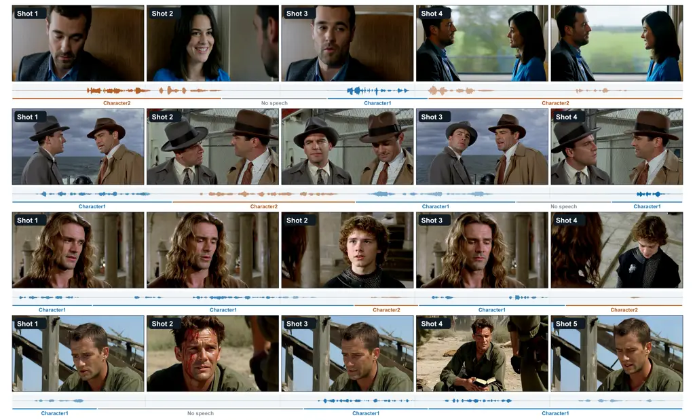
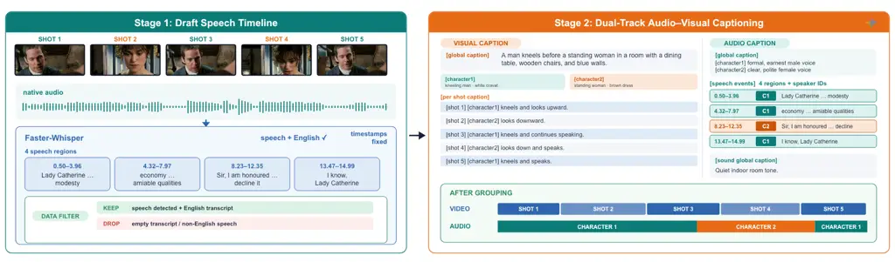
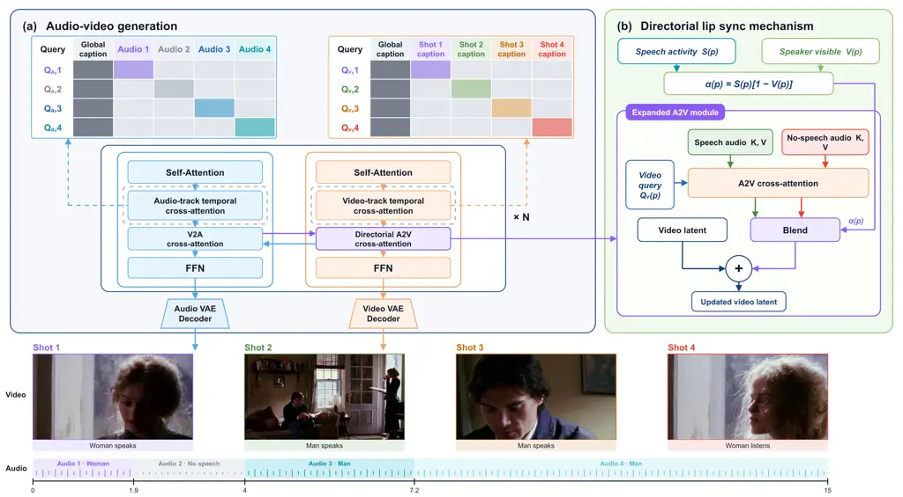
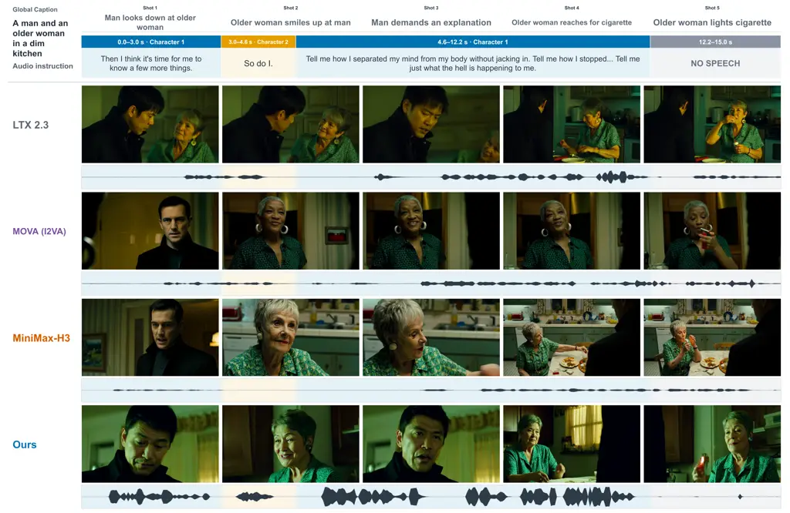
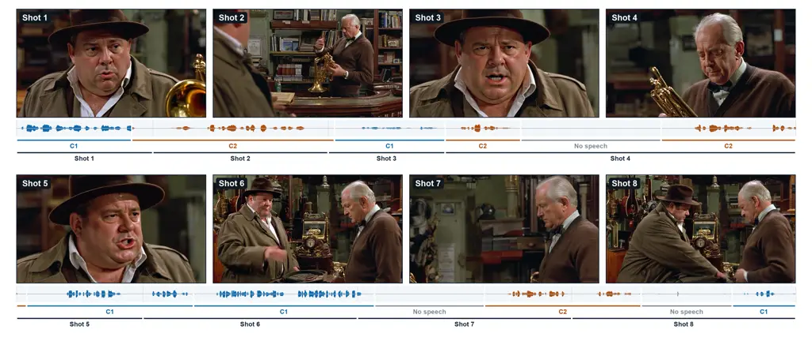
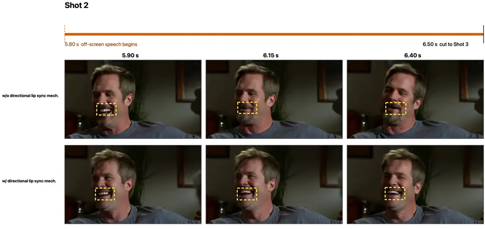

# Découpage: Directorial Audio-Visual Control for Long Multi-Shot Video Generation

Yifan Wang    Hao Ouyang    Qiuyu Wang    Yihao Meng    Wen Wang
Affiliation: The Hong Kong University of Science and Technology  Ant
Group  Zhejiang University    Zeyue Tian    Yichong Lu    Hanlin Wang   
Qingyan Bai    Zichen Liu    Yujun Shen    Qifeng Chen

###### Abstract

In cinematic storytelling, sound and visual transitions do not always
coincide in lockstep: dialogue frequently bridges across cuts to reveal
reactions or introduces new scenes via J- and L-cuts, while deliberate
silences pace the scene. Existing audio-visual generative frameworks,
however, lack explicit mechanisms to coordinate independent visual and
acoustic timing over extended horizons. As narrative duration and shot
complexity scale, these systems struggle to maintain long-range dialogue
pacing—often hallucinating speech during intended silences or
erroneously driving mouth movements on silent listeners. To enable
fine-grained cinematic control, we present Découpage, a
screenplay-driven framework for long-form, multi-shot, and
multi-character joint audio-video generation. Rather than coupling
modality boundaries by default, Découpage uncouples generation into
independently bounded visual and acoustic tracks governed by persistent
character identities. Découpage builds on a joint audio-video diffusion
model with dual-schedule temporal cross-attention, incorporating a
directorial Lip-sync mechanism that selectively decouples speech
conditioning from visual facial dynamics during off-screen dialogue. On
multi-shot conversational benchmarks, Découpage achieves precise control
over shot transitions, audio timing, and visibility-aware lip
synchronization, directing 15- to 60-second screenplay-driven
audio-video generation with multimodal coherence. Demos are available on
the [project page](https://wyf0824.github.io/decoupage/).

|     |
| --- |
|     |



Figure 1: Screenplay-directed audio-video generation. Découpage directs
visual and audio timing tracks across multi-shot scenes. Four 15-second
examples demonstrate precise control over speech bridging across cuts
(J-/L-cuts) and silent listener reactions, with all shot transitions and
synthesized audio strictly following the screenplay timeline.

## 1 Introduction

Cinematic storytelling relies fundamentally on the freedom to uncouple
what is seen from what is heard. A camera cut marks a discrete visual
shift, whereas dialogue routinely spills across visual boundaries: in J-
and L-cuts, speech anticipates an incoming scene or carries past a cut
to capture a listener’s silent reaction. These expressive devices
require independently scheduled visual and acoustic timelines, balanced
by deliberate silences and tightly synchronized articulation whenever a
visible character actually speaks.

Recent joint audio-video foundation models have enabled impressive
synchronized multimodal synthesis (HaCohen et al., 2026; Liu et al.,
2024; Zhang et al., 2025; Ma et al., 2026). However, they inherently
inherit a _rigid synchrony assumption_—a built-in tendency to
co-terminate shot boundaries, acoustic events, and facial dynamics
within tightly coupled windows. In multi-shot conversations, this
coupling falls short: dialogue easily drifts across cuts, scripted
silences leak spurious speech, and off-screen voices erroneously trigger
mouth movements on silent listeners. These failures expose two distinct
directorial challenges: acoustic continuity and deliberate silences must
be maintained independently across camera cuts, while active speech must
animate only visible speakers. Crucially, extending visual continuity
alone (Meng et al., 2025; Meng et al., 2026) leaves these cross-modal
pacing conflicts unresolved.

To address this gap, we introduce Découpage, a screenplay-driven
framework that brings fine-grained directorial control to multi-shot,
multi-character audio-video generation. Rather than binding modality
boundaries together, Découpage decomposes generation into two
independently timed visual and acoustic tracks aligned by a shared clock
and persistent character identities. Under this formulation, dialogue
can naturally span visual transitions while speakers move on- and
off-screen. To support this decoupled design, we construct continuous
15- and 60-second training sequences by merging adjacent cinematic
shots, pairing Whisper-derived speech timelines with Gemini-annotated
character roles (Radford et al., 2023; Klein, 2023; Reid et al., 2024)
to natively retain sound bridges and reaction shots.

Building upon a joint diffusion backbone adapted via LoRA (Hu et al.,
2021), Découpage introduces two complementary mechanisms for decoupled
control. First, dual-schedule temporal cross-attention enforces
shot-aware video–text intervals and timestamp-aware audio–text intervals
during denoising, steering multi-shot visual composition and acoustic
dialogue schedules along independent timelines. Second, to resolve
listener attribution errors, we introduce the directorial Lip-sync
mechanism, an inference-time method that selectively regulates
speech-driven articulation based on character visibility. During
inference, whenever an utterance occurs off-screen, it selectively
diverts the video stream’s audio cross-attention to an auxiliary
non-speech trajectory. This bypasses unwanted speech-driven facial
articulation on reaction shots while retaining the main joint
audio-generation path without requiring additional learned parameters.

Evaluating cinematic multi-shot conversations demands assessing both
temporal fidelity and selective synchronization. Beyond standard
generation metrics, a valid framework must verify that dialogue stays
within its scripted window, that deliberate silences remain quiet, and
that visible listeners stay quiescent during off-screen speech. Across
15- and 60-second conversational benchmarks, Découpage substantially
outperforms existing joint generators in shot-cut adherence, turn
containment, and silence preservation, while effectively eliminating
spurious lip synchronization on reaction shots.

Our contributions are threefold:

- •
  Screenplay Formulation and Data Pipeline We formulate multi-shot
  generation through independently bounded visual and acoustic tracks,
  supported by an automated pipeline that curates continuity-preserving
  15- and 60-second scenes with persistent character identities.
- •
  Directorial Audio-Visual Generation We employ dual-schedule temporal
  cross-attention for independently timed shot and acoustic control,
  with a training-free directorial Lip-sync mechanism that reduces
  unintended listener articulation during off-screen dialogue.
- •
  Cinematic Benchmark and Scalability We establish a screenplay-aligned
  benchmark with targeted metrics for cut fidelity, silence
  preservation, and listener quiescence. Découpage achieves
  state-of-the-art script adherence on 15-second scenes and robustly
  sustains these directorial controls when scaled to minute-long
  narratives.

## 2 Related Work

### 2.1 Long-form and multi-shot video generation

Long-form generation has increasingly separated narrative planning from
visual rendering. VideoDirectorGPT translates a prompt into an explicit
scene plan before generation (Lin et al., 2024), MovieDreamer combines a
hierarchical autoregressive narrative model with diffusion
rendering (Zhao et al., 2025), and StoryDiffusion introduces cross-frame
consistency mechanisms for image and video stories (Zhou et al., 2024).
VideoAuteur further uses rolling visual context and keyframe-based
rendering to produce long narrative videos (Xiao et al., 2025). These
methods establish the value of high-level story structure, but their
plans do not directly specify an editable soundtrack.

Another line makes the shot itself an explicit unit of control.
ShotAdapter models transitions with dedicated tokens and local attention
masks (Kara et al., 2025); HoloCine combines shot-local text windows
with sparse inter-shot attention for minute-scale generation (Meng et
al., 2025); CausalCine retrieves relevant history during autoregressive
shot progression (Meng et al., 2026); and ShotDirector controls camera
parameters and editing patterns with shot-aware conditioning (Wu et al.,
2025). These works primarily organize visual continuity; they do not
directly model the independently timed flow of dialogue across cuts. We
instead treat the cut schedule and the acoustic-event schedule as
independently timed but jointly generated tracks, so dialogue and sound
can begin, end, or continue across a visual edit.

### 2.2 Joint audio-video generation

Joint audio-video models replace post-hoc sound generation with coupled
denoising. SyncFlow uses interacting audio and video diffusion
transformers for text-conditioned synthesis (Liu et al., 2024); JavisDiT
adds hierarchical spatiotemporal priors for synchronized generation (Liu
et al., 2026a); and Animate and Sound an Image jointly expands a still
image into motion and audio (Wang et al., 2025). More recent systems
develop scalable dual-stream architectures and stronger cross-modal
interaction, including LTX-2 (HaCohen et al., 2026), UniAVGen (Zhang et
al., 2025), Cross-Modal Context Learning (Ma et al., 2026), and
Harmony (Hu et al., 2026).

Closed-source systems also support native joint generation. Seedance 1.5
Pro uses a dual-branch diffusion transformer with cross-modal
interaction (Esser et al., 2024), while Seedance 2.0 extends audio-video
generation to multimodal reference and editing inputs (Team Seedance and
others, 2025; Team Seedance and others, 2026). Veo 3 jointly denoises
temporal audio latents and spatiotemporal video latents (Google
DeepMind, 2025). Kling-Omni’s technical report describes unified
multimodal video generation and editing (Kling Team and others, 2025);
the subsequent Kling 3.0 release adds native audio, multi-character
dialogue, and shot-level storyboard control (Kuaishou Technology, 2026).
These capabilities make explicit shot and dialogue control a relevant
comparison axis, beyond perceptual quality alone.

Controllable variants begin to expose speech and cinematic structure.
MM-Sonate adds phoneme-level control and reference-timbre conditioning
for intelligible, identity-preserving speech (Qiang et al., 2026), while
CineDance and MAVIN extend joint generation toward multi-shot narratives
with structured annotations or hierarchical scripts (Chen et al., 2026;
Liu et al., 2026b). These advances emphasize synchronized audiovisual
coherence, but symmetric cross-modal interaction alone does not specify
when speech should animate a visible face. In particular, an off-screen
utterance and a listener’s reaction are temporally related without
requiring lip synchronization. Our rigid synchrony critique concerns
this control gap, rather than an architectural prohibition on off-screen
sound. Découpage makes shot and acoustic schedules independently
addressable, and selectively regulates speech-driven articulation based
on shot-level character visibility. We evaluate both temporal alignment
and visibility-conditioned coupling explicitly.

### 2.3 Multi-Character Speech and Cinematic Articulation

Audio-driven talking-face generation has evolved from single-speaker lip
synchronization (Prajwal et al., 2020; Zhang et al., 2024; Li et al., 2024) to multi-character identity routing through spatial-temporal masks
and label-aware positional embeddings (Kong et al., 2025; Huang et al.,
2025). These methods typically animate visible target faces from a
supplied audio signal. Their central task is to produce the intended
articulation, whereas cinematic dialogue also requires deciding when
audible speech should leave visible listeners unarticulated. Reaction
shots and J- and L-cuts make this distinction explicit: a speaker’s
voice can continue after their face has left the frame. Conversational
diagnostics likewise highlight the importance of speaker–listener
attribution (Zhou et al., 2026). Our focus is this role decision within
native joint generation. We leverage shot-level visibility to
dynamically regulate the audio-to-video update, complementing
asynchronous dialogue scheduling without requiring a separate
talking-face synthesis stage.

## 3 Method

We define a structured screenplay as two independently timed tracks
specifying visual shots and acoustic events, with shared character
identities and a common scene clock. Given this screenplay, Découpage
jointly generates a multi-shot video and its soundtrack. To follow these
independent schedules, we applies dual-schedule temporal cross-attention
to the video and audio streams, allowing dialogue to span visual cuts. A
training-free directorial Lip-sync mechanism further regulates
audio-to-video cross-attention residuals based on shot-level speaker
visibility, reducing unintended listener articulation during off-screen
dialogue.

### 3.1 Screenplay Formulation and Data Pipeline

#### Dual-track representation.

We represent the screenplay as a visual track
$`\mathcal{S}_{V}=\{(I_{i}^{V},c_{i}^{V},\mathcal{C}_{i})\}_{i=1}^{N_{V}}`$
and an acoustic track
$`\mathcal{S}_{A}=\{(I_{j}^{A},c_{j}^{A},\rho_{j})\}_{j=1}^{N_{A}}`$.
Here, $`I_{i}^{V}`$ is a shot interval, $`c_{i}^{V}`$ describes its
framing and action, and $`\mathcal{C}_{i}`$ contains its visible
character identities. Each acoustic event has an interval $`I_{j}^{A}`$
and a description $`c_{j}^{A}`$ specifying dialogue or non-speech sound;
$`\rho_{j}`$ identifies the speaker when the event contains speech.
Character identities persist across shots and dialogue turns.

Both tracks use the same continuous scene clock $`t\in[0,T]`$, where
$`T`$ is the sequence duration, but their boundaries are independent. In
particular, an acoustic event may overlap multiple shots. Its speaker
identity remains fixed, while its on-screen or off-screen state changes
according to the visible characters in each overlapping shot. J- and
L-cuts are thus specified by placing acoustic events relative to visual
cuts.



Figure 2: Joint audio-video data pipeline. Adjacent shots form
audiovisual sequences. Faster-Whisper establishes a fixed speech
timeline and filters out empty or non-English transcripts. Gemini 3.0
Pro then produces visual and audio captions with persistent character
identities. Finally, adjacent speech events assigned to the same
character are grouped into character-level audio intervals.

#### Continuity-preserving sequence construction.

Following HoloCine’s shot-based preprocessing (Meng et al., 2025), we
merge temporally adjacent shots from the same source into 15- and
60-second sequences. Video and native audio are resampled together,
preserving their alignment and dialogue across cuts. We remove duplicate
sequence plans and retain the shot boundaries.

#### Data captioning.

We use Faster-Whisper (Radford et al., 2023; Klein, 2023) to obtain
transcripts and speech timestamps, which remain fixed during annotation.
Given cut-aware frame samples, the assembled audio, and timestamped
transcripts, Gemini 3.0 Pro produces visual and acoustic tracks with
shared character identities. The visual track describes each shot’s
framing, visible characters, and actions. The acoustic track annotates
dialogue and speaker identities along the Whisper timeline, marks
intervals without speech as \<NO SPEECH\>, and uses a \[sound global
caption\] to describe foley, ambient sounds, background music, and the
scene’s overall acoustic atmosphere.

Recurring characters receive persistent \[characterX\] identifiers
across shots and speech events, including off-screen dialogue; voices
whose speakers never appear in the sequence are labeled \[bg\]. We group
speech annotations by character and exclude audio annotations involving
more than four distinct speaking characters. We retain reaction shots
and off-screen dialogue rather than applying a global lip-sync filter
that could exclude these valid examples.



Figure 3: Overview of Découpage. (a) Dual-track temporal cross-attention
guides joint audio-video generation along independent visual and
acoustic schedules, allowing dialogue to continue across shot
boundaries. (b) The directorial lip-sync mechanism blends speech and
no-speech A2V residuals based on speaker visibility to suppress
unintended listener articulation.

### 3.2 Dual-Schedule Temporal Cross-Attention

To coordinate multi-shot visuals and continuous audio without enforcing
rigid modality synchrony, we implement dual-schedule temporal
cross-attention. Our dual-schedule isolates the visual and acoustic text
conditions along their respective screenplay timelines: a visual cut
shifts the accessible shot descriptions for video queries, while an
ongoing speech or acoustic event conditioning remains intact across that
transition.

Specifically, for each modality $`X\in\{V,A\}`$, let $`\tau_{X}(p)`$
denote the scene timestamp corresponding to latent query token $`p`$.
The textual conditioning keys are partitioned into global context tokens
$`\mathcal{G}`$, shared register tokens $`\mathcal{R}`$, and
interval-specific text tokens $`\mathcal{T}_{i}^{X}`$ associated with
interval $`I_{i}^{X}`$. Notably,
$`\mathcal{G}=\mathcal{G}_{V}\cup\mathcal{G}_{A}`$ simultaneously
encapsulates sequence-level global descriptions for both video and
audio. The accessible key index set $`\mathcal{A}_{X}(p)`$ for query
$`p`$ is formally defined as:

```math
\mathcal{A}_{X}(p)=\mathcal{G}\cup\mathcal{R}\cup\bigcup_{i:\,\tau_{X}(p)\in I_{i}^{X}}\mathcal{T}_{i}^{X}. \tag{1}
```

For the visual track ($`X=V`$), each query token $`p`$ strictly attends
to its current shot’s prompt $`I_{i}^{V}`$. For the acoustic track
($`X=A`$), the union naturally accommodates multiple concurrent acoustic
descriptions active at timestamp $`\tau_{A}(p)`$, seamlessly allowing
ambient foley and environmental sounds.

We enforce this dual-schedule temporal cross-attention via an additive
attention mask $`M_{XT}\in\mathbb{R}^{N_{X}\times L_{T}}`$:

```math
M_{XT}[p,k]=\begin{cases}0,&k\in\mathcal{A}_{X}(p),\\
-\kappa,&\text{otherwise},\end{cases} \tag{2}
```

where $`\kappa`$ is a large positive scalar ($`e.g.,10^{4}`$). The
routed cross-attention is computed as:

```math
\operatorname{Attn}_{XT}=\operatorname{softmax}\!\left(\frac{Q_{X}K_{T,X}^{\top}}{\sqrt{d_{X}}}+M_{XT}\right)V_{T,X}, \tag{3}
```

where $`Q_{X}`$ denotes the latent queries of modality $`X`$, and
$`K_{T,X},V_{T,X}`$ are the text conditioning keys and values. Because
recurring characters share consistent identifiers (e.g., \[character1\])
across different intervals $`\mathcal{T}_{i}^{A}`$ and
$`\mathcal{T}_{i}^{V}`$, this dual-schedule formulation grounds
long-range identity consistency across alternating visual shots and
asynchronous dialogue turns.

### 3.3 Directorial Lip-Sync Mechanism

While dual-schedule temporal cross-attention specifies _when_ camera
cuts occur and _when_ dialogue begins or ends, it does not dictate
_whether_ active speech should animate a visible character. During
listener/reaction shots, dialogue naturally carries over while the
camera captures a silent listener. Rather than leaving the video
features unconstrained without acoustic guidance, we supply an explicit
quiescent signal by deriving an auxiliary audio trajectory conditioned
on \<NO SPEECH\>. This training-free mechanism selectively suppresses
speech-driven lip motion during off-screen dialogue, while preserving
the listener’s natural facial expressions and emotional reactions
undisturbed.

#### Paired speech and no-speech trajectories.

At each denoising step, we obtain audio states from the native joint
trajectory and an auxiliary, paired-noise audio-only trajectory
conditioned on \<NO SPEECH\>. At block $`l`$, these trajectories supply
two sets of audio keys and values,
$`(K_{A,\mathrm{native}}^{(l)},V_{A,\mathrm{native}}^{(l)})`$ and
$`(K_{A,\mathrm{ns}}^{(l)},V_{A,\mathrm{ns}}^{(l)})`$. Both are
evaluated against the same native video queries:

```math
r_{b}^{(l)}=\mathcal{F}_{\mathrm{A2V}}^{(l)}\left(Q_{V}^{(l)},K_{A,b}^{(l)},V_{A,b}^{(l)}\right),\quad b\in\{\mathrm{native},\mathrm{ns}\}, \tag{4}
```

where $`\mathcal{F}_{\mathrm{A2V}}^{(l)}`$ denotes the block’s
audio-to-video cross attention and residual-output mapping. The
alternative residual therefore uses audio features from the
corresponding block and denoising step, rather than a zeroed audio input
or a separate full video prediction.

#### Directorial A2V residual blending.

We blend the paired audio to video (A2V) residuals according to whether
the screenplay places the active speaker on screen. For a video query
$`p`$ in shot $`i`$, let $`S(p)\in\{0,1\}`$ indicate scheduled speech
activity, and let $`V(p)=\mathbb{I}(\rho_{j}\in\mathcal{C}_{i})`$
indicate whether the active speaker $`\rho_{j}`$ belongs to the set of
characters $`\mathcal{C}_{i}`$ shown in that shot. These screenplay
directives determine the blending weight

```math
\alpha(p)=S(p)\bigl(1-V(p)\bigr), \tag{5}
```

which we apply to the paired residuals at each block $`l`$:

```math
\tilde{r}_{\mathrm{A2V}}^{(l)}(p)=\bigl(1-\alpha(p)\bigr)r_{\mathrm{native}}^{(l)}(p)+\alpha(p)r_{\mathrm{ns}}^{(l)}(p). \tag{6}
```

During off-screen dialogue ($`S=1,V=0`$), $`\alpha=1`$ replaces the
native A2V residual with its no-speech counterpart, providing quiescent
acoustic guidance for the visible listener. When the speaker is on
screen ($`V=1`$) or no speech is scheduled ($`S=0`$), $`\alpha=0`$
retains the native residual. The control is applied uniformly across
video queries within each temporal intersection of a shot and a speech
interval, requiring no spatial face masks. At the A2V residual addition,
the video state is updated as

```math
h_{V,\mathrm{out}}^{(l)}(p)=h_{V,\mathrm{base}}^{(l)}(p)+\tilde{r}_{\mathrm{A2V}}^{(l)}(p). \tag{7}
```

where $`h_{V,\mathrm{base}}^{(l)}`$ is the video state before this
residual is added. Subsequent block operations proceed normally. This
intervention changes the audio-derived update received by the visible
scene during off-screen speech, while retaining native coupling for
visible speakers.

The auxiliary audio trajectory requires no video backbone computation or
video-to-audio (V2A) cross-attention, functioning solely to supply the
no-speech audio states for the alternative A2V residual. Meanwhile, the
main generation branch retains its native bidirectional coupling without
directly replacing or blending the main branch’s audio prediction. This
lightweight design introduces minimal computational overhead, as
verified by the per-step runtime in Section 4.5.

## 4 Experiments

|                              |                     |                        |                      |                    |                    |                     |                 |                       |                     |                     |
| ---------------------------- | ------------------- | ---------------------- | -------------------- | ------------------ | ------------------ | ------------------- | --------------- | --------------------- | ------------------- | ------------------- |
|                              | Video Quality       |                        |                      | Audio Quality      |                    |                     |                 | Voice Identity        |                     | AV Align.           |
| Model                        | Cut F1 $`\uparrow`$ | Cnt MAE $`\downarrow`$ | Imaging $`\uparrow`$ | WER $`\downarrow`$ | Cont. $`\uparrow`$ | Leak $`\downarrow`$ | PQ $`\uparrow`$ | Consist. $`\uparrow`$ | Margin $`\uparrow`$ | Sync-C $`\uparrow`$ |
| 15-second Evaluation Dataset |                     |                        |                      |                    |                    |                     |                 |                       |                     |                     |
| LTX-2.3 Base                 | 0.26                | 1.23                   | 0.68                 | 35.69              | 52.68              | 18.69               | 6.18            | 0.42                  | 0.12                | 2.52                |
| MiniMax-H3                   | 0.28                | 0.48                   | 0.70                 | 10.23              | 41.95              | 27.28               | 7.26            | 0.50                  | 0.14                | 4.88                |
| MOVA (I2VA)                  | 0.18                | 7.38                   | 0.56                 | 38.22              | 39.33              | 28.47               | 6.26            | 0.36                  | 0.01                | 3.24                |
| Ours                         | 0.99                | 0.05                   | 0.68                 | 4.59               | 93.01              | 1.12                | 6.91            | 0.53                  | 0.29                | 3.59                |
| 60-second Evaluation Dataset |                     |                        |                      |                    |                    |                     |                 |                       |                     |                     |
| LTX-2.3 Base                 | 0.05                | 5.27                   | 0.61                 | 43.68              | 11.88              | 32.71               | 6.26            | 0.42                  | 0.06                | 2.77                |
| Ours                         | 0.76                | 1.81                   | 0.66                 | 7.13               | 91.12              | 4.46                | 6.84            | 0.57                  | 0.22                | 4.00                |

Table 1: Quantitative results on the 15-second and 60-second benchmarks.
Metrics WER, Cont., and Leak are reported in percentage (%). Bold font
indicates the best performance within each duration group.

### 4.1 Datasets and Experimental Setup

#### Datasets and Evaluation Benchmark.

The automated curation pipeline (Section 3.1) yields approximately
30,000 cleaned, temporally aligned video–audio sequences for model
adaptation. To benchmark performance under complex conversational
dynamics, we construct an evaluation suite comprising 200 15-second and
200 60-second multi-character screenplays. Each screenplay explicitly
specifies shot boundaries, recurring character identities, dialogue
lines, and fine-grained acoustic timestamps, enabling standardized
evaluation across both short- and long-horizon video generation.

#### Implementation Details and Baselines.

We instantiate our approach upon the LTX-2.3 Base joint audio–video
backbone (HaCohen et al., 2026), fine-tuning with LoRA (rank $`r=32`$,
initial learning rate $`5\times 10^{-5}`$ with a linear decay schedule)
across 32 NVIDIA H20 GPUs. We compare Découpage against representative
open and proprietary joint audiovisual generation models, including the
base model LTX2.3, MiniMax-H3 (MiniMax, 2026), and MOVA (SII-OpenMOSS
Team et al., 2026) in its image-to-video-audio (I2VA) configuration. All
baselines are supplied with identical screenplay directives and
evaluated using their official inference and sampling settings.

### 4.2 Evaluation Metrics

#### Cinematic Shot Control.

We detect scene transitions at a fixed threshold of 0.18 and match them
one-to-one to screenplay cuts within 0.5 seconds. We report Cut F1 and
the mean absolute error in cut count (Count MAE). In addition, we
evaluate the Imaging Quality dimension of VBench (Huang et al., 2023) to
assess overall video fidelity.

#### Dialogue and Pacing Control.

We transcribe generated audio with Faster-Whisper (Radford et al., 2023;
Klein, 2023) and compute corpus-level word error rate (WER) against the
reference dialogue. Containment ($`\uparrow`$) is the percentage of
target turns whose aligned speech overflows the scripted window by no
more than 0.2 seconds for the 15-second evaluation dataset or 0.4
seconds for the 60-second evaluation dataset. Silence Leakage
($`\downarrow`$) is the duration-weighted overlap between recognized
words and the interior of scripted silence intervals. We assess acoustic
naturalness with AudioBox P-Q (Vyas et al., 2023). Exact definitions and
support rules appear in Appendix A.2.

#### Vocal and Audiovisual Consistency.

We evaluate character voice identity with ECAPA-TDNN
embeddings (Desplanques et al., 2020). Role Consistency is the cosine
similarity of same-character voice embeddings across utterances; Role
Margin is its within-video margin over different-character similarity.
Sync-C is the SyncNet confidence (Chung and Zisserman, 2016), which
measures audiovisual alignment between a visible person’s lip movements
and the speech audio. To detect whether non-speaking characters are
erroneously driven by off-screen dialogue, we introduce TemporalBias,
which measures spurious audio-visual coupling on listener faces via
time-shifted SyncNet contrast (details in Appendix A.2). Lower values
indicate that listener mouth movements remain natural and independent of
acoustic timing, rather than being falsely modulated by speech.

### 4.3 Quantitative Results



Figure 4: Qualitative comparison on a five-shot screenplay. Columns
present shot prompts and the target dialogue schedule; rows show
keyframes and synthesized audio waveforms across models. Blue/orange
highlights mark each character’s speech windows, and gray denotes
silence. Découpage adheres to the multi-shot structure across
transitions, respects the Shot-4 listener, and correctly synthesizes the
Shot-5 slience and lighter flick, achieving superior audio-visual
alignment.

#### Comparison on 15-Second Generations.

Table 1 shows that Découpage achieves the strongest screenplay control
and character voice consistency among the evaluated methods on the
15-second benchmark. It achieves near-perfect adherence to the requested
edits, with 0.99 Cut F1 and 0.05 Count MAE. It also obtains the lowest
WER (4.59%), the highest containment (93.01%), and the lowest silence
leakage (1.12%). Beyond temporal control, Découpage achieves the highest
Role Consistency (0.53) and Role Margin (0.29), maintaining consistent
character voices across conversations. These gains preserve competitive
audiovisual quality. Découpage also improves AudioBox P-Q from 6.18 to
6.91 and Sync-C from 2.52 to 3.59. Although MiniMax-H3 achieves a higher
Sync-C score (5.00), the supplementary video comparisons show that
Découpage provides satisfactory lip synchronization for the cinematic
video generation.

#### Scaling to Minute-Long Narratives.

When scaling the generation horizon to 60 seconds, Découpage robustly
maintains its high-fidelity temporal control and narrative coherence. As
shown in Table 1, it preserves an impressive 0.76 Cut F1 and 91.12%
containment with a mere 4.46% silence leakage. In stark contrast,
standard baselines struggle severely over extended durations—for
instance, LTX-2.3 Base degrades to 0.05 Cut F1 and 11.88% containment,
while its silence leakage surges to 32.71%. Furthermore, Découpage
retains strong character voice consistency and separation, achieving
0.57 Role Consistency and 0.22 Role Margin. These results confirm that
our framework’s screenplay adherence and acoustic grounding scale
gracefully to continuous, minute-long cinematic scenes without drifting
or collapsing.

### 4.4 Qualitative Results

Figure 4 compares Découpage with LTX-2.3 Base (HaCohen et al., 2026),
MOVA (SII-OpenMOSS Team et al., 2026), and MiniMax-H3 (MiniMax, 2026) on
the same five-shot screenplay. The example contains two alternating
speakers, a long third dialogue turn that spans two visual shots, and a
final 2.8-second no-speech interval. The baseline rows show weaker
adherence to the requested shot sequence and poorer control of dialogue
timing, consistent with the dataset-level results in Table 1. In
contrast, Découpage faithfully follows the screenplay’s visual-shot and
acoustic-event schedules: it reproduces all five requested compositions,
carries the third utterance across the cut to the Shot-4 listener
without driving the listener’s lips, and preserves the Shot-5 no-speech
interval while generating the lighter flick. Qualitative results for
60-second generations are presented in Appendix A.1, with more
qualitative examples provided in the supplementary materials.

### 4.5 Ablation Study

Table 2 examines both components on a fixed subset of 136 of the 200
screenplays in the 15-second benchmark, where the lip-sync mechanism is
applicable. All ablation configurations use the same subset, while
Table 1 reports results on the full benchmark. Removing dual-schedule
temporal cross-attention reduces Cut F1 from 0.99 to 0.34 and dialogue
containment from 92.83% to 39.34%, demonstrating the importance of
independently timed text conditioning for shot and dialogue scheduling.
The directorial lip-sync mechanism addresses a complementary aspect of
control: whether active speech should drive visible articulation.
Compared with native audiovisual coupling, it reduces listener
TemporalBias from 1.78 to 0.33, an 81.5% relative reduction, while
Imaging Quality, speaker Sync-C, and audio metrics remain broadly
stable. These results indicate reduced unwanted audiovisual coupling on
listener shots while retaining visible-speaker synchronization. A
matched qualitative comparison is provided in Appendix A.3, with videos
in the supplementary materials. To assess the computational cost of
these gains, we compare inference runtime with and without the
directorial lip-sync mechanism using the same model checkpoint. On a
single NVIDIA H20 GPU, enabling the mechanism increases the per-step
runtime from 12.81 to 13.01 seconds (Table 2), corresponding to an
additional 0.20 seconds (1.56%). This modest overhead requires no
additional training or learned parameters.

|                            |                     |                      |                    |                    |                     |                   |                         |                         |                              |
| -------------------------- | ------------------- | -------------------- | ------------------ | ------------------ | ------------------- | ----------------- | ----------------------- | ----------------------- | ---------------------------- |
|                            | Video Quality       |                      | Audio Quality      |                    |                     |                   | AV Alignment            |                         | Efficiency                   |
| Configuration              | Cut F1 $`\uparrow`$ | Imaging $`\uparrow`$ | WER $`\downarrow`$ | Cont. $`\uparrow`$ | Leak $`\downarrow`$ | Sim. $`\uparrow`$ | Bias (L) $`\downarrow`$ | Sync-C (S) $`\uparrow`$ | Time (s/step) $`\downarrow`$ |
| Dual-schedule temporal CA  |                     |                      |                    |                    |                     |                   |                         |                         |                              |
| w/o Temporal CA            | 0.34                | 0.65                 | 6.57               | 39.34              | 25.98               | 0.39              | 2.31                    | 3.16                    | 12.81                        |
| Directorial Lip-Sync Mech. |                     |                      |                    |                    |                     |                   |                         |                         |                              |
| w/o Mechanism              | 0.99                | 0.66                 | 4.38               | 90.89              | 0.74                | 0.55              | 1.78                    | 3.53                    | 12.81                        |
| w/ Mechanism (Ours)        | 0.99                | 0.66                 | 4.16               | 92.83              | 0.77                | 0.56              | 0.33                    | 3.42                    | 13.01                        |

Table 2: Ablation study on core components. Evaluated on a fixed subset
of the 15-second conversational benchmark. Best values within each block
are in bold. Notably, the lip-sync mechanism is entirely training-free:
both configurations in the second block operate on the exact same
checkpoint. Runtime denotes seconds per denoising step measured on a
single NVIDIA H20 GPU.

## 5 Conclusion

Découpage enables independent handling of visual shot cuts and
continuous cinematic audio through dual‑schedule temporal
cross‑attention. It orchestrates shot transitions and dialogue schedules
via decoupled time schedules, while the directorial lip‑sync mechanism
leverages auxiliary non‑speech acoustic states to suppress phantom
articulation on silent listeners. Together, these designs naturally
unlock cinematic reaction shots and sound‑bridge effects for long‑form
video generation. Evaluations over 15‑second and 60‑second multi‑shot
conversational scenes demonstrate clear improvements in cut adherence,
dialogue containment, and recurring‑character voice consistency,
yielding high‑quality narrative multi‑shot audiovisual outputs.

#### Limitations and Future Work.

Our current formulation targets turn‑taking dialogue and does not
explicitly support simultaneous, overlapping speech from multiple
characters. This limits performance for crowded group scenes where
several actors speak concurrently. One potential path forward is to
extend our acoustic track to model multiple co‑active speech events
within the same time interval. Moving forward, an exciting frontier is
exploring real‑time, directorial‑level joint audiovisual generation to
enable responsive, on‑the‑fly cinematic creation. In parallel, we
envision developing assisted screenplay authoring tools to simplify
high‑level creative control and lower end‑user barriers.

## AI use statement

Generative AI tools were used to assist with literature organization and
the drafting and revision of manuscript text, including improving
clarity, grammar, and readability. All AI-assisted content was reviewed
and edited by the authors to ensure that it accurately reflected the
research conducted. The authors verified the cited sources, checked
technical descriptions and implementation claims against the code, and
reviewed the experiments and results included in the paper. All
substantive research decisions and interpretations of the findings
remained the responsibility of the authors. The authors take full
responsibility for the accuracy, originality, and integrity of the final
manuscript.

## Reproducibility Statement

To support reproducibility, we will release the full codebase and
accompanying documentation upon publication. The release will include
environment specifications and dependencies, model configurations,
hyperparameters, random seeds, data preparation and splitting
procedures, and training schedules. We will also provide the evaluation
scripts and metric implementations used to produce the reported results,
together with step-by-step commands for running the experiments.
Hardware configurations and execution-time information will be
documented to help researchers assess the computational requirements.
These materials will enable independent verification of our findings and
facilitate further research building on our work.

## References

- Chen et al. (2026) Y. Chen, T. Hu, Y. Wang, Q. He, Z. Xue, Q. Zhou, X.
  Li, L. Ma, J. Zhang, and D. Tao CineDance: towards next-generation
  multi-shot long-form cinematic audio-video generation. arXiv preprint
  arXiv:2606.09639. Cited by: §2.2.
- Chung and Zisserman (2016) J. S. Chung and A. Zisserman Out of time:
  automated lip sync in the wild. In Workshop on Multi-view Lip-reading,
  ACCV, Cited by: §4.2.
- Desplanques et al. (2020) B. Desplanques, J. Thienpondt, and K.
  Demuynck ECAPA-TDNN: emphasized channel attention, propagation and
  aggregation in TDNN based speaker verification. In Interspeech 2020,
  pp. 3830–3834. External Links:
  [Document](https://dx.doi.org/10.21437/Interspeech.2020-2650) Cited
  by: §4.2.
- Esser et al. (2024) P. Esser, S. Kulal, A. Blattmann, R. Entezari, J.
  Müller, H. Saini, Y. Levi, D. Lorenz, A. Sauer, F. Boesel, et al.
  Scaling rectified flow transformers for high-resolution image
  synthesis. In Forty-first international conference on machine
  learning, Cited by: §2.2.
- Google DeepMind (2025) Google DeepMind Veo 3: technical report.
  Technical report Google DeepMind. External Links:
  [Link](https://storage.googleapis.com/deepmind-media/veo/Veo-3-Tech-Report.pdf)
  Cited by: §2.2.
- HaCohen et al. (2026) Y. HaCohen, B. Brazowski, N. Chiprut, Y.
  Bitterman, A. Kvochko, A. Berkowitz, D. Shalem, D. Lifschitz, D.
  Moshe, E. Porat, E. Richardson, G. Shiran, et al. LTX-2: efficient
  joint audio-visual foundation model. arXiv preprint arXiv:2601.03233.
  Cited by: §1, §2.2, §4.1, §4.4.
- Hu et al. (2021) E. J. Hu, Y. Shen, P. Wallis, Z. Allen-Zhu, Y. Li, S.
  Wang, L. Wang, and W. Chen Lora: low-rank adaptation of large language
  models. arXiv preprint arXiv:2106.09685. Cited by: §1.
- Hu et al. (2026) T. Hu, Z. Yu, G. Zhang, Z. Su, Z. Zhou, Y. Zhang, Y.
  Zhou, Q. Lu, and R. Yi Harmony: harmonizing audio-video generation
  through cross-task synergy. In Proceedings of the IEEE/CVF Conference
  on Computer Vision and Pattern Recognition, pp. 16085–16095. External
  Links:
  [Link](https://openaccess.thecvf.com/content/CVPR2026/html/Hu_Harmony_Harmonizing_Audio-Video_Generation_through_Cross-Task_Synergy_CVPR_2026_paper.html)
  Cited by: §2.2.
- Huang et al. (2025) Y. Huang, W. Wang, S. Zhao, T. Xu, L. Liu, and E.
  Chen Bind-Your-Avatar: multi-talking-character video generation with
  dynamic 3d-mask-based embedding router. arXiv preprint
  arXiv:2506.19833. Cited by: §2.3.
- Huang et al. (2023) Z. Huang, Y. He, J. Yu, F. Zhang, et al. VBench:
  comprehensive benchmark suite for video generative models. arXiv
  preprint arXiv:2311.17982. Cited by: §4.2.
- Kara et al. (2025) O. Kara, K. K. Singh, F. Liu, D. Ceylan, J. M.
  Rehg, and T. Hinz ShotAdapter: text-to-multi-shot video generation
  with diffusion models. In Proceedings of the IEEE/CVF Conference on
  Computer Vision and Pattern Recognition, pp. 28405–28415. External
  Links: [Document](https://dx.doi.org/10.1109/CVPR52734.2025.02645)
  Cited by: §2.1.
- Klein (2023) G. Klein Faster-whisper: faster whisper transcription
  with CTranslate2. Note: GitHub repository External Links:
  [Link](https://github.com/SYSTRAN/faster-whisper) Cited by: §1, §3.1,
  §4.2.
- Kling Team et al. (2025) Kling Team et al. Kling-Omni technical
  report. arXiv preprint arXiv:2512.16776. External Links:
  [Document](https://dx.doi.org/10.48550/arXiv.2512.16776),
  [Link](https://arxiv.org/abs/2512.16776) Cited by: §2.2.
- Kong et al. (2025) Z. Kong, F. Gao, Y. Zhang, Z. Kang, X. Wei, X.
  Cai, G. Chen, and W. Luo Let them talk: audio-driven multi-person
  conversational video generation. arXiv preprint arXiv:2505.22647.
  Cited by: §2.3.
- Kuaishou Technology (2026) Kuaishou Technology Kling AI launches 3.0
  model, ushering in an era where everyone can be a director. Note:
  Official release announcement, February 5 External Links:
  [Link](https://ir.kuaishou.com/news-releases/news-release-details/kling-ai-launches-30-model-ushering-era-where-everyone-can-be)
  Cited by: §2.2.
- Li et al. (2024) C. Li, C. Zhang, W. Xu, J. Lin, J. Xie, W. Feng, B.
  Peng, C. Chen, and W. Xing LatentSync: taming audio-conditioned latent
  diffusion models for lip sync with SyncNet supervision. arXiv preprint
  arXiv:2412.09262. External Links: 2412.09262,
  [Document](https://dx.doi.org/10.48550/arXiv.2412.09262),
  [Link](https://arxiv.org/abs/2412.09262) Cited by: §2.3.
- Lin et al. (2024) H. Lin, A. Zala, J. Cho, and M. Bansal
  VideoDirectorGPT: consistent multi-scene video generation via
  LLM-guided planning. In Conference on Language Modeling, External
  Links: [Link](https://arxiv.org/abs/2309.15091) Cited by: §2.1.
- Liu et al. (2024) H. Liu, G. Le Lan, X. Mei, Z. Ni, A. Kumar, V.
  Nagaraja, W. Wang, M. D. Plumbley, Y. Shi, and V. Chandra SyncFlow:
  toward temporally aligned joint audio-video generation from text.
  arXiv preprint arXiv:2412.15220. External Links: 2412.15220,
  [Document](https://dx.doi.org/10.48550/arXiv.2412.15220),
  [Link](https://arxiv.org/abs/2412.15220) Cited by: §1, §2.2.
- Liu et al. (2026a) K. Liu, W. Li, L. Chen, S. Wu, Y. Zheng, J. Ji, F.
  Zhou, J. Luo, Z. Liu, H. Fei, and T. Chua JavisDiT: joint audio-video
  diffusion transformer with hierarchical spatio-temporal prior
  synchronization. In International Conference on Learning
  Representations, External Links: 2503.23377,
  [Link](https://arxiv.org/abs/2503.23377) Cited by: §2.2.
- Liu et al. (2026b) K. Liu, Y. Mao, Z. Cai, Z. Geng, J. Wang, Q.
  Wang, X. Wang, P. Wan, K. Gai, S. Weng, and B. Shi MAVIN: multi-shot
  audio-visual generation with narrative control. arXiv preprint
  arXiv:2606.29473. Cited by: §2.2.
- Ma et al. (2026) B. Ma, L. Lang, M. Zhang, D. He, X. Ge, Y. Zhang, G.
  Song, and Y. Liu Improving joint audio-video generation with
  cross-modal context learning. arXiv preprint arXiv:2603.18600. Cited
  by: §1, §2.2.
- Meng et al. (2026) Y. Meng, Z. Liu, H. Ouyang, Q. Wang, K. L.
  Cheng, Y. Yu, H. Wang, H. Li, J. Zhu, Y. Zeng, X. Zhu, Y. Shen, Q.
  Chen, and H. Qu CausalCine: real-time autoregressive generation for
  multi-shot video narratives. arXiv preprint arXiv:2605.12496. Cited
  by: §1, §2.1.
- Meng et al. (2025) Y. Meng, H. Ouyang, Y. Yu, Q. Wang, W. Wang, K. L.
  Cheng, H. Wang, Y. Li, C. Chen, Y. Zeng, Y. Shen, and H. Qu HoloCine:
  holistic generation of cinematic multi-shot long video narratives.
  arXiv preprint arXiv:2510.20822. Cited by: §1, §2.1, §3.1.
- MiniMax (2026) MiniMax MiniMax H3: an open model breaking the
  boundaries between tasks and modalities. Note: MiniMax Research blog
  External Links: [Link](https://www.minimax.io/blog/minimax-h3) Cited
  by: §4.1, §4.4.
- Prajwal et al. (2020) K. R. Prajwal, R. Mukhopadhyay, V. P.
  Namboodiri, and C. V. Jawahar A lip sync expert is all you need for
  speech to lip generation in the wild. In Proceedings of the 28th ACM
  International Conference on Multimedia, pp. 484–492. External Links:
  [Document](https://dx.doi.org/10.1145/3394171.3413532) Cited by: §2.3.
- Qiang et al. (2026) C. Qiang, J. Wang, X. Wang, K. Yin, Y. Guo, X.
  Zeng, N. Li, Z. Li, Y. Liang, Z. Zhang, T. Ma, Y. Chen, Z. Liu, F.
  Deng, C. Zhang, and P. Wan MM-Sonate: multimodal controllable
  audio-video generation with zero-shot voice cloning. arXiv preprint
  arXiv:2601.01568. Cited by: §2.2.
- Radford et al. (2023) A. Radford, J. W. Kim, T. Xu, G. Brockman, C.
  McLeavey, and I. Sutskever Robust speech recognition via large-scale
  weak supervision. In Proceedings of the 40th International Conference
  on Machine Learning, Cited by: §1, §3.1, §4.2.
- Reid et al. (2024) M. Reid, N. Savinov, D. Teplyashin, D. Lepikhin, T.
  Lillicrap, J. Alayrac, R. Soricut, A. Lazaridou, O. Firat, J.
  Schrittwieser, et al. Gemini 1.5: unlocking multimodal understanding
  across millions of tokens of context. arXiv preprint arXiv:2403.05530.
  Cited by: §1.
- SII-OpenMOSS Team et al. (2026) SII-OpenMOSS Team, D. Yu, M. Chen, Q.
  Chen, Q. Luo, Q. Wu, Q. Cheng, R. Li, T. Liang, W. Zhang, et al. MOVA:
  towards scalable and synchronized video–audio generation. arXiv
  preprint arXiv:2602.08794. Cited by: §4.1, §4.4.
- Team Seedance et al. (2025) Team Seedance et al. Seedance 1.5 Pro: a
  native audio-visual joint generation foundation model. arXiv preprint
  arXiv:2512.13507. External Links:
  [Document](https://dx.doi.org/10.48550/arXiv.2512.13507),
  [Link](https://arxiv.org/abs/2512.13507) Cited by: §2.2.
- Team Seedance et al. (2026) Team Seedance et al. Seedance 2.0:
  advancing video generation for world complexity. arXiv preprint
  arXiv:2604.14148. External Links:
  [Document](https://dx.doi.org/10.48550/arXiv.2604.14148),
  [Link](https://arxiv.org/abs/2604.14148) Cited by: §2.2.
- Vyas et al. (2023) A. Vyas, B. Shi, M. Le, A. Tjandra, Y. Wu, B.
  Guo, J. Zhang, X. Zhang, R. Adkins, W. Ngan, et al. AudioBox: unified
  audio generation with natural language prompts. arXiv preprint
  arXiv:2312.15821. Cited by: §4.2.
- Wang et al. (2025) X. Wang, R. Song, C. Li, X. Cheng, B. Li, Y. Wu, Y.
  Wang, H. Xu, and Y. Wang Animate and sound an image. In Proceedings of
  the IEEE/CVF Conference on Computer Vision and Pattern Recognition,
  pp. 23369–23378. External Links:
  [Document](https://dx.doi.org/10.1109/CVPR52734.2025.02176) Cited by:
  §2.2.
- Wu et al. (2025) X. Wu, X. Chen, Y. Wang, and Y. Qiao ShotDirector:
  directorially controllable multi-shot video generation with
  cinematographic transitions. arXiv preprint arXiv:2512.10286. External
  Links: 2512.10286,
  [Document](https://dx.doi.org/10.48550/arXiv.2512.10286),
  [Link](https://arxiv.org/abs/2512.10286) Cited by: §2.1.
- Xiao et al. (2025) J. Xiao, F. Cheng, L. Qi, L. Gui, Y. Zhao, S.
  Lin, J. Cen, Z. Ma, A. Yuille, and L. Jiang VideoAuteur: towards long
  narrative video generation. In Proceedings of the IEEE/CVF
  International Conference on Computer Vision, pp. 19163–19173. External
  Links: [Document](https://dx.doi.org/10.1109/ICCV51701.2025.01781)
  Cited by: §2.1.
- Zhang et al. (2025) G. Zhang, Z. Zhou, T. Hu, Z. Peng, Y. Zhang, Y.
  Chen, Y. Zhou, Q. Lu, and L. Wang UniAVGen: unified audio and video
  generation with asymmetric cross-modal interactions. arXiv preprint
  arXiv:2511.03334. Cited by: §1, §2.2.
- Zhang et al. (2024) Y. Zhang, Z. Zhong, M. Liu, Z. Chen, B. Wu, Y.
  Zeng, C. Zhan, Y. He, J. Huang, and W. Zhou MuseTalk: real-time
  high-fidelity video dubbing via spatio-temporal sampling. arXiv
  preprint arXiv:2410.10122. External Links: 2410.10122,
  [Document](https://dx.doi.org/10.48550/arXiv.2410.10122),
  [Link](https://arxiv.org/abs/2410.10122) Cited by: §2.3.
- Zhao et al. (2025) C. Zhao, M. Liu, W. Wang, W. Chen, F. Wang, H.
  Chen, B. Zhang, and C. Shen MovieDreamer: hierarchical generation for
  coherent long visual sequences. In International Conference on
  Learning Representations, External Links:
  [Link](https://proceedings.iclr.cc/paper_files/paper/2025/hash/7d4647db960780c8b5a4e7d9e4a58d68-Abstract-Conference.html)
  Cited by: §2.1.
- Zhou et al. (2026) Y. Zhou, H. Li, R. Lin, H. Huang, J. Zhou, C.
  Yuan, T. Lan, Z. Zhou, Y. Li, J. Xu, J. Liao, Y. Cheng, X. Chen, X.
  Mao, and Y. Feng MTAVG-Bench: a diagnostic benchmark for multi-talker
  dialogue-centric audio-video generation. arXiv preprint
  arXiv:2602.00607. Cited by: §2.3.
- Zhou et al. (2024) Y. Zhou, D. Zhou, M. Cheng, J. Feng, and Q. Hou
  StoryDiffusion: consistent self-attention for long-range image and
  video generation. In Advances in Neural Information Processing
  Systems, Vol. 37, pp. 110315–110340. External Links:
  [Link](https://proceedings.neurips.cc/paper_files/paper/2024/hash/c42f76b2ec3b3acff7c7b31f6486d0c9-Abstract-Conference.html)
  Cited by: §2.1.

## Appendix A Supplementary Results

### A.1 Minute-Long Qualitative Results

Figure 5 illustrates our model’s ability to generate a 60-second
multi-shot audiovisual sequence. More examples are provided in the
supplementary materials.



Figure 5: Qualitative example of a 60-second generation. Eight
representative frames show a two-character exchange unfolding across
multiple shots in a trumpet shop. Beneath each row, the generated audio
waveform is aligned with the corresponding shot sequence. The colored
strips indicate the screenplay-specified speaking role (C1 or C2), while
gray segments denote intervals with no requested speech. The example
visualizes coordinated shot transitions, character turns, and
speech–silence timing over a full-minute sequence.

### A.2 Metric Definitions and Evaluation Protocol

Dialogue accuracy. For video $`i`$, let $`n_{i}`$ be the number of
reference words and let $`s_{i}`$, $`d_{i}`$, and $`u_{i}`$ denote
substitutions, deletions, and insertions between the screenplay dialogue
and the Faster-Whisper transcript. We report corpus-level word error
rate as

```math
\operatorname{WER}=100\,\frac{\sum_{i}(s_{i}+d_{i}+u_{i})}{\sum_{i}n_{i}}. \tag{8}
```

Silence leakage. Let $`S_{i}`$ be the union of requested silence
intervals in video $`i`$, $`S_{i}^{-\tau}`$ the union after removing
$`\tau`$ seconds from each end of each interval, and $`W_{i}`$ the union
of recognized word intervals. With $`\mu`$ denoting duration, we define

```math
\operatorname{SL}_{\tau}=100\,\frac{\sum_{i}\mu\!\left(S_{i}^{-\tau}\cap W_{i}\right)}{\sum_{i}\mu\!\left(S_{i}\right)},\qquad\tau=0.2\,\mathrm{s}. \tag{9}
```

Intervals shorter than $`2\tau`$ have no remaining interior, while the
denominator retains the original requested silence duration. Using word
intervals avoids counting pauses enclosed within longer recognition
segments.

Text-aligned containment. For turn $`t`$, let $`[a_{t},b_{t}]`$ be the
allowed speech window and $`[\hat{a}_{t},\hat{b}_{t}]`$ its boundaries
obtained from transcript alignment. The total boundary overflow is

```math
o_{t}=\max(0,a_{t}-\hat{a}_{t})+\max(0,\hat{b}_{t}-b_{t}). \tag{10}
```

For the set $`T`$ of all target turns and its validly aligned subset
$`A`$, containment at tolerance $`\delta`$ is

```math
\operatorname{Containment}_{\delta}=\frac{100}{|T|}\sum_{t\in A}\mathbf{1}[o_{t}\leq\delta]. \tag{11}
```

Missing or invalid alignments remain in the denominator and count as
failures; unused time within the allowed window incurs no penalty. We
use $`\delta=0.2\,\mathrm{s}`$ for the 15-second evaluation dataset and
$`\delta=0.4\,\mathrm{s}`$ for the 60-second evaluation dataset.



Figure 6: Matched comparison of the Directorial Lip-Sync Mechanism near
the end of Shot 2. The first row shows results without the mechanism,
and the second row shows results with it, at 5.90, 6.15, and 6.40
seconds. Yellow dashed boxes highlight the mouth region.

Recurring-role voice consistency. Let $`e_{ict}`$ be the frozen
ECAPA-TDNN embedding of an eligible turn $`t`$ for character $`c`$ in
video $`i`$. Let $`P_{ic}`$ contain all unordered pairs of distinct
eligible turns for that character, $`C_{i}`$ the characters with at
least one such pair, and $`\mathcal{V}`$ the videos with at least one
eligible character. We compute

```math
\operatorname{Consistency}=\frac{1}{|\mathcal{V}|}\sum_{i\in\mathcal{V}}\frac{1}{|C_{i}|}\sum_{c\in C_{i}}\frac{1}{|P_{ic}|}\sum_{(t,u)\in P_{ic}}\frac{e_{ict}^{\top}e_{icu}}{\lVert e_{ict}\rVert_{2}\lVert e_{icu}\rVert_{2}}. \tag{12}
```

Timestamp-window crops use the requested speech windows and their
screenplay character labels. Role Margin is computed within each
eligible video as the difference between same-role and different-role
similarity, rather than by subtracting independently supported aggregate
means.

Audio-Video Alignment For Audio-Video alignment, prompt speech
timestamps are intersected with requested shot intervals and visible
roles to form listener and visible-speaker windows of at least 2.2
seconds. A single S3FD track must cover at least 95% of each continuous
window. Imaging Quality is computed on complete 15-second clips. Shot
transitions are detected at a fixed threshold of 0.18 and matched
one-to-one to requested cuts within 0.5 seconds.

#### TemporalBias formulation.

To measure soundtrack-specific temporal coupling on listener/off-screen
windows, we define an Audio-Lock contrast using SyncNet confidence. For
each window $`m`$, let $`C_{m}(v_{m},a_{m})`$ denote the near-lag
SyncNet confidence between the detected facial track $`v_{m}`$ and its
aligned audio $`a_{m}`$. We construct temporally displaced controls by
circularly shifting $`a_{m}`$ by a fraction $`\delta`$ of the window
duration, where $`\mathcal{D}=\{0.25,0.375,0.5,0.625\}`$. The contrast
is

```math
\Delta C_{m}=C_{m}(v_{m},a_{m})-\underset{\delta\in\mathcal{D}}{\operatorname{median}}C_{m}\!\left(v_{m},\operatorname{shift}(a_{m},\delta)\right). \tag{13}
```

We then aggregate the contrast magnitude over the $`N`$
listener/off-screen windows:

```math
\operatorname{TemporalBias}=\frac{1}{N}\sum_{m=1}^{N}|\Delta C_{m}|. \tag{14}
```

If a listener’s facial dynamics exhibit no soundtrack-specific temporal
preference, $`\Delta C_{m}`$ should be close to zero. Accordingly, a
lower TemporalBias indicates weaker unwanted audiovisual temporal
coupling and is better.

### A.3 Matched Qualitative Directional Lip-Sync Mechanism Case

Figure 6 compares matched trajectories without and with the directional
Lip-sync mechanism at three aligned timestamps near the end of Shot 2.
The prompt, seed, checkpoint, sampling settings, and native V2A path are
fixed; only the inference-time mechanism setting differs. Character 2
remains visible while Character 1 speaks off screen from 5.80 seconds
until the cut at 6.50 seconds. All three displayed timestamps lie inside
this interval. In these frames, the output without the mechanism moves
from an open laugh toward a narrower mouth configuration during the
off-screen line, whereas the matched output with the mechanism remains
in an open-laugh configuration. Videos can be found in the supplementary
materials.
